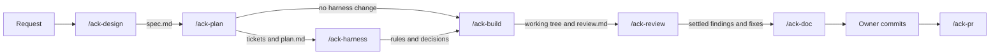

# AI Harness Documentation

- The harness lives in `.claude/`, with `AGENTS.md` and `.github/copilot-instructions.md` beside it.
- Claude Code reads all of it. GitHub Copilot and other tools read `AGENTS.md` and the Copilot digest ([Other Tools](#other-tools)).
- `skills-lock.json` pins the third-party skills copied into `.claude/skills/`.

## Overview

- A feature moves through `/ack-design`, `/ack-plan`, `/ack-harness`, `/ack-build`, `/ack-review`, and `/ack-doc`, then the owner's commit and `/ack-pr`. Each command but `/ack-pr`, the last, ends by naming the next and what it does.
- The owner approves the spec, the plan, and the fix list of the review. Nothing is committed without the owner's word.
- Every behavior is built test-first, at a seam agreed during design.
- A fact that has to hold every time is a hook or a `deny` entry in `.claude/settings.json`, not a sentence.
- The harness reuses published skills where one exists. The `ack-*` skills adapt them to this repository and stay thin.

## Related Documents

- [Project Structure Documentation][ref-doc-project-structure]: the module layout the rules describe
- [Installation Documentation][ref-doc-installation]: the local stack a boot check runs against
- [Decisions][ref-doc-decisions]: why the alternatives to a rule were rejected, one file per scope

## Table of Contents

- [Overview](#overview)
- [Related Documents](#related-documents)
- [Flow](#flow)
    - [Design](#design)
    - [Plan](#plan)
    - [Harness](#harness)
    - [Build](#build)
    - [Review](#review)
- [Standalone Commands](#standalone-commands)
- [Agents](#agents)
- [Work Artifacts](#work-artifacts)
- [Model and Effort](#model-and-effort)
- [Rules and Hooks](#rules-and-hooks)
- [Permission Mode](#permission-mode)
- [Database and Redis Reads](#database-and-redis-reads)
- [Other Tools](#other-tools)
- [Copied Skills](#copied-skills)
- [After Forking](#after-forking)
- [Checking the Harness](#checking-the-harness)

## Flow



A feature runs in one session: each command starts from the files the previous one wrote, and the session suggests `/compact` at a command boundary once its context is large.

### Design

`/ack-design <the feature in one sentence>` runs in the session.

1. It reads the code, the rules binding it, and the decision entries the request touches.
2. It asks the owner rounds of multiple-choice questions until no decision is left open. It looks up facts itself.
3. It agrees the test seams with the owner: the public boundaries the unit specs assert at.
4. It writes `.scratch/<feature>/spec.md`, with the rule changes and decision entries the design needs, and asks for approval.

### Plan

`/ack-plan .scratch/<feature>/spec.md` runs in the session.

1. It breaks the spec into tickets, one file each, with the tickets that block it, its seam, its first failing spec, and its acceptance criteria.
2. It writes `plan.md`, the index a person reads: ticket order, harness changes, status, evidence.
3. A fresh `reader` reads the tickets cold and reports every guess a builder would have to make. A read with no question and no mismatch ends the step.
4. The session fixes the tickets and a second fresh `reader` reads them. When it still has a question or a mismatch, `advisor` makes the third and last attempt and edits the files itself.
5. The owner approves the plan.

### Harness

`/ack-harness .scratch/<feature>/plan.md` runs in the session when the plan lists a harness change.

1. `harness` writes each rule change and decision entry the plan lists.
2. The session ticks each one in `plan.md`. `/ack-build` does not start while one is open.

### Build

`/ack-build .scratch/<feature>/plan.md` runs in the session and does not stop until every ticket is done and the gates are green.

1. One `coder` builds one ticket, test-first: a failing unit spec, then the code that turns it green. Each dispatch carries the ticket's position, and the hand-back returns it (`DONE 3/10`).
2. The session ticks the ticket, records the evidence in `plan.md`, and reports the position to the owner (`3/10`), then moves to the next ticket whose blockers are done.
3. A choice the ticket, the spec, and the rules leave open stops the `coder`, which hands back `NEEDS_DECISION` with the options and its recommendation. The first route that fits answers it:
    - The spec, its owner decisions, or a decision entry: the session answers.
    - Otherwise `.claude/hooks/jev.sh decision` asks TypeSafe's Jev whether the choice is what the product does or how to build it. When Jev is sure it is how to build, `advisor` answers, and passes to the owner what only the owner can answer.
    - Any other answer, an unsure or failed call included: the owner answers, and may hand the choice to `advisor`.
4. The answer corrects the ticket step, its acceptance criterion, and the spec. One line under the ticket's `## Deviations` records what differs, why, and who decided.
5. A check that still fails after two attempts goes to `debugger` for a root cause.
6. One `reviewer` checks the whole build and writes `.scratch/<feature>/review.md`:
    - It runs the gates: `pnpm typecheck`, `pnpm lint`, `pnpm deadcode`, `pnpm spell`, the module specs, and coverage per changed file.
    - When wiring changed, it boots the app, calls each changed endpoint, and reads through MCP the MongoDB rows, cache keys, and queue jobs the call wrote.
    - It checks every acceptance criterion, every rule binding the changed files, and each changed endpoint and job beside the nearest flow of the same kind.
7. Each red result goes to `coder` as a pinned fix, and a `reviewer` checks it again. The findings wait in `review.md`.
8. The session hands back the result and names `/ack-review`, which settles the findings in `review.md`. An owner answer that rejected a named alternative is listed as a decision candidate for `/ack-harness`.

A build that was interrupted resumes from the first ticket that is not done.

### Review

`/ack-review .scratch/<feature>/plan.md` runs in the session on every feature, once.

1. It starts from the `review.md` the build wrote: a results table with a row per command, endpoint call, and data check, a coverage table with a row per rule file, decision entry, and flow, and one section per finding with the exact change to make.
2. A feature built outside `/ack-build` has no `review.md`, so one `reviewer` writes it first, as the build does.
3. The session puts each finding to the owner, one at a time, with a recommendation. The owner keeps it, drops it, or changes it.
4. The session writes the fix list into `review.md` and the owner approves it.
5. `coder` applies each kept finding as written, a defect outside the feature that a pinned fix repairs included. A finding about the spec goes to `/ack-design`, one about a rule to `/ack-harness`, and a defect outside the feature that needs a design, an owner-only command, or held work to the sweep log.
6. A second `reviewer` runs the gates again and reads the fixed findings. A finding still open goes to the owner.
7. The session names `/ack-doc`, which brings the docs in line with the code and ends by proposing the commit subject. An owner answer that rejected a named alternative is listed as a decision candidate for `/ack-harness`.

## Standalone Commands

| Command | Use it when | Principle |
| --- | --- | --- |
| `/ack-quick <a change or a symptom>` | a small change spans files, or something is wrong and the cause is unknown | a pin first, a symptom's root cause included, then the owner's call beside Jev's three signals, then the fix, with a spec where behavior changes, and its review |
| `/ack-spec <module or path>` | existing code lacks unit specs, or a spec went stale | the code wins; `tester` changes no behavior, so each defect goes to the sweep log |
| `/ack-doc <files, a plan path, or all>` | a doc is stale, missing, or needs a diagram | the code wins; each page holds one type |
| `/ack-pr <mode>` | a branch is settled and needs a pull request or release notes | every claim traces to the diff |
| `/ack-harness <change>` | the harness, a decision entry, or this page changes | the checkout wins |

## Agents

| Agent | Does | Writes | Level |
| --- | --- | --- | --- |
| `coder` | builds one ticket or one pinned fix, test-first | `src/`, `test/unit/`, `prisma/schema.prisma`, the run surface | sonnet, high |
| `reviewer` | runs and reads a built feature or a pinned fix: the gates, a boot, each changed endpoint and the data it wrote, then the spec, the rules, and each flow | `.scratch/<feature>/review.md` | opus, high |
| `reader` | cold-reads a plan, reviews the harness files | nothing | sonnet, high |
| `advisor` | settles what two cold reads of a plan left open, or a coder's decision on how to build a ticket | the spec, the plan, and the tickets under `.scratch/` | opus, high |
| `debugger` | reproduces a symptom and finds its root cause | nothing | opus, high |
| `tester` | covers existing code with unit specs | `test/unit/` | sonnet, high |
| `writer` | docs, root people files, pull request text | `docs/`, `.scratch/pr/` | sonnet, medium |
| `harness` | writes the harness from a settled requirement | `.claude/`, `AGENTS.md`, the Copilot digest, decision entries, this page | opus, high |
| `Explore` | locates code and hands back `file:line` pointers | nothing | haiku, medium |
| `researcher` | answers a question from the web, each finding with its URL and date | nothing | haiku, medium |

- An agent cannot ask the owner. It hands the question back, and the session asks.
- The session itself designs, plans, and orchestrates: it assigns, asks the owner, and reads hand-backs. Gates, boots, endpoint calls, and data reads are `reviewer`'s, and a symptom's are `debugger`'s.
- The session settles a harness change with the owner and `harness` writes it.

## Work Artifacts

`.scratch/` is gitignored. It holds one folder per feature, and the `quick/`, `requirements/`, and `pr/` folders:

```text
.scratch/<feature>/
    spec.md                  the approved spec
    plan.md                  the index: approval, order, status, evidence
    issues/01-<slug>.md      one ticket per file
    issues/02-<slug>.md
    review.md                the review: results, coverage, findings, the owner's answers, the fix list
.scratch/quick/
    <slug>.md                a /ack-quick pin
.scratch/requirements/
    harness-<slug>.md        a requirement settled for a later /ack-harness run
    doc-<slug>.md            a requirement settled for a later /ack-doc run
.scratch/pr/
    pr-<slug>.md             a pull request description
    pr-comment-<slug>.md     a pull request comment or review reply
    version-<slug>.md        release notes
```

- A ticket carries `**Status:** ready-for-agent`, then `done`.
- A platform issue is created only when the owner asks for one.
- `generated/report-src-sweep.md` is the sweep log of open source defects.

## Model and Effort

- `coder` builds every ticket and every review fix on sonnet at high effort.
- `advisor` settles a plan's last cold read and a build decision on opus at high effort.
- `reviewer` runs on opus at high effort for every dispatch.
- `reader` reads a plan cold and reviews the harness files on sonnet at high effort.
- `/ack-harness` runs `harness` on opus at high effort.
- `Explore` locates code on haiku at medium effort, for the session and every skill.
- `researcher` answers a question from the web on haiku at medium effort, for the session and every skill.
- Every agent runs at the `model` and `effort` in its own file, and no skill sets a level per dispatch.
- TypeSafe's Jev is optional: it routes a build decision ([Build](#build), step 3), and shows the owner three signals beside a `/ack-quick` pin ([Standalone Commands](#standalone-commands)). Set `TYPESAFE_API_KEY` in `.env.harness` at the repository root to turn it on. Remove the key or add `JEV_ROUTER_ENABLED=false` there to turn it off, and the owner answers every decision the spec leaves open.
- `.env.harness` is gitignored, and no agent reads it.

## Rules and Hooks

- `.claude/rules/*.md` state what the code must do. Each loads by file path; five bind every file.
- `bash .claude/hooks/rules.sh <path>...` prints the rules that bind a path.

| Hook | Runs | Does |
| --- | --- | --- |
| `guard-bash.sh` | before every Bash call | denies owner-only database commands, secret reads, non-pnpm installs, a command that writes `.claude/rules/discipline.md`, and a command that writes under `src/` or `test/`, which Edit and Write change |
| `guard-write.sh` | before every file write | denies secrets, generated trees, edits to a copied skill, an `eslint-disable` comment, and a focused or skipped spec |
| `guard-session.sh` | before every MongoDB and Redis MCP call, web search, and web fetch | denies the session's own call, naming the agent to dispatch; a call inside an agent runs |
| `rules-gate.sh` | before every file write, and after every file read | denies a write until the session or agent has read whole every path-scoped rule that binds the file, and names the rules still unread |
| `format.sh` | after every file write | formats the file |
| `verify.sh` | at session start, and when a session stops | records the `src/` and `test/` files already changed at start; at stop, for every `src/` and `test/` file changed since, whatever wrote it, runs typecheck and the unit specs of their modules, skipped when those files are unchanged since the last green run |
| `roster.sh` | at session start | prints the `/ack-*` commands |
| `context-hint.sh` | when the owner sends a prompt | on an `/ack-*` command with the context at 150k tokens or more, suggests `/compact` first; it never blocks |

`jev.sh` and `check.sh` are scripts a skill runs, and `mcp.sh` is the launcher `.mcp.json` runs. None is a hook.

`.claude/settings.json` also asks before a git command that moves a ref, before `pnpm add`, `remove`, or `up`, before a `gh` command that writes, and before every edit of `.claude/rules/discipline.md`, which `guard-bash.sh` keeps out of Bash.

## Permission Mode

- `.claude/settings.json` starts a session in `acceptEdits`: a file edit applies without a prompt.
- `auto` is set per user, in `~/.claude/settings.json` or with `--permission-mode auto`. A project file cannot set it.
- The `ask` and `deny` entries and both guards hold in either mode.
- The Bash sandbox stays off: it is incompatible with the Docker commands a boot check runs.

## Database and Redis Reads

`.mcp.json` declares three read-only MCP servers for the local compose containers. Each starts through `.claude/hooks/mcp.sh`, which reads its URL from `.env.harness` at the repository root:

| Server | Reads | Key in `.env.harness` |
| --- | --- | --- |
| `mongodb` | the MongoDB replica set, in read-only mode | `MCP_MONGODB_URL` |
| `redis-cache` | the `redis-cache` instance, `db:0`, the cache | `MCP_REDIS_CACHE_URL` |
| `redis-queue` | the `redis-queue` instance, `db:0`, the BullMQ queues | `MCP_REDIS_QUEUE_URL` |

- No URL is written in a tracked file, and none reaches the session.
- Each value is the URL the host reaches the container at: the same as `DATABASE_URL`, `REDIS_CACHE_URL`, and `REDIS_QUEUE_URL` for a local setup.
- The MongoDB server runs through `npx`, the Redis servers through `uvx`, which needs [uv][ref-uv].
- `debugger` and `reviewer` have the tools. The other agents do not.
- `guard-session.sh` denies the session's own call to any of the three servers: the session dispatches `reviewer` to check a change's data, or `debugger` to trace a symptom's.
- The Redis server has no read-only mode, so `.claude/settings.json` denies each of its writing tools by name.
- `mongosh`, `redis-cli`, and every command that writes to a database stay denied and owner-only.

## Other Tools

- `AGENTS.md` is the shared base. Claude Code loads it through the import on the first line of `.claude/CLAUDE.md`. Codex, Cursor, and Copilot read it directly.
- `AGENTS.md` tells every tool to run `bash .claude/hooks/rules.sh <path>` before an edit and read the rules it prints.
- `.agents/skills` is a symlink to `.claude/skills/`, so a tool that reads the shared skills folder finds the same skills. `.claude/skills/` stays the source.
- The `/ack-*` flow, the agents, the hooks, and every `ask` and `deny` entry run in Claude Code only. Another tool gets the instructions and none of the guards.

## Copied Skills

Each skill below is copied unchanged from its repository by the [`skills` CLI][ref-skills-cli]. The license texts are in `.claude/skills/licenses/`.

| Skill | Source | License | Used by |
| --- | --- | --- | --- |
| `grilling`, `to-spec` | [mattpocock/skills][ref-mattpocock-skills] | MIT | `/ack-design` |
| `to-tickets` | [mattpocock/skills][ref-mattpocock-skills] | MIT | `/ack-plan` |
| `tdd` | [mattpocock/skills][ref-mattpocock-skills] | MIT | `coder` |
| `codebase-design` | [mattpocock/skills][ref-mattpocock-skills] | MIT | `tdd` refers to it for seam vocabulary |
| `code-review` | [mattpocock/skills][ref-mattpocock-skills] | MIT | `reviewer` |
| `diagnosing-bugs` | [mattpocock/skills][ref-mattpocock-skills] | MIT | `debugger` |
| `writing-for-agents` | [mattpocock/skills][ref-mattpocock-skills] | MIT | `harness` |
| `ponytail` | [DietrichGebert/ponytail][ref-ponytail] | MIT | the session, `coder`, `debugger`, `harness` |
| `caveman` | [JuliusBrussee/caveman][ref-caveman] | Apache-2.0 | agent hand-backs |
| `humanizer` | [blader/humanizer][ref-humanizer] | MIT | `writer` |
| `documentation` | [mcollina/skills][ref-mcollina-skills] | MIT | `writer`, and the `/ack-doc` reader test |
| `diagram-design` | [cathrynlavery/diagram-design][ref-diagram-design] | MIT | `writer`, for a designed diagram |

- A copied skill is never edited. An `ack-*` skill or an agent follows it and states where this repository departs from it.
- Update all of them:
    ```bash
    pnpm skills:update
    ```
- Add one:
    ```bash
    npx skills@latest add <owner>/<repo> -a claude-code -s <skill> -y --copy
    ```
- After an update, run `/ack-harness` to re-read each departure against the new text.

## After Forking

The harness describes this boilerplate. A project built from it changes these first:

1. The first paragraph of `AGENTS.md` says no backward compatibility, backfill, or data-migration note. A product with clients and stored data replaces it, and the matching lines in `.claude/agents/coder.md`, `.claude/agents/reviewer.md`, `/ack-design`, and `/ack-plan`.
2. The `deny` list in `.claude/settings.json` keeps every command that writes to a database for the owner. Loosen it only for a database that is safe to lose.
3. `repository` in `.claude/hooks/jev.json` describes the application to Jev.
4. `.claude/decisions/` holds the reasons this boilerplate's rejected alternatives lost. Keep the entries whose rule you keep, and add one through `/ack-harness` when a design rejects a named alternative.
5. The Stack, Layout, and Commands sections of `AGENTS.md` follow the code as it changes.

## Checking the Harness

`bash .claude/hooks/check.sh` prints one line per defect: invalid JSON, a hook that does not parse, a file over its word budget, a retired name, a path that does not exist, a copied skill missing from the lock.

After a change to a skill or an agent, run its scenarios in a fresh session and compare:

| Skill | Scenario | Expected |
| --- | --- | --- |
| `/ack-design` | a one-sentence field addition | asks about the route scope and nullability, reads the module itself, writes a spec with seams |
| `/ack-design` | a request a decision entry rejects | names the entry and offers no option it rejects |
| `/ack-design` | the owner answers "you decide" | decides and lists the assumption in the spec |
| `/ack-plan` | a spec that adds a status code | the ticket names the status-code procedure |
| `/ack-plan` | a spec with an unnamed message key | the cold read asks for it, the ticket is fixed, a fresh `reader` reads again |
| `/ack-plan` | a first cold read with no question and no mismatch | no second `reader` runs |
| `/ack-plan` | a ticket two readers still question | `advisor` edits the tickets and no reader runs after it |
| `/ack-build` | a plan that is not approved | stops and names `/ack-plan` |
| `/ack-build` | one ticket | the hand-back quotes the spec failing, then passing, and `plan.md` records it |
| `/ack-build` | a plan with two tickets done | continues from the third |
| `/ack-build` | a plan with an open harness change | stops and names `/ack-harness` |
| `/ack-build` | no `TYPESAFE_API_KEY`, and a `coder` hands back `NEEDS_DECISION` | `jev.sh decision` prints `owner (off).`, the owner answers, and no `advisor` runs unless the owner names it |
| `/ack-build` | a `NEEDS_DECISION` on how to build a ticket that `jev.sh decision` routes to `advisor` | `advisor` corrects the ticket step and criterion and adds one `## Deviations` line, and the next `coder` builds the corrected step |
| `/ack-review` | a plan with a ticket not done | stops and names `/ack-build` |
| `/ack-build` | a finished build | `review.md` has a results row per command, endpoint call, and data check, a coverage row per rule file and per changed flow, and each finding names its exact change |
| `/ack-review` | a finding the owner drops | no `coder` runs for it, and `review.md` records the answer |
| `/ack-review` | a fix `coder` cannot apply as written | the finding goes to the owner, and `coder` picks no other fix |
| `/ack-doc` | a new how-to page | the dispatch carries `Type: how-to`, `writer` quotes `pnpm lint:docs` and `pnpm spell`, and the reader test asks the how-to check first |

<!-- REFERENCES -->

[ref-doc-project-structure]: project-structure.md
[ref-doc-installation]: installation.md
[ref-doc-decisions]: ../.claude/decisions/README.md
[ref-skills-cli]: https://github.com/vercel-labs/skills
[ref-uv]: https://docs.astral.sh/uv/
[ref-mattpocock-skills]: https://github.com/mattpocock/skills
[ref-ponytail]: https://github.com/DietrichGebert/ponytail
[ref-caveman]: https://github.com/JuliusBrussee/caveman
[ref-humanizer]: https://github.com/blader/humanizer
[ref-mcollina-skills]: https://github.com/mcollina/skills
[ref-diagram-design]: https://github.com/cathrynlavery/diagram-design
