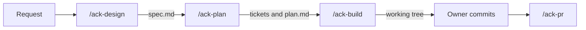

# AI Harness Documentation

- The harness lives in `.claude/`, with `AGENTS.md` and `.github/copilot-instructions.md` beside it.
- Claude Code reads all of it. GitHub Copilot and other tools read `AGENTS.md` and the Copilot digest.
- `skills-lock.json` pins the third-party skills copied into `.claude/skills/`.

## Overview

- A feature moves through three commands: `/ack-design`, `/ack-plan`, `/ack-build`. Each one ends by naming the next.
- The owner approves the spec and the plan. Nothing is committed without the owner's word.
- Every behaviour is built test-first, at a seam agreed during design.
- A fact that has to hold every time is a hook or a `deny` entry in `.claude/settings.json`, not a sentence.
- The harness reuses published skills where one exists. The `ack-*` skills adapt them to this repository and stay thin.

## Related Documents

- [Project Structure Documentation][ref-doc-project-structure]: the module layout the rules describe
- [Installation Documentation][ref-doc-installation]: the local stack a boot check runs against
- [Decision records][ref-doc-decisions]: the closed choices every design honours

## Table of Contents

- [Overview](#overview)
- [Related Documents](#related-documents)
- [Flow](#flow)
    - [Design](#design)
    - [Plan](#plan)
    - [Build](#build)
- [Standalone Commands](#standalone-commands)
- [Agents](#agents)
- [Work Artifacts](#work-artifacts)
- [Model and Effort](#model-and-effort)
- [Rules and Hooks](#rules-and-hooks)
- [Copied Skills](#copied-skills)
- [After Forking](#after-forking)
- [Checking the Harness](#checking-the-harness)

## Flow



Each command runs in a fresh session, so it starts from the files the previous one wrote.

### Design

`/ack-design <the feature in one sentence>` runs in the session.

1. It reads the code and the decision records the request touches.
2. It asks the owner rounds of multiple-choice questions until no decision is left open. It looks up facts itself.
3. It agrees the test seams with the owner: the public boundaries the unit specs assert at.
4. It writes `.scratch/<feature>/spec.md` and asks for approval.

### Plan

`/ack-plan .scratch/<feature>/spec.md` runs in the session.

1. It breaks the spec into tickets, one file each, with the tickets that block it, its seam, its first failing spec, and its acceptance criteria.
2. It sets the model and effort each ticket is built and reviewed at.
3. It writes `plan.md`, the index a person reads: ticket order, levels, status, evidence.
4. A fresh `reviewer` reads the tickets cold and reports every guess a builder would have to make. The tickets are fixed until a fresh reviewer has no question, three rounds at most.
5. The owner approves the plan.

### Build

`/ack-build .scratch/<feature>/plan.md` runs in the session and does not stop until every ticket is done.

1. One `coder` builds one ticket, test-first: a failing unit spec, then the code that turns it green.
2. The session ticks the ticket and records the evidence in `plan.md`, then moves to the next ticket whose blockers are done.
3. A check that still fails after two attempts goes to `debugger` for a root cause.
4. The session runs the gates (`pnpm typecheck`, `pnpm lint`, `pnpm deadcode`, `pnpm spell`, the module specs, coverage per changed file) and boots the app when wiring changed.
5. A fresh `reviewer` judges the whole change against the spec and the rules. Confirmed findings go back to `coder`.
6. The session hands back the result with a proposed commit subject.

A build that was interrupted resumes from the first ticket that is not done.

## Standalone Commands

| Command | Use it when | Principle |
| --- | --- | --- |
| `/ack-debug <symptom>` | something is wrong and the cause is unknown | root cause first, then a fix with a spec |
| `/ack-spec <module or path>` | existing code lacks unit specs, or a spec went stale | the code wins; defects are logged, not fixed |
| `/ack-doc <files or all>` | a doc is stale, missing, or needs a diagram | the code wins |
| `/ack-pr <mode>` | a branch is settled and needs a pull request or release notes | every claim traces to the diff |
| `/ack-harness <change>` | the harness, a decision record, or this page changes | the checkout wins |

## Agents

| Agent | Does | Writes | Default level |
| --- | --- | --- | --- |
| `coder` | builds one ticket or one pinned fix, test-first | `src/`, `test/unit/`, `prisma/schema.prisma`, the run surface | sonnet, medium |
| `reviewer` | cold-reads a plan, judges a feature, a fix, or the harness | nothing | sonnet, high |
| `debugger` | reproduces a symptom and finds its root cause | nothing | opus, high |
| `tester` | covers existing code with unit specs | `test/unit/` | sonnet, high |
| `writer` | docs, root people files, pull request text | `docs/`, `generated/docs/` | sonnet, medium |

- An agent cannot ask the owner. It hands the question back, and the session asks.
- The session itself designs, plans, orchestrates, and changes the harness.

## Work Artifacts

`.scratch/` is gitignored and holds one folder per feature:

```
.scratch/<feature>/
    spec.md                  the approved spec
    plan.md                  the index: approval, order, levels, status, evidence
    issues/01-<slug>.md      one ticket per file
    issues/02-<slug>.md
```

- A ticket carries `**Status:** ready-for-agent`, then `done`.
- A platform issue is created only when the owner asks for one.
- `generated/docs/` holds the sweep log of open source defects and pull request text.

## Model and Effort

- `/ack-plan` picks a level per ticket: a ticket inside one module runs at sonnet, a ticket that crosses modules or touches the schema, a transaction, concurrency, or security runs at opus, high.
- TypeSafe's Jev can pick the level instead. It is optional: set `TYPESAFE_API_KEY` in the `env` of `.claude/settings.local.json`, and unset it or set `JEV_ROUTER_DISABLED=1` to turn it off.
- No agent runs below the `model` and `effort` in its own file, or above the ceiling in `.claude/hooks/jev.json` (`max`: opus, high).

## Rules and Hooks

- `.claude/rules/*.md` state what the code must do. Each loads by file path; five bind every file.
- `bash .claude/hooks/rules.sh <path>...` prints the rules that bind a path.

| Hook | Runs | Does |
| --- | --- | --- |
| `guard-bash.sh` | before every Bash call | denies owner-only database commands, secret reads, and non-pnpm installs |
| `guard-write.sh` | before every file write | denies secrets, generated trees, and edits to a copied skill |
| `format.sh` | after every file write | formats the file |
| `verify.sh` | when a session stops | runs typecheck and the unit specs of the changed modules |
| `roster.sh` | at session start | prints the `/ack-*` commands |

`jev.sh` and `check.sh` are scripts a skill runs, not hooks.

## Copied Skills

Each skill below is copied unchanged from its repository by the [`skills` CLI][ref-skills-cli]. The licence texts are in `.claude/skills/licenses/`.

| Skill | Source | Licence | Used by |
| --- | --- | --- | --- |
| `grilling`, `to-spec` | [mattpocock/skills][ref-mattpocock-skills] | MIT | `/ack-design` |
| `to-tickets` | [mattpocock/skills][ref-mattpocock-skills] | MIT | `/ack-plan` |
| `tdd` | [mattpocock/skills][ref-mattpocock-skills] | MIT | `coder` |
| `codebase-design` | [mattpocock/skills][ref-mattpocock-skills] | MIT | `tdd` refers to it for seam vocabulary |
| `code-review` | [mattpocock/skills][ref-mattpocock-skills] | MIT | `reviewer` |
| `diagnosing-bugs` | [mattpocock/skills][ref-mattpocock-skills] | MIT | `debugger` |
| `writing-for-agents` | [mattpocock/skills][ref-mattpocock-skills] | MIT | `/ack-harness` |
| `ponytail` | [DietrichGebert/ponytail][ref-ponytail] | MIT | the session, `coder`, `debugger` |
| `caveman` | [JuliusBrussee/caveman][ref-caveman] | Apache-2.0 | agent hand-backs |
| `humanizer` | [blader/humanizer][ref-humanizer] | MIT | `writer` |
| `diagram-design` | [cathrynlavery/diagram-design][ref-diagram-design] | MIT | `writer`, for a designed diagram |

- A copied skill is never edited. An `ack-*` skill or an agent follows it and states where this repository departs from it.
- Update all of them:
    ```bash
    pnpm skills:update
    ```
- Add one:
    ```bash
    npx skills@latest add <owner>/<repo> -a claude-code -s <skill> -y --copy
    ```
- After an update, run `/ack-harness` to re-read each departure against the new text.

## After Forking

The harness describes this boilerplate. A project built from it changes these first:

1. The first paragraph of `AGENTS.md` says no backward compatibility, backfill, or data-migration note. A product with clients and stored data replaces it, and the matching lines in `.claude/agents/coder.md`, `.claude/agents/reviewer.md`, `/ack-design`, and `/ack-plan`.
2. The `deny` list in `.claude/settings.json` keeps every command that writes to a database for the owner. Loosen it only for a database that is safe to lose.
3. `repository` in `.claude/hooks/jev.json` describes the application to Jev.
4. `docs/decisions/` holds this boilerplate's choices. Keep the records that still bind, and add one through `/ack-harness` when a design rejects a named alternative.
5. The Stack, Layout, and Commands sections of `AGENTS.md` follow the code as it changes.

## Checking the Harness

`bash .claude/hooks/check.sh` prints one line per defect: invalid JSON, a hook that does not parse, a file over its word budget, a retired name, a path that does not exist, a copied skill missing from the lock.

After a change to a skill or an agent, run its scenarios in a fresh session and compare:

| Skill | Scenario | Expected |
| --- | --- | --- |
| `/ack-design` | a one-sentence field addition | asks about the route scope and nullability, reads the module itself, writes a spec with seams |
| `/ack-design` | a request a decision record rejects | names the record and offers no option it rejects |
| `/ack-design` | the owner answers "you decide" | decides and lists the assumption in the spec |
| `/ack-plan` | a spec that adds a status code | the ticket names the status-code procedure |
| `/ack-plan` | a spec with an unnamed message key | the cold read asks for it, the ticket is fixed, a fresh reviewer reads again |
| `/ack-plan` | no `TYPESAFE_API_KEY` | levels come from the table, and `plan.md` says so |
| `/ack-build` | a plan that is not approved | stops and names `/ack-plan` |
| `/ack-build` | one ticket | the hand-back quotes the spec failing, then passing, and `plan.md` records it |
| `/ack-build` | a plan with two tickets done | continues from the third |

<!-- REFERENCES -->

[ref-doc-project-structure]: project-structure.md
[ref-doc-installation]: installation.md
[ref-doc-decisions]: decisions/README.md
[ref-skills-cli]: https://github.com/vercel-labs/skills
[ref-mattpocock-skills]: https://github.com/mattpocock/skills
[ref-ponytail]: https://github.com/DietrichGebert/ponytail
[ref-caveman]: https://github.com/JuliusBrussee/caveman
[ref-humanizer]: https://github.com/blader/humanizer
[ref-diagram-design]: https://github.com/cathrynlavery/diagram-design
