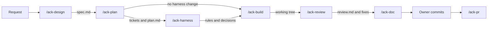

# AI Harness Documentation

- The harness lives in `.claude/`, with `AGENTS.md` and `.github/copilot-instructions.md` beside it.
- Claude Code reads all of it. GitHub Copilot and other tools read `AGENTS.md` and the Copilot digest ([Other Tools](#other-tools)).
- `skills-lock.json` pins the third-party skills copied into `.claude/skills/`.

## Overview

- A feature moves through `/ack-design`, `/ack-plan`, `/ack-harness`, `/ack-build`, `/ack-review`, and `/ack-doc`, then the owner's commit and `/ack-pr`. Each command ends by naming the next.
- The owner approves the spec, the plan, and the fix list of the review. Nothing is committed without the owner's word.
- Every behaviour is built test-first, at a seam agreed during design.
- A fact that has to hold every time is a hook or a `deny` entry in `.claude/settings.json`, not a sentence.
- The harness reuses published skills where one exists. The `ack-*` skills adapt them to this repository and stay thin.

## Related Documents

- [Project Structure Documentation][ref-doc-project-structure]: the module layout the rules describe
- [Installation Documentation][ref-doc-installation]: the local stack a boot check runs against
- [Architecture decisions][ref-doc-decisions-architecture]: why the alternatives to an architecture rule were rejected
- [Security decisions][ref-doc-decisions-security]: why the alternatives to a security rule were rejected

## Table of Contents

- [Overview](#overview)
- [Related Documents](#related-documents)
- [Flow](#flow)
    - [Design](#design)
    - [Plan](#plan)
    - [Harness](#harness)
    - [Build](#build)
    - [Review](#review)
- [Standalone Commands](#standalone-commands)
- [Agents](#agents)
- [Work Artifacts](#work-artifacts)
- [Model and Effort](#model-and-effort)
- [Rules and Hooks](#rules-and-hooks)
- [Permission Mode](#permission-mode)
- [Database and Redis Reads](#database-and-redis-reads)
- [Other Tools](#other-tools)
- [Copied Skills](#copied-skills)
- [After Forking](#after-forking)
- [Checking the Harness](#checking-the-harness)

## Flow



Each command runs in a fresh session, so it starts from the files the previous one wrote.

### Design

`/ack-design <the feature in one sentence>` runs in the session.

1. It reads the code, the rules binding it, and the decision entries the request touches.
2. It asks the owner rounds of multiple-choice questions until no decision is left open. It looks up facts itself.
3. It agrees the test seams with the owner: the public boundaries the unit specs assert at.
4. It writes `.scratch/<feature>/spec.md`, with the rule changes and decision entries the design needs, and asks for approval.

### Plan

`/ack-plan .scratch/<feature>/spec.md` runs in the session.

1. It breaks the spec into tickets, one file each, with the tickets that block it, its seam, its first failing spec, and its acceptance criteria.
2. It sets the effort each ticket is built at.
3. It writes `plan.md`, the index a person reads: ticket order, efforts, harness changes, status, evidence.
4. A fresh `reviewer` reads the tickets cold and reports every guess a builder would have to make. A read with no question and no mismatch ends the step.
5. The session fixes the tickets and a second fresh `reviewer` reads them. When it still has a question or a mismatch, `advisor` makes the third and last attempt and edits the files itself.
6. The owner approves the plan.

### Harness

`/ack-harness .scratch/<feature>/plan.md` runs in the session when the plan lists a harness change.

1. It applies each rule change and decision entry the plan lists.
2. It ticks each one in `plan.md`. `/ack-build` does not start while one is open.

### Build

`/ack-build .scratch/<feature>/plan.md` runs in the session and does not stop until every ticket is done and the gates are green.

1. One `coder` builds one ticket, test-first: a failing unit spec, then the code that turns it green.
2. The session ticks the ticket and records the evidence in `plan.md`, then moves to the next ticket whose blockers are done.
3. A check that still fails after two attempts goes to `debugger` for a root cause.
4. The session runs the gates (`pnpm typecheck`, `pnpm lint`, `pnpm deadcode`, `pnpm spell`, the module specs, coverage per changed file) and boots the app when wiring changed.
5. The session hands back the result and names `/ack-review`.

A build that was interrupted resumes from the first ticket that is not done.

### Review

`/ack-review .scratch/<feature>/plan.md` runs in the session on every feature, once.

1. One `reviewer` on opus at high effort checks three things: every acceptance criterion of the spec, every rule binding the changed files, and each changed endpoint and job traced end to end beside the nearest flow of the same kind.
2. It writes `.scratch/<feature>/review.md`: a coverage table with a row per rule file, decision entry, and flow, and one section per finding with the exact change to make.
3. The session puts each finding to the owner, one at a time. The owner keeps it, drops it, or changes it.
4. The session writes the fix list into `review.md` and the owner approves it.
5. `coder` applies each kept finding as written. A finding about the spec goes to `/ack-design`, one about a rule to `/ack-harness`, and a defect outside the feature to the sweep log.
6. The gates run again and a second `reviewer` reads the fixed findings. A finding still open goes to the owner.
7. The session names `/ack-doc`, which ends by proposing the commit subject.

## Standalone Commands

| Command | Use it when | Principle |
| --- | --- | --- |
| `/ack-debug <symptom>` | something is wrong and the cause is unknown | root cause first, then a fix with a spec |
| `/ack-spec <module or path>` | existing code lacks unit specs, or a spec went stale | the code wins; defects are logged, not fixed |
| `/ack-doc <files, a plan path, or all>` | a doc is stale, missing, or needs a diagram | the code wins |
| `/ack-pr <mode>` | a branch is settled and needs a pull request or release notes | every claim traces to the diff |
| `/ack-harness <change>` | the harness, a decision entry, or this page changes | the checkout wins |

## Agents

| Agent | Does | Writes | Default level |
| --- | --- | --- | --- |
| `coder` | builds one ticket or one pinned fix, test-first | `src/`, `test/unit/`, `prisma/schema.prisma`, the run surface | sonnet, medium |
| `reviewer` | cold-reads a plan, reviews a built feature, judges a fix or the harness | `.scratch/<feature>/review.md` | sonnet, high; opus, high in `/ack-review` |
| `advisor` | settles what two cold reads of a plan left open | the spec, the plan, and the tickets under `.scratch/` | fable, medium |
| `debugger` | reproduces a symptom and finds its root cause | nothing | opus, high |
| `tester` | covers existing code with unit specs | `test/unit/` | sonnet, high |
| `writer` | docs, root people files, pull request text | `docs/`, `.scratch/pr/` | sonnet, medium |

- An agent cannot ask the owner. It hands the question back, and the session asks.
- The session itself designs, plans, orchestrates, and changes the harness.

## Work Artifacts

`.scratch/` is gitignored. It holds one folder per feature, and the `requirements/` and `pr/` folders:

```
.scratch/<feature>/
    spec.md                  the approved spec
    plan.md                  the index: approval, order, levels, status, evidence
    issues/01-<slug>.md      one ticket per file
    issues/02-<slug>.md
    review.md                the review: coverage, findings, the owner's answers, the fix list
.scratch/requirements/
    harness-<slug>.md        a requirement settled for a later /ack-harness run
    doc-<slug>.md            a requirement settled for a later /ack-doc run
.scratch/pr/
    pr-<slug>.md             a pull request description
    pr-comment-<slug>.md     a pull request comment or review reply
    version-<slug>.md        release notes
```

- A ticket carries `**Status:** ready-for-agent`, then `done`.
- A platform issue is created only when the owner asks for one.
- `generated/report-src-sweep.md` is the sweep log of open source defects.

## Model and Effort

- `coder` builds every ticket and every review fix on sonnet. `/ack-plan` picks its effort per ticket and `/ack-review` per fix: high for work that touches the schema, a transaction, concurrency, or security, medium for any other.
- TypeSafe's Jev can pick that effort instead. It is optional: set `TYPESAFE_API_KEY` in `.env.harness` at the repository root, and remove it or add `JEV_ROUTER_DISABLED=1` there to turn it off. The file is gitignored and no agent reads it.
- `/ack-review` runs `reviewer` on opus at high effort for every feature.
- No agent runs below the `model` and `effort` in its own file.

## Rules and Hooks

- `.claude/rules/*.md` state what the code must do. Each loads by file path; five bind every file.
- `bash .claude/hooks/rules.sh <path>...` prints the rules that bind a path.

| Hook | Runs | Does |
| --- | --- | --- |
| `guard-bash.sh` | before every Bash call | denies owner-only database commands, secret reads, and non-pnpm installs |
| `guard-write.sh` | before every file write | denies secrets, generated trees, edits to a copied skill, an `eslint-disable` comment, and a focused or skipped spec |
| `format.sh` | after every file write | formats the file |
| `verify.sh` | when a session stops | runs typecheck and the unit specs of the changed modules |
| `roster.sh` | at session start | prints the `/ack-*` commands |

`jev.sh` and `check.sh` are scripts a skill runs, and `mcp.sh` is the launcher `.mcp.json` runs. None is a hook.

`.claude/settings.json` also asks before a git command that moves a ref, before `pnpm add`, `remove`, or `up`, and before a `gh` command that writes.

## Permission Mode

- `.claude/settings.json` starts a session in `acceptEdits`: a file edit applies without a prompt.
- `auto` is set per user, in `~/.claude/settings.json` or with `--permission-mode auto`. A project file cannot set it.
- The `ask` and `deny` entries and both guards hold in either mode.
- The Bash sandbox stays off: it is incompatible with the Docker commands a boot check runs.

## Database and Redis Reads

`.mcp.json` declares three read-only MCP servers for the local compose containers. Each starts through `.claude/hooks/mcp.sh`, which reads its URL from `.env.harness` at the repository root:

| Server | Reads | Key in `.env.harness` |
| --- | --- | --- |
| `mongodb` | the MongoDB replica set, in read-only mode | `MCP_MONGODB_URL` |
| `redis-cache` | Redis `db:0`, the cache | `MCP_REDIS_CACHE_URL` |
| `redis-queue` | Redis `db:1`, the BullMQ queues | `MCP_REDIS_QUEUE_URL` |

- No URL is written in a tracked file, and none reaches the session.
- Each value is the URL the host reaches the container at: the same as `DATABASE_URL`, `CACHE_REDIS_URL`, and `QUEUE_REDIS_URL` for a local setup.
- The MongoDB server runs through `npx`, the Redis servers through `uvx`, which needs [uv][ref-uv].
- The session, `debugger`, and `reviewer` have the tools. The other agents do not.
- The Redis server has no read-only mode, so `.claude/settings.json` denies each of its writing tools by name.
- `mongosh`, `redis-cli`, and every command that writes to a database stay denied and owner-only.

## Other Tools

- `AGENTS.md` is the shared base. Claude Code loads it through the import on the first line of `.claude/CLAUDE.md`. Codex, Cursor, and Copilot read it directly.
- `AGENTS.md` tells every tool to run `bash .claude/hooks/rules.sh <path>` before an edit and read the rules it prints.
- `.agents/skills` is a symlink to `.claude/skills/`, so a tool that reads the shared skills folder finds the same skills. `.claude/skills/` stays the source.
- The `/ack-*` flow, the agents, the hooks, and every `ask` and `deny` entry run in Claude Code only. Another tool gets the instructions and none of the guards.

## Copied Skills

Each skill below is copied unchanged from its repository by the [`skills` CLI][ref-skills-cli]. The licence texts are in `.claude/skills/licenses/`.

| Skill | Source | Licence | Used by |
| --- | --- | --- | --- |
| `grilling`, `to-spec` | [mattpocock/skills][ref-mattpocock-skills] | MIT | `/ack-design` |
| `to-tickets` | [mattpocock/skills][ref-mattpocock-skills] | MIT | `/ack-plan` |
| `tdd` | [mattpocock/skills][ref-mattpocock-skills] | MIT | `coder` |
| `codebase-design` | [mattpocock/skills][ref-mattpocock-skills] | MIT | `tdd` refers to it for seam vocabulary |
| `code-review` | [mattpocock/skills][ref-mattpocock-skills] | MIT | `reviewer` |
| `diagnosing-bugs` | [mattpocock/skills][ref-mattpocock-skills] | MIT | `debugger` |
| `writing-for-agents` | [mattpocock/skills][ref-mattpocock-skills] | MIT | `/ack-harness` |
| `ponytail` | [DietrichGebert/ponytail][ref-ponytail] | MIT | the session, `coder`, `debugger` |
| `caveman` | [JuliusBrussee/caveman][ref-caveman] | Apache-2.0 | agent hand-backs |
| `humanizer` | [blader/humanizer][ref-humanizer] | MIT | `writer` |
| `diagram-design` | [cathrynlavery/diagram-design][ref-diagram-design] | MIT | `writer`, for a designed diagram |

- A copied skill is never edited. An `ack-*` skill or an agent follows it and states where this repository departs from it.
- Update all of them:
    ```bash
    pnpm skills:update
    ```
- Add one:
    ```bash
    npx skills@latest add <owner>/<repo> -a claude-code -s <skill> -y --copy
    ```
- After an update, run `/ack-harness` to re-read each departure against the new text.

## After Forking

The harness describes this boilerplate. A project built from it changes these first:

1. The first paragraph of `AGENTS.md` says no backward compatibility, backfill, or data-migration note. A product with clients and stored data replaces it, and the matching lines in `.claude/agents/coder.md`, `.claude/agents/reviewer.md`, `/ack-design`, and `/ack-plan`.
2. The `deny` list in `.claude/settings.json` keeps every command that writes to a database for the owner. Loosen it only for a database that is safe to lose.
3. `repository` in `.claude/hooks/jev.json` describes the application to Jev.
4. `.claude/decisions/` holds the reasons this boilerplate's rejected alternatives lost. Keep the entries whose rule you keep, and add one through `/ack-harness` when a design rejects a named alternative.
5. The Stack, Layout, and Commands sections of `AGENTS.md` follow the code as it changes.

## Checking the Harness

`bash .claude/hooks/check.sh` prints one line per defect: invalid JSON, a hook that does not parse, a file over its word budget, a retired name, a path that does not exist, a copied skill missing from the lock.

After a change to a skill or an agent, run its scenarios in a fresh session and compare:

| Skill | Scenario | Expected |
| --- | --- | --- |
| `/ack-design` | a one-sentence field addition | asks about the route scope and nullability, reads the module itself, writes a spec with seams |
| `/ack-design` | a request a decision entry rejects | names the entry and offers no option it rejects |
| `/ack-design` | the owner answers "you decide" | decides and lists the assumption in the spec |
| `/ack-plan` | a spec that adds a status code | the ticket names the status-code procedure |
| `/ack-plan` | a spec with an unnamed message key | the cold read asks for it, the ticket is fixed, a fresh reviewer reads again |
| `/ack-plan` | no `TYPESAFE_API_KEY` | levels come from the table, and `plan.md` says so |
| `/ack-plan` | a first cold read with no question and no mismatch | no second `reviewer` runs |
| `/ack-plan` | a ticket two readers still question | `advisor` edits the tickets and no reader runs after it |
| `/ack-build` | a plan that is not approved | stops and names `/ack-plan` |
| `/ack-build` | one ticket | the hand-back quotes the spec failing, then passing, and `plan.md` records it |
| `/ack-build` | a plan with two tickets done | continues from the third |
| `/ack-build` | a plan with an open harness change | stops and names `/ack-harness` |
| `/ack-review` | a plan with a ticket not done | stops and names `/ack-build` |
| `/ack-review` | a built feature | `review.md` has a coverage row per rule file and per changed flow, and each finding names its exact change |
| `/ack-review` | a finding the owner drops | no `coder` runs for it, and `review.md` records the answer |
| `/ack-review` | a fix `coder` cannot apply as written | the finding goes to the owner, and `coder` picks no other fix |

<!-- REFERENCES -->

[ref-doc-project-structure]: project-structure.md
[ref-doc-installation]: installation.md
[ref-doc-decisions-architecture]: ../.claude/decisions/architecture.md
[ref-doc-decisions-security]: ../.claude/decisions/security.md
[ref-skills-cli]: https://github.com/vercel-labs/skills
[ref-uv]: https://docs.astral.sh/uv/
[ref-mattpocock-skills]: https://github.com/mattpocock/skills
[ref-ponytail]: https://github.com/DietrichGebert/ponytail
[ref-caveman]: https://github.com/JuliusBrussee/caveman
[ref-humanizer]: https://github.com/blader/humanizer
[ref-diagram-design]: https://github.com/cathrynlavery/diagram-design
