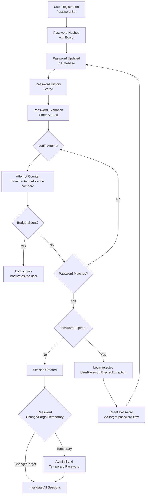
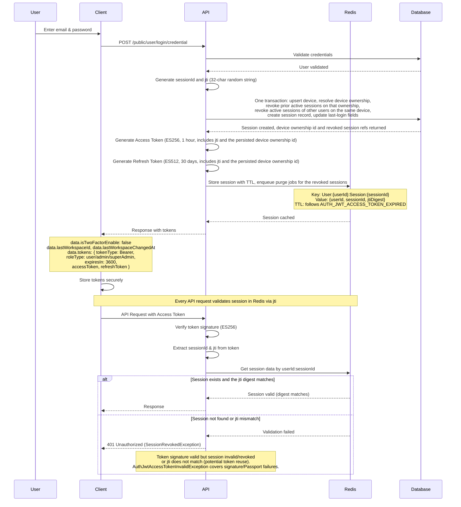
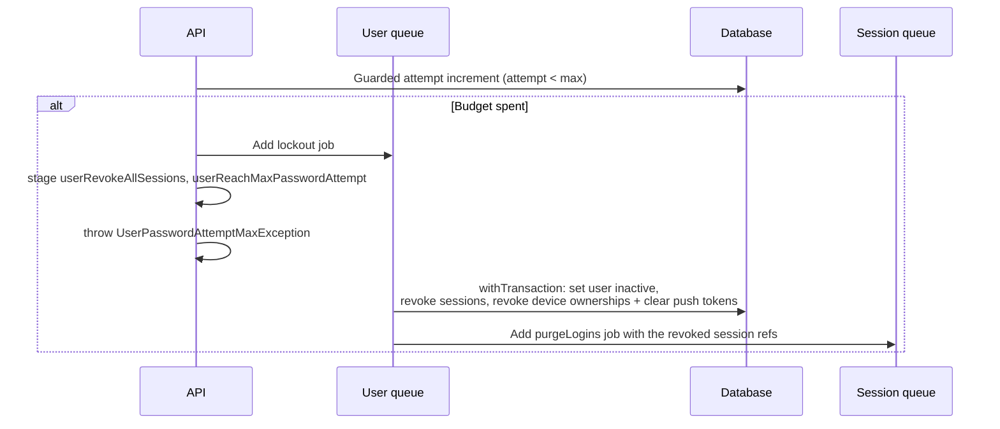
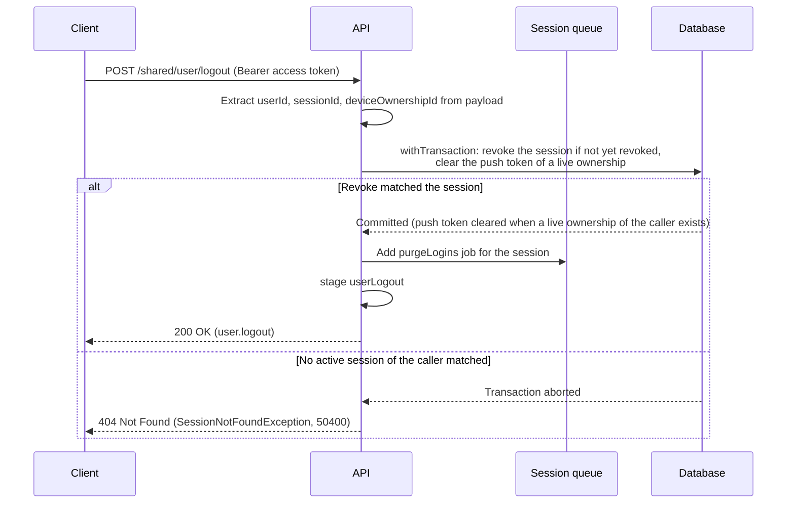
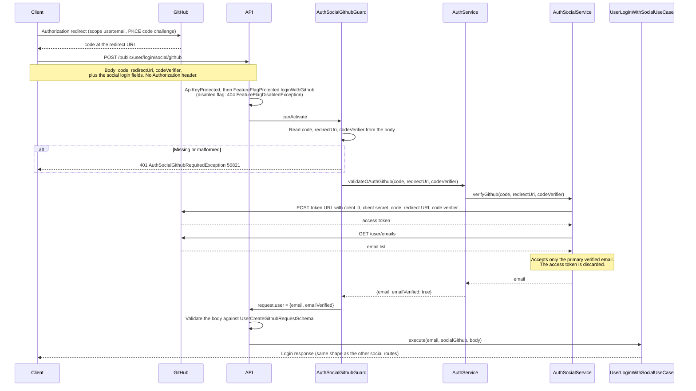
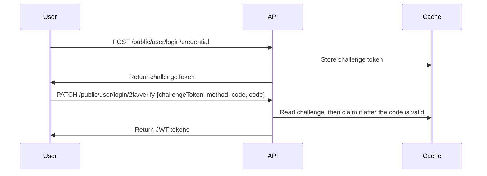
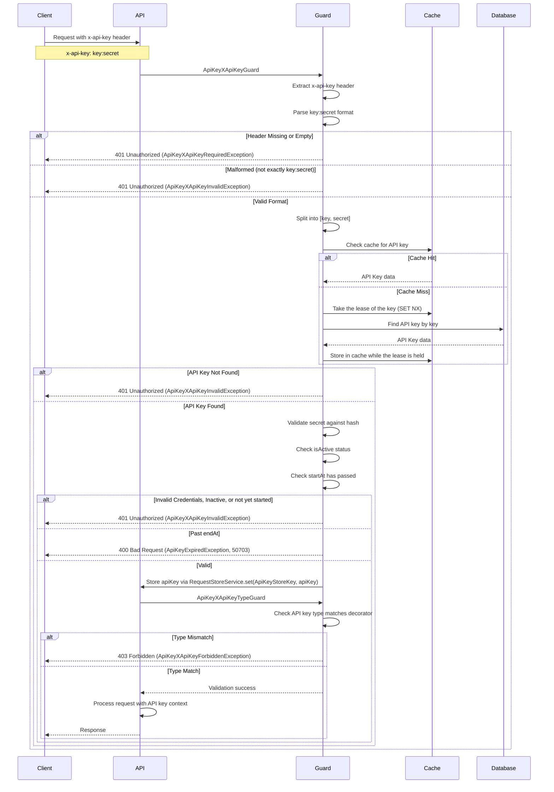
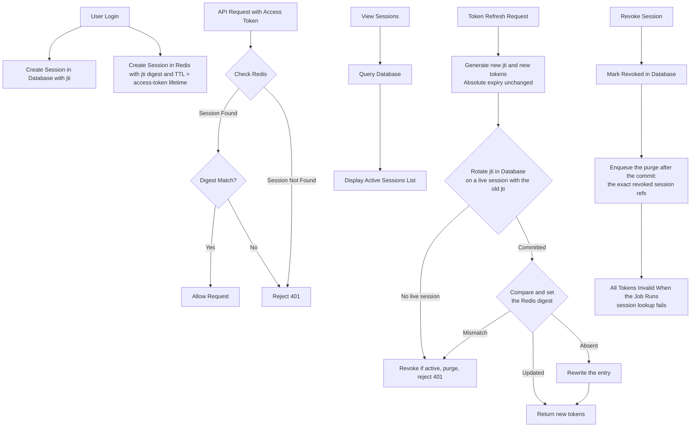
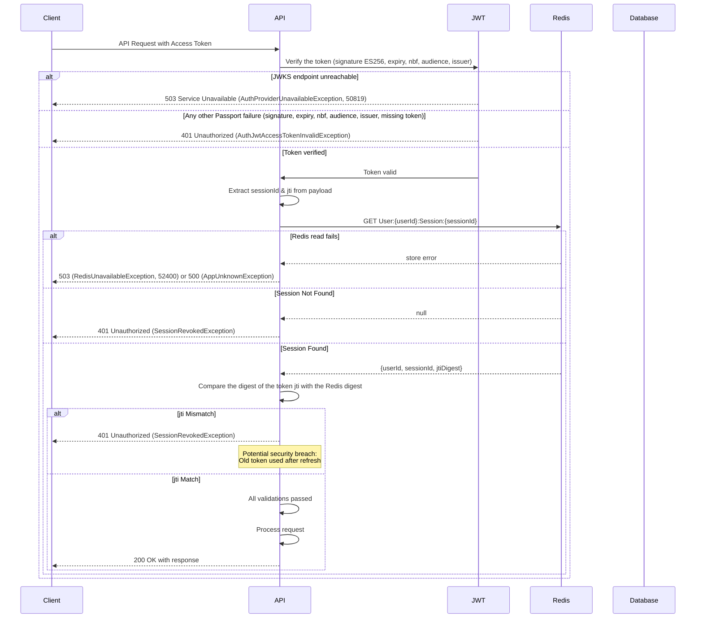

# Authentication Documentation

- Auth lives in `src/modules/auth`.
- Sessions live in `src/modules/session`.
- API keys live in `src/modules/api-key`.

## Overview

Credential login, JWT access/refresh (ES256/ES512), Redis plus Mongo sessions, Google/Apple/GitHub social login, and API keys.

- **Password:** bcrypt hash, expiration, rotation, attempt limits, history, and reset/change/temporary-password flows that invalidate sessions.
- **JWT:**
    - Access and refresh tokens.
    - `jti` is checked against the session on each request.
- **Session:**
    - Redis holds validation and TTL.
    - The database holds listing, management, and history.
    - A missing or mismatched Redis `jti` rejects the request.
- **Social:**
    - Google OAuth 2.0, Apple Sign In, and GitHub OAuth.
    - The backend verifies the provider token (Google, Apple) or exchanges the authorization code (GitHub), then follows the same session path as credential login.
- **API key:** default and system keys, checked against the database and cache.

Configuration lives in two files:

- `src/configs/auth.config.ts` holds tokens, password, two-factor, social providers, and API keys.
- `src/configs/session.config.ts` holds the Redis session key pattern, the login cache TTL (`loginCacheTtlInMs`, the access-token lifetime from `AUTH_JWT_ACCESS_TOKEN_EXPIRED`), and the purge job id pattern.

## Related Documents

- [Cache Documentation][ref-doc-cache]: Session cache in Redis
- [Configuration Documentation][ref-doc-configuration]: Auth and session config
- [Environment Documentation][ref-doc-environment]: JWT and OAuth env vars
- [Device Documentation][ref-doc-device]: Devices and session lifecycle
- [Two Factor Documentation][ref-doc-two-factor]: TOTP and backup codes
- [Workspace Documentation][ref-doc-workspace]: Workspace scope and invite sign-up
- [Project Documentation][ref-doc-project]: Project scope inside a workspace
- [Authorization Documentation][ref-doc-authorization]: What an authenticated caller may reach

This document covers authentication only: proving who the caller is.

Authorization, workspace, and project scoping are separate docs.

## Table of Contents

- [Overview](#overview)
- [Related Documents](#related-documents)
- [Password](#password)
    - [Password Configuration](#password-configuration)
    - [Password Flow](#password-flow)
- [JWT Authentication](#jwt-authentication)
    - [JWT Configuration](#jwt-configuration)
    - [JWT Flow](#jwt-flow)
        - [JWT Access Token Flow](#jwt-access-token-flow)
        - [JWT Refresh Token Flow](#jwt-refresh-token-flow)
        - [JWT Logout Flow](#jwt-logout-flow)
    - [JWT Tokens](#jwt-tokens)
        - [JWT Access Token](#jwt-access-token)
        - [JWT Refresh Token](#jwt-refresh-token)
    - [JWT Payload Structure](#jwt-payload-structure)
        - [JWT Access Token Payload](#jwt-access-token-payload)
        - [JWT Refresh Token Payload](#jwt-refresh-token-payload)
    - [Usage](#usage)
        - [Protecting Endpoints](#protecting-endpoints)
        - [Getting JWT Payload](#getting-jwt-payload)
        - [Getting Raw Token](#getting-raw-token)
    - [Security: JWT ID (jti)](#security-jwt-id-jti)
        - [How it Works](#how-it-works)
- [Social Authentication](#social-authentication)
    - [Social Authentication Flow](#social-authentication-flow)
    - [Google Authentication](#google-authentication)
        - [Configuration](#configuration)
        - [Setup Google OAuth 2.0](#setup-google-oauth-20)
        - [Usage](#usage-1)
    - [Apple Authentication](#apple-authentication)
        - [Configuration](#configuration-1)
        - [Setup Apple Sign In](#setup-apple-sign-in)
        - [Usage](#usage-2)
    - [GitHub Authentication](#github-authentication)
        - [GitHub Authorization Flow](#github-authorization-flow)
        - [GitHub Configuration](#github-configuration)
        - [Setup GitHub OAuth](#setup-github-oauth)
        - [GitHub Usage](#github-usage)
- [Two-Factor Authentication (TOTP)](#two-factor-authentication-totp)
    - [Configuration](#configuration-2)
    - [Flow](#flow)
- [API Key Authentication](#api-key-authentication)
    - [Configuration](#configuration-3)
    - [API Key Types](#api-key-types)
        - [Default API Key](#default-api-key)
        - [System API Key](#system-api-key)
    - [Request Format](#request-format)
    - [Usage](#usage-3)
        - [Protecting Endpoints](#protecting-endpoints-1)
        - [Getting API Key Payload](#getting-api-key-payload)
    - [API Key Authentication Flow](#api-key-authentication-flow)
- [Session Management](#session-management)
    - [Session Endpoints](#session-endpoints)
    - [Session Storage](#session-storage)
        - [Redis (Primary: Validation)](#redis-primary-validation)
        - [Database (Secondary: Management)](#database-secondary-management)
        - [How They Work Together](#how-they-work-together)
    - [Session Lifecycle](#session-lifecycle)
    - [Session Validation Flow](#session-validation-flow)
    - [What Happens on Revocation](#what-happens-on-revocation)

## Password

Password handling covers:

- bcrypt hashing
- expiration and rotation
- history
- login attempt limits
- reset, change, and temporary password creation, each with session invalidation

### Password Configuration

All password settings are configured in `src/configs/auth.config.ts`:

```typescript
export default registerAs('auth', (): IConfigAuth => ({
    password: {
        // Enable/disable login attempt limiting feature
        attempt: true,

        // Failed login attempts tolerated; the next login inactivates the user
        maxAttempt: 5,

        // Number of bcrypt salt rounds used for password hashing
        saltLength: 12,

        // Password expiration (182 days), stored in milliseconds
        expiredInMs: ms('182d'),

        // Temporary password expiration (3 days), stored in milliseconds
        expiredTemporaryInMs: ms('3d'),

        // Password reuse window in days (90), the unit the reuse check takes
        // A password kept in history for this long cannot be set again
        periodInDays: ms('90d') / ms('1d'),

        // Length of a generated temporary password
        temporaryLength: 10,
    },
}));
```

### Password Flow



## JWT Authentication

- Access and refresh tokens are JWTs ([RFC 7519][ref-jwt]).
- This project signs them with ECDSA: ES256 for access, ES512 for refresh.
- Specs: [JWT.io][ref-jwt].

> [!NOTE] JWT authentication uses cryptographic key pairs. Key generation is covered under Generate Keys in the [Installation Documentation][ref-doc-installation].

### JWT Configuration

All JWT settings are configured in `src/configs/auth.config.ts`:

```typescript
export default registerAs('auth', (): IConfigAuth => ({
    jwt: {
        accessToken: {
            // JWKS URI the access-token strategy verifies signatures against (required)
            jwksUri: process.env.AUTH_JWT_ACCESS_TOKEN_JWKS_URI!,

            // Key ID stamped into the token header as `kid` (required)
            kid: process.env.AUTH_JWT_ACCESS_TOKEN_KID!,

            // Algorithm for signing and verifying access tokens
            algorithm: 'ES256', // ECDSA using P-256 and SHA-256

            // Private key for signing access tokens (from environment)
            privateKey: process.env.AUTH_JWT_ACCESS_TOKEN_PRIVATE_KEY!,

            // Public key, used by the direct verify helpers on AuthJwtDomain
            publicKey: process.env.AUTH_JWT_ACCESS_TOKEN_PUBLIC_KEY!,

            // Access token expiration in seconds, the unit the JWT signer takes,
            // parsed from the ms() string in AUTH_JWT_ACCESS_TOKEN_EXPIRED
            expirationTimeInSeconds:
                ms(
                    process.env.AUTH_JWT_ACCESS_TOKEN_EXPIRED as ms.StringValue
                ) / 1000,
        },

        refreshToken: {
            // JWKS URI the refresh-token strategy verifies signatures against (required)
            jwksUri: process.env.AUTH_JWT_REFRESH_TOKEN_JWKS_URI!,

            // Key ID stamped into the token header as `kid` (required)
            kid: process.env.AUTH_JWT_REFRESH_TOKEN_KID!,

            // Algorithm for signing and verifying refresh tokens
            algorithm: 'ES512', // ECDSA using P-521 and SHA-512

            // Private key for signing refresh tokens (from environment)
            privateKey: process.env.AUTH_JWT_REFRESH_TOKEN_PRIVATE_KEY!,

            // Public key, used by the direct verify helpers on AuthJwtDomain
            publicKey: process.env.AUTH_JWT_REFRESH_TOKEN_PUBLIC_KEY!,

            // Refresh token expiration in seconds, parsed from the ms() string in
            // AUTH_JWT_REFRESH_TOKEN_EXPIRED; it also sets the initial session expiry and Redis TTL
            expirationTimeInSeconds:
                ms(
                    process.env.AUTH_JWT_REFRESH_TOKEN_EXPIRED as ms.StringValue
                ) / 1000,
        },

        // JWT audience claim (identifies intended recipients)
        audience: process.env.AUTH_JWT_AUDIENCE!,

        // JWT issuer claim (identifies who issued the token)
        issuer: process.env.AUTH_JWT_ISSUER!,

        // Length of the random jti
        jtiLength: 32,
    },

    jwks: {
        // Fetches the strategies make to the JWKS endpoint per minute
        requestsPerMinute: 60,

        // How long a fetched key stays cached
        cacheMaxAgeInMs: ms('10m'),
    },
}));
```

The header and scheme a token travels in are constants in `src/modules/auth/constants/auth.constant.ts`:

- `AuthHeaderName` is `Authorization`.
- `AuthBearerScheme` is `Bearer`.
- Both Passport strategies extract the token with `ExtractJwt.fromAuthHeaderWithScheme(AuthBearerScheme)`.
- A login response reports `AuthBearerScheme` as its `tokenType`.

The Passport strategies (`AuthJwtAccessStrategy`, `AuthJwtRefreshStrategy`) verify the signature on incoming requests against the **JWKS endpoint**, not against the configured `publicKey`.

Both strategies:

- cache JWKS keys for `auth.jwks.cacheMaxAgeInMs` (10 minutes)
- rate-limit fetches to `auth.jwks.requestsPerMinute` (60) requests per minute
- enforce `audience`, `issuer`, expiration, and `nbf`

The configured `publicKey` is only used by `AuthJwtDomain.validateAccessToken` / `AuthJwtDomain.validateRefreshToken`.

An unreachable JWKS endpoint answers `AuthProviderUnavailableException` (503, `50819`) on both guards, not a token error:

- `AuthUtil.toProviderUnavailableException` maps a JWKS client error or a network error code (`ECONNREFUSED`, `ECONNRESET`, `ENOTFOUND`, `ETIMEDOUT`, `EAI_AGAIN`, `EHOSTUNREACH`, `ENETUNREACH`) to it.
- Any other Passport failure answers `AuthJwtAccessTokenInvalidException` (401, `50800`) or `AuthJwtRefreshTokenInvalidException` (401, `50801`).

### JWT Flow

#### JWT Access Token Flow

Login through token generation:



The session read goes straight to the Redis store (`SessionCache.getLogin`), so a store failure is not read as a missing session:

- A Redis outage during the read answers 503 (`RedisUnavailableException`, `52400`) when Redis is not connected, and 500 (`AppUnknownException`) for any other store error.
- A missing key or a `jti` mismatch answers `SessionRevokedException` (401, `50401`).

The route itself is gated by `@FeatureFlagProtected(EnumFeatureFlagKey.loginWithCredential)` and `@ApiKeyProtected()`, so a disabled flag rejects the request with `FeatureFlagDisabledException` (404, `50601`) before any credential is read.

Credential checks run in a fixed order. Each one throws before the next is reached:

1. user found and status `active`, else `UserCredentialInvalidException` (401, `51026`)
2. password set, else the same `UserCredentialInvalidException`
3. password attempt counted: a guarded update increments the counter only while it is below `maxAttempt`, before the password is compared
4. attempt budget not spent: a spent budget enqueues the lockout job, and the service stages the lockout rows returned with the attempt, then answers `UserPasswordAttemptMaxException` (403, `51012`)
5. password matches: a mismatch writes a `userLoginFailed` row and answers `UserCredentialInvalidException` (401, `51026`)
6. email verified: an unverified account is sent a verification email when `UserVerificationDomain.isEmailResendable` holds, then answers `UserEmailNotVerifiedException` (403, `51016`) whether the email was sent or not
7. password not expired (`UserPasswordExpiredException`, 403, `51011`), checked only after a match and after the verification check

- An unknown email, an inactive account, a passwordless account, and a wrong password answer the same `UserCredentialInvalidException`, so a caller cannot tell which case failed.
- The `userLoginFailed` row and the lockout rows are flushed although the request answers an error, because the error path flushes every staged activity log ([Activity Log][ref-doc-activity-log]).
- A match resets the attempt counter before the verification and expiry checks.
- An unverified account with an expired password still receives the verification email and answers `UserEmailNotVerifiedException`.

**Lockout.** A spent password or two-factor budget enqueues the `lockout` job on the `user` queue (`UserQueue.lockout`, payload `{ userId }`). The attempt count returns the lockout rows `userRevokeAllSessions` and the matching `userReachMax…Attempt` (`UserPasswordDomain.countPasswordAttempt`, `UserAuthDomain.countCredentialAttempt`, `UserTwoFactorDomain.countAttempt`). The service stages them, then asserts the counted attempt and answers its max-attempt exception.

`UserProcessorService.lockout` runs one transaction:

1. A guarded update sets the user `inactive`, matching only an active user. A user already inactive ends the job there.
2. It revokes every active session of the user, with the user as the revoking actor.
3. It revokes every live device ownership of the user and clears their push tokens ([Device][ref-doc-device]).

After the commit the job enqueues the purge of the revoked session keys: one `purgeLogins` job on the `session` queue carrying the user id and the exact refs the transaction revoked.



One branch then short-circuits before any session or token is created. When two-factor is enabled:

- No session and no tokens are created.
- The challenge is written to Redis (`AuthCache.createChallenge`), concurrently with the secret provisioning when setup is required. A Redis failure there answers 500, or 503 (`52400`) when Redis is not connected.
- The response carries `data.isTwoFactorEnable: true` and `data.twoFactor` with `challengeToken`, `challengeExpiresInMs`, `isRequiredSetup`, and `backupCodesRemaining`.
- When `isRequiredSetup` is true, the response also provisions the secret and carries `otpauthUrl` and `secret`.
- See [Two-Factor Authentication (TOTP)](#two-factor-authentication-totp).

An unverified email never reaches a session. After the password matched, the login handles an active, unverified account in this order:

1. `UserVerificationDomain.isEmailResendable` is false when the account is verified or its last verification email is inside `verification.resendInMinutes`. The login then sends nothing.
2. When it holds, the login reads the recipient through `NotificationDomain.getRecipient`, creates the verification (`UserVerificationDomain.createEmail`), stages `userSendVerificationEmail`, and enqueues the verification email.
3. The login answers `UserEmailNotVerifiedException` (403, `51016`) whether the email was sent or not, so the response never reveals which. The `userSendVerificationEmail` row is staged only when the email was sent and is written although the request answers an error.
4. A wrong password sends no email. The resend-verification route shares the same gate and answers 200 in every account state.

`IUserLoginOutcome` models the login result as a union of two outcomes:

- A token outcome: `isTwoFactorEnable: false` with `tokens`.
- A two-factor outcome: `isTwoFactorEnable: true` with `twoFactor`. It is either the verify challenge or, when `isRequiredSetup` is true, the setup challenge that also carries `otpauthUrl` and `secret`.
- Both carry `lastWorkspaceId` and `lastWorkspaceChangedAt`.

Session creation also enforces the device constraints. Inside one database transaction (`UserAuthHttpService.createTokenAndSession`, shared by credential login, social login, and two-factor verification):

1. device upsert and device-ownership upsert
2. revocation of every still-active session bound to that device-user pair, unless the ownership is new
3. revocation of every active session bound to another user's ownership of the same device ([Device][ref-doc-device])
4. creation of the new session record
5. the last-login update

Ordering around the transaction:

- The login activity row is prepared before the transaction.
- The session id and `jti` are minted before it (`AuthUtil.createLoginIdentifiers`).
- The token pair is signed after the commit (`AuthJwtDomain.createTokens`), so the `deviceOwnershipId` claim is the id the transaction persisted.

After the commit, one parallel batch runs:

- the new session key is written (`SessionDomain.setLogin`)
- the purge of exactly the superseded session refs is enqueued (`SessionQueue.purgeLogins`)
- one purge per other user whose sessions the login revoked is enqueued, each with that user's exact refs
- the new-device login notification is enqueued when the device ownership was created rather than reused, with the recipient snapshot read before the transaction and the session id as the event id of the job

Then:

- The login row is staged once that batch settles.
- One `userRevokeSessionByDeviceLogin` row per affected user is staged after it.
- A purge or notification enqueue failure is logged and reported, and the login still succeeds.
- `SessionDomain.setLogin` writes the key, then re-reads the session row and deletes the key when the row was revoked meanwhile.
- A failed key write revokes the new session, enqueues its purge, and answers 500, or 503 (`52400`) when Redis is not connected. No login row is staged.

#### JWT Refresh Token Flow

- When the access token expires, the refresh token is used to obtain a new access token.
- Each refresh issues a new `jti`, which is what the session check matches.
- `AuthJwtRefreshGuard` verifies the token signature, expiry, audience, and issuer only. It reads no session, so the rotation below is the only session check.

`UserAuthHttpService.refresh` rotates the session (`rotateSession`):

1. It signs the new token pair under a fresh `jti`. The new refresh token expires when the presented one would.
2. It rotates the `jti` in the database by compare-and-set: the `where` carries the session id, the old `jti`, `isRevoked: false`, and an unexpired `expiredAt`.
3. A rotation that matches no row is token reuse or a revoked session: the session is revoked if still active, its purge is enqueued, and the request answers `SessionRevokedException` (401, `50401`).
4. After the commit it rotates the Redis entry by compare-and-set on the stored `jti` digest, which also resets the entry TTL.
5. A digest mismatch is reuse as well: the session is revoked and purged, and the request answers `SessionRevokedException`.
6. A missing entry (it expired or was purged) is rewritten through `SessionDomain.setLogin`, which deletes it again when the session row is revoked.
7. `userRefreshToken` is staged only after step 6 completes.

```mermaid
sequenceDiagram
    participant Client
    participant API
    participant Redis
    participant Database
    participant Queue as Session queue

    Client->>API: POST /shared/user/refresh
    Note over Client,API: Authorization: Bearer <refresh_token>

    API->>API: Verify Refresh Token (ES512)
    API->>API: Generate new jti and new tokens<br/>(refresh expiry = remaining life of the old refresh token)
    API->>API: prepare userRefreshToken, userRevokeSession
    API->>Database: withTransaction: rotate jti where jti = old, not revoked,<br/>not expired; update last-login fields
    alt No live session matched the old jti
        Database-->>API: Not rotated
        API->>Database: Revoke the session if still active
        API->>Queue: Add purgeLogins job when a session was revoked
        API->>API: stage userRevokeSession when a session was revoked
        API-->>Client: 401 Unauthorized (SessionRevokedException, 50401)
    else Committed
        API->>Redis: Compare-and-set the jti digest, reset the TTL
        alt Digest matches
            Redis-->>API: updated
            API->>API: stage userRefreshToken
            API-->>Client: New Access Token + New Refresh Token
            Note over Client,API: Session ID remains the same<br/>New refresh token expires at the same<br/>instant the old one would have
        else Digest mismatch
            Redis-->>API: mismatch
            API->>Database: Revoke the session
            API->>Queue: Add purgeLogins job
            API-->>Client: 401 Unauthorized (SessionRevokedException, 50401)
        else Entry absent
            Redis-->>API: absent
            API->>Redis: setLogin with the new jti
            API-->>Client: New Access Token + New Refresh Token
        end
    end
```

- A Redis outage during the compare-and-set answers 500 (`AppUnknownException`), or 503 (`RedisUnavailableException`, `52400`) when the error maps to an unreachable Redis.
- A failed rewrite of an absent entry revokes the session first, then answers 500 or 503.
- A write conflict in the rotation transaction answers `SessionRevokedException` without revoking the session.
- A refresh token without a `jti` or `sessionId` answers `AuthJwtRefreshTokenInvalidException` (401, `50801`) in the strategy.
- A retry of a lost response with the old token is reuse, so it revokes the session.
- `userRefreshToken` is success-only, so a refresh that ends in 401 or 500 writes no `userRefreshToken` row.

#### JWT Logout Flow

Endpoint: `POST /shared/user/logout`.

- It is protected by `@AuthJwtAccessProtected`, `@UserProtected`, `@TermPolicyAcceptanceProtected`, and `@ApiKeyProtected`.
- It returns `200 OK` with message `user.logout`.
- It records the `userLogout` activity-log action.

The handler reads `userId`, `sessionId`, and `deviceOwnershipId` from the access-token payload, then `UserAuthHttpService.logout`:

1. Prepares `userLogout`.
2. Opens `this.databaseService.withTransaction` and composes `SessionDomain.revokeInTx` and `DeviceDomain.clearNotificationInTx`:
    - The revoke matches only a session of the caller that is not yet revoked.
    - When the revoke matches nothing, the transaction aborts with `SessionNotFoundException` (404, `50400`) and nothing changes.
    - A write conflict in the transaction answers the same `SessionNotFoundException`.
    - `DeviceDomain.clearNotificationInTx` resolves the device only through a live ownership: the `deviceOwnershipId` from the token, belonging to the caller, not revoked.
    - When no such ownership exists (missing, owned by another user, or already revoked), the domain logs a warning and clears no push token. The session revoke still commits.
    - Otherwise the ownership's push token and provider are cleared and its `lastActiveAt` is stamped.
3. After the commit, `SessionQueue.purgeLogins` enqueues the purge of the session's Redis key.
    - An enqueue failure is logged and reported, and the logout still succeeds.
4. Stages `userLogout`.
    - `ActivityLogInterceptor` writes the row once the handler returns.



- Logout revokes only the current session.
- Other active sessions remain valid.

### JWT Tokens

#### JWT Access Token

A short-lived token used to authenticate API requests.

- **Algorithm**: ES256 (ECDSA using P-256 and SHA-256)
- **Validity**: Configured in `auth.config.ts` (default: 1 hour)
- **Config**: `AUTH_JWT_ACCESS_TOKEN_EXPIRED` environment variable
- **Purpose**: Authenticate API requests
- **jti**: Included for session tracking and validation

#### JWT Refresh Token

A long-lived token used to obtain new access tokens without requiring the user to log in again.

- **Algorithm**: ES512 (ECDSA using P-521 and SHA-512)
- **Validity**: Configured in `auth.config.ts` (default: 30 days)
- **Config**: `AUTH_JWT_REFRESH_TOKEN_EXPIRED` environment variable
- **Session expiry**: The session row's `expiredAt` is login time plus this expiration, and a refresh never extends it
- **Purpose**: Generate new access tokens without re-authentication
- **jti**: Included for session tracking and validation

### JWT Payload Structure

#### JWT Access Token Payload

Interface `IAuthJwtAccessTokenPayload`

```typescript
{
    loginAt: Date;
    loginFrom: EnumUserLoginFrom;
    loginWith: EnumUserLoginWith;
    email: string;
    username: string;
    userId: string;
    sessionId: string;
    deviceOwnershipId: string;
    roleId: string;

    // Standard JWT claims
    jti?: string;  // JWT ID - unique token identifier
    iat?: number;  // Issued at
    nbf?: number;  // Not before
    exp?: number;  // Expiration time
    aud?: string;  // Audience
    iss?: string;  // Issuer
    sub?: string;  // Subject
}
```

#### JWT Refresh Token Payload

Interface `IAuthJwtRefreshTokenPayload`

A type alias derived from `IAuthJwtAccessTokenPayload` with `Omit`. The refresh payload drops `roleId`, `username`, and `email`, keeping the rest:

```typescript
{
    loginAt: Date;
    loginFrom: EnumUserLoginFrom;
    loginWith: EnumUserLoginWith;
    userId: string;
    sessionId: string;
    deviceOwnershipId: string;

    // Standard JWT claims
    jti?: string;  // JWT ID - unique token identifier
    iat?: number;
    nbf?: number;
    exp?: number;
    aud?: string;
    iss?: string;
    sub?: string;
}
```

### Usage

#### Protecting Endpoints

To protect an endpoint with JWT access token validation, use the `@AuthJwtAccessProtected` decorator:

```typescript
@Doc({ summary: 'get profile' })
@Response('user.profile', { schema: UserProfileResponseSchema })
@TermPolicyAcceptanceProtected()
@UserProtected()
@RequestThrottle({ user: true })
@AuthJwtAccessProtected()
@ApiKeyProtected()
@Get('/profile/get')
async profile(
    @AuthJwtPayload('userId') userId: string
): Promise<IResponseReturn<IUserProfile>> {
    return this.userProfileHttpService.getProfile(userId);
}
```

Decorators apply bottom-up, so the decorator written lower in the source runs earlier. In the stack above, `@ApiKeyProtected()` runs first, then `@AuthJwtAccessProtected()`, then the per-user throttle of `@RequestThrottle`, then `@UserProtected()`, then `@TermPolicyAcceptanceProtected()`. The throttle sits above the JWT decorator because its per-user limiter reads the authenticated user. "Below" and "above" on this page mean position in the source: a guard written below another runs before it.

Refresh uses `@AuthJwtRefreshProtected` on `POST /refresh`:

```typescript
@Doc({ summary: 'refresh token' })
@Response('user.refresh', { schema: AuthTokenResponseSchema })
@UserProtected()
@RequestThrottle({ user: true, route: EnumRequestThrottleRoute.relaxed })
@AuthJwtRefreshProtected()
@ApiKeyProtected()
@HttpCode(HttpStatus.OK)
@Post('/refresh')
async refresh(
    @UserCurrent() user: IUser,
    @AuthJwtToken() refreshToken: string
): Promise<IResponseReturn<IAuthToken>> {
    return this.userAuthHttpService.refresh(user, refreshToken);
}
```

#### Getting JWT Payload

To access the JWT payload in your controller, use the `@AuthJwtPayload()` decorator:

Shared profile reads `userId` from the payload:

```typescript
@TermPolicyAcceptanceProtected()
@UserProtected()
@RequestThrottle({ user: true })
@AuthJwtAccessProtected()
@ApiKeyProtected()
@Get('/profile/get')
async profile(
    @AuthJwtPayload('userId') userId: string
): Promise<IResponseReturn<IUserProfile>> {
    return this.userProfileHttpService.getProfile(userId);
}
```

`AuthJwtPayload<T, K>(field?)` reads `request.user`, which the authenticating guard wrote.

| Piece   | Meaning                                                |
| ------- | ------------------------------------------------------ |
| `T`     | payload type; defaults to `IAuthJwtAccessTokenPayload` |
| `field` | typed as a key of `T`                                  |

- Without a field it returns the whole payload
- With a field it returns that field, non-null
- The social login routes read `@AuthJwtPayload<IAuthSocialPayload>('email')`
- An empty `request.user` (a route that reads the payload without an authenticating guard) throws `AuthJwtGuardMissingException` (401, `50820`).
- A named field that is `null` or absent from the payload throws `RequestContextMissingException` (500, `50304`).
- `UserGuard` throws `AuthJwtGuardMissingException` too when it finds no payload on the request.
- No check for a missing or misordered guard runs when the route is decorated. A route stacked in the wrong order boots and answers the guard-only exception on every request.
- A decorator argument check still throws when the route is decorated and fails the boot (`RoleProtectedEmptyException`, `PolicyProtectedEmptyException`, `PolicyProtectedActionEmptyException`, `RequestEnvProtected()` with no environment).

#### Getting Raw Token

To access the raw JWT token string, use the `@AuthJwtToken()` decorator:

Refresh is the call site:

```typescript
@UserProtected()
@RequestThrottle({ user: true, route: EnumRequestThrottleRoute.relaxed })
@AuthJwtRefreshProtected()
@ApiKeyProtected()
@HttpCode(HttpStatus.OK)
@Post('/refresh')
async refresh(
    @UserCurrent() user: IUser,
    @AuthJwtToken() refreshToken: string
): Promise<IResponseReturn<IAuthToken>> {
    return this.userAuthHttpService.refresh(user, refreshToken);
}
```

### Security: JWT ID (jti)

A unique identifier (32-character random string) generated during login and token refresh, stored in both the token payload and the session in Redis.

#### How it Works

1. **During Login**
    - API generates a unique jti (32-character random string)
    - The SHA-256 digest of the jti is stored in the Redis session, never the jti itself
    - jti is embedded in both access and refresh tokens as a standard JWT claim

2. **During Every API Request (Access Token)**
    - Client sends request with access token
    - API extracts the jti from the access token payload
    - API retrieves session from Redis using userId and sessionId (`AuthJwtAccessStrategy`)
    - API hashes the token jti with SHA-256 and compares the digests with `HelperHashService.sha256Compare`, a constant-time comparison (`AuthUtil.isJtiMatch`)
    - **If the digest matches**: Request is allowed
    - **If the digest doesn't match**: Request is rejected (401 Unauthorized, potential token reuse)
    - **If the Redis read fails**: Request is rejected (503 when Redis is not connected, otherwise 500)

3. **During Token Refresh (Refresh Token)**
    - Client sends the refresh token to the API
    - API extracts the jti from the refresh token payload
    - API rotates the session row only while its stored jti equals the presented one
    - API then compares and rotates the Redis digest in one script
    - **If the jti matches**: Token refresh proceeds with a new jti
    - **If the jti doesn't match**: The session is revoked and the request is rejected (401 Unauthorized, token reuse)

4. **jti Rotation**
    - Each successful token refresh generates a **new jti** (32-character random string)
    - Old jti is invalidated
    - New jti is stored in the database session record, then in Redis once the transaction has committed
    - The Redis script rotates the digest only while the entry holds the old digest, and resets the entry TTL to the access-token lifetime
    - New tokens contain the new jti
    - The session's absolute expiry is never pushed out
    - The new refresh token carries only the time still left on the presented refresh token
    - A session cannot outlive `AUTH_JWT_REFRESH_TOKEN_EXPIRED` counted from login

5. **What the check catches**
    - An access or refresh token presented after a refresh carries the old jti, which no longer matches
    - Each refresh writes a new jti, so a token maps to one point in the session's history
    - Deleting the session key from Redis invalidates every access token carrying that sessionId at once
    - An intercepted old token cannot be replayed

## Social Authentication

- Social authentication allows users to sign in using their Google, Apple, or GitHub accounts.
- The backend validates the OAuth credentials provided by the client and extracts user information to create a session, similar to credential-based authentication.

**Supported Providers:**

- Google OAuth 2.0
- Apple Sign In
- GitHub OAuth (authorization code with PKCE; see [GitHub Authentication](#github-authentication))

### Social Authentication Flow

Google and Apple social login:

```mermaid
sequenceDiagram
    participant User
    participant Client
    participant GoogleApple as Google/Apple
    participant Guard
    participant API
    participant AuthService
    participant AuthSocialService
    participant AuthJwtService
    participant Redis
    participant Database

    User->>Client: Click "Sign in with Google/Apple"
    Client->>GoogleApple: Request OAuth token
    GoogleApple-->>Client: OAuth token

    Client->>API: POST /public/user/login/social/{google|apple}
    Note over Client,API: Authorization: Bearer <oauth_token>

    API->>API: ApiKeyProtected, then FeatureFlagProtected<br/>(disabled flag: 404 FeatureFlagDisabledException)
    API->>Guard: AuthSocialGoogleGuard / AuthSocialAppleGuard
    Guard->>Guard: Split the Authorization header on the Bearer scheme (AuthBearerScheme)

    alt Google Authentication
        Guard->>AuthService: validateOAuthGoogle(token)
        AuthService->>AuthSocialService: verifyGoogle(token)
        Note over AuthSocialService: OAuth2Client from google-auth-library,<br/>built from the client id; verifyIdToken<br/>with audience = the client id
        AuthSocialService-->>AuthService: TokenPayload {email, email_verified}
        AuthService-->>Guard: {email, emailVerified}
    else Apple Authentication
        Guard->>AuthService: validateOAuthApple(token)
        AuthService->>AuthSocialService: verifyApple(token)
        Note over AuthSocialService: verifyAppleToken from verify-apple-id-token,<br/>against every configured Apple client id
        AuthSocialService-->>AuthService: Payload {email, email_verified}
        AuthService-->>Guard: {email, emailVerified}
    end
    Note over AuthService: Rethrows a not-configured exception as is;<br/>maps an unreachable provider to AuthProviderUnavailableException;<br/>wraps any other verification error in<br/>AuthSocialGoogleInvalidException / AuthSocialAppleInvalidException

    alt Provider not configured
        Guard-->>Client: 404 Not Found (AuthSocialGoogleNotConfiguredException 50817 /<br/>AuthSocialAppleNotConfiguredException 50818)
    else Provider unreachable
        Guard-->>Client: 503 Service Unavailable (AuthProviderUnavailableException 50819)
    else Token Valid
        Guard->>API: request.user = {email, emailVerified}
        API->>Database: Find user by email
        Note over API,Database: Created only when the flag's<br/>signUpAllowed metadata is true
        Database-->>API: User record

        API->>API: AuthUtil.createLoginIdentifiers()
        Note over API: Mints sessionId through DatabaseUtil<br/>and a 32-char random jti

        API->>Database: One transaction: upsert device, resolve device ownership,<br/>revoke prior active sessions on that ownership and<br/>other users' sessions on the device,<br/>create session record with jti, update last-login fields
        Database-->>API: Committed, device ownership id returned

        API->>AuthJwtService: createTokens(user, { sessionId, jti, deviceOwnershipId, loginAt }, loginFrom, loginWith)
        AuthJwtService-->>API: Access Token (ES256) + Refresh Token (ES512), both carrying the jti and the device ownership id
        API->>Redis: Store session with the jti digest and TTL
        Note over Redis: Key: User:{userId}:Session:{sessionId}<br/>Value: {userId, sessionId, jtiDigest}<br/>TTL: follows AUTH_JWT_ACCESS_TOKEN_EXPIRED
        Redis-->>API: Session cached

        API-->>Client: Response with tokens
        Note over Client: Same UserLoginResponseDto as<br/>credential login: isTwoFactorEnable<br/>plus tokens or twoFactor

        Client->>Client: Store tokens securely

    else Token Invalid
        Guard-->>Client: 401 Unauthorized (AuthSocialGoogleInvalidException / AuthSocialAppleInvalidException)
    end
```

Social login joins the credential login path once the user is resolved:

- The two-factor branch and the device constraints apply exactly as they do for credential login.
- The email-verification branch does not apply. A social user who is not yet verified is marked verified in place before the shared path runs, and the same write clears the stored password and its expiry, so the email owner is the only credential holder. `UserEmailNotVerifiedException` is never reached from a social login.
- A user whose status is not `active` is rejected with `UserInactiveForbiddenException` at the same point, whether the record was just created or already existed.

The three routes are also gated by `@FeatureFlagProtected(EnumFeatureFlagKey.loginWithGoogle)` / `@FeatureFlagProtected(EnumFeatureFlagKey.loginWithApple)` / `@FeatureFlagProtected(EnumFeatureFlagKey.loginWithGithub)` and `@ApiKeyProtected()`. The social guard sits above `@FeatureFlagProtected()` in source, so guards run in this order:

1. `@ApiKeyProtected()`
2. `@FeatureFlagProtected()`, on its anonymous branch
    - A disabled flag answers `FeatureFlagDisabledException` (404, `50601`) before any provider call
3. the social guard

A missing or malformed `Authorization` header fails with `AuthSocialGoogleRequiredException` / `AuthSocialAppleRequiredException` (401) before any token verification runs. The GitHub route reads its code from the body instead and fails with `AuthSocialGithubRequiredException` (401, `50821`).

A provider with no client id configured answers 404 before the token is verified: `AuthSocialGoogleNotConfiguredException` (`50817`), `AuthSocialAppleNotConfiguredException` (`50818`), or `AuthSocialGithubNotConfiguredException` (`50823`).

- `AuthService` rethrows these as they are.
- A provider whose key or certificate endpoint cannot be reached answers `AuthProviderUnavailableException` (503, `50819`): `AuthUtil.toProviderUnavailableException` recognizes a failed Google certificate fetch, a JWKS client error, an error flagged `isEndpointUnavailable`, and the network error codes of the JWKS paragraph above.
- Every other verification failure becomes `AuthSocialGoogleInvalidException` / `AuthSocialAppleInvalidException` (401). The GitHub failures are in [GitHub Usage](#github-usage).

When the account does not exist and the flag's `signUpAllowed` metadata is true, the user is created on this path:

1. The workspace context resolves from `inviteToken` when present, otherwise a personal workspace.
    - Supplying an `inviteToken` requires the `workspace` flag's `invitationAllowed` metadata.
    - An invite token that resolves to nothing, or to an invite for another email, fails with `WorkspaceInviteInvalidException`.
2. The default user role is resolved.
3. The username is checked against the allowed pattern, the bad-word list, and existing usernames.
4. The record is created already verified.
5. Once the login has completed, the welcome notification is enqueued with a `welcomeSocial` recipient snapshot that `NotificationUtil.mapRecipient` builds from the written user values, with no device tokens and no stored settings (`NotificationQueue.sendWelcomeSocial`). A failed enqueue is logged and reported, and the login still succeeds.

An existing account skips this block, and its login ignores any `inviteToken` in the body.

When the account does not exist and `signUpAllowed` is false, the login fails with `UserNotFoundException`.

### Google Authentication

#### Configuration

Google authentication is configured in `auth.config.ts`:

```typescript
export default registerAs('auth', (): IConfigAuth => ({
    google: {
        clientId:
            process.env.AUTH_SOCIAL_GOOGLE_CLIENT_ID === ''
                ? null
                : (process.env.AUTH_SOCIAL_GOOGLE_CLIENT_ID ?? null),
    },
}));
```

**Environment Variables:**

- `AUTH_SOCIAL_GOOGLE_CLIENT_ID`: Google OAuth 2.0 client ID
    - Empty or unset leaves Google sign-in unconfigured

`AuthSocialService` builds one `OAuth2Client` from the client id alone.

- It verifies every Google ID token with `audience` set to that client id, so a token minted for another client is rejected.
- With no client id, `verifyGoogle` throws `AuthSocialGoogleNotConfiguredException` (404, `50817`) before any verification.

#### Setup Google OAuth 2.0

To obtain Google OAuth credentials:

1. Go to [Google Cloud Console][ref-google-console]
2. Create a new project or select existing project
3. Enable Google+ API
4. Create OAuth 2.0 credentials (Web application)
5. Configure authorized redirect URIs
6. Copy the Client ID to your `.env` file

Setup: [Google OAuth 2.0 Documentation][ref-google-client-secret]

#### Usage

**Protecting the Endpoint:**

```typescript
@Doc({ summary: 'login with social google' })
@Response('user.loginWithSocialGoogle', { schema: UserLoginResponseSchema })
@AuthSocialGoogleProtected()
@FeatureFlagProtected(EnumFeatureFlagKey.loginWithGoogle)
@RequestThrottle({ route: EnumRequestThrottleRoute.strict })
@ApiKeyProtected()
@HttpCode(HttpStatus.OK)
@Post('/login/social/google')
async loginWithGoogle(
    @AuthJwtPayload<IAuthSocialPayload>('email') email: string,
    @Body({ schema: UserCreateSocialRequestSchema })
    body: UserCreateSocialRequestDto
): Promise<IResponseReturn<IUserLoginOutcome>> {
    return this.userLoginWithSocialUseCase.execute(
        email,
        EnumUserLoginWith.socialGoogle,
        body
    );
}
```

- The guard puts the verified `IAuthSocialPayload` (`email`, `emailVerified`) on `request.user`, which is what `@AuthJwtPayload` reads.
- The request body still carries the device and `from` fields the session needs.

### Apple Authentication

#### Configuration

Apple authentication is configured in `auth.config.ts`:

```typescript
export default registerAs('auth', (): IConfigAuth => ({
    apple: {
        clientId:
            process.env.AUTH_SOCIAL_APPLE_CLIENT_ID === ''
                ? null
                : (process.env.AUTH_SOCIAL_APPLE_CLIENT_ID ?? null),
        signInClientId:
            process.env.AUTH_SOCIAL_APPLE_SIGN_IN_CLIENT_ID === ''
                ? null
                : (process.env.AUTH_SOCIAL_APPLE_SIGN_IN_CLIENT_ID ?? null),
    },
}));
```

**Environment Variables:**

- `AUTH_SOCIAL_APPLE_CLIENT_ID`: Apple service ID
- `AUTH_SOCIAL_APPLE_SIGN_IN_CLIENT_ID`: Apple sign-in client ID

#### Setup Apple Sign In

To obtain Apple credentials:

1. Go to [Apple Developer Portal](https://developer.apple.com/)
2. Create an App ID with Sign in with Apple capability
3. Create a Services ID for web authentication
4. Configure return URLs
5. Download and configure private key
6. Copy Service ID (Client ID) to your `.env` file

Setup: [Apple Sign In Documentation](https://developer.apple.com/sign-in-with-apple/get-started/)

#### Usage

**Protecting the Endpoint:**

```typescript
@Doc({ summary: 'login with social apple' })
@Response('user.loginWithSocialApple', { schema: UserLoginResponseSchema })
@AuthSocialAppleProtected()
@FeatureFlagProtected(EnumFeatureFlagKey.loginWithApple)
@RequestThrottle({ route: EnumRequestThrottleRoute.strict })
@ApiKeyProtected()
@HttpCode(HttpStatus.OK)
@Post('/login/social/apple')
async loginWithApple(
    @AuthJwtPayload<IAuthSocialPayload>('email') email: string,
    @Body({ schema: UserCreateSocialRequestSchema })
    body: UserCreateSocialRequestDto
): Promise<IResponseReturn<IUserLoginOutcome>> {
    return this.userLoginWithSocialUseCase.execute(
        email,
        EnumUserLoginWith.socialApple,
        body
    );
}
```

- The Apple token is verified against whichever of `clientId` and `signInClientId` are set, so one route serves the web Services ID and the native app.
- With neither set, `verifyApple` throws `AuthSocialAppleNotConfiguredException` (404, `50818`) before any verification.

### GitHub Authentication

GitHub OAuth apps issue no ID token, so the client sends an authorization code in the request body instead of an ID token in `Authorization`.

The client builds the authorize URL, not the API:

1. The client generates a PKCE code verifier and its `S256` code challenge. GitHub accepts only `S256`; the `plain` method is not supported.
2. The client sends the challenge on the authorize redirect.
3. The client sends the verifier to this API as `codeVerifier`.
4. The API forwards the verifier to GitHub, which checks it against the challenge.

#### GitHub Authorization Flow



#### GitHub Configuration

GitHub authentication is configured in `auth.config.ts` under `github`:

- `clientId` and `clientSecret` come from `AUTH_SOCIAL_GITHUB_CLIENT_ID` and `AUTH_SOCIAL_GITHUB_CLIENT_SECRET`.
    - Both blank or unset is the unconfigured state: `verifyGithub` throws `AuthSocialGithubNotConfiguredException` (404, `50823`) before any GitHub call.
    - Exactly one set fails boot validation.
- `tokenUrl` and `apiUrl` come from `AUTH_SOCIAL_GITHUB_TOKEN_URL` and `AUTH_SOCIAL_GITHUB_API_URL`.
    - Both are optional, and `.env.example` carries the github.com defaults.
    - A blank or missing value uses the github.com default, `https://github.com/login/oauth/access_token` and `https://api.github.com`.
    - A set value is a URL with no trailing slash.
- `apiVersion` is `2026-03-10` and `timeoutInMs` is 10 seconds, both fixed in `auth.config.ts` with no environment key.
- No GitHub key is required for boot.
- The `loginWithGithub` feature flag row comes from the feature-flag seed: enabled, 100% rollout, `signUpAllowed: true`. See [Feature Flag Documentation][ref-doc-feature-flag].
- The `github` health indicator in `GET /api/system/health/third-party` reports down with `GitHub is not configured` unless both the client id and the client secret are set.

**GitHub Enterprise Server:**

- Set `AUTH_SOCIAL_GITHUB_TOKEN_URL` to `https://HOSTNAME/login/oauth/access_token`.
- Set `AUTH_SOCIAL_GITHUB_API_URL` to `https://HOSTNAME/api/v3`.
- Register the OAuth app on that server.

See [Environment Documentation][ref-doc-environment] for the values and [Configuration Documentation][ref-doc-configuration] for the config shape.

#### Setup GitHub OAuth

To obtain GitHub OAuth credentials:

1. Go to [GitHub Developer Settings][ref-github-oauth-apps]
2. Register a new OAuth app
3. Set the authorization callback URL to the redirect URI the client uses
4. Generate a client secret
5. Copy the Client ID and Client secret to your `.env` file

#### GitHub Usage

**Protecting the Endpoint:**

```typescript
@Doc({ summary: 'login with social github' })
@Response('user.loginWithSocialGithub', { schema: UserLoginResponseSchema })
@AuthSocialGithubProtected()
@FeatureFlagProtected(EnumFeatureFlagKey.loginWithGithub)
@RequestThrottle({ route: EnumRequestThrottleRoute.strict })
@ApiKeyProtected()
@HttpCode(HttpStatus.OK)
@Post('/login/social/github')
async loginWithGithub(
    @AuthJwtPayload<IAuthSocialPayload>('email') email: string,
    @Body({ schema: UserCreateGithubRequestSchema })
    body: UserCreateGithubRequestDto
): Promise<IResponseReturn<IUserLoginOutcome>> {
    return this.userLoginWithSocialUseCase.execute(
        email,
        EnumUserLoginWith.socialGithub,
        body
    );
}
```

- The request body is the social login body plus three required fields:
    - `code`: the authorization code GitHub returned to the redirect URI
    - `redirectUri`: the redirect URI of the authorization request
    - `codeVerifier`: the PKCE verifier (RFC 7636) of the authorization
- The client requests the `user:email` scope.
- Nothing rides in `Authorization`.
- The guard puts `{ email, emailVerified: true }` on `request.user`, which is what `@AuthJwtPayload` reads.

**Account linking:**

- The account is found by the provider-verified primary email and by nothing else.
- A changed GitHub primary email is a new account.
- The email path follows the shared rules above: first login signs up when the flag's `signUpAllowed` metadata is true.
- An existing unverified credential account with the same email is marked verified and its password cleared, as in the shared social path above.

**Single-use code:**

- The guard exchanges the code once, before body validation and the sign-up checks.
- A request that then fails (a taken username, a malformed field) has already spent the code, so the client starts a new GitHub authorization redirect before retrying.
- A Google or Apple ID token can be resubmitted.

**Errors:**

- `AuthSocialGithubRequiredException` (401, `50821`): the body lacks a valid `code`, `redirectUri`, or `codeVerifier`.
- `AuthSocialGithubInvalidException` (401, `50822`): a bad or expired code, a redirect URI mismatch, no primary verified email, or a token without `user:email`.
- `AuthSocialGithubNotConfiguredException` (404, `50823`): the client id and secret are both blank.
- `AuthProviderUnavailableException` (503, `50819`): a GitHub outage, timeout, or rate limit.
- A rejection caused by the app setup (wrong client credentials, an unsupported API version) answers 500 and leaks nothing to the client.

The API tells a client fault from its own misconfiguration in two places:

- The `error` field of GitHub's token response: `bad_verification_code`, `redirect_uri_mismatch`, and `unverified_user_email` are the client's and answer 401. Any other value, `incorrect_client_credentials` included, answers 500.
- The status of `GET /user/emails`: 401, 403, and 404 answer 401. 410 and any other failure status answer 500.

**Token handling:**

- The GitHub access token is used for one `GET /user/emails` call.
- It is never stored, logged, or returned, and no revoke call is made.

## Two-Factor Authentication (TOTP)

- TOTP-based 2FA adds a second verification step to login.
- Tokens are only issued after the user passes 2FA.

### Configuration

Two-Factor settings are configured in `src/configs/auth.config.ts`:

```typescript
export default registerAs('auth', (): IConfigAuth => ({
    twoFactor: {
        strategy: 'totp', // OTP strategy (totp)
        algorithm: 'sha1', // Hash algorithm (sha1)
        issuer: process.env.AUTH_TWO_FACTOR_ISSUER!,
        digits: 6,
        periodInSeconds: ms('30s') / 1000, // Token validity window in seconds, the unit otplib takes
        window: 1,
        secretLength: 32,
        challengeTtlInMs: ms('5m'),
        challengeKeyPattern: 'TwoFactor:Challenge:{token}',
        backupCodes: {
            count: 8,
            length: 10,
        },
        maxAttempt: 5,
        encryption: {
            key: process.env.AUTH_TWO_FACTOR_ENCRYPTION_KEY!,
        },
    },
}));
```

**Configuration Options:**

- `strategy`: OTP strategy, `totp` (time-based)
- `algorithm`: Hash algorithm used for TOTP generation, `sha1`
- `issuer`: Label shown in the authenticator app, from `AUTH_TWO_FACTOR_ISSUER`
- `periodInSeconds`: Token validity window in seconds (default: 30), passed straight to otplib
- `digits`: Number of digits in the OTP code (default: `6`)
- `window`: Backward-only time steps tolerated (default: `1`)
    - `epochTolerance` is `[window × periodInSeconds, 0]`.
    - A past step is therefore accepted, and a future one is not.
- `secretLength`: Length of the generated secret (default: `32`)
- `challengeTtlInMs`: TTL for the challenge token in cache (default: `5m`)
- `challengeKeyPattern`: Cache key pattern for the challenge token (`TwoFactor:Challenge:{token}`)
- `maxAttempt`: Attempts counted before the next one is refused and the lockout job inactivates the account (default: `5`)
- `backupCodes.count`: Number of backup codes generated (default: `8`)
- `backupCodes.length`: Length of each backup code (default: `10`)
- `encryption.key`: Root secret for the stored TOTP secrets, from `AUTH_TWO_FACTOR_ENCRYPTION_KEY` (exactly 64 base64url characters)

### Flow



- A user whose two-factor is flagged `requiredSetup` completes enrollment at `POST /public/user/login/2fa/enable` with the same `challengeToken`, then verifies.
- Both routes are public: `@ApiKeyProtected()` is the only guard on either.

Details: [Two-Factor Documentation][ref-doc-two-factor].

## API Key Authentication

API keys authenticate machines:

- They have no session.
- The key is checked against the database and cache.
- The callers are external integrations, webhook senders, internal services, scheduled jobs, and third-party clients.

### Configuration

API Key authentication is configured in `auth.config.ts`:

```typescript
export default registerAs('auth', (): IConfigAuth => ({
    xApiKey: {
        keyPattern: 'ApiKey:{key}',
        cacheTtlInMs: ms('5m'),
        leaseKeyPattern: 'ApiKey:Lease:{key}',
        leaseTtlInMs: ms('10s'),
    },
}));
```

**Configuration Options:**

- `keyPattern`: Redis cache key pattern for API key caching (`{key}` is replaced with the key)
- `cacheTtlInMs`: TTL of a cached key (default: `5m`)
- `leaseKeyPattern`: Redis key pattern of the read-through lease (`ApiKey:Lease:{key}`)
- `leaseTtlInMs`: TTL of the lease (default: `10s`)

An admin write that changes or deletes a key runs in this order:

1. The database write.
2. The delete of the key's cache entry.
3. The staged activity row.

A failed cache delete answers 500, or 503 (`52400`) when Redis is not connected, with the database change applied and no activity row staged.

Details: [Cache][ref-doc-cache].

### API Key Types

#### Default API Key

Default API keys are used for standard external integrations and third-party access.

**Characteristics:**

- Type: `EnumApiKeyType.default`
- Purpose: General-purpose API access
- Use Case: External clients, third-party integrations
- Validation: Requires valid `key:secret` combination
- Cache: Cached in Redis for performance

**Guard Decorator:**

```typescript
@ApiKeyProtected()
```

Public login stacks it:

```typescript
@FeatureFlagProtected(EnumFeatureFlagKey.loginWithCredential)
@RequestThrottle({ route: EnumRequestThrottleRoute.strict })
@ApiKeyProtected()
@HttpCode(HttpStatus.OK)
@Post('/login/credential')
async loginWithCredential(
    @Body({ schema: UserLoginRequestSchema })
    body: UserLoginRequestDto
): Promise<IResponseReturn<IUserLoginOutcome>> {
    return this.userAuthHttpService.loginCredential(body);
}
```

#### System API Key

System API keys are used for internal system operations that bypass standard authentication.

**Characteristics:**

- Type: `EnumApiKeyType.system`
- Purpose: System-level operations
- Use Case: Internal services, background jobs, system maintenance
- Validation: Requires valid `key:secret` combination
- Cache: Cached in Redis for performance

**Guard Decorator:**

```typescript
@ApiKeySystemProtected()
```

Health checks stack it on `HealthSystemController` (`VERSION_NEUTRAL`, path `/health` under `/system`):

```typescript
@ApiKeySystemProtected()
@Get('/aws')
async checkAws(): Promise<IResponseReturn<HealthAwsResponseDto>> {
    return this.healthHttpService.checkAws();
}
```

### Request Format

- API keys are sent via the `x-api-key` header with the format `${key}:${secret}`.
- The stored `key` carries the environment it was minted in as a prefix, `<APP_ENV>_<random>` (for example `local_fyFGb7ywyM37TqDY8nuhAmGW5` for the seeded default key).
- The header sends that full value.

**Header Format:**

```
x-api-key: ${key}:${secret}
```

**Format Rules:**

- Pattern: `key:secret`, where `key` is the full `<APP_ENV>_<random>` value
- Separator: Colon (`:`)
- Both key and secret are required
- No spaces allowed
- Case-sensitive

### Usage

#### Protecting Endpoints

**Default API Key Protection:**

```typescript
@FeatureFlagProtected(EnumFeatureFlagKey.loginWithCredential)
@RequestThrottle({ route: EnumRequestThrottleRoute.strict })
@ApiKeyProtected()
@HttpCode(HttpStatus.OK)
@Post('/login/credential')
async loginWithCredential(
    @Body({ schema: UserLoginRequestSchema })
    body: UserLoginRequestDto
): Promise<IResponseReturn<IUserLoginOutcome>> {
    return this.userAuthHttpService.loginCredential(body);
}
```

**System API Key Protection:**

```typescript
@ApiKeySystemProtected()
@Get('/aws')
async checkAws(): Promise<IResponseReturn<HealthAwsResponseDto>> {
    return this.healthHttpService.checkAws();
}
```

#### Getting API Key Payload

`@ApiKeyPayload(field?)` reads the `ApiKey` that `@ApiKeyProtected()` or `@ApiKeySystemProtected()` stored under `ApiKeyStoreKey`:

- With no argument it returns the whole `ApiKey`.
- With a field name typed against `ApiKey` it returns that field.
- Both are non-null.
    - A route that reads it without the guard answers `ApiKeyGuardMissingException` (401, `50707`).
    - A field name that is `null` or absent from the stored key answers `RequestContextMissingException` (500, `50304`).

See [Security and Middleware][ref-doc-security-and-middleware].

### API Key Authentication Flow



- A key that does not exist answers `ApiKeyXApiKeyInvalidException` (401, `50701`), the same answer as a wrong secret, an inactive key, or a key before its `startAt`, so a caller cannot probe which keys exist.
- A key with the right secret and a passed `endAt` answers `ApiKeyExpiredException` (400, `50703`).
- `@ApiKeyProtected()` and `@ApiKeySystemProtected()` install both guards in one `UseGuards` call, in the order `ApiKeyXApiKeyGuard`, then `ApiKeyXApiKeyTypeGuard`. The first writes the key under `ApiKeyStoreKey`, and the second reads it.
- `ApiKeyXApiKeyTypeGuard` answers `ApiKeyGuardMissingException` (401, `50707`) for an empty store. Because one decorator installs both guards, a route reaches that answer only through `@ApiKeyPayload()` on a route without either decorator.
- The cache is an optimization, and the database stays the authority:
    - A cache read that fails reads as a miss, so the lookup falls through to the database.
    - A cache miss takes a short read-through lease before the database read, and only the lease holder writes the entry, so concurrent misses fill the cache once.
    - A cache write that fails after a database hit is logged at error level and ignored, so the request still authenticates.
    - A key that is not found in the database is not cached, so every request naming an unknown key reads the database.
- `ApiKeyNotFoundException` (404, `50704`) belongs to the admin API key routes, which look a key up by id.

## Session Management

- Sessions are bound to a user and a device.
- Users and admins can list them and revoke them.

Sessions sit on `DeviceOwnership` (one user on one device):

- That pair may hold only one active session.
- A device can still be owned by more than one user, but only one of them holds a live session: a login revokes the others ([Device][ref-doc-device]).

Storage:

- **Redis:** access-token validation, with the access-token lifetime as TTL
- **Database:** listing, management, refresh rotation, and audit trail

### Session Endpoints

Global prefix `/api` and version `v1` apply as elsewhere.

| Method | Path | Scope |
| --- | --- | --- |
| `GET` | `/shared/user/session/list` | The caller's own sessions (cursor) |
| `DELETE` | `/shared/user/session/revoke/:sessionId` | Revoke one of the caller's sessions |
| `GET` | `/admin/user/:userId/session/list` | A user's sessions (offset), filterable by `isRevoked` |
| `DELETE` | `/admin/user/:userId/session/revoke/:sessionId` | Revoke one session of a user |
| `DELETE` | `/admin/user/:userId/session/revoke-all` | Revoke every active session of a user |

List query:

- Both list routes take one `orderBy` as `field:direction`.
- The shared cursor list accepts `createdAt`. The admin offset list accepts `createdAt` and `updatedAt`.
- Each route's request schema validates it against that route's allow-list, so an unlisted field or direction answers a validation error (422, `50300`).
- The allow-list also rides in the response metadata as `availableOrderBy`.

Route guards:

- The admin routes carry `@RoleProtected(EnumRoleType.admin)`.
- The admin routes carry `@PolicyProtected` on `user: [read]` plus `session: [read]` (list) or `session: [read, delete]` (both revoke routes).
- The admin routes carry no workspace guard.
- Every session route is throttled with `@RequestThrottle({ user: true })`.

**Revoke one.** `DELETE /shared/user/session/revoke/:sessionId` and the admin `DELETE /admin/user/:userId/session/revoke/:sessionId`:

1. The admin route checks that the admin outranks the target user's role.
2. The write revokes only a session that is not yet revoked and belongs to the user.
3. The purge of the session's Redis key is enqueued.
4. The activity rows are staged.

Outcome:

- When the write matches nothing (the session does not exist, belongs to another user, or a concurrent revoke got there first), the request answers `SessionNotFoundException` (404, `50400`), and no purge is enqueued and nothing is written to the activity log.

**Revoke all (admin).** `DELETE /admin/user/:userId/session/revoke-all`:

1. checks that the user is not the admin and that the admin outranks the target user's role.
2. revokes every active session of the user in one transaction (`SessionRepository.revokeActiveByUser`).
3. enqueues the purge of the revoked session keys (`SessionQueue.purgeLogins`).
4. stages its activity rows.

It answers with the message `session.revokeAll`.

| Case | Exception | statusCode | HTTP |
| --- | --- | --- | --- |
| `userId` is the admin's own account | `UserNotSelfException` | `51001` | 400 |
| The user holds no active session, or does not exist | `SessionNotFoundException` | `50400` | 404 |

Activity rows:

- Neither case in the table revokes a session or writes an activity-log row.
- A successful revoke-all writes `adminSessionRevokeAll` for the admin and `userRevokeAllSessionsByAdmin` for the user, each carrying `sessionCount`.
- The single-session admin revoke writes `adminSessionRevoke` and `userRevokeSessionByAdmin`.
- The single-session admin revoke writes only `adminSessionRevoke` when the admin revokes a session of their own account.
- A user's own revoke writes `userRevokeSession`.

See [Activity Log][ref-doc-activity-log] and [Status Codes][ref-doc-status-codes].

### Session Storage

#### Redis (Primary: Validation)

Used to validate **access tokens**.

- Every API call carrying an access token checks Redis.
- A session key that is missing, or a jti that does not match, rejects the request at once, even with a valid token signature.
- A refresh request reads no Redis entry at its guard. The refresh rotation compares and rewrites the entry ([JWT Refresh Token Flow](#jwt-refresh-token-flow)).

**Data Stored:**

```typescript
{
    sessionId: string;
    userId: string;
    jtiDigest: string; // SHA-256 digest of the JWT ID
}
```

**Redis Key Pattern:**

```
User:{userId}:Session:{sessionId}
```

**TTL Behavior:**

- Initial TTL: `session.loginCacheTtlInMs`, the access-token lifetime from `AUTH_JWT_ACCESS_TOKEN_EXPIRED` (default: 1 hour)
- On refresh: the entry is rewritten with the new digest and the TTL is reset to the same value
- An entry that expired between refreshes is rewritten by the next refresh while the session row is still active
- Auto Cleanup: Expired entries are removed by Redis when the TTL expires

**Example:**

- If `AUTH_JWT_ACCESS_TOKEN_EXPIRED=1h`, an access token stops validating one hour after the last login or refresh, even if its own expiry is later
- The session row expires `AUTH_JWT_REFRESH_TOKEN_EXPIRED` after login, whatever the Redis entry does

#### Database (Secondary: Management)

Used for session listing and management purposes.

**Fields Stored:**

- `jti`: JWT ID the refresh rotation compares
- `ipAddress`: Client IP at login time
- `userAgent`: Parsed user agent (browser, OS, device)
- `geoLocation`: Geographic location derived from IP (optional): `latitude`, `longitude`, `country`, `region`, `city`
- `deviceOwnershipId`: Reference to the `DeviceOwnership` record associated with this session (represents the user-device relationship)
- `expiredAt`, `revokedAt`, `isRevoked`, `revokedById`: Lifecycle and revocation tracking fields

**When Updated:**

- Created during login with initial jti (linked to a DeviceOwnership)
- Updated when session jti is rotated during token refresh
- Updated when session is revoked
- Can be queried to show user's active sessions across devices

**Not Used For:**

- Access-token validation (Redis handles this via the jti digest)
- Real-time validation during API requests

#### How They Work Together



#### What Happens on Revocation

When a session is revoked:

1. **Database**: Session record is updated with revocation metadata, and the write is awaited (inside a transaction when the revoke is part of a larger operation):
    - `isRevoked = true`
    - `revokedAt = now`
    - `revokedById = userId` (who initiated the revocation)
2. **Redis**: After the commit, `SessionQueue.purgeLogins(userId, sessions)` enqueues one `purgeLogins` job on the `session` queue.
    - The job carries the user id and the exact session refs the revoke returned, whether the path revoked one session, a subset, or every session of the user.
    - `SessionProcessorService` runs it: `SessionCache.deleteLogins` deletes exactly those keys, and the push tokens of the user's ownerships without a live session are cleared. A login made after the revoke keeps its key.
    - An enqueue failure is logged and reported, and the request still succeeds. An unpurged key keeps passing the session check until its TTL expires.
3. **Activity log**: The rows are staged after the enqueue.
4. **Access Tokens**: All access tokens for this session become invalid once the purge job runs (the Redis lookup fails)
5. **Refresh Tokens**: A refresh with a token of this session fails at once, because the rotation matches no live session row
6. **Active Requests**: Any subsequent API calls with tokens from this session are rejected with 401 Unauthorized once the job has run

### Session Lifecycle

1. **Creation (Login)**
    - User logs in successfully
    - System generates unique sessionId and jti
    - Session linked to a `DeviceOwnership` (the specific user-device pair)
    - **Device Constraints**: Only one active session per device-user pair is allowed, and the login revokes the active sessions of other users on the same device
    - Session stored in both Redis (with TTL) and Database (with jti and deviceOwnershipId)
    - Tokens issued containing sessionId and jti

2. **Validation (Every Request)**
    - Access token received
    - Token signature verified (ES256)
    - sessionId and jti extracted from token
    - Redis checked for session existence
    - jti digest compared between token and Redis session
    - Request allowed only if session exists AND the digest matches

3. **Refresh**
    - Refresh token received
    - Token signature verified (ES512)
    - sessionId and jti extracted from token
    - New jti and tokens generated
    - jti rotated in the Database only while it equals the presented jti on a live session, then compared and rotated in Redis
    - Old jti invalidated (old tokens won't work); presenting one revokes the session

4. **Expiration**
    - Redis TTL expires (access-token lifetime without a refresh)
    - All access tokens become invalid (session not found in Redis)
    - A refresh before the session row expires rewrites the entry
    - The session row expires `AUTH_JWT_REFRESH_TOKEN_EXPIRED` after login, and the database record remains for audit trail

5. **Revocation**
    - User or admin revokes session
    - Database record marked as revoked
    - Revoked session purge enqueued after the commit, then the activity row staged
    - All tokens for this session become invalid when the purge job runs

**What invalidates sessions.** Every trigger follows one order:

1. Revoke the session rows in the database.
2. Commit.
3. Enqueue the session purge.
4. Stage the activity rows.

Around that order:

- The JWT guards read Redis, so a revoked token fails on the first request after the purge job has run.
- The purge job carries the user id and the exact revoked session refs. No purge matches a key pattern.
- An enqueue failure is logged and reported, and does not fail the request.
- The password change, forgot-password reset, admin temporary password, and admin two-factor reset enqueue their notification concurrently with the purge enqueue, after the commit and before the activity rows are staged. A notification enqueue failure is logged and reported, and the request still succeeds.
- Each of those four reads the recipient snapshot (address, enabled channels, device tokens) before the transaction opens. The order commit, enqueue, stage is unchanged.
- The admin two-factor reset also sets the user's two-factor attempt counter to 0 inside its transaction.

| Trigger | Scope | Purge job carries |
| --- | --- | --- |
| Password change (`PATCH /shared/user/password/change`) | All sessions of the user | The revoked session refs |
| Forgot-password reset (`PATCH /public/user/password/reset`) | All sessions of the user | The revoked session refs |
| Admin temporary password | All sessions of the target user | The revoked session refs |
| Two-factor disable, and admin two-factor reset | All sessions of the user | The revoked session refs |
| Self account deletion (`DELETE /user/user/self/delete`) | All sessions of the user, revoked in the same transaction as the soft-delete and the device-ownership revoke | The revoked session refs |
| A spent password or two-factor attempt budget (the `lockout` job) | All sessions of the user, revoked in the same transaction as the `inactive` status write and the device-ownership revoke | The revoked session refs |
| Admin revoke-all (`DELETE /admin/user/:userId/session/revoke-all`) | All sessions of the target user | The revoked session refs |
| Admin status change to `blocked` or `inactive` (`PATCH /admin/user/update/:userId/status`) | All sessions of the target user | The revoked session refs |
| Device removal, by the user or an admin | All sessions bound to that device ownership | The revoked session refs |
| Re-login from an already-owned device | Prior active sessions on that device-user pair | The revoked session refs |
| Login on a device another user is signed in to | Every active session of the other users on that device, per user | Each user's revoked session refs |
| Refresh-token reuse | The reused session only | That session's ref |
| Logout (`POST /shared/user/logout`) | The current session only | That session's ref |
| Session revoke, by the user or an admin | The named session only | That session's ref |

**Self account deletion.** `UserHttpService.deleteSelf`:

1. Refuses an `admin` or `superAdmin` account, then prepares `userRevokeAllSessions` (with the user passed explicitly as `userId` and `createdBy`) and `userDeleteSelf`.
2. Checks the current password of an account that holds one, under the password attempt counter.
3. Runs one transaction that:
    - refuses the deletion while the user owns a workspace with another member, and soft-deletes the workspaces the user owns alone
    - cancels the user's pending join requests and invites, and removes their workspace, project, mobile-number, and two-factor rows
    - revokes every active session, and every live device ownership with its push token cleared ([Device][ref-doc-device])
    - rewrites the user's identity, sets it `inactive`, and soft-deletes it
4. After the commit, enqueues the purge of the revoked session keys and, when the user has a profile photo under their own profile photo path, the `user` queue job that deletes the photo from S3 (see [File Upload][ref-doc-file-upload]).
5. Stages `userRevokeAllSessions`, `userDeleteSelf`, and one `workspaceDeleted` row per deleted workspace.

Both user rows are written on every self-deletion, including one with no active session.

**Status change by an admin.**

- Setting a user to `blocked` or `inactive` revokes every active session of that user in the same transaction as the status write, then enqueues the purge of the revoked session keys.
- A user with no active session changes status without an error, and no revoke-all rows are written.
- When at least one session was revoked, the call stages `adminSessionRevokeAll` and `userRevokeAllSessionsByAdmin` first, then the status pair (`adminUserUpdateStatus` with `userBlocked` or `userUpdateStatus`).
- Setting a user to `active` revokes nothing and enqueues no purge.

Account status is also enforced per request. `UserGuard`, applied through `@UserProtected()`, re-reads the user from the database on every call:

- It rejects a valid token whose user row no longer exists (`UserAccountNotFoundException`, 401, `51020`). The lookup filters `deletedAt: null`, so a soft-deleted user counts as gone.
- It rejects a request that carries no JWT payload (`AuthJwtGuardMissingException`, 401, `50820`).
- It rejects a blocked account (`UserBlockedForbiddenException`).
- It rejects any other non-active status (`UserInactiveForbiddenException`).
- It rejects an expired password (`UserPasswordExpiredException`), except on a token whose `loginWith` is social.
- It rejects an unverified email (`UserEmailNotVerifiedException`) unless the route opts out with `@UserProtected(false)`.

The same re-read is why a password that expires mid-session locks the caller out without any session being revoked.

Which deletion answers `UserAccountNotFoundException` and which answers `SessionRevokedException`:

- A self-deleted user (`DELETE /user/user/self/delete`) is soft-deleted, and every session is revoked and its purge is enqueued. The next request with an old token fails at the JWT guard with `SessionRevokedException` (401, `50401`), before `UserGuard` runs.
- `UserAccountNotFoundException` needs a session key that still validates while the user row is gone. That happens when the purge enqueue after a self-deletion failed (the failure is logged and reported) or its job has not run yet, and the key has not expired, or when the row was removed outside the API.

### Session Validation Flow



<!-- REFERENCES -->

[ref-jwt]: https://jwt.io
[ref-google-console]: https://console.cloud.google.com/
[ref-google-client-secret]: https://developers.google.com/identity/protocols/oauth2
[ref-github-oauth-apps]: https://github.com/settings/developers
[ref-doc-installation]: installation.md
[ref-doc-cache]: cache.md
[ref-doc-configuration]: configuration.md
[ref-doc-environment]: environment.md
[ref-doc-feature-flag]: feature-flag.md
[ref-doc-device]: device.md
[ref-doc-two-factor]: two-factor.md
[ref-doc-authorization]: authorization.md
[ref-doc-workspace]: workspace.md
[ref-doc-project]: project.md
[ref-doc-activity-log]: activity-log.md
[ref-doc-status-codes]: status-codes.md
[ref-doc-security-and-middleware]: security-and-middleware.md
[ref-doc-file-upload]: file-upload.md
