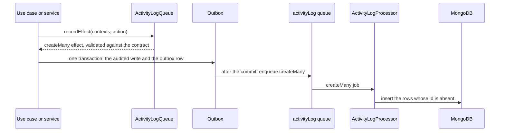

# Activity Log

This page explains the `activity-log` module, for a developer who records an action, reads the audit trail, or changes what an entry holds.

## Table of Contents

- [Related Documents](#related-documents)
- [Overview](#overview)
- [Recording an entry in the transaction](#recording-an-entry-in-the-transaction)
- [Actor and target rows](#actor-and-target-rows)
- [Failed logins](#failed-logins)
- [Reading entries](#reading-entries)

## Related Documents

- [Queue][ref-doc-concept-queue]: the outbox row, the dispatch after the commit, and the retries behind the `activityLog` queue
- [Analytic][ref-doc-concept-analytic]: the metrics that count and list entries
- [User][ref-doc-concept-user]: the sign-up, lockout, and deletion flows that write entries
- [Session][ref-doc-concept-session]: the revoke entries of a login on a shared device
- [Workspace][ref-doc-concept-workspace]: the workspace actions that write entry pairs
- [I18n][ref-doc-concept-i18n]: the `activityLog` message keys
- [Pagination][ref-doc-concept-pagination]: the cursor and offset lists
- [Activity Log Guide][ref-doc-guide-activity-log]: record a new action with its actor and target rows
- [Activity Log Reference][ref-doc-reference-activity-log]: every action, its rows, and its metadata
- [Status Codes][ref-doc-reference-status-codes-activity-log]: the code and message of `ActivityLogContractInvalidException`

## Overview

- An entry is an outbox row added in the transaction of the write it records. The action and its entry commit together or not at all, and a worker writes the row afterward ([Queue][ref-doc-concept-queue-outbox]).
- `ActivityLogProcessor` hands the job to `ActivityLogProcessCreateManyUseCase`, which calls `ActivityLogService.createMany`. `ActivityLogRepository.createMany` reads which ids already exist and inserts only the absent ones, so a retried job writes no row twice.
- The id and the `createdAt` of a row are drawn when the entry is recorded, so every retry carries the same values.
- A job records entries too. Every row stores the actor's request log and a job runs outside the request, so its payload carries `ActivityLogQueue.toPayload(...)`, the ids and the request log of the request that queued it, and its use case passes that payload to `recordEffectFromPayload`.
- Every `EnumActivityLogAction` member has a contract row in `ActivityLogActionContract` and a message under `activityLog.<action>`.

## Recording an entry in the transaction

`ActivityLogQueue.recordEffect(requestContext, apiKeyContext, authContext, input)` builds the effect. It takes the request log (IP, user agent, geo location), the API key, and the actor from the three contexts, and `authContext` is `null` where the route has none.

- One call records one entry: `recordEffect` takes one input and returns a `createMany` effect holding one row. A flow that writes several entries calls it once per entry and adds the effects together with `addManyInTx`.
- Whoever runs the write adds the entry: a service for its own action, a use case for a flow it sequences. The entry is built after the write, so it carries what the write returned.
- An action with no write adds its entry in a transaction that holds the add alone, committed before the use case throws. A write that must survive the request's failure, such as a failed-attempt count with its entry, commits in a transaction of its own before the use case throws, so what follows cannot undo it ([Failed logins](#failed-logins)).
- The contract validates the entry. A missing required field, a field the contract does not take, or metadata that fails the schema throws `ActivityLogContractInvalidException`.
- The `user` value of the contract decides where the owner comes from, and names no target row of a pair. With `payload`, the owner and `createdBy` are the `userId` of the JWT, taken from the context payload `toPayload` builds, the input carries neither, and a request with no JWT throws `ActivityLogContractInvalidException`. With `target`, the input carries the owner as `userId` and the acting user as `createdBy`.
- A flow with no signed-in user (a login, a sign-up, a failed attempt, a job) records with `target`, and so do many actions of a signed-in user (`workspaceSwitched`, `userAllSessionsRevoked`). Other self actions use `payload` (`userSessionRevoked`).
- The `workspace` value is `none` or `target`. With `target` the input carries the `workspaceId` and the row stores it, and a missing or empty one throws `ActivityLogContractInvalidException`. With `none` the input carries none and the row stores `null`. Every action with a workspace uses `target`.
- Metadata is a strict zod object per action, so a key the schema does not declare fails. It holds no secret and no large object, and it is `null` when empty.
- The description is rendered when the entry is recorded: `ActivityLogUtil.getDescription` resolves `activityLog.<action>` with the metadata as placeholders in the default language (`message.defaultLanguage`), not the caller's, and the text is stored on the row.

## Actor and target rows

An action one user takes on another writes two rows:

- The actor row uses the action the actor performed and belongs to the actor. Its metadata carries `targetUserId`. In a workspace or a project the action is the plain name, `<subject><PastVerb>` with no `By<Actor>` suffix. On the platform admin surface it is `admin<Subject><PastVerb>`.
- The target row uses the paired `By<Actor>` action and belongs to the affected user, with `createdBy` set to the actor. Its metadata carries `actorUserId`. `<Actor>` is the acting role: `ByAdmin` for a platform admin on an admin-surface pair or a workspace or project owner or admin on a workspace or project pair, `ByOwner`, `ByInvitee`, or `ByDeviceLogin`.
- When the affected user is the actor, the flow writes the actor row only. Each flow makes that comparison itself.
- A sign-in on a device that other users hold writes target rows only. Each user whose live sessions the sign-in revoked gets one `userSessionRevokedByDeviceLogin` row, and a user with no live session gets none ([Session][ref-doc-concept-session]).
- An admin ownership transfer writes three entries: one for the admin, one for the previous owner, and one for the new owner.

The pair of every action is in [Activity Log Reference][ref-doc-reference-activity-log-pairs]. The workspace volume metrics leave out the target actions that `ActivityLogWorkspaceVolumeContract` lists ([Analytic][ref-doc-concept-analytic-activity]).

## Failed logins

A refused login still leaves its entries, because the entry commits before the exception is thrown.

- A wrong password runs one transaction that counts the attempt and records `userLoginFailed`. The failed user is both `userId` and `createdBy`. The use case then throws `UserCredentialInvalidException`.
- When the counted attempt reaches the budget, the same transaction records `userMaxPasswordAttemptReached` and adds the `loginLocked` notification, and the use case throws `UserPasswordAttemptMaxException` ([User][ref-doc-concept-user-lockout]).
- The lock on MFA attempts records `userMaxMfaAttemptReached` the same way ([MFA][ref-doc-concept-mfa]).
- The three actions take `user` as `target` and `workspace` as `none`, with empty metadata.

The analytic failed-login and lockout metrics count these three rows ([Analytic][ref-doc-concept-analytic-activity]).

## Reading entries

There are four lists: the caller's own entries and a workspace's entries, each for the signed-in user and for an admin.

- A user-scoped list returns every row whose `userId` is that user, with or without a workspace: the actions the user performed and the target rows written when someone else acted on the user.
- A workspace-scoped list returns the rows of one workspace. The shared one (the `/shared` routes the signed-in user calls) is narrowed to the caller's rows, the rows whose `userId` is the caller, and sits behind the `workspace` flag and the workspace guard. The admin one is narrowed only when a `userId` filter is passed, so a paired workspace action shows twice there, once for each party.
- The only order preset is `latest`, `createdAt` descending.
- The shared scope maps its page through `ActivityLogUtil.toMaskedList`. A row the reader created stays whole. A row another actor created has `ipAddress`, `userAgent`, `geoLocation`, and `createdBy` set to `null` and no `actorUserId` in its metadata, so a target row never exposes the actor's request.
- The admin scope returns every field.
- Both scopes answer through `ActivityLogResponseSchema`. The metadata passes through `ActivityLogMetadataResponseSchema`, which declares every metadata key as optional and strips a stored key it does not declare.

<!-- REFERENCES -->

[ref-doc-concept-queue]: queue.md
[ref-doc-concept-queue-outbox]: queue.md#outbox-row-in-the-transaction
[ref-doc-concept-analytic]: analytic.md
[ref-doc-concept-analytic-activity]: analytic.md#metrics-fed-by-the-activity-log
[ref-doc-concept-user]: user.md
[ref-doc-concept-user-lockout]: user.md#status-and-lockout
[ref-doc-concept-session]: session.md
[ref-doc-concept-mfa]: mfa.md
[ref-doc-concept-workspace]: workspace.md
[ref-doc-concept-i18n]: i18n.md
[ref-doc-concept-pagination]: pagination.md
[ref-doc-guide-activity-log]: ../guides/activity-log.md
[ref-doc-reference-activity-log]: ../reference/activity-log.md
[ref-doc-reference-activity-log-pairs]: ../reference/activity-log.md#actor-and-target-pairs
[ref-doc-reference-status-codes-activity-log]: ../reference/status-codes.md#activity-log
