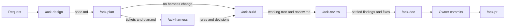

# AI Harness Documentation

This page explains how the AI harness works, for a contributor who runs Claude Code or another AI tool on this repository.

## Table of Contents

- [Related Documents](#related-documents)
- [Overview](#overview)
- [Flow](#flow)
    - [Design](#design)
    - [Plan](#plan)
    - [Harness](#harness)
    - [Build](#build)
    - [Review](#review)
- [Work Artifacts](#work-artifacts)
- [Model and Effort](#model-and-effort)
- [Rules and Hooks](#rules-and-hooks)
- [Permission Mode](#permission-mode)
- [Database and Redis Reads](#database-and-redis-reads)

## Related Documents

- [AI Harness Reference][ref-doc-ai-harness-reference]: the commands, agents, hooks, other tools, and copied skills
- [AI Harness Guide][ref-doc-ai-harness-guide]: adapting the harness after a fork, and checking it after a change
- [Project Structure Documentation][ref-doc-project-structure]: the module layout the rules describe
- [Installation Documentation][ref-doc-installation]: the local stack a boot check runs against
- [Decisions][ref-doc-decisions]: why the alternatives to a rule were rejected, one file per scope

## Overview

- The harness lives in `.claude/`, with `AGENTS.md` and `.github/copilot-instructions.md` beside it.
- Claude Code reads all of it. What GitHub Copilot and other tools read is in [Other Tools][ref-doc-ai-harness-reference-other-tools].
- The third-party skills the harness reuses are in [Copied Skills][ref-doc-ai-harness-reference-copied-skills].
- A feature moves through `/ack-design`, `/ack-plan`, `/ack-harness`, `/ack-build`, `/ack-review`, and `/ack-doc`, then the owner's commit and `/ack-pr`. Each command but `/ack-pr`, the last, ends by naming the next and what it does.
- A feature runs in one session: each command starts from the files the previous one wrote, and the session suggests `/compact` at a command boundary once its context is large.
- The owner approves the spec, the plan, and the fix list of the review. Nothing is committed without the owner's word.
- Every behavior is built test-first, at a seam agreed during design.
- A fact that has to hold every time is a hook or a `deny` entry in `.claude/settings.json`, not a sentence.
- The harness reuses published skills where one exists. The `ack-*` skills adapt them to this repository and stay thin.

## Flow

- The session designs, plans, and orchestrates: it assigns, asks the owner, and reads hand-backs. Gates, boots, endpoint calls, and data reads are `reviewer`'s, and a symptom's are `debugger`'s.
- An agent cannot ask the owner. It hands the question back, and the session asks.
- Each agent, what it writes, and its level are in [Agents][ref-doc-ai-harness-reference-agents].

### Design

- `/ack-design <the feature in one sentence>` runs in the session. It reads the code, the rules binding it, and the decision entries the request touches, and looks up facts itself.
- The owner answers rounds of multiple-choice questions until no decision is left open, and agrees the test seams: the public boundaries the unit specs assert at.
- The approved `.scratch/<feature>/spec.md` carries the rule changes and decision entries the design needs, and the plan starts from it.

### Plan

- `/ack-plan .scratch/<feature>/spec.md` breaks the spec into tickets, one file each, with the tickets that block it, its seam, its first failing spec, and its acceptance criteria.
- `plan.md` is the index a person reads: ticket order, harness changes, status, evidence.
- A fresh `reader` reads the tickets cold and reports every guess a builder would have to make. A read with no question and no mismatch settles the tickets.
- After the session fixes the tickets, a second fresh `reader` reads them. A question or mismatch it still has goes to `advisor`, the third and last attempt, which edits the files itself.
- The owner's approval of the plan opens the build.

### Harness

- `/ack-harness .scratch/<feature>/plan.md` runs when the plan lists a harness change. The session settles each change with the owner, and `harness` writes each rule change and decision entry.
- The session ticks each change in `plan.md`, and `/ack-build` waits while one is open.

### Build

- `/ack-build .scratch/<feature>/plan.md` runs until every ticket is done and the gates are green. An interrupted build resumes from the first ticket that is not done.
- One `coder` builds one ticket, test-first: a failing unit spec, then the code that turns it green. Each dispatch carries the ticket's position, and the hand-back returns it (`DONE 3/10`).
- The session ticks the ticket, records the evidence in `plan.md`, reports the position to the owner (`3/10`), and moves to the next ticket whose blockers are done.
- A choice the ticket, the spec, and the rules leave open stops the `coder`, which hands back `NEEDS_DECISION` with the options and its recommendation. The first route that fits answers it:
    - The spec, its owner decisions, or a decision entry: the session answers.
    - Otherwise `.claude/hooks/jev.sh decision` asks TypeSafe's Jev whether the choice is what the product does or how to build it. When Jev is sure it is how to build, `advisor` answers, and passes to the owner what only the owner can answer.
    - Any other answer, an unsure or failed call included: the owner answers, and may hand the choice to `advisor`.
- The answer corrects the ticket step, its acceptance criterion, and the spec. One line under the ticket's `## Deviations` records what differs, why, and who decided.
- A check that still fails after two attempts goes to `debugger` for a root cause.
- One `reviewer` checks the whole build and writes `.scratch/<feature>/review.md`:
    - It runs the gates: `pnpm typecheck`, `pnpm lint`, `pnpm deadcode`, `pnpm spell`, the module specs, and coverage per changed file.
    - When wiring changed, it boots the app, calls each changed endpoint, and reads through MCP the MongoDB rows, cache keys, and queue jobs the call wrote.
    - It checks every acceptance criterion, every rule binding the changed files, and each changed endpoint and job beside the nearest flow of the same kind.
- Each red result goes to `coder` as a pinned fix, and a `reviewer` checks it again. The findings wait in `review.md` for `/ack-review`.
- An owner answer that rejected a named alternative is listed as a decision candidate for `/ack-harness`.

### Review

- `/ack-review .scratch/<feature>/plan.md` runs once on every feature, from the `review.md` the build wrote: a results table with a row per command, endpoint call, and data check, a coverage table with a row per rule file, decision entry, and flow, and one section per finding with the exact change to make.
- A feature built outside `/ack-build` has no `review.md`, so one `reviewer` writes it first, as the build does.
- The session puts each finding to the owner, one at a time, with a recommendation. The owner keeps it, drops it, or changes it, and approves the fix list the session writes into `review.md`.
- `coder` applies each kept finding as written, a defect outside the feature that a pinned fix repairs included. A finding about the spec goes to `/ack-design`, one about a rule to `/ack-harness`, and a defect outside the feature that needs a design, an owner-only command, or held work to the sweep log.
- A second `reviewer` runs the gates again and reads the fixed findings. A finding still open goes to the owner.
- `/ack-doc` follows: it brings the docs in line with the code and ends by proposing the commit subject. Each code bug and each thing noticed outside its scope goes to the owner with a recommended fix, and the doc keeps a claim a code bug breaks until `/ack-quick` fixes the code and `/ack-doc` runs on the page again, before the next phase starts. An owner answer that rejected a named alternative is listed as a decision candidate for `/ack-harness`.

## Work Artifacts

`.scratch/` is gitignored. It holds one folder per feature, and the `quick/`, `requirements/`, and `pr/` folders:

- `.scratch/<feature>/spec.md`: the approved spec.
- `.scratch/<feature>/plan.md`: the index: approval, order, status, evidence.
- `.scratch/<feature>/issues/<NN>-<slug>.md`: one ticket per file. A ticket carries `**Status:** ready-for-agent`, then `done`.
- `.scratch/<feature>/review.md`: the review: results, coverage, findings, the owner's answers, the fix list.
- `.scratch/quick/<slug>.md`: a `/ack-quick` pin.
- `.scratch/requirements/harness-<slug>.md` and `doc-<slug>.md`: a requirement settled for a later `/ack-harness` or `/ack-doc` run.
- `.scratch/pr/pr-<slug>.md`, `pr-comment-<slug>.md`, and `version-<slug>.md`: a pull request description, a pull request comment or review reply, and release notes.

A platform issue is created only when the owner asks for one. `generated/report-src-sweep.md` is the sweep log of open source defects.

## Model and Effort

- Every agent runs at the `model` and `effort` in its own file, and no skill sets a level per dispatch.
- TypeSafe's Jev is optional: it routes a build decision ([Build](#build)), and shows the owner three signals beside a `/ack-quick` pin ([Standalone Commands][ref-doc-ai-harness-reference-standalone-commands]). Set `TYPESAFE_API_KEY` in `.env.harness` at the repository root to turn it on. Remove the key or add `JEV_ROUTER_ENABLED=false` there to turn it off, and the owner answers every decision the spec leaves open.
- `.env.harness` is gitignored, and no agent reads it.

## Rules and Hooks

- `.claude/rules/*.md` state what the code must do. Each loads by file path; five bind every file.
- `bash .claude/hooks/rules.sh <path>...` prints the rules that bind a path.
- Each hook, when it runs, and what it does is in [Hooks][ref-doc-ai-harness-reference-hooks].
- `.claude/settings.json` also asks before a git command that moves a ref, before `pnpm add`, `remove`, or `up`, before a `gh` command that writes, and before every edit of `.claude/rules/discipline.md`, which `guard-bash.sh` keeps out of Bash.

## Permission Mode

- `.claude/settings.json` starts a session in `acceptEdits`: a file edit applies without a prompt.
- `auto` is set per user, in `~/.claude/settings.json` or with `--permission-mode auto`. A project file cannot set it.
- The `ask` and `deny` entries and both guards hold in either mode.
- The Bash sandbox stays off: it is incompatible with the Docker commands a boot check runs.

## Database and Redis Reads

`.mcp.json` declares three read-only MCP servers for the local compose containers. Each starts through `.claude/hooks/mcp.sh`, which reads its URL from `.env.harness` at the repository root:

- `mongodb` reads the MongoDB replica set in read-only mode, from `MCP_MONGODB_URL`.
- `redis-cache` reads the `redis-cache` instance, `db:0`, the cache, from `MCP_REDIS_CACHE_URL`.
- `redis-queue` reads the `redis-queue` instance, `db:0`, the BullMQ queues, from `MCP_REDIS_QUEUE_URL`.
- No URL is written in a tracked file, and none reaches the session.
- Each value is the URL the host reaches the container at: the same as `DATABASE_URL`, `REDIS_CACHE_URL`, and `REDIS_QUEUE_URL` for a local setup.
- The MongoDB server runs through `npx`, the Redis servers through `uvx`, which needs [uv][ref-uv].
- `debugger` and `reviewer` have the tools. The other agents do not.
- `guard-session.sh` denies the session's own call to any of the three servers: the session dispatches `reviewer` to check a change's data, or `debugger` to trace a symptom's.
- The Redis server has no read-only mode, so `.claude/settings.json` denies each of its writing tools by name.
- `mongosh`, `redis-cli`, and every command that writes to a database stay denied and owner-only.

<!-- REFERENCES -->

[ref-doc-ai-harness-reference]: ../reference/ai-harness.md
[ref-doc-ai-harness-reference-other-tools]: ../reference/ai-harness.md#other-tools
[ref-doc-ai-harness-reference-copied-skills]: ../reference/ai-harness.md#copied-skills
[ref-doc-ai-harness-reference-agents]: ../reference/ai-harness.md#agents
[ref-doc-ai-harness-reference-standalone-commands]: ../reference/ai-harness.md#standalone-commands
[ref-doc-ai-harness-reference-hooks]: ../reference/ai-harness.md#hooks
[ref-doc-ai-harness-guide]: ../guides/ai-harness.md
[ref-doc-project-structure]: ../concepts/architecture.md
[ref-doc-installation]: ../getting-started/installation.md
[ref-doc-decisions]: ../../.claude/decisions/README.md
[ref-uv]: https://docs.astral.sh/uv/
