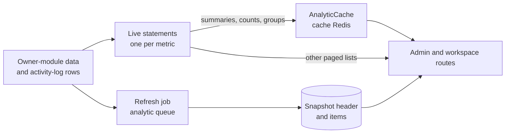

# Analytic

This page explains the `analytic` module, for a developer who adds a metric, changes a detection threshold, or reads how a number is produced.

## Table of Contents

- [Related Documents](#related-documents)
- [Overview](#overview)
- [Live metrics and snapshots](#live-metrics-and-snapshots)
- [Caching and thresholds](#caching-and-thresholds)
- [Metrics fed by the activity log](#metrics-fed-by-the-activity-log)

## Related Documents

- [Activity Log][ref-doc-concept-activity-log]: the entries several metrics count
- [Authorization][ref-doc-concept-authorization]: the `analytic` policy subject on the admin routes
- [Workspace][ref-doc-concept-workspace]: the workspace guard on the workspace routes
- [Cache][ref-doc-concept-cache]: the read-through the metric results use
- [Queue][ref-doc-concept-queue]: the scheduler behind the snapshot refresh
- [Pagination][ref-doc-concept-pagination]: the offset page metadata of the list routes
- [Database][ref-doc-concept-database]: the read-only repositories and the `AnalyticSnapshot` models
- [Activity Log Reference][ref-doc-reference-activity-log]: the actions the metrics count
- [Configuration Reference][ref-doc-reference-configuration-analytic]: the `analytic` keys
- [Status Codes][ref-doc-reference-status-codes-analytic]: the code and message of `AnalyticInvalidDateRangeException`

## Overview

- Analytic exposes read-only metrics. A platform admin gets dashboard numbers, anomaly and fraud reports, and risk scores across the platform. A workspace admin gets the summary, the invite funnel, the join outcomes, and the member roles of the workspace named in `x-workspace-id`. The member roles are the live count of that workspace's members per role, apart from the `workspaceMembership` snapshot, the member counts per workspace across the platform.
- Fraud and anomaly routes only report. They return counts, lists, and risk scores, and they never block a user, revoke a session, or change a credential.
- The anomaly area holds impossible travel, login spike by IP, failed-login spike, and device proliferation. The fraud area holds credential stuffing, account takeover, mass registration, password-reset enumeration, shared fingerprint, session after admin, forgot-password token abuse, and the risk score.
- The module reads every feature's models in its own read-only repositories. An area is the first route segment (`user`, `auth`, `device`, `api-key`, `term-policy`, `workspace`, `project`, `notification`, `fraud`, `anomaly`), and each has one service and one repository. A service injects its own repositories, services, utils, and caches, and `FeatureFlagService`, never another module's repository and never a queue class. Only the snapshot repository writes.
- An admin route needs `@RoleProtected()` for an admin role and the `analytic` `read` policy. A workspace route needs the workspace guard for an `admin` and the `workspace` flag, and no policy.
- A metric is one statement: one builder statement when it computes the whole result, otherwise one `aggregateRaw` pipeline. A pipeline's stages sit in the repository method that runs it, and the repository parses the result with a zod schema into a named shape.

## Live metrics and snapshots

A result is either answered on request or generated in the background. Every result outside the eight generated signals is answered on request.

- **On request.** The statement is bounded by an index to a short window or to rare events, or it counts or groups one collection an index serves. A summary, a count, and a group are read through the cache. The workspace activity volume list, a paged group over the client's date range, caches each page with the dashboard TTL. Every other paged list runs uncached.
- **Generated.** A pipeline over a whole live population that joins, windows, or buckets per user, or that groups a whole collection with no bounding window, is too heavy for a request. The `analytic` queue's refresh job computes it into `AnalyticSnapshot` and `AnalyticSnapshotItem`.

The generated signals are `impossibleTravel`, `deviceProliferation`, `sharedFingerprint`, `riskScore`, `concurrentSessions`, `devicePerUser`, `workspaceMembership`, and `mfaAdoption` (`EnumAnalyticSnapshotSignal`).

- `AnalyticQueue` declares one scheduler per signal. Each runs every `analytic.snapshot.refreshIntervalInMs` and at once on a start, and a tick is the `refreshSnapshot` job with the signal as its payload. A scheduler has no outbox row ([Queue][ref-doc-concept-queue]).
- `AnalyticProcessRefreshSnapshotUseCase` switches on the signal, calls the owning analytic service to compute it, and hands the result to `AnalyticSnapshotService`.
- A signal with items goes through `replace` (the five signals other than the three below): it writes the run's items in batches of `analytic.snapshot.writeBatchSize` under a new run id, swaps the signal's header to that run, and then deletes the items of earlier runs. A signal whose result is a fixed set of named values goes through `replaceHeader` and writes no item: `concurrentSessions`, `devicePerUser`, and `mfaAdoption`.
- No transaction spans a run. A header write that fails rejects the job, and the retry heals it.
- A reader loads the header and its run's items in one pipeline from MongoDB, with no cache in front. The client sends no window or date range, because the window is the configured one.
- A generated route answers `computedAt`. Before the first run a summary answers `count` 0 with `metadata`, `windowStart`, `windowEnd`, and `computedAt` as `null`, and a list's metadata omits the key.
- An on-request signal whose window is fixed in config also takes no window from the client. The login spike by IP answers that window as `windowStart` and `windowEnd` and `computedAt` as `null`. The failed-login spike has no window and answers all three as `null`.

## Caching and thresholds

`AnalyticCache` builds the keys from the `analytic.cache.*` patterns, and a service calls `CacheService.readThrough` with the key, a zod schema, and a TTL ([readThrough and TTLs][ref-doc-concept-cache-readthrough]).

- Three TTLs apply, one for the dashboard metrics and the workspace results, one for the failed-login anomaly summary, and one for the fraud summaries and the login-spike-by-IP summary. Their keys are in the [Configuration Reference][ref-doc-reference-configuration-analytic].
- A workspace result is keyed by the workspace id, so one workspace never reads another's number.
- An entry ends by its TTL alone: no write invalidates an analytic cache.
- A required date range is `startDate` and `endDate`. `AnalyticDateService` answers `AnalyticInvalidDateRangeException` (400) for a span at or below zero or above `analytic.maxWindowInMs` (90 days). An optional range takes both bounds or neither, and one bound answers the same exception.
- The detection thresholds are config values, not environment values: windows, minimum counts, risk weights, and band cutoffs. A band is an `EnumAnalyticFraudBand` (`monitor`, `review`, `elevate`, `critical`).
- The failed-login spike is the near-lockout count: the users whose `passwordAttempt` reaches the near-lockout threshold or whose `passwordLockedUntil` lies ahead, read from `User` and not from the activity log.
- A risk score adds the weight of each signal that flags the user: session after admin, impossible travel, new device after password change, credential-stuffing IP, shared fingerprint, near lockout, mass-registration IP, and forgot-password abuse. The refresh job gathers each user's flags in `AnalyticFraudRepository.findRiskScoreCandidates` over the `analytic.fraud.riskScoreLookbackInMs` window. The near-lockout signal derives its threshold from the `passwordMaxAttempts` sub-key of the `loginWithCredential` flag minus `analytic.fraud.nearLockoutOffset`, read by the service when it computes.

## Metrics fed by the activity log

Several metrics count or list `ActivityLog` rows by action ([Activity Log][ref-doc-concept-activity-log]). The actions are in the [Activity Log Reference][ref-doc-reference-activity-log].

- The lockout metric counts `userLoginFailed` as failed, and `userMaxPasswordAttemptReached` and `userMaxMfaAttemptReached` as max attempt. Credential stuffing groups the same three by IP.
- Mass registration groups `userSignedUp` and `userCreated` by IP.
- The blocked-users metric counts `userBlockedByAdmin`.
- The four login actions are `userLoggedInWithCredential`, `userLoggedInWithGoogle`, `userLoggedInWithApple`, and `userLoggedInWithPasskey` (`UserLoginAnalyticActions`). Login frequency counts them, login method groups them by action, and the login spike by IP groups them by IP.
- Session after admin reads `userSessionRevokedByAdmin` and `userAllSessionsRevokedByAdmin` rows and flags a login action by the revoked user within the configured revoke window ([Configuration Reference][ref-doc-reference-configuration-analytic]). It reads the target rows, whose owner is the user whose sessions were revoked.
- Password reset enumeration groups `userPasswordResetRequested` by IP.
- Workspace activity volume counts every activity row that carries a workspace id except the fourteen target actions `ActivityLogWorkspaceVolumeContract` lists (`$nin`). The admin activity-volume list and the workspace summary apply the same exclusion.
- The failed-login rows are written although the request answers an error, because their transaction commits before the exception ([Failed logins][ref-doc-concept-activity-log-failed]).

<!-- REFERENCES -->

[ref-doc-concept-activity-log]: activity-log.md
[ref-doc-reference-activity-log]: ../reference/activity-log.md
[ref-doc-concept-activity-log-failed]: activity-log.md#failed-logins
[ref-doc-concept-authorization]: authorization.md#policies-and-casl-abilities
[ref-doc-concept-workspace]: workspace.md
[ref-doc-concept-cache]: cache.md
[ref-doc-concept-cache-readthrough]: cache.md#readthrough-and-ttls
[ref-doc-concept-queue]: queue.md
[ref-doc-concept-pagination]: pagination.md
[ref-doc-concept-database]: database.md
[ref-doc-reference-configuration-analytic]: ../reference/configuration.md#analytic
[ref-doc-reference-status-codes-analytic]: ../reference/status-codes.md#analytic
