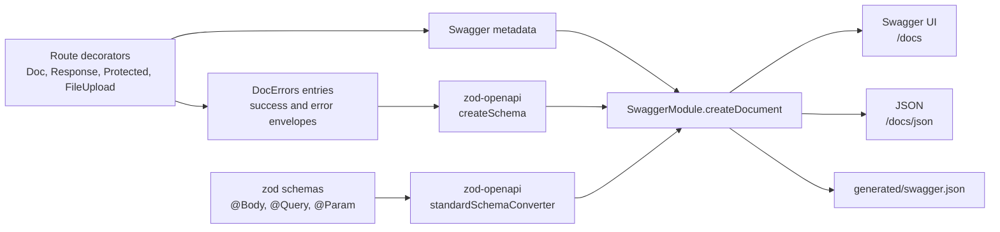

# API Documentation

This page explains how the Swagger and OpenAPI document is assembled, for a developer who documents a route or consumes the document.

## Table of Contents

- [Related Documents](#related-documents)
- [Overview](#overview)
- [Decorators co-located with routes](#decorators-co-located-with-routes)
- [Who documents what](#who-documents-what)
- [Error kits](#error-kits)
- [Zod to OpenAPI](#zod-to-openapi)
- [Serving the document](#serving-the-document)

## Related Documents

- [API Documentation Guide][ref-doc-guide-api-documentation]: add `@Doc` to a route and get `swagger.json`
- [Request Validation][ref-doc-request-validation]: the request schemas the document reads
- [Response][ref-doc-response]: the response decorators that publish the success envelope
- [Pagination][ref-doc-pagination]: the list query schemas and the pagination error kit
- [Status Codes][ref-doc-reference-status-codes]: the code behind each documented error
- [Authorization][ref-doc-authorization]: the `*Protected` decorators and their guards
- [File Upload][ref-doc-file-upload]: the multipart decorators

## Overview

- The document is not written by hand. It is built from metadata that the runtime decorators of a route already carry and from the zod schemas that validate and serialize the route.
- A route that works documents itself: a decorator that mounts a guard, an interceptor, or a pipe also publishes the errors that component can raise.
- The document is the endpoint list of the API. No page of these docs repeats it.
- The document is built only when `app.env` is not `production`. In production the `/docs` UI, the JSON route, and `generated/swagger.json` do not exist.

## Decorators co-located with routes

OpenAPI rides on the decorators a route already needs, so a route has no separate documentation file.

- `@Doc` is the one decorator a controller method adds for documentation. Its options are `summary`, `description`, `operation` (the operation id), `deprecated`, and `errors`. It also sets the three optional inbound headers (`x-custom-lang`, `x-request-id`, and `x-correlation-id`) and the global kit errors.
- `DocErrors` takes `IDocResponseEntry` entries and emits the error responses they describe. Kit decorators call it with their own constants, and a controller calls it for none.
- `@Response`, `@ResponsePagination`, and `@ResponseFile` publish the success response and the errors of their own interceptor.
- Each `*Protected` decorator publishes the errors of the guard it mounts, and a decorator that reads a credential also publishes its security scheme.
- `FileUploadSingle`, `FileUploadMultiple`, and `FileUploadMultipleFields` publish the multipart body and the upload errors.

An entry holds the `httpStatus`, the application `statusCode`, the message path, and an optional `schema` for `data` and an optional `baseSchema` for the envelope (`src/common/doc/interfaces/doc.interface.ts`). Every set of entries is a data constant named `<Decorator>DocErrors`, in the `constants/` folder of its owner.

## Who documents what

Each part of a route has one source.

- The body, the path params, and the query come from the zod schema bound on `@Body`, `@Param`, and `@Query`.
- A path param that only a guard reads comes from the `*Protected` decorator that mounts the guard.
- The operation summary and description come from `@Doc`.
- The success envelope and `data` come from `@Response`, `@ResponsePagination`, or `@ResponseFile`.
- The list query (page, cursor, `perPage`, `search`, `orderBy`, and filters) comes from the list schema on `@Query`, built from the pagination base schemas.
- A multipart body comes from a `FileUpload*` decorator.
- The authentication and guard errors come from the `*Protected` decorators.
- The errors every request can raise come from `@Doc`, and the errors of one flow come from `DocErrors` through the `errors` option of `@Doc`.

- A hand-written schema object beside a zod schema is a mirror that drifts, so the schema is the only source of a field.
- The security schemes are `accessToken`, `refreshToken`, `google`, `apple`, and `xApiKey`. Each name is a module constant shared by the decorator and `src/swagger.ts`, and the API key scheme reads the `x-api-key` header.
- `@ResponsePagination` publishes no query parameters. The list schema on `@Query` does.

## Error kits

One error has one source, decided by where its exception lives and what raises it.

- An error raised for any request from `src/common/` or `src/app/` belongs to `@Doc`, as `DocGlobalErrors`.
- An error raised behind one runtime component of the kit belongs to that component: pagination errors to `@ResponsePagination`, upload errors to `FileUpload*`, export errors to `@ResponseFile`, and serialization errors to `@Response`.
- An error raised by a guard or an auth strategy of a module belongs to the matching `*Protected` or auth decorator.
- An error raised by one flow and required in the document belongs to `DocErrors`, through `@Doc({ errors })`.

- `DocGlobalErrors` holds the failures any route can answer: the unknown error, the request timeout, the validation error, the rate limit, the helper encryption errors, the missing schema and context errors, and the 503 and 501 answers of the kits (`src/common/doc/constants/doc.constant.ts`).
- A decorator that mounts a different guard per argument takes one constant per branch.
- A `@Global()` module changes nothing here: its errors reach the document through a guard that gates them or through `DocErrors`.
- When several entries share an HTTP status, the response carries one shared envelope schema and a named example per message path, so the document shows each code of that status. Entries repeated across decorators are merged by `httpStatus`, `statusCode`, and message path.
- A `*Protected` decorator publishes the errors of the guard it mounts, the guard-missing exception included: the exception that guard throws when a guard below it stored nothing, such as `WorkspaceGuardMissingException`. A decorator does not inspect the other guards on the route.

## Zod to OpenAPI

A DTO is a zod schema plus the type inferred from it, and [zod-openapi][ref-zod-openapi] produces the OpenAPI schema from the schema itself. There is no annotation layer.

- `src/swagger.ts` passes `standardSchemaConverter` to `SwaggerModule.createDocument`, which converts every schema bound on `@Body`, `@Query`, and `@Param`.
- The success response takes another path. `@Response` and `@ResponsePagination` pass the route's data schema to `DocErrors` as the `schema` of a success entry (the HTTP status of the route, with its message path). `DocErrors` extends the envelope schema with that `data` and calls `createSchema` for it, as it does for the envelope of every error entry. `@ResponseFile` publishes a binary response of the file's media type.
- `.meta({ description, example })` on a field sets its description and example. A derived schema keeps the `.meta()` of every field it keeps, so only a new field carries its own.
- The constraints become OpenAPI keywords: `.min()` and `.max()` give length or range limits, `.regex()` gives `pattern`, `z.enum()` gives `enum`, `.optional()` keeps the field out of `required`, and `.nullable()` sets the nullable type.

## Serving the document

`src/swagger.ts` builds the document once at boot, after `configure(app)` and before the app listens, and serves it three ways.

- The Swagger UI answers at the `doc.prefix` path, `/docs`.
- The JSON answers at the path `doc.jsonUrlPattern` gives with the prefix filled in, `/docs/json`.
- `generated/swagger.json` is written at each boot. A write failure logs a warning and the boot continues.
- The three exist only when `app.env` is not `production`, so a production deployment publishes no route list. The UI and the JSON carry only the two security headers `src/swagger.ts` sets and no rate limit ([Security][ref-doc-security-headers]).

<!-- REFERENCES -->

[ref-zod-openapi]: https://github.com/samchungy/zod-openapi
[ref-doc-guide-api-documentation]: ../guides/api-documentation.md
[ref-doc-security-headers]: security.md#headers
[ref-doc-request-validation]: request-validation.md
[ref-doc-response]: response.md
[ref-doc-pagination]: pagination.md
[ref-doc-reference-status-codes]: ../reference/status-codes.md
[ref-doc-authorization]: ../authorization.md
[ref-doc-file-upload]: ../file-upload.md
