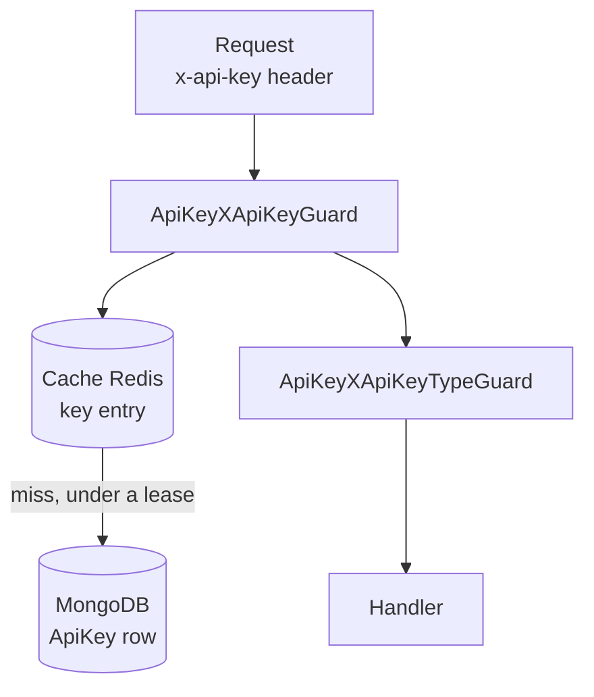

# API Key

This page explains how the API identifies the application that calls it, for a developer who protects a route with a key or manages keys.

## Table of Contents

- [Related Documents](#related-documents)
- [Overview](#overview)
- [Default and system keys](#default-and-system-keys)
- [Lookup and cache lease](#lookup-and-cache-lease)
- [Soft delete](#soft-delete)

## Related Documents

- [Activity Log][ref-doc-concept-activity-log]: the `apiKeyId` of each entry and the admin list by key
- [Authentication][ref-doc-concept-authentication]: the signed-in user, which is separate from the calling application
- [Cache][ref-doc-concept-cache]: `readThrough`, the lease, and the invalidation through the outbox
- [Dependencies][ref-doc-dependencies-required]: how a cache Redis outage answers
- [Route Protection Guide][ref-doc-guide-route-protection]: where the key decorator sits in the stack
- [Decorators and Guards Reference][ref-doc-reference-decorators-and-guards]: the key decorators, the context, and the missing-entry exception
- [Configuration Reference][ref-doc-reference-configuration-auth]: the `auth.xApiKey` keys
- [Seeded rows][ref-doc-reference-database-apikey]: the keys a local seed writes
- [Status Codes][ref-doc-reference-status-codes-api-key]: the code and message of each exception named here

## Overview

The diagram shows how the two API key guards resolve a key from the cache and the database.

- A key identifies an application, such as a web client, a mobile client, or an operator tool. It carries no user.
- Every route behind `/public`, `/user`, `/shared`, and `/admin` carries the default key decorator, and every `/system` route, the `/system/health` checks included, carries the system key decorator. The one route that needs no key is the hello route (`GET /api/public/hello`, `HelloPublicController`).
- One decorator mounts two guards in a fixed order: `ApiKeyXApiKeyGuard` validates the header and writes the key to the request store, and `ApiKeyXApiKeyTypeGuard` compares the key's type with the decorator.
- The key decorator runs first on every route, so a request with no valid key is refused before any JWT, user, or database work of the route starts.

## Default and system keys

`EnumApiKeyType` has two members. A key of the wrong type for a route answers `ApiKeyXApiKeyForbiddenException` (403, `50702`).

- `default`: `@ApiKeyProtected()`. It serves the application routes: sign-in, sign-up, and everything a signed-in client calls.
- `system`: `@ApiKeySystemProtected()`. It serves the `/system` routes, such as the health checks and the system lists.

The client sends the key in the `x-api-key` header as `<key>:<secret>`:

- `key` is `<APP_ENV>_<random>`, where `<APP_ENV>` is the `app.env` value (`local`, `development`, `staging`, or `production`) and the random part has `auth.xApiKey.keyLength` characters. The full value, environment prefix included, goes into the header. A key from another environment is absent from this database and answers `50701` as unknown.
- `secret` has `auth.xApiKey.secretLength` characters. The API stores only `hash`, the SHA-256 of `<key>:<secret>`, and compares it with a constant-time comparison ([Cryptography used][ref-doc-concept-security-crypto]).
- A missing or blank header answers `ApiKeyXApiKeyRequiredException` (401, `50700`). A header that is not exactly two non-blank parts around one `:` answers `ApiKeyXApiKeyInvalidException` (401, `50701`).

An admin manages keys through the API key routes. A create or a reset answers the secret once and never again. An admin can rename a key, set or clear its `startAt` and `endAt` window, activate or deactivate it, reset its secret, and soft-delete it ([Soft delete](#soft-delete)). A local seed writes one key of each type, published in the repository ([Seeded rows][ref-doc-reference-database-apikey]).

## Lookup and cache lease

`ApiKeyService.validateXApiKey` runs the lookup:

1. It parses the header. A malformed header answers `50701`.
2. It reads the key entry through the cache (`auth.xApiKey.keyPattern`, TTL `auth.xApiKey.cacheTtlInMs`) with a loader that reads the `ApiKey` row by `key`. The read takes a lease (`auth.xApiKey.leaseKeyPattern`, TTL `auth.xApiKey.leaseTtlInMs`). Every concurrent miss runs the loader, and only the lease holder writes the entry. The lease stops a loader that read before an invalidation from writing a stale entry after it ([Cache][ref-doc-concept-cache]).
3. A key the database does not hold answers `50701`. Nothing is cached for it, so each request that names an unknown key reads MongoDB.
4. A wrong secret, an inactive key, and a key whose `startAt` has not passed answer the same `50701`, so a caller cannot tell which keys exist.
5. A key with the right secret whose `endAt` has passed answers `ApiKeyExpiredException` (400, `50703`). Expiry has its own code because it answers only after the secret matched, so only the holder of the key learns that it expired.
6. A valid key is stored in the request store, and the type guard compares its type.

The cache holds a side copy of the row, and MongoDB stays the source of truth:

- An admin write that renames, activates or deactivates, re-dates, resets, or deletes a key adds a cache invalidation row to the transaction of the write. After the commit the `cache` queue deletes the key entry and its lease. Until the job runs, the old entry keeps answering, and when the job runs late the entry TTL (`auth.xApiKey.cacheTtlInMs`) bounds that window ([Invalidation through the outbox][ref-doc-concept-cache-invalidation]).
- A cache Redis error answers `RedisUnavailableException` (503, `52400`), because the cache Redis is a required dependency.
- `ApiKeyXApiKeyTypeGuard` answers `ApiKeyGuardMissingException` (401, `50707`) for an empty store, which happens only when it runs without `ApiKeyXApiKeyGuard` before it. Both key decorators mount the two guards in that order. `@ApiKeyContext()` on a route with no key decorator throws `RequestContextMissingException` (500, `50304`).
- `ApiKeyNotFoundException` (404, `50704`) belongs to the admin routes that look a key up by id.

## Soft delete

An admin delete soft-deletes the key: `softDeleteInTx` sets `deletedAt` and `deletedBy` (the id of the deleting admin) on the live row, and the same transaction adds the cache invalidation row. The row stays because the activity entries that name the key point at it (`ActivityLog.apiKey` is `Restrict`, `prisma/schema.prisma`), and the trace of a leaked key stays listable.

- Every read and every guarded update of `ApiKey` filters `deletedAt: null`. Once the invalidation job has run, a deleted key answers the `x-api-key` guard as an unknown key (`50701`), and the entry TTL bounds the window until then.
- The admin get, update, and delete routes answer `ApiKeyNotFoundException` for a deleted key, and the admin key list leaves it out. No route restores a deleted key.
- The deleted row keeps its `key` and `hash`, and the unique index on each keeps a deleted key's values from being issued again.
- Every entry a request or a job writes stores the `apiKeyId` of the request that caused it. Seed rows hold `null`, and the hello route writes no entry.
- The row stays in the database and its entries keep `apiKeyId`, so the admin list by key lists them ([Activity Log][ref-doc-concept-activity-log]). The API cannot read the key itself.
- A deleted key counts in no analytic card, such as the API key card that counts active, expired, and inactive keys (`AnalyticApiKeyRepository`).

<!-- REFERENCES -->

[ref-doc-concept-authentication]: authentication.md
[ref-doc-concept-cache]: cache.md
[ref-doc-concept-activity-log]: activity-log.md
[ref-doc-concept-security-crypto]: security.md#cryptography-used
[ref-doc-concept-cache-invalidation]: cache.md#invalidation-through-the-outbox
[ref-doc-dependencies-required]: dependencies.md#required-mongodb-and-redis
[ref-doc-guide-route-protection]: ../guides/route-protection.md
[ref-doc-reference-decorators-and-guards]: ../reference/decorators-and-guards.md
[ref-doc-reference-configuration-auth]: ../reference/configuration.md#auth
[ref-doc-reference-database-apikey]: ../reference/database.md#apikey
[ref-doc-reference-status-codes-api-key]: ../reference/status-codes.md#api-key
