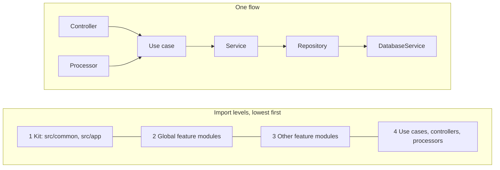

# Architecture

This page explains how the application is organized, for a developer who reads the code or adds a module.

## Table of Contents

- [Related Documents](#related-documents)
- [Overview](#overview)
- [Folder layout](#folder-layout)
- [Layers](#layers)
- [Levels](#levels)
- [Modules and their domains](#modules-and-their-domains)
- [Router surfaces](#router-surfaces)
- [Entry points](#entry-points)
- [Twelve-Factor](#twelve-factor)

## Related Documents

- [Features][ref-doc-features]: what each feature does
- [Configuration][ref-doc-concept-configuration]: how `src/configs/` and `AppEnvSchema` work
- [Dependencies][ref-doc-dependencies]: MongoDB, Redis, and the optional adapters
- [Installation][ref-doc-installation]: running the application locally
- [Production][ref-doc-production]: running several instances of the application
- [AI Harness][ref-doc-ai-harness]: the rules that keep the layers and levels

## Overview

The diagram shows the layers one flow passes through and the import levels, lowest first.



- A request travels Controller, Use case, Service, Repository, `DatabaseService`. A feature job travels Processor, Use case, then the same chain. A kit processor (`CacheProcessor`, `OutboxProcessor`) awaits its kit service. Each layer has one job, so a change to transport, orchestration, domain logic, or storage touches one layer.
- A level imports the levels below it and never a higher one, so the import graph has no cycle and the boot cannot fail on one. The one exception is a queue class, which a service of any level injects, because a side effect belongs to the module that owns its job, whoever causes it.
- A module is a domain. What two modules do together is a use case's sequence, so two domains never depend on each other's internals.
- Every instance of the application is interchangeable: no state another instance needs lives in process memory or on local disk. Any instance serves any request or job, and an instance starts or stops without coordination.

## Folder layout

The source tree sits under `src/`:

```text
src
  ├── app          app.module and the exception filters
  ├── common       the kit: shared infrastructure modules
  ├── configs      one registerAs file per config namespace
  ├── generated    Prisma client and package fields, gitignored
  ├── languages    nestjs-i18n JSON, one file per module prefix
  ├── migration    seeds: data, seeds, bases, enums, interfaces
  ├── modules      feature modules
  ├── router       the modules that mount the HTTP controllers by scope and provide every processor
  ├── bootstrap.ts
  ├── configure.ts
  ├── instrument.ts
  ├── main.ts
  ├── migration.ts
  └── swagger.ts
```

- `src/generated/` is written by `pnpm generate` and holds `prisma-client/` and `package/package.ts` (the `version`, `author`, and `repository` fields of `package.json`). Application code imports both through the `@generated/*` alias.
- The project is native ESM: `"type": "module"`, `module: nodenext`, and `verbatimModuleSyntax`.
- Every import between `src/` folders goes through a `tsconfig.json` path alias: `@app/*`, `@common/*`, `@configs/*`, `@modules/*`, `@router/*`, `@migration/*`, `@generated/*`, and the root files `@main`, `@migration`, `@bootstrap`, `@instrument`, `@swagger`, and `@configure`.
- Outside `src/`: `prisma/schema.prisma` is the one schema, `test/` holds the unit specs and helpers, `ci/` holds the deployable image and Compose files, `scripts/` holds `generate-secret.ts` and `generate-package.ts`, and `keys/` and `generated/` hold generated files that git ignores.

A feature module under `src/modules/<name>/` keeps only the folders its feature needs:

- Always: `controllers`, `dtos`, `interfaces`, `services`, `use-cases`, and almost always `constants`, `enums`, `exceptions`, `repositories`, `utils`.
- Where the feature needs them: `caches`, `contracts`, `decorators`, `factories`, `guards`, `indicators`, `middlewares`, `processors`, `queues`, `templates`, `validations`.
- Two Nest module files sit at the root of the folder, and only a file with something to provide exists:
    - `<name>.module.ts` provides the services, repositories, utils, caches, queue classes, and factories. It exports its services, utils, and queue classes, never a cache or a repository.
    - `<name>.use-case.module.ts` provides and exports the use cases. Only `src/router/` imports it.

## Layers

- Controller (`controllers/`): one endpoint returning one use case's `execute`.
- Processor (`processors/`): one job case awaiting one use case's `execute`. A kit processor (`CacheProcessor`, `OutboxProcessor`) awaits its kit service.
- Use case (`use-cases/`): the business logic of one action. It decides which operations run, in which order, across which modules, inside the transaction it alone opens.
- Service (`services/`): one module's application logic, its operations and the invariants it keeps.
- Repository (`repositories/`): data access on one Prisma model and its satellite models.
- Util (`utils/`): pure shaping a module shares, with arguments in and a value out.
- Queue class (`queues/`): the module's side-effect entry. It builds the module's outbox effects and enqueues committed rows.

- A use case has one public method, `execute`. It injects any module's services, utils, and queue classes, and assembles them into the action. It writes no module's operation.
- A service injects its own module's repositories, services, utils, and caches, the services of a lower level, the queue class of any module, and the kit. It never injects another module's repository or cache.
- A repository issues statements against the model it owns. It injects no repository and no service.
- Only a use case opens a transaction, one per flow, because only the use case knows where a flow starts and ends, and every write of the flow commits together. Services and repositories join it through `*InTx` methods.
- A side effect, a notification included, is an outbox row written in the transaction of the action that causes it, so a rolled-back write leaves no effect and a committed write never loses one. The queue class enqueues it after the commit.
- Seeds under `src/migration/` write through `DatabaseService` directly.

## Levels

Lowest first:

1. The kit: `src/common/` and `src/app/`. Anyone injects it.
2. The `@Global()` feature modules.
3. Every other feature module.
4. Use cases, then controllers and processors.

- A service injects no service and no util of another module on its own level, so two domains stay independent. When a step needs another module on its level, the step moves up into a use case.
- A shared piece moves down into a lower level's service, or into `src/common/` when it is module-agnostic.
- No import cycle exists at any level. A cycle fails the boot with a `ReferenceError`.
- `eslint.config.mjs` enforces the layer matrix and these edges with `eslint-plugin-boundaries`.
- `src/common/common.module.ts` composes the kit modules: message, Sentry, Redis, queue, cache, database, request, logger, response, helper, pagination, file, and outbox. `AwsModule` and `FirebaseModule` sit outside it and are imported where used.
- A feature module is `@Global()` only when a guard, strategy, interceptor, or decorator injects its classes: `ApiKeyModule`, `AuthModule`, `FeatureFlagModule`, `PolicyModule`, `RoleModule`, `SessionModule`, and `TermPolicyModule`. `@Global()` removes the import, never the level.

## Modules and their domains

The platform has four domain groups. A module belongs to one.

- Identity and auth:
    - `auth`: JWT access and refresh tokens, JWKS, and the social providers.
    - `user`: accounts, sign-in, sign-up, and profile.
    - `session`: sessions and their invalidation.
    - `device`: the devices users sign in from.
    - `mfa`: TOTP, passkeys, and backup codes.
    - `api-key`: `x-api-key` credentials.
    - `password-history`: previous password hashes.
- Access control:
    - `role`: roles and their rank.
    - `policy`: CASL policies.
    - `term-policy`: versioned legal documents and acceptance.
    - `feature-flag`: runtime flags with targeting and rollout.
- Workspace and project:
    - `workspace`: tenancy, membership, invites, and join requests.
    - `project`: projects scoped to a workspace.
- Platform:
    - `notification`: notifications across email, push, in-app, and silent channels.
    - `activity-log`: audited user actions.
    - `analytic`: read-only metrics, anomaly summaries, and fraud reports.
    - `country`: country reference data.
    - `health`: dependency and instance checks.
    - `hello`: the liveness route.

`health` and `hello` have no repository.

## Router surfaces

`src/router/router.module.ts` mounts five scopes, each one module under `src/router/http/`:

- `/public`: routes for callers who are not signed in, such as sign-in, sign-up, and public reads, behind an API key. The liveness route needs none.
- `/system`: routes for operators, such as the health checks, behind a system API key.
- `/admin`: routes for platform administrators across every module.
- `/user`: routes of the signed-in user, where a workspace-scoped route selects the active workspace with the `x-workspace-id` header.
- `/shared`: the signed-in user's own account data: profile, sessions, devices, MFA, notifications, activity log, password history, and term-policy acceptance.

- Routes sit under the global prefix `/api` and the version segment `/v1`. The health and hello controllers are version neutral, so the liveness route is `/api/public/hello`.
- A scope module declares its controllers and imports the `<Module>UseCaseModule` of each feature whose use cases they inject.
- `src/router/processor/router.processor.module.ts` provides every processor, whose files live in the feature modules and the kit, and imports each `<Module>UseCaseModule` whose use cases they call, so the BullMQ workers boot with the HTTP application.
- `/docs` serves Swagger, and the endpoint list is the Swagger document. `src/swagger.ts` builds it only outside production and writes `generated/swagger.json` at the same boot.

## Entry points

- `src/main.ts` imports `@instrument`, then imports `@bootstrap` and calls `bootstrapApplication`. `src/migration.ts` does the same with `bootstrapMigration`. Each entry catches a failure with `bootstrapFailed`.
- `src/instrument.ts` loads `.env` and initializes Sentry before Nest exists.
- `src/bootstrap.ts` holds `bootstrapApplication` (create the Nest app, set `NODE_ENV` and `TZ` from the config, apply `configure`, build Swagger, listen), `bootstrapMigration` (nest-commander runs one seed command and exits), and `bootstrapFailed` (log one `fatal` line, report to Sentry, exit with code 1).
- `src/configure.ts` holds the Nest factory options and `configure(app)`: the Pino logger, the global prefix, the trusted proxy setting, no `x-powered-by` header, and URI versioning.
- `src/swagger.ts` builds the OpenAPI document outside production.
- `src/app/app.module.ts` imports `CommonModule` and `RouterModule` and registers the `APP_FILTER` providers general, HTTP, validation, and validation-import. Nest runs them in reverse, most specific first.
- The seeds in `src/migration/seeds/` run as `node dist/migration.js <command> --type seed` or `--type remove`: [Commands][ref-doc-reference-commands].

## Twelve-Factor

The project follows the [Twelve-Factor App][ref-12factor] methodology.

- Codebase: one repository, with a deploy per environment.
- Dependencies: declared in `package.json` and locked in `pnpm-lock.yaml`, installed with `--frozen-lockfile`.
- Config: environment variables, validated at boot by `AppEnvSchema`.
- Backing services: MongoDB, Redis, S3, SES, and Firebase attach through environment values.
- Build, release, run: `pnpm build` and the `ci/dockerfile` image are separate from `node dist/main.js`.
- Processes: no state another instance needs lives in memory or on local disk.
- Port binding: the Nest HTTP server binds `APP_HTTP_HOST` and `APP_HTTP_PORT`.
- Concurrency: several `apis` instances share MongoDB and both Redis instances, and a recurring job is a BullMQ job scheduler, so one instance runs each tick.
- Disposability: shutdown hooks are enabled, and a failed boot exits with code 1 so a supervisor restarts the process.
- Dev and prod parity: the local and deployed Compose files run the same services in the same `deps` and `apis` profiles: MongoDB, two Redis instances, the JWKS server, BullBoard, and `apis`.
- Logs: Pino writes to standard output, and to files under `/logs` when `LOGGER_FILE_ENABLED` is `true`.
- Admin processes: seeds and the schema push run as one-off commands.

<!-- REFERENCES -->

[ref-12factor]: https://12factor.net
[ref-doc-features]: ../features.md
[ref-doc-concept-configuration]: configuration.md
[ref-doc-dependencies]: dependencies.md
[ref-doc-installation]: ../getting-started/installation.md
[ref-doc-production]: ../production.md
[ref-doc-ai-harness]: ai-harness.md
[ref-doc-reference-commands]: ../reference/commands.md
