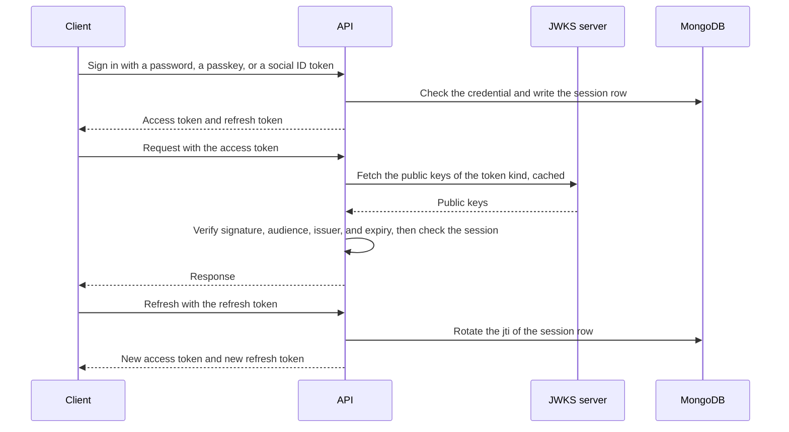

# Authentication

This page explains how the application identifies a signed-in caller, for a developer who changes a sign-in flow or debugs a rejected token.

## Table of Contents

- [Related Documents](#related-documents)
- [Overview](#overview)
- [Login methods](#login-methods)
- [Password checks](#password-checks)
- [Tokens and JWKS](#tokens-and-jwks)
- [Refresh rotation and jti](#refresh-rotation-and-jti)
- [Logout](#logout)
- [Social sign-in and its nonce](#social-sign-in-and-its-nonce)

## Related Documents

- [Session][ref-doc-concept-session]: the two stores behind the per-request check and what revokes a session
- [MFA][ref-doc-concept-mfa]: the second proof a login asks for
- [User][ref-doc-concept-user]: sign-up, password reset and history, and account status
- [Device][ref-doc-concept-device]: the device upsert that every login runs
- [API Key][ref-doc-concept-api-key]: the key that identifies the calling application
- [Authorization][ref-doc-concept-authorization]: what a signed-in caller may reach
- [Route Protection Guide][ref-doc-guide-route-protection]: stack the guards on a route
- [Social Sign-In Guide][ref-doc-guide-social-sign-in]: configure Google and Apple
- [Passkeys Guide][ref-doc-guide-passkeys]: register and use a passkey
- [Decorators and Guards Reference][ref-doc-reference-decorators-and-guards]: the JWT guards and the contexts they write
- [Dependencies][ref-doc-dependencies-token-providers]: how an unreachable JWKS endpoint or provider answers
- [Configuration Reference][ref-doc-reference-configuration-auth]: the `auth` and `session` keys
- [Status Codes][ref-doc-reference-status-codes-auth]: the code and message of each exception named here

## Overview

The diagram shows the three exchanges between a client and the API: sign-in, a request verified against the JWKS endpoint, and a refresh.

- A sign-in ends in one of two outcomes: a session with a token pair, or an MFA challenge the client answers before the session exists.
- The `auth` module owns the tokens, the guards, the social verification, and the password policy. The `user` module owns the sign-in use cases, and the `session`, `mfa`, and `device` modules own what a login writes.
- The two tokens are ES256 and ES512 JWTs. Every access token is checked against a session on every request, so a revoked session stops working before its token expires.
- An API key identifies the calling application and is separate from the signed-in user: [API Key][ref-doc-concept-api-key].

## Login methods

Each method has its own route and its own seeded feature flag. A disabled flag answers `FeatureFlagDisabledException` (404, `50601`) before any credential is read. `loginWithPasskey` gates both passkey calls. The nonce route and the MFA verify call carry no login flag.

- Password: flag `loginWithCredential`. The caller sends an email and a password.
- Passkey: flag `loginWithPasskey`. The caller sends a WebAuthn assertion.
- Google: flag `loginWithGoogle`. The caller sends a Google ID token.
- Apple: flag `loginWithApple`. The caller sends an Apple ID token.

Every first-factor login route also takes the request's device (a fingerprint, a platform, an optional name and push token) and the client kind (`website` or `mobile`).

Password login (`UserLoginCredentialUseCase`) runs its checks in a fixed order. Each check throws before the next one runs:

1. An unknown email, an account whose status is not `active`, and an account with no password all answer `UserCredentialInvalidException` (401, `51025`), so the answer never says which case failed.
2. A password lock that has not ended answers `UserPasswordAttemptMaxException` (403, `51011`) before the password is compared, so a guess made during a lock is never compared and learns nothing.
3. The password is compared with its Argon2id hash. A mismatch is counted in a transaction of its own that also writes the `userLoginFailed` entry. The count commits before the request throws, so the failed attempt survives the failure. The failure that reaches the budget locks password sign-in and answers `51011`. Any other mismatch answers `51025`.
4. An unverified email sends a verification email when the account is outside its resend window, then answers `UserEmailNotVerifiedException` (403, `51015`) whether or not it sent one.
5. An expired password answers `UserPasswordExpiredException` (403, `51010`). Only a temporary password an admin issued expires: [Password, reset, and history][ref-doc-concept-user-password].

The budget and the lock duration are the `passwordMaxAttempts` and `passwordLockDurationInMinutes` metadata of the `loginWithCredential` flag. A matching password resets the counter and the lock in the transaction that issues the session, the MFA challenge, or the verification email. A matching password that ends in `51010`, or in `51015` with no email sent, resets nothing. The lock touches no status, session, or device: [Status and lockout][ref-doc-concept-user-lockout].

Passkey login (`UserLoginWithPasskeyUseCase`) is two calls:

1. The first call is public. It creates an `MfaChallenge` row with the purpose `passwordless` and no user, and answers the `challengeToken` with the WebAuthn request options. The challenge has no user because the passkey is a discoverable credential (a resident key is required): the assertion names the credential id, and the credential names the user.
2. The second call sends the challenge token and the assertion. The use case finds the passkey by the credential id the assertion names, loads its user, and applies the account checks of a password login.
3. An unknown credential id answers `MfaPasskeyInvalidException` (401, `52610`) and counts nothing. An account that is not active answers `51025`. An unverified account answers `51015` and is sent no email.
4. A mismatch counts on the MFA budget of the credential's user. A running MFA lock answers `MfaAttemptMaxException` (403, `52603`) before the compare.
5. A match claims the challenge and creates the session in one transaction, with `loginWith` set to `passkey`. No further factor is asked.

Passkey enrollment is an MFA feature: [Passkeys][ref-doc-concept-mfa-passkeys]. The `loginWithPasskey` flag alone gates the sign-in, and the `mfa` flag alone gates registration.

After the first factor, a login outcome has one of two shapes. Both carry `lastWorkspaceId` and `lastWorkspaceChangedAt`, which name the workspace the user last selected:

- A token outcome (`isMfaRequired: false`) carries `tokens`.
- An MFA outcome (`isMfaRequired: true`) carries `mfa`: the `challengeToken`, its lifetime in `expiresInMs`, the `methods` the user can answer with, and the WebAuthn options when a passkey is one of them. The session starts when the verify call succeeds: [Challenge at login][ref-doc-concept-mfa-challenge].

A session starts in one transaction (`UserAuthService.createTokenAndSessionInTx`), shared by every login:

1. The device and the user's ownership of it are upserted.
2. The user's earlier live sessions on that ownership are revoked, unless the ownership is new.
3. Every live session of another user on the same device is revoked ([One signed-in user per device][ref-doc-concept-device-one-user]).
4. The session row is written with `expiredAt` set to the login time plus the refresh token lifetime, and the last login is stamped.
5. The login activity entry is added, and a `newDeviceLogin` notification when the ownership is new.

The token pair is signed after those writes, so the `deviceOwnershipId` claim is the id the transaction stored. Each revoke adds a purge row to the same transaction ([Lifecycle and revocation][ref-doc-concept-session-lifecycle]).

## Password checks

A password enters the system at sign-up, a change, and a reset. `AuthPasswordService` checks and hashes it.

- The request schema accepts 8 to 64 characters of any composition.
- `assertAllowed` rejects a password that contains a context word with `AuthPasswordContextWordException` (400, `50810`). The context words are the application name, the email name, the username, and the display name, each split on every run of non-alphanumeric characters. A word counts when it has at least `auth.password.contextWordMinLength` characters, and the match ignores case.
- It then rejects a password found in the `CommonPassword` collection with `AuthPasswordCommonException` (400, `50811`). The lookup lowercases the password, and the collection is seeded ([Seeded rows][ref-doc-reference-database-seeded]).
- An admin-generated password skips both checks.
- Hashing is Argon2id (`HelperHashService.argon2Hash`). The hash is the only stored form. The history, the temporary password, and the reset flows are in [User][ref-doc-concept-user-password].

## Tokens and JWKS

- The access token is an ES256 JWT valid for one hour (`auth.jwt.accessToken.expiresInSeconds`). The refresh token is an ES512 JWT valid for 30 days (`auth.jwt.refreshToken.expiresInSeconds`).
- `AuthJwtService` signs both with the private keys from the environment and stamps the `kid`, the audience, the issuer, the user id as `sub`, and the session `jti` into each.
- The client sends a token as `Authorization: Bearer <token>`. A login response reports `Bearer` as its `tokenType`.
- The access payload carries `userId`, `roleId`, `username`, `sessionId`, `deviceOwnershipId`, `loginAt`, `loginFrom`, and `loginWith`; the user id is also the `sub` claim. The refresh payload carries the same fields without `roleId` and `username`.
- `jti` is a random 32-character string drawn for every issue. The session row and the login entry hold only its SHA-256 digest ([Cryptography used][ref-doc-concept-security-crypto]).

`pnpm generate:secret` writes `keys/access-jwks.json` and `keys/refresh-jwks.json`, and the Compose JWKS server (`ci/jwks-server/`) serves them ([Installation][ref-doc-installation-keys]).

The Passport strategies verify a signature against the JWKS endpoint of the token kind (`auth.jwt.accessToken.jwksUri`, `auth.jwt.refreshToken.jwksUri`), and they enforce the audience, the issuer, the expiry, and `nbf`:

- Each strategy caches the keys for `auth.jwks.cacheMaxAgeInMs` and fetches at most `auth.jwks.requestsPerMinute` times per minute.
- A token the strategy cannot verify, or one with no `sub`, `sessionId`, or `jti`, answers `AuthJwtAccessTokenInvalidException` (401, `50800`) or `AuthJwtRefreshTokenInvalidException` (401, `50801`).
- An unreachable JWKS endpoint answers `AuthProviderUnavailableException` (503, `50808`). `AuthService` recognizes a JWKS client error, a failed Google certificate fetch, and the network error codes `ECONNREFUSED`, `ECONNRESET`, `ENOTFOUND`, `ETIMEDOUT`, `EAI_AGAIN`, `EHOSTUNREACH`, and `ENETUNREACH`.
- The access strategy then asks the session whether the token's jti digest is live. A session that is not live, or one whose digest still differs after the entry is reloaded once, answers `SessionRevokedException` (401, `50401`), and a Redis failure answers 503 ([Per-request check][ref-doc-concept-session-check]).

`AuthJwtAccessGuard` and `AuthJwtRefreshGuard` write the signed-in context of the request, `userId`, `sessionId`, `deviceOwnershipId`, and `loginWith`, to the request store. They write the acting user id there too, which the logger, the audit stamps, and the per-user throttle read. The refresh context also holds the raw refresh token: [Request store][ref-doc-reference-decorators-store].

## Refresh rotation and jti

A refresh swaps the token pair under a new `jti` and keeps the session. `AuthJwtRefreshGuard` verifies the refresh token and reads no session, so the rotation in `UserRefreshUseCase` is the only session check of a refresh.

1. The use case reads the session row. A row that is revoked, past its `expiredAt`, idle past `session.idleTimeoutInMs`, or holding another digest means the token was replayed. The use case revokes the session when it is unrevoked and inside its expiry and idle bounds, adds the purge row and the `userSessionRevoked` entry, and answers `SessionRevokedException` (401, `50401`).
2. A live session gets a new pair under a fresh `jti`. The new refresh token expires when the presented one would, so a refresh never extends the session. A refresh token with no `jti` or `exp` answers `50801` before anything is signed.
3. One transaction rotates the digest with a guarded write that matches only the old digest on a live row, stamps `lastLoginAt` and the other `last*` columns of the user and the ownership's `lastActiveAt` (the `loginAt` claim keeps the original login time), and adds the `userTokenRefreshed` entry.
4. A rotation that matches no row, because a concurrent refresh rotated first, answers `50401` and revokes nothing. Both racing requests presented the current token, so neither is a replay.
5. The rotation writes no cache entry. The first request with the new access token reloads the entry, and the old access token passes only while the entry still holds the old digest.

A client that retries a lost response with the old refresh token presents a replayed token, so the session is revoked. The client signs in again.

## Logout

`UserLogoutUseCase` revokes the current session only. The other sessions of the user stay live.

1. One transaction revokes the session named by the access token, clears the push token of the caller's live device ownership, and adds the `userLoggedOut` entry. The revoke adds the purge row.
2. A session that is already revoked answers `SessionNotFoundException` (404, `50400`), and nothing changes. That answer is reachable only before the purge job runs, while the revoked session's entry still passes (a second logout).
3. A device ownership that is missing, revoked, or another user's clears no token and logs a warning. The revoke still commits.
4. The purge job deletes the login entry after the commit, and the access token stops passing when it runs or when the entry TTL ends, whichever comes first.

## Social sign-in and its nonce

The client asks a public route for a nonce, puts it into the provider's ID token request, and sends the ID token as the bearer of the login route. The nonce stops a captured or reused ID token from signing in again.

- `AuthSocialService.createNonce` draws a nonce of `auth.social.nonce.length` characters, stores only its SHA-256 hash with an expiry of `auth.social.nonce.expiresInMs`, and answers the plain nonce once. The same call deletes the expired rows, and no job purges them.
- The guard (`AuthSocialGoogleGuard`, `AuthSocialAppleGuard`) splits the `Authorization` header on the `Bearer` scheme. A missing or malformed header answers `AuthSocialGoogleRequiredException` (401, `50802`) or `AuthSocialAppleRequiredException` (401, `50804`).
- Google verification uses `OAuth2Client.verifyIdToken` with the audience set to `AUTH_SOCIAL_GOOGLE_CLIENT_ID`, so a token minted for another client id fails. Apple verification checks the token against every id in `AUTH_SOCIAL_APPLE_CLIENT_IDS`. Both need a `sub`, an email, and a verified email.
- A provider with no client id answers 501 after the header check and before any verification (`50806`, `50807`). An unreachable provider endpoint answers `AuthProviderUnavailableException` (503, `50808`). Any other failure answers `AuthSocialGoogleInvalidException` or `AuthSocialAppleInvalidException` (401, `50803`, `50805`).
- The guard spends the nonce only after the token verifies, so a forged token cannot burn a client's nonce. It hashes the token's `nonce` claim and runs one `deleteMany` on the hash with a live expiry, so one of two concurrent requests wins. A missing, unknown, expired, or used nonce answers `AuthSocialNonceInvalidException` (401, `50812`), and a login that fails later still spent the nonce.
- The guard writes the verified `email`, `emailVerified`, and `subject` to the request store.

`UserLoginWithSocialUseCase` resolves the user from that context:

1. A `UserSocial` row for the provider and the `subject` names the user. Only an active user signs in: any other status answers `UserInactiveForbiddenException` (403, `51007`).
2. With no link, the provider-verified email finds the account. An account found by email passes the same active-only check, and any other status answers `51007`. An account that already has a link for this provider with another subject answers the provider's invalid exception (401).
3. With no account, the `signUpAllowed` metadata of the provider's flag decides. When it is true the request creates the user, its workspace, its term-policy acceptances, and the link in one transaction ([Sign-up and personal workspace][ref-doc-concept-user-sign-up]). When it is false the login answers `UserNotFoundException` (404, `51000`).
4. An unverified credential account that the email matches is marked verified in the login transaction and its password is cleared, which leaves the email owner as the only credential holder.
5. The login transaction writes the link when the subject was new.

The flow then joins the shared login path: an MFA challenge when the user has a factor, otherwise a session ([Login methods](#login-methods)). A social login never answers `UserEmailNotVerifiedException`, and `UserGuard` skips the password expiry check on a token whose `loginWith` is not `credential`. The guard checks expiry because an admin-issued temporary password that expires mid-session stops the session's next credential request.

<!-- REFERENCES -->

[ref-doc-concept-session]: session.md
[ref-doc-concept-security-crypto]: security.md#cryptography-used
[ref-doc-installation-keys]: ../getting-started/installation.md#3-generate-keys-and-env
[ref-doc-concept-session-lifecycle]: session.md#lifecycle-and-revocation
[ref-doc-concept-session-check]: session.md#per-request-check
[ref-doc-concept-mfa]: mfa.md
[ref-doc-concept-mfa-passkeys]: mfa.md#passkeys
[ref-doc-concept-mfa-challenge]: mfa.md#challenge-at-login
[ref-doc-concept-user]: user.md
[ref-doc-concept-user-password]: user.md#password-reset-and-history
[ref-doc-concept-user-lockout]: user.md#status-and-lockout
[ref-doc-concept-user-sign-up]: user.md#sign-up-and-personal-workspace
[ref-doc-concept-device]: device.md
[ref-doc-concept-device-one-user]: device.md#one-signed-in-user-per-device
[ref-doc-concept-api-key]: api-key.md
[ref-doc-concept-authorization]: authorization.md
[ref-doc-guide-route-protection]: ../guides/route-protection.md
[ref-doc-guide-social-sign-in]: ../guides/social-sign-in.md
[ref-doc-guide-passkeys]: ../guides/passkeys.md
[ref-doc-reference-decorators-and-guards]: ../reference/decorators-and-guards.md
[ref-doc-reference-decorators-store]: ../reference/decorators-and-guards.md#request-store
[ref-doc-dependencies-token-providers]: dependencies.md#token-providers
[ref-doc-reference-configuration-auth]: ../reference/configuration.md#auth
[ref-doc-reference-status-codes-auth]: ../reference/status-codes.md#auth
[ref-doc-reference-database-seeded]: ../reference/database.md#seeded-rows
