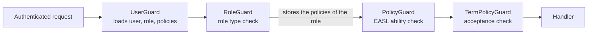

# Authorization

This page explains how a route decides whether the caller may use it, for a developer who protects a route or changes what a role may do.

## Table of Contents

- [Related Documents](#related-documents)
- [Overview](#overview)
- [Guard pipeline](#guard-pipeline)
- [Roles](#roles)
- [Policies and CASL abilities](#policies-and-casl-abilities)
- [Term-policy gate](#term-policy-gate)
- [Workspace and project gates](#workspace-and-project-gates)

## Related Documents

- [Authentication][ref-doc-concept-authentication]: the JWT guard every gate below builds on
- [API Key][ref-doc-concept-api-key]: the application check that is the first route guard
- [User][ref-doc-concept-user]: the account status the user guard enforces
- [Term Policy][ref-doc-concept-term-policy]: the acceptance gate
- [Workspace][ref-doc-workspace]: the workspace guard and the `x-workspace-id` header
- [Project][ref-doc-project]: the project guard and its member roles
- [Feature Flag][ref-doc-feature-flag]: the flag guard in the stack
- [Request Pipeline][ref-doc-concept-request-pipeline]: where guards sit on a request
- [Security][ref-doc-concept-security]: the rate limits that run beside the guards
- [Route Protection Guide][ref-doc-guide-route-protection]: stack the decorators on a route
- [Role Guide][ref-doc-guide-role]: create a role and its policies
- [Decorators and Guards Reference][ref-doc-reference-decorators-and-guards]: the decorator order, each guard's store key, and the missing-entry exceptions
- [Field Access Reference][ref-doc-reference-field-access]: the fields each audience reads and writes per resource

## Overview

- A route declares what it needs with `*Protected` decorators. Each decorator mounts one guard, and a guard rejects the request with a typed exception or lets it through.
- Authentication answers who the caller is. Authorization answers what that caller may reach: the role type, the permissions of the role, the acceptance of the legal documents, and the workspace and project the request names.
- Roles and policies are database rows. No role or policy is cached, and `UserGuard` reads the user with its role and policies on every request, so a change applies to the next request.
- An `/admin` route scopes by `@RoleProtected()` and `@PolicyProtected()`. A `/user` or `/shared` route that works inside a workspace scopes by the workspace guard, and by the project guard under `:projectId`; not every `/user` route does. An admin route carries no workspace or project guard: it reads across workspaces and takes the workspace or project id from the path.

## Guard pipeline

Nest runs the guards of a method bottom-up, so the decorator nearest the method runs first. The decorator order of a route therefore fixes the order of the gates:

1. The API key guard, then the JWT guard. The two global throttle guards run before the API key guard.
2. The per-user throttle, mounted directly above the JWT decorator so it runs after it. It counts by the actor id the JWT guard writes and runs before every guard that reads the database.
3. The feature flag guard. It reads only the actor id, so its decorator sits above the JWT decorator and a disabled feature answers before the user read.
4. The user guard, then the workspace guard and the project guard on a workspace route.
5. The role guard, then the policy guard, on an admin route and on the one `/user` route that limits by role type.
6. The term-policy guard.

- A guard reads what a guard that ran before it wrote to the request store and never loads it a second time. `UserGuard` writes the user, `RoleGuard` writes the policies, and the later guards read them.
- A guard whose input is missing throws the guard-only exception of that subject: 401 for identity (the JWT payload, the user, the API key) and 403 for authorization (the policies, the workspace, the project). Nothing checks the stack when a route is decorated, so a misordered stack boots and fails on every request.
- A decorator argument error throws when the route is decorated, so the boot fails: `RoleProtectedEmptyException`, `PolicyProtectedEmptyException`, `PolicyProtectedActionEmptyException`, `FeatureFlagKeyEmptyException`, `FeatureFlagKeyNestedException`, and `RequestEnvProtectedEmptyException`.
- A reordered stack changes the error a caller sees before it changes what the caller reaches, because each gate rejects first in its own place.

The decorator order, the store key each guard reads, and the exception of each empty entry are one table in [Decorators and Guards Reference][ref-doc-reference-decorators-and-guards].

## Roles

A role has a type, `superAdmin`, `admin`, or `user`, and the types rank in that order (3, 2, 1).

- `@RoleProtected(...types)` lists the types a route accepts. `RoleGuard` reads the user the user guard stored and calls `RoleService.validateRoleGuard`. A type outside the list answers `RoleForbiddenException` (403, `50502`).
- A `superAdmin` passes every role check and every policy check, so a route never lists `superAdmin`.
- `RoleGuard` stores the policy list of the caller. A `superAdmin` and a `user` role store an empty list, and an `admin` role stores its policies.
- The seeded roles `superadmin`, `admin`, and `user` are immutable. They cannot be deleted, and their type cannot change. `user.default.role` names the role a sign-up gets. A seeded role's description and policies stay editable.
- A role name is 3 to 30 letters and digits, lower-cased on input, and fixed after create. A request sets the type to `admin` or `user`, never `superAdmin`.

An admin-facing write on a role, its policies, or a user checks rank:

- The actor must outrank the target: a role, a policy, or the user it acts on. An admin outranks `user` and never `admin`. A `superAdmin` outranks every type, a `superAdmin` target included. The failure is `RoleRankForbiddenException` (403, `50504`).
- No actor edits the role they hold or its policies (`RoleSelfForbiddenException`, 403, `50505`).
- A role that users hold cannot be deleted (`RoleUsedException`, 409, `50503`).
- A blocked user is never touched by an admin write: a status change, a password update, an MFA reset, a session revoke (one or all), and a device removal answer `UserBlockedInvalidException` (400, `51006`).

No admin route changes the role of an existing user. A role is assigned when the user is created.

## Policies and CASL abilities

A `Policy` row belongs to a role and names one subject and a list of actions. A role holds at most one policy per subject, and a second one answers `PolicyExistException` (409, `51102`).

- The subjects are `all`, `apiKey`, `role`, `user`, `session`, `activityLog`, `passwordHistory`, `termPolicy`, `featureFlag`, `device`, `workspace`, `project`, and `analytic`.
- The actions are `manage`, `read`, `create`, `update`, and `delete`.
- The seeded `admin` role holds every action on every subject ([Seeded rows][ref-doc-reference-database-policy]).

`@PolicyProtected({ subject, action[] }, ...)` lists the abilities a route needs. `PolicyGuard` reads the user and the stored policies, and `PolicyService.validatePolicyGuard` evaluates them:

1. A `superAdmin` passes.
2. `PolicyAbilityFactory.createByUser` builds a CASL ability from the role's policies with `can(actions, subject)`. CASL reads `manage` as any action and `all` as any subject.
3. `handlerPolicies` passes only when at least one policy is required and every action of every required policy is allowed. An empty required list, an empty action list, or a role with no policy rows denies. The check runs at request time because `every` over an empty list passes: the factory returns `false` for an empty required list, and a `PolicyGuard` that reads no metadata (`?? []`) fails closed beside the boot check.
4. A denial answers `PolicyForbiddenException` (403, `51100`).

A route that lists two policies needs both. The admin session routes list `user: [read]` beside the `session` actions they use.

Policies belong to admin-type roles:

- Creating a policy on a `user`-type role answers `PolicyRoleTypeInvalidException` (400, `51104`). Deleting one stays allowed.
- Changing a role to the `user` type while it holds a policy answers `RoleHasPoliciesException` (400, `50507`).

## Term-policy gate

`@TermPolicyAcceptanceProtected()` rejects a request until the user has accepted the latest published version of each required legal document. The guard, its defaults, and the routes that skip it are in [Term Policy][ref-doc-concept-term-policy-guard].

## Workspace and project gates

`@WorkspaceProtected(...roles)` selects the active workspace from the `x-workspace-id` header and loads the caller's membership. `@ProjectProtected(...roles)` selects a project of that workspace from the `:projectId` route parameter and loads the caller's project membership.

- With roles listed, the member's role must be in the list. A workspace member with the role `owner` always passes a workspace role list.
- On `@ProjectProtected(...roles)` with roles listed, a workspace member with the role `owner` or `admin` (`EnumWorkspaceMemberRole`, not the role type `admin`) passes without a project membership row. With no roles, a project membership row is required.
- Their guards, their exceptions, and the roles are in [Workspace][ref-doc-workspace] and [Project][ref-doc-project]. Their place in the stack is in [Decorators and Guards Reference][ref-doc-reference-decorators-and-guards].

The fields each audience reads and writes on a resource are in [Field Access Reference][ref-doc-reference-field-access].

<!-- REFERENCES -->

[ref-doc-concept-authentication]: authentication.md
[ref-doc-concept-api-key]: api-key.md
[ref-doc-concept-user]: user.md
[ref-doc-concept-term-policy]: term-policy.md
[ref-doc-concept-term-policy-guard]: term-policy.md#acceptance-at-sign-up-and-per-request
[ref-doc-concept-request-pipeline]: request-pipeline.md#guards
[ref-doc-concept-security]: security.md#rate-limiting
[ref-doc-workspace]: workspace.md
[ref-doc-project]: project.md
[ref-doc-feature-flag]: feature-flag.md
[ref-doc-guide-route-protection]: ../guides/route-protection.md
[ref-doc-guide-role]: ../guides/role.md
[ref-doc-reference-decorators-and-guards]: ../reference/decorators-and-guards.md
[ref-doc-reference-database-policy]: ../reference/database.md#policy
[ref-doc-reference-field-access]: ../reference/field-access.md
