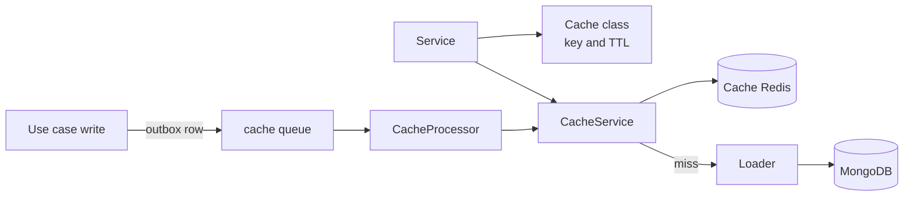

# Cache

This page explains how the application caches reads in Redis, for a developer who adds a cached read or a write that changes a cached row.

## Table of Contents

- [Related Documents](#related-documents)
- [Overview](#overview)
- [One Redis client](#one-redis-client)
- [readThrough and TTLs](#readthrough-and-ttls)
- [Invalidation through the outbox](#invalidation-through-the-outbox)
- [Session login entry](#session-login-entry)

## Related Documents

- [Queue][ref-doc-concept-queue]: the outbox and the `cache` queue that carry an invalidation
- [Database][ref-doc-concept-database]: MongoDB, the source of truth every entry mirrors
- [Dependencies][ref-doc-dependencies-required]: how a cache Redis outage answers
- [Security][ref-doc-concept-security]: the rate-limit counters that share the cache Redis
- [Helper Reference][ref-doc-reference-helper]: `fillPattern`, which builds a key from its pattern
- [Configuration Reference][ref-doc-reference-configuration-redis]: the `redis` keys and every cache TTL key

## Overview

- MongoDB is the source of truth and the cache is a side resource. Every entry has a TTL and is never the only copy of a value.
- The cache Redis (`db:0` of `REDIS_CACHE_URL`) holds cache entries, their lease keys, and the rate-limit counters, and nothing else.
- A short-lived value that gates a flow, such as a one-time code, a reset token, or a login challenge, is a database row and never a cache entry, because a cache entry is never an invariant and no value is written to both stores.
- The cache Redis is required. A Redis error in `CacheService` or `RequestThrottleStorageService` throws `RedisUnavailableException` (HTTP 503): [Dependencies][ref-doc-dependencies-required].

## One Redis client

`RedisModule.forRoot()` is a global kit module and owns every Redis client, all of them `ioredis`. `RedisClientFactory` builds three and connects each before the application boots:

- The cache client (`RedisCacheClient`) connects to `redis.cache.url` with command and connect timeouts, no offline queue, and the key prefix `Cache:`. The prefix applies to every key, Lua `KEYS` included, so code passes unprefixed keys. The option keys are in the [Configuration Reference][ref-doc-reference-configuration-redis].
- The queue producer client (`RedisQueueClient`) and the queue worker client (`RedisQueueWorkerClient`) use `redis.queue.url` and belong to [Queue][ref-doc-concept-queue].
- Each client logs one `warn` per `error` event and one `log` line per `ready` event. On shutdown a ready client runs `quit()` and any other runs `disconnect()`.

The cache client has no offline queue, so a command fails fast while Redis is down.

`CacheModule.forRoot()` provides `CacheService` over the cache client, and `CacheQueue` over the `cache` queue. Both are exported, and `RedisModule` and `CacheModule` are composed once, in `CommonModule`.

## readThrough and TTLs

A cache entry has three parts that live in different places:

- A cache class (`ApiKeyCache`, `FeatureFlagCache`, `SessionCache`, `AnalyticCache`) holds the key patterns and TTLs it reads from config, and one `build<Subject>Key` method per key. A leased cache adds `build<Subject>Lease` and `build<Subject>Keys`, which return the entry key and the lease key. It holds no read, no delete, no loader, and no repository.
- The service calls `CacheService.readThrough(key, schema, ttlInMs, loader, options?)` with the cache's key and TTL, a zod schema for the value, and a loader. The loader is a repository read, or a private method of the service that shapes what it caches.
- `CacheService` stores the value as JSON with `PX` and the TTL. Its schema revives what JSON drops, such as dates.

`readThrough` runs in this order:

1. It reads the key. A value that passes `JSON.parse` and `schema.safeParse` is the hit and is returned.
2. A missing entry, or one that fails either check, runs the loader. A failing entry logs one `warn` and its key is unlinked first.
3. It stores the loader's result with the TTL. When the loader returns `null`, `readThrough` returns `null` and stores nothing.

A shared hot key (`ApiKeyCache`, `FeatureFlagCache`) passes `options.lease`:

- The lease keeps a stale entry from being written after a delete. A slow loader that read before an invalidation cannot write its value afterwards: the invalidation job removes the lease, and the Lua write checks the lease token.
- The lease is a second key taken with `SET NX PX` before the loader runs. Only the reader that took the lease writes the value, through one Lua script that checks the lease token, writes the entry, and deletes the lease.
- A reader that finds the lease taken still runs the loader and returns its result without storing it.
- A lease that no write releases expires after its lease TTL.
- No stale entry outlives the key delete. Between the commit and the job, the old entry is still served.

A key comes from a pattern in config, such as `ApiKey:{key}` or `User:{userId}:Session:{sessionId}`. A pattern with one token goes through `String.prototype.replace` with a function replacement, so a value containing `$&` stays literal. A pattern with two or more tokens goes through `HelperStringService.fillPattern`, which fills them in one pass so a substituted value is never read as a token again, and a token without a value throws `HelperPatternTokenMissingException`.

Each cache reads its TTL from its own config key ([Configuration Reference][ref-doc-reference-configuration-redis]). `AnalyticCache` entries end by their TTL alone: no write invalidates them.

## Invalidation through the outbox

The API key and feature flag caches are invalidated through the outbox. They are cache-aside: a write that changes or deletes a cached row never sets its keys. It deletes them, as an outbox row, because an update outside MongoDB that must not be lost is an outbox row:

1. The use case opens a transaction over the `*InTx` write.
2. The service adds `CacheQueue.invalidateEffect(keys)` to that transaction as an outbox row. `ApiKeyCache.buildApiKeyKeys` and `FeatureFlagCache.buildFeatureFlagKeys` both return the entry key and the lease key, and the service passes both to `invalidateEffect`. `ApiKeyService` is the reference caller.
3. After the commit the outbox dispatches an `invalidate` job on the `cache` queue, at high priority, with a `null` idempotency key, the business key that would dedupe a repeated row ([Queue][ref-doc-concept-queue-outbox]).
4. `CacheProcessor` awaits `CacheService.invalidate(keys)`, which unlinks the keys.
5. The next read after the job misses, and `readThrough` sets the entry again.

- A create adds no invalidation, because no entry exists yet.
- A Redis error in the job throws `RedisUnavailableException`, which extends `AppBaseException`, and the processor base rethrows it unchanged, so BullMQ retries the job with the `cache.queue.backoffDelayInMs` backoff.
- `CacheService.invalidate` has two other callers, covered in [Session login entry](#session-login-entry): `SessionService.isLoginActive` and `SessionService.deleteLogins`.
- `CacheService.flush` empties the whole Redis database of the cache connection, so it also empties the rate-limit counters. `MigrationSeedBase` is its one caller, after every seed run, so a seed run resets the rate-limit counters.

The outbox row, the dispatch after the commit, and the retries are [Queue][ref-doc-concept-queue-outbox].

## Session login entry

The session check of every JWT access token reads one entry per login, `User:{userId}:Session:{sessionId}`.

- `SessionService.isLoginActive` reads it through `readThrough`. The value is `{ jtiDigest }`, the SHA-256 digest of the token's `jti`, never the `jti`. The loader reads the live session row.
- The TTL is `session.loginCacheTtlInMs`, shorter than the access token's lifetime, and the entry takes no lease.
- A hit whose digest matches the token passes. A hit with a different digest is invalidated and read through once more, and the check answers on that second read.
- A refresh writes no entry. The first request with the new token reloads it, and the old access token passes only while the entry holds the old digest.
- This entry has its own paths, apart from `CacheQueue`. `SessionService.isLoginActive` calls `CacheService.invalidate` directly in the request path when the digest differs.
- A revoke adds a purge row, `SessionQueue.purgeLoginsEffect`, to the revoke's transaction. The `purgeLogins` job on the `session` queue calls `SessionService.deleteLogins`, which invalidates the exact login keys of the revoked sessions. A revocation reaches the cache when that job runs.

<!-- REFERENCES -->

[ref-doc-concept-queue]: queue.md
[ref-doc-concept-queue-outbox]: queue.md#outbox-row-in-the-transaction
[ref-doc-concept-database]: database.md
[ref-doc-dependencies-required]: dependencies.md#required-mongodb-and-redis
[ref-doc-concept-security]: security.md#rate-limiting
[ref-doc-reference-helper]: ../reference/helper.md
[ref-doc-reference-configuration-redis]: ../reference/configuration.md#redis
