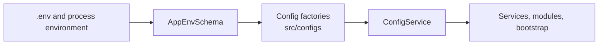

# Configuration

This page explains how configuration works, for a developer who adds a setting or reads one in application code.

## Table of Contents

- [Related Documents](#related-documents)
- [Overview](#overview)
- [From .env to AppEnvSchema](#from-env-to-appenvschema)
- [Config factories](#config-factories)
- [Reading config](#reading-config)
- [Pattern placeholders](#pattern-placeholders)
- [Optional integrations](#optional-integrations)

## Related Documents

- [Configuration Reference][ref-doc-reference-configuration]: every key, default, and environment variable
- [Dependencies][ref-doc-dependencies]: what an unset optional integration does
- [Installation][ref-doc-installation]: creating `.env` for the local stack
- [Production][ref-doc-production]: the values a deployed environment sets by hand
- [Vault][ref-doc-vault]: filling and pulling an env file

## Overview



- The environment holds secrets and values that differ between deployments. `AppEnvSchema` validates every key before a Nest provider resolves a config value. The one exception is `src/instrument.ts`, which runs before Nest and calls the `app`, `logger`, and `sentry` factories on the raw environment: [Reading config](#reading-config).
- One factory per concern turns the environment and the values the code fixes into a typed object. `src/configs/index.ts` registers every factory.
- Consumers read the typed object through `ConfigService`.
- A value has one layer:
    - Environment: a secret, or a value that differs between deployments of the same code, such as a URL, a credential, or a log level.
    - Config: a value the code decides and an adopter tunes, such as a TTL, a limit, a cron, a pattern, or a token lifetime.
    - Constant: a value whose change breaks a contract, such as a header name, a store key, or a value a library fixes.
    - Feature flag: a product feature an operator switches at runtime, with its rollout and numeric policy.

## From .env to AppEnvSchema

`ConfigModule.forRoot` loads the factories and validates the environment. This excerpt is from `src/common/common.module.ts`:

```typescript
ConfigModule.forRoot({
    load: configs,
    isGlobal: true,
    cache: true,
    envFilePath: ['.env'],
    expandVariables: false,
    validationSchema: AppEnvSchema,
}),
```

- `.env` is the only file loaded. No `.env.<APP_ENV>` file exists.
- `expandVariables` is `false`, so a `$` inside a value stays literal.
- `src/instrument.ts` loads `.env` into `process.env` through `dotenv/config` before Nest starts. A variable the process environment already holds is not overwritten.
- `AppEnvSchema` lives in `src/app/dtos/app.env.dto.ts` and declares every key a factory reads.
- A field takes one of these shapes:
    - A boolean is `RequestBooleanStringSchema`: exactly `true` or `false`.
    - An encryption root is `RequestEncryptionSecretSchema`: 64 base64url characters.
    - A port is an integer.
    - An enum value is a `z.enum` over its enum, so a typo fails by name.
    - A third-party key is a `RequestOptionalEnv*Schema` from `src/common/request/validations/request.optional-env.validation.ts`: an absent value and a blank line both parse to `null` in the schema's result, and a set value must meet its format.
- A `superRefine` on the schema adds the rules that span keys: a triggered integration requires its group ([Integration triggers][ref-doc-reference-configuration-triggers]), the passkey origins take fixed shapes, and the deployed-environment rules in [Variables set by hand][ref-doc-production-variables].
- A failed validation stops the boot. The error reaches `bootstrapFailed`, which logs one `fatal` line, reports to Sentry when `SENTRY_DSN` is set, and exits with code 1. `src/migration.ts` runs the same handler for a seed command.

## Config factories

Each file in `src/configs/` is one namespace: an `IConfig<Namespace>` interface and a default export `registerAs('<camelNamespace>', ...)`. This excerpt is from `src/configs/database.config.ts`:

```typescript
export default registerAs('database', (): IConfigDatabase => {
    return {
        url: process.env.DATABASE_URL!,
        debugEnabled: process.env.DATABASE_DEBUG_ENABLED === 'true',
        seedTransactionTimeoutInMs: ms('60s'),
        seedBatchSize: 1000,
        serverSelectionTimeoutInMs: ms('5s'),
        connectTimeoutInMs: ms('5s'),
        slowQueryThresholdInMs: ms('500ms'),
    };
});
```

- A factory reads `process.env` directly and parses no schema. The schema's role is validation: Nest does not write its parsed result back over a key `process.env` already holds, so a factory sees the raw string, and the optional-key read below turns a blank into `null` a second time.
- The read shapes are fixed:
    - A required key is `process.env.KEY!`.
    - A boolean is `process.env.KEY === 'true'`.
    - A number is `Number(process.env.KEY!)`.
    - A list is `split(',')`, trimmed, with empty entries filtered out.
    - An optional key is `process.env.KEY === '' ? null : (process.env.KEY ?? null)`, so its interface field is `T | null`.
- An environment key is its config path in upper snake case: `mfa.totp.encryptionSecret` is `MFA_TOTP_ENCRYPTION_SECRET`. One key has one owning path.
- A key ending in `InMs`, `InSeconds`, `InMinutes`, `InDays`, or `InBytes` names the unit its consumer reads, and the factory builds it from `ms('...')` or `bytes('...')`.
- A new environment variable is the factory field, its interface member, the `AppEnvSchema` key, a line in `.env.example`, and its row in the [Configuration Reference][ref-doc-reference-configuration].
- `src/main.ts` and `src/migration.ts` import `@instrument` first, then import `@bootstrap` dynamically. `bootstrapApplication` writes `process.env.NODE_ENV` from `app.env` and `process.env.TZ` from `app.timezone` once the config is loaded.

## Reading config

- `process.env` is read in `src/configs/`, `src/bootstrap.ts`, and `src/instrument.ts` only. Every other file injects `ConfigService`.
- A class reads each key once, in its constructor, into a `private readonly` field named from the key path. This excerpt is from `src/modules/feature-flag/caches/feature-flag.cache.ts`:

```typescript
this.keyPattern = this.configService.get<string>('featureFlag.keyPattern')!;
```

- A module `useFactory`, a queue options factory, `bootstrap.ts`, `configure.ts`, and `swagger.ts` read where they build.
- `src/instrument.ts` runs before Nest exists. It imports `dotenv/config` and calls the `app`, `logger`, and `sentry` factories on the unvalidated environment, so Sentry initializes from raw values.

## Pattern placeholders

A config value ending in `Pattern` is a template with `{token}` placeholders: cache and Redis keys, job idempotency keys, S3 paths and URLs, email links, and the export file name. The consumer fills it where it uses it.

- One placeholder: `String.prototype.replace('{name}', () => value)`. The function form stops a value containing `$&` or `$1` from being read as a replacement pattern.
- Two or more placeholders: `HelperStringService.fillPattern(pattern, values)`. It scans the pattern once, so a substituted value is never read as a token again.
- A token with no supplied value throws `HelperPatternTokenMissingException` (52202, HTTP 500) naming the token.

## Optional integrations

- AWS S3, AWS SES, Firebase, Google sign-in, Apple sign-in, and Sentry are optional. A blank or absent line leaves one unset.
- The trigger table, and the keys a triggered integration then requires, is in [Integration triggers][ref-doc-reference-configuration-triggers].
- What an unset integration does at runtime is in [Optional adapters][ref-doc-dependencies-optional-adapters].

<!-- REFERENCES -->

[ref-doc-reference-configuration]: ../reference/configuration.md
[ref-doc-reference-configuration-triggers]: ../reference/configuration.md#integration-triggers
[ref-doc-dependencies]: dependencies.md
[ref-doc-dependencies-optional-adapters]: dependencies.md#optional-adapters
[ref-doc-installation]: ../getting-started/installation.md
[ref-doc-production]: ../production.md
[ref-doc-production-variables]: ../production.md#variables-set-by-hand
[ref-doc-vault]: vault.md
