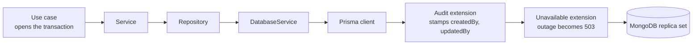

# Database

This page explains how the application reads and writes MongoDB, for a developer who writes a repository or a use case.

## Table of Contents

- [Related Documents](#related-documents)
- [Overview](#overview)
- [Client and extensions](#client-and-extensions)
- [Transactions](#transactions)
- [Audit stamping](#audit-stamping)
- [Soft delete and restore](#soft-delete-and-restore)
- [Generated unique values](#generated-unique-values)
- [Repository error contracts](#repository-error-contracts)

## Related Documents

- [Database Reference][ref-doc-reference-database]: the models, the composite types, and the seeded rows
- [Seed Guide][ref-doc-guide-seed]: push the schema, run, add, and remove seeds
- [Module Guide][ref-doc-guide-module]: add a model and its repository to a new module
- [Architecture][ref-doc-architecture]: the layers a statement travels through
- [Queue][ref-doc-concept-queue]: the outbox row that joins a transaction
- [Dependencies][ref-doc-dependencies]: how a MongoDB outage answers
- [Error Handling][ref-doc-concept-error-handling]: how the filter chain renders the database exceptions
- [Commands][ref-doc-reference-commands]: the `db:*` scripts
- [Configuration Reference][ref-doc-reference-configuration-database]: the `database` keys

## Overview



- MongoDB is the source of truth, and Prisma is the only way the application reaches it. `prisma/schema.prisma` declares the models, and `pnpm db:generate` writes the client into `src/generated/prisma-client`, which code imports from `@generated/prisma-client/client`.
- The project holds no migration files. `pnpm db:migrate` runs `prisma db push`, which applies the schema as it is.
- MongoDB runs as a replica set, because Prisma transactions need one.
- A repository owns one model and its satellites, models with no repository of their own that its owner's repository writes. A repository runs a statement on `DatabaseService.client`, or on the `tx` that its `*InTx` method receives. A service or a use case never reaches the client.

## Client and extensions

`DatabaseModule.forRoot()` is a global kit module. It provides `DatabaseExtensionFactory`, `DatabaseClientFactory`, the `DatabaseClient` token, `DatabaseService`, and `DatabaseUtil`. It exports `DatabaseService`, `DatabaseUtil`, and `DatabaseExtensionFactory`.

- `DatabaseClientFactory` extends `PrismaClient`. Its constructor passes `datasourceUrl` from `DatabaseUtil.buildClientUrl(database.url)`, which appends `serverSelectionTimeoutMS` and `connectTimeoutMS` from `database.serverSelectionTimeoutInMs` and `database.connectTimeoutInMs`.
- `DatabaseClientFactory.create()` returns the extended client, typed `IDatabaseClient`: the one client the application uses. It chains two extensions on the base client, the audit extension first and the unavailable extension second. The module provides the result once, under the `DatabaseClient` token.
- `DatabaseService` holds that client as `client` and exposes `withTransaction`, `beforeCommit`, and `afterCommit`. It does not extend `PrismaClient` and exposes no model delegate.
- At boot `onModuleInit` registers the query log handlers, then runs `$connect()` and `$runCommandRaw({ ping: 1 })`. A failure of either throws `AppUnknownException`, so the application does not boot while MongoDB is unreachable. A failed `$disconnect` at shutdown is logged and the shutdown continues.
- A query that takes `database.slowQueryThresholdInMs` or longer logs one `warn` with its model, action, and duration, and never the query text or parameters. A faster query logs at `verbose` only while `database.debugEnabled` is on, and the Prisma `error`, `warn`, and `info` events log only then too. The handlers attach to `DatabaseClientFactory`, the base client, because the extended client has no `$on`.

The unavailable extension wraps every operation, on `client` and on a `tx` alike.

- An error that `DatabaseUtil.isUnavailableError` accepts, a Prisma `P2010` whose message holds `Server selection timeout`, becomes `DatabaseUnavailableException` (HTTP 503). Any other error passes through unchanged.
- `withTransaction` converts a `$transaction` that cannot start with the same detection and the same exception.
- The filter chain renders the exception as 503: [Dependencies][ref-doc-dependencies-required].

## Transactions

Inside a feature module only a use case opens a transaction, so every write of a flow commits together. It opens one through `DatabaseService.withTransaction(fn, options?)`, Prisma's interactive `$transaction` on the extended client. A seed opens its own the same way ([Seed Guide][ref-doc-guide-seed]). A service or a repository that takes part in it exposes an `*InTx` method with a `tx: IDatabaseTransactionClient` parameter and runs every statement on that `tx`. A statement on `databaseService.client` inside the callback escapes the transaction.

- An action opens a transaction only when its writes span more than one table or include an outbox row. An action that writes one table and no outbox row goes from the service to the repository on the client with no transaction.
- Validation runs before the transaction opens, so the transaction holds the writes and their guards.
- `IDatabaseTransactionClient` derives from the extended client's `$transaction` parameter, because Prisma's own `TransactionClient` lacks the extensions.
- `options` is Prisma's `transactionOptions` shape. A caller that passes one reads it from its own `*TimeoutInMs` key, and an omitted `options` keeps Prisma's defaults. Seeds pass `database.seedTransactionTimeoutInMs`.
- A write conflict (Prisma `P2034`) is never retried. No contract names it, so it answers 500.

`withTransaction` also keeps two commit hooks per `tx`:

- `beforeCommit(tx, callback)` runs after `fn` resolves and inside the transaction, in registration order. A callback that rejects rolls the transaction back.
- `afterCommit(tx, callback)` runs once the transaction has committed, in registration order, before `withTransaction` returns. A rolled-back transaction runs none. A callback never throws: its author catches its own errors, as `OutboxService.dispatch` does.
- Any module may register a hook, and `OutboxService` is the one that does: it writes its buffered rows in one `beforeCommit` insert and dispatches them in one `afterCommit` callback ([Outbox row in the transaction][ref-doc-concept-queue-outbox]).
- An `afterCommit` callback suits a best-effort step whose loss is recovered or harms nothing, such as the outbox dispatch that the sweep repeats. An update outside MongoDB that must not be lost is an outbox row, never an `afterCommit` callback alone.

## Audit stamping

The `audit-actor` extension registers a query hook on every model for `create`, `createMany`, `update`, `updateMany`, and `upsert`.

- It fills `createdBy` and `updatedBy` from the acting user in the request store (`RequestActorStoreKey`). The JWT access and refresh guards write that key, so only an authenticated HTTP request has an actor.
- A create hook fills both fields, an update hook fills `updatedBy`, and an upsert fills the `create` and the `update` payloads. `createMany` stamps every item of its array.
- It fills a field only when the model has the column and the payload holds `null` or omits it. A non-null value the caller passes wins, and an explicit `null` is overwritten by the actor.
- It stamps the top-level payload only. A nested write passes its audit values explicitly.
- A processor, a seed, and a public route have no actor, so nothing is stamped. A row that names a user passes it explicitly, and a system row such as a nonce, a snapshot, or an outbox row leaves `createdBy` unset.
- `createdBy`, `updatedBy`, and `deletedBy` are `String? @db.ObjectId` and hold a user id. `deletedBy` exists only on a model with `deletedAt`.

## Soft delete and restore

The extension adds `softDelete` and `restore` to every model at runtime. Their types exist only on a model with a `deletedAt` column, `User`, `Workspace`, `Project`, `ApiKey`, and `UserMobileNumber`, so a call on another model does not compile. A live row is one whose `deletedAt` is `null`.

- `softDelete({ where, data? })` sets `deletedAt` to now, and `deletedBy` and `updatedBy` to the actor, or to `null` when there is no actor. It merges `data` into the same update, and an explicit `deletedAt`, `deletedBy`, or `updatedBy` in `data` wins.
- `restore({ where, data? })` clears `deletedAt` and `deletedBy`, sets `updatedBy` to the actor, or to `null` when there is no actor, unless `data` names one, and merges `data`.
- A soft delete with a guard is a live-row `update()` or `updateMany` that carries `deletedAt` and `deletedBy` in `data`.
- A hard `delete` or `deleteMany` writes no audit field.
- The repository, not the extension, rewrites the slug when it soft-deletes a `Workspace` or a `Project`: the slug becomes `deleted-<id>` (`workspace.deletedSlugPattern`, `project.deletedSlugPattern`), one statement per row. The slug is unique on `Workspace` and unique per workspace on `Project`, so the original slug is free for a new row.
- A soft delete of a `UserMobileNumber` rewrites its `number` to `user.deletedMobileNumberPattern` (`deleted-{id}`) the same way, so the unique `[userId, countryId, phoneCode, number]` frees the old number for a new row.
- A soft-deleted `ApiKey` keeps its `key` and `hash`, which stay unique.
- Every relation declares `onUpdate: Restrict` and an `onDelete`, and Prisma emulates both in the client on MongoDB. The action of each relation is in [Database Reference][ref-doc-reference-database-relations].
- A read is never filtered. The extension writes audit fields and never rewrites a `where`, so every read of a soft-deletable model filters `deletedAt: null` itself, and `PaginationService` counts with the same `where` as the page.

## Generated unique values

A slug, or a short reference, that sits behind a unique index can collide with a row that holds it. The application retries such a value up to a `*MaxAttempts` config key (`workspace.slugMaxAttempts`, `project.slugMaxAttempts`, `workspace.invite.referenceMaxAttempts`), and the retries end with an exception, never an unbounded loop. A long random value such as a token or an API key is not retried.

1. The use case draws its candidates before the loop. A slug uses `HelperStringService.generateSlugCandidates(prefix, maxLength, count)`.
2. It writes with one candidate per attempt, each attempt in its own transaction where the write has one.
3. A unique collision on the generated field reaches the use case as the repository's typed exception, for example `WorkspaceSlugAlreadyExistsException`. The loop continues with the next candidate.
4. When the candidates run out, the use case throws `AppUnknownException` carrying the last collision.

`DatabaseUtil.isUniqueCollision(error, field)` recognizes the collision: it is true for a `PrismaClientKnownRequestError` with code `P2002` whose `meta.target` contains the field name, compared in lower case. A seed that retries a slug calls it directly. A value the request supplies fails on the first collision with the feature's own exception and is never retried.

## Repository error contracts

A repository whose write catches extends `DatabaseRepositoryBase` and declares an error contract.

- The contract is a constant that `satisfies IDatabaseErrorContract`. It maps `DatabaseRecordNotFoundCode` (`P2025`) to an exception class, and `DatabaseUniqueConstraintCode` (`P2002`) to a map from a model field to an exception class.
- `toException(error)` returns and never throws. It passes an `AppBaseException` through, then returns a new instance of the class the contract names for the error code or the collided field, and otherwise an `AppUnknownException` carrying the error.
- A contract names a generated field that a retry loop acts on, or a business answer that no fail-fast read gives. Every other database error, a race included, answers 500.
- A repository with nothing to name uses `DatabaseEmptyErrorContract`. `WorkspaceDatabaseErrorContract` (`src/modules/workspace/contracts/workspace.database-error.contract.ts`) maps a slug collision to `WorkspaceSlugAlreadyExistsException`:

    ```typescript
    export const WorkspaceDatabaseErrorContract = {
        [DatabaseUniqueConstraintCode]: {
            [Prisma.WorkspaceScalarFieldEnum.slug]:
                WorkspaceSlugAlreadyExistsException,
        },
    } satisfies IDatabaseErrorContract;
    ```

<!-- REFERENCES -->

[ref-doc-reference-database]: ../reference/database.md
[ref-doc-reference-database-relations]: ../reference/database.md#relations-and-referential-actions
[ref-doc-guide-seed]: ../guides/seed.md
[ref-doc-guide-module]: ../guides/module.md
[ref-doc-architecture]: architecture.md
[ref-doc-concept-queue]: queue.md
[ref-doc-concept-queue-outbox]: queue.md#outbox-row-in-the-transaction
[ref-doc-dependencies]: dependencies.md
[ref-doc-dependencies-required]: dependencies.md#required-mongodb-and-redis
[ref-doc-concept-error-handling]: error-handling.md
[ref-doc-reference-commands]: ../reference/commands.md#database-and-seeds
[ref-doc-reference-configuration-database]: ../reference/configuration.md#database
