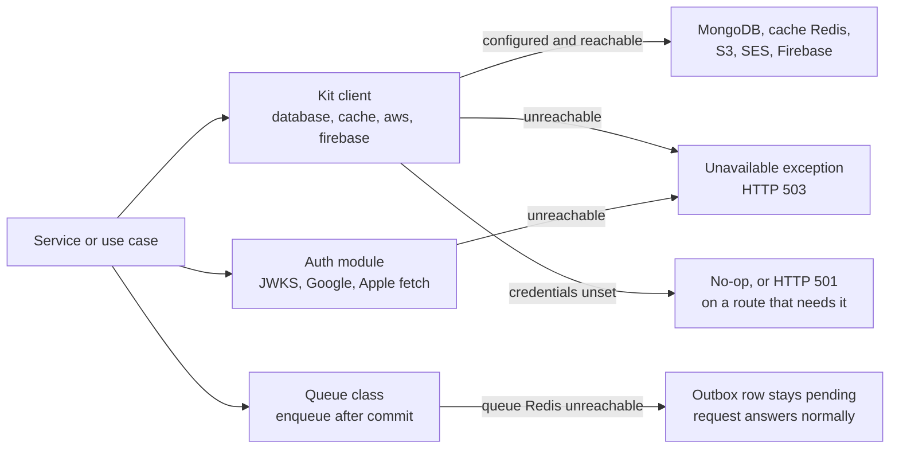

# Dependencies

This page explains how the application treats the services it depends on, for a developer who builds on a kit client or operates an instance.

## Table of Contents

- [Related Documents](#related-documents)
- [Overview](#overview)
- [Required: MongoDB and Redis](#required-mongodb-and-redis)
- [Token providers](#token-providers)
- [Optional adapters](#optional-adapters)
- [Health checks](#health-checks)

## Related Documents

- [Configuration][ref-doc-concept-configuration]: how the keys of each dependency are validated
- [Configuration Reference][ref-doc-reference-configuration]: the keys, and the integration triggers
- [Production][ref-doc-production]: hosted MongoDB and Redis, TLS between hosts, and cloud setup
- [Hosted Dependencies][ref-doc-guide-hosted-dependencies]: running the host application against hosted MongoDB and Redis
- [Status Codes][ref-doc-status-codes]: the numeric code of each exception named here
- [Cache][ref-doc-cache]: the cache Redis client and its entries
- [Queue][ref-doc-queue]: the queue Redis client, the outbox, and BullBoard

## Overview

- Boot needs MongoDB and both Redis instances. A request needs MongoDB and the cache Redis while the application runs, and a queue Redis outage after boot delays background work only.
- Six integrations are optional: AWS S3, AWS SES, Firebase, Sentry, Google sign-in, and Apple sign-in.
- Each kit owns the client of its provider. A call that cannot reach the provider throws that kit's unavailable exception, and the filter chain answers it with HTTP 503. The auth module owns the JWKS, Google, and Apple fetches and throws its own unavailable exception.
- A request that needs an optional integration whose credentials are unset answers 501: the deployment never configured it. A configured integration whose provider does not answer answers 503: the deployment configured it and the provider is unreachable.

## Required: MongoDB and Redis

MongoDB is the source of truth. The cache Redis is a side resource: it never holds the only copy of a value, yet the application needs it to run, so an outage answers 503. Boot connects to all three services.

- Boot connects to MongoDB (`$connect()` then a `ping` command) and to the cache, queue, and queue worker Redis clients. A service that is down at boot stops the boot with a fatal log and exit code 1.
- MongoDB runs as a replica set because transactions need one.
- An instance reaches MongoDB through `DatabaseService`. A statement or a transaction start that times out selecting a server throws `DatabaseUnavailableException` (HTTP 503). The timeouts are `database.serverSelectionTimeoutInMs` and `database.connectTimeoutInMs`.
- The cache Redis holds cache entries and the throttle counters. Every Redis error in `CacheService` or `RequestThrottleStorageService` throws `RedisUnavailableException` (HTTP 503). A cache entry always has a TTL and is never the only copy of a value.
- The cache client has no offline queue and a command timeout of `redis.commandTimeoutInMs`, so a command fails fast while Redis is down.
- The queue Redis holds BullMQ jobs. A side effect is an outbox row written in the transaction of the action that causes it, and the enqueue follows the commit.
    - A queue Redis outage never fails the request. The failed enqueue logs one `warn` and leaves the outbox row `pending`.
    - The outbox sweep re-dispatches a row that stays `pending` past `outbox.pendingAfterInMs`, so the job runs once the queue Redis is back.

## Token providers

The auth module, a feature module and no kit, fetches the keys that verify a token:

- The access and refresh JWKS URIs verify the application's own tokens. The two JWKS endpoints are also in the third-party health check.
- Google sign-in fetches Google's certificates, and Apple sign-in fetches Apple's keys. Both are optional integrations and answer 501 while unset.
- A JWKS, Google certificate, or Apple key fetch that fails on the network or at the endpoint throws `AuthProviderUnavailableException` (HTTP 503), mapped in `AuthService.toProviderUnavailableException`. A token that fails verification answers 401.

## Optional adapters

An adapter whose credentials are unset logs one `warn` in `onModuleInit` and stays uninitialized. `isInitialized()` reports its state. Every later call logs its own `warn` and returns an empty result.

- AWS S3 (`AwsS3Service`): provider methods return `null`, `[]`, `false`, or nothing. A route that cannot work without S3 throws `AwsS3NotConfiguredException` (HTTP 501).
- AWS SES (`AwsSesService`): `send` and template calls return an empty output. Forgot-password and resend-verification answer `AwsSesNotConfiguredException` (HTTP 501) for every caller, before the account is read.
- Firebase (`FirebaseService`): `sendPush` returns `false` and `sendMulticast` reports every token as failed. The push send step checks `isInitialized()` first and skips the job without a failure or a retry.
- Google and Apple sign-in: the sign-in route throws `AuthSocialGoogleNotConfiguredException` or `AuthSocialAppleNotConfiguredException` (HTTP 501).
- Sentry: `src/instrument.ts` initializes Sentry only when `SENTRY_DSN` is set, and `SentryService` calls send nothing without it.

A configured adapter never checks that its provider is reachable at boot. Firebase is the one adapter that parses its credentials at boot: a private key that cannot be normalized or an SDK initialization error fails boot with `FirebasePrivateKeyInvalidException` or `FirebaseInitializationFailedException`. A call to a configured adapter whose provider does not answer throws its kit's unavailable exception:

- S3 and SES: `AwsUnavailableException` (HTTP 503) on any error the client raises unless it is a service exception flagged `$fault: 'client'`, such as a rejected request. A client fault passes through as it came.
- Firebase: `FirebaseUnavailableException` (HTTP 503) when the send of every chunk rejects. A partial rejection returns that chunk's tokens for a retry.

A seed that needs an integration logs a warning and skips without it: `templateEmailNotification` needs SES, and `awsS3Config` needs S3 and `AWS_S3_IAM_PRINCIPAL_ARN`. The `termPolicy` seed writes every row and uploads content only when S3 is set.

The variables that turn each integration on: [Integration triggers][ref-doc-reference-configuration-triggers].

## Health checks

Four system routes, each behind a system API key, report the state of the dependencies:

- The database check covers MongoDB, the cache Redis, and the queue. It answers 503 with its normal body while one is down, at `/api/system/health/database`.
- The AWS check covers the public and private S3 buckets and SES.
- The third-party check covers Sentry, Firebase, Google, Apple, and the two JWKS endpoints.
- The instance check compares memory and disk use with the thresholds of the `health` config.
- The AWS, third-party, and instance checks answer 200 whatever they report.
- An unset integration reports `down` with the message `<name> is not configured`.

<!-- REFERENCES -->

[ref-doc-concept-configuration]: configuration.md
[ref-doc-reference-configuration]: ../reference/configuration.md
[ref-doc-reference-configuration-triggers]: ../reference/configuration.md#integration-triggers
[ref-doc-production]: ../production.md
[ref-doc-guide-hosted-dependencies]: ../guides/hosted-dependencies.md
[ref-doc-status-codes]: ../reference/status-codes.md
[ref-doc-cache]: ../cache.md
[ref-doc-queue]: ../queue.md
