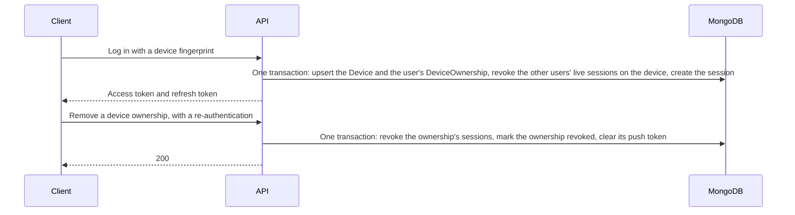

# Device

This page explains devices and device ownership, for a developer who changes a login, a push token, or the removal of a device.

## Table of Contents

- [Related Documents](#related-documents)
- [Overview](#overview)
- [Device and ownership](#device-and-ownership)
- [One signed-in user per device](#one-signed-in-user-per-device)
- [Removing an ownership](#removing-an-ownership)
- [Self-deletion](#self-deletion)

## Related Documents

- [Authentication][ref-doc-concept-authentication]: the login transaction that upserts the device
- [Session][ref-doc-concept-session]: the sessions that belong to an ownership and the purge that ends them
- [User][ref-doc-concept-user]: the deletion job that revokes every ownership
- [MFA][ref-doc-concept-mfa]: the re-authentication a device removal asks for
- [Notification][ref-doc-notification]: how the push job reads and sends to the tokens
- [Activity Log][ref-doc-activity-log]: the entries a removal and a device login write
- [Status Codes][ref-doc-reference-status-codes-device]: `DeviceNotFoundException`

## Overview

The diagram shows the two flows that write devices: a login upserts the device and its ownership, and removing an ownership revokes its sessions.

- A `Device` is a client, identified by a fingerprint the client generates. A `DeviceOwnership` joins a user to a device and carries that user's sessions and push token.
- A device can have several owners over time, and holds one signed-in user at a time. A login signs other users out so that a refresh token an earlier user left on the device stops working once another user signs in.
- The `device` module owns both models. `DeviceRepository` writes `Device`, and `DeviceOwnershipRepository` writes `DeviceOwnership`. A use case of another module reaches them through `DeviceService` inside its own transaction.

## Device and ownership

`Device` holds:

- `fingerprint`, unique across the table. The client sends it on every login (32 to 128 characters of letters, digits, and `._:-`), and the login upserts the device on it. A token refresh and a device refresh identify the device from the `deviceOwnershipId` claim of the access token.
- `name`, optional. A device refresh writes `name` and `platform` on this shared row, so every owner of the device sees the change.
- `platform`: `ios`, `android`, or `web`.
- `lastActiveAt`, stamped by a login and by a device refresh.

`DeviceOwnership` holds, one row per user and device pair:

- `isRevoked`, `revokedAt`, and `revokedById`, the removal state.
- `lastActiveAt`, stamped by a login, a device refresh, a token refresh, and a logout.
- `notificationToken` and `notificationProvider`, the push token and its provider: `fcm` for `android`, `apns` for `ios`, and `null` when no token is stored. A web ownership stores its token with provider `null`.

The device list answers the ownership: `isRevoked`, `revokedAt`, `revokedBy`, `notificationProvider`, `activeSessionCount`, `isCurrentDevice`, and the nested device's `name`, `platform`, and `lastActiveAt`. Only the fingerprint and `notificationToken` never reach a response.

A login on a revoked ownership reactivates the same row. A login that creates an ownership or reactivates one counts as a new device and queues the `newDeviceLogin` notification. In the steps below, "new" means created or reactivated, and a reactivated ownership holds no live session to revoke.

The push token belongs to the ownership, so two users of one device hold separate tokens:

- A login sets the token when the request carries one. A device refresh (the device route, not a token refresh, which writes no push token) writes `name`, `platform`, and `notificationToken` as given, and `null` clears a value. A device refresh or a login that carries a token clears that token from every other user's ownership in their transaction.
- The notification job reads the tokens of the user's non-revoked ownerships that hold a live session, seals them, and the push channel opens them to send ([Notification][ref-doc-notification]).
- A token is cleared by logout, by a device refresh that sends `null`, by a device refresh or a login that carries the token (from every other user's ownership), by removing the ownership, by self-deletion, by the daily stale-token cleanup (`notification.push.cleanupStaleTokensCron`, for tokens idle past `notification.push.staleTokenThresholdInMs`), and by the cleanup that follows a push provider rejecting a token.

## One signed-in user per device

Every login (password, passkey, social, and a verified MFA challenge) runs `UserAuthService.createTokenAndSessionInTx`. Inside its transaction the login:

1. Upserts the device and the caller's ownership, and reads the ids of every other user's non-revoked ownership of the same device.
2. Revokes the caller's earlier live sessions on that ownership, unless the ownership is new. The caller is not an affected user: these sessions get a purge row and no activity entry.
3. Revokes every live session on the other ownerships and groups the revoked refs by user.
4. Creates the new session.

For each affected user, a user whose live sessions on the device the login revoked, the transaction adds:

- one purge row with that user's exact session refs
- one `userSessionRevokedByDeviceLogin` entry, with the affected user as `userId` and the logging-in user as `createdBy`

The outcome for an affected user:

- Their ownership stays unrevoked, so the device stays in their list with no live session.
- Their access and refresh tokens fail with `SessionRevokedException` once the purge job runs.
- No notification goes to them, and the logging-in user's own login entry is unchanged.
- No push reaches them from the commit on, because a producer selects tokens only from ownerships that hold a live session. Their push token is cleared in the login transaction when the new login carries the same token, and by the stale-token cleanup otherwise.

A previous owner whose ownership holds no live session is not affected: it gets no purge row and no entry.

## Removing an ownership

A user removes one of their own ownerships after a re-authentication. An admin removes the ownership of a user the admin outranks and asks no re-authentication. One transaction opened by the use case does the writes:

1. It revokes the live sessions of that ownership and adds the purge row.
2. It marks the ownership revoked with the acting user as `revokedById`, and clears its push token and provider. The row stays for the audit trail, with `lastActiveAt` at its last real activity.
3. It adds the activity entries. A self removal writes `userDeviceRemoved`. An admin removal of another user's device writes `adminDeviceRemoved` for the admin and `userDeviceRemovedByAdmin` for the owner, and an admin removal of the admin's own device writes the first only. Each carries the count of revoked sessions.

- An ownership that does not exist, belongs to another user than the one the route names, or is already revoked answers `DeviceNotFoundException` (404, `51300`), and the transaction aborts with no change.
- An admin removal refuses an unknown user with `UserNotFoundException` (404, `51000`), a target the admin does not outrank with `RoleRankForbiddenException` (403, `50504`), and a blocked target with `UserBlockedInvalidException` (400, `51006`).
- The shared `Device` row is untouched, and other users' ownerships of the device keep their tokens and sessions.
- The purge job ends the access tokens of the revoked sessions when it runs.

## Self-deletion

The account deletion job calls `DeviceService.revokeAllByUserInTx` in its transaction. It marks every non-revoked ownership of the user revoked and clears each push token and provider. Other users' ownerships of the same device keep their tokens, and the path writes no device activity entry. The rest of the job is in [Self-deletion and purge][ref-doc-concept-user-delete].

<!-- REFERENCES -->

[ref-doc-concept-authentication]: authentication.md
[ref-doc-concept-session]: session.md
[ref-doc-concept-user]: user.md
[ref-doc-concept-user-delete]: user.md#self-deletion-and-purge
[ref-doc-concept-mfa]: mfa.md#reauthentication
[ref-doc-notification]: notification.md#push-channel-and-tokens
[ref-doc-activity-log]: ../reference/activity-log.md
[ref-doc-reference-status-codes-device]: ../reference/status-codes.md#device
