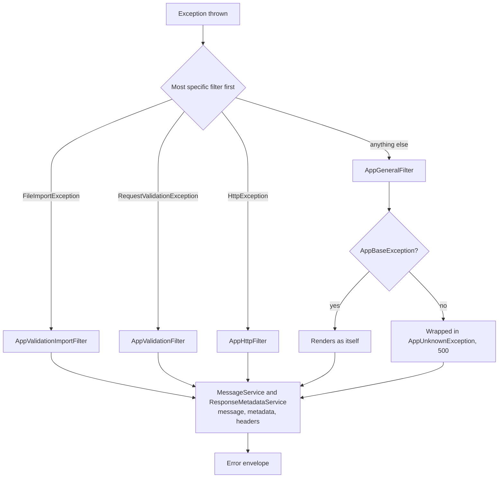

# Error Handling

This page explains how the application turns a failure into a response or a process exit, for a developer who throws an error or reads one from a client.

## Table of Contents

- [Related Documents](#related-documents)
- [Overview](#overview)
- [Filter chain](#filter-chain)
- [Typed exceptions and status codes](#typed-exceptions-and-status-codes)
- [Wrapping a cause](#wrapping-a-cause)
- [Failures outside a request](#failures-outside-a-request)

## Related Documents

- [Status Code Guide][ref-doc-guide-status-code]: allocate a code, write the exception, and add its message
- [Status Codes][ref-doc-reference-status-codes]: the code of every exception, by module
- [HTTP Contract][ref-doc-http-contract]: the error envelope, its metadata, and its headers
- [Request Validation][ref-doc-request-validation]: the validation errors
- [I18n][ref-doc-i18n]: how an error's message path becomes a sentence
- [Dependencies][ref-doc-dependencies]: the 503 and 501 answers of the kits and adapters
- [Request Pipeline][ref-doc-request-pipeline]: where a filter sits on a request
- [Logging][ref-doc-concept-logging]: error logging
- [Sentry][ref-doc-concept-sentry]: which errors reach Sentry

## Overview



- Every application error that answers a request is a class that extends `AppBaseException`. It fixes its module, its status code, its HTTP status, and the path of its message, so a client can branch on `module` and `statusCodeKey`. The one exception is the job failure `QueueException` and its subclasses, which extend `Error` because no request answers them.
- Four exception filters turn an error into the one error envelope. Every filter builds its metadata and headers through `ResponseMetadataService` and resolves its message through `MessageService`, and only then writes the envelope.
- A failure with no request to answer, such as a boot error or a job error, takes a different exit.

## Filter chain

`AppModule` registers four filters as `APP_FILTER` providers, in the order general, HTTP, validation, validation import (`src/app/app.module.ts`). NestJS evaluates global filters in reverse, so the most specific filter claims an error first:

1. `AppValidationImportFilter` catches `FileImportException`, the per-row failures of a CSV import.
2. `AppValidationFilter` catches `RequestValidationException` and maps its issues to the `errors` array ([Request Validation][ref-doc-request-validation-mapping]).
3. `AppHttpFilter` catches the framework's `HttpException`, such as an unknown route (404) or a rate-limit breach (429). It has no application status code: the `statusCode` is the HTTP status, and the message path is `http.{status}`.
4. `AppGeneralFilter` catches everything else. An `AppBaseException` renders as itself, and any other error becomes an `AppUnknownException` with status code `50000` and HTTP 500. It maps no database, Redis, or third-party error: the kit that owns the client throws its own unavailable exception.

Every filter resolves the message in the request language ([I18n][ref-doc-i18n]). Beyond that, the filters differ:

- A refused request leaves one `warn`, `A request was refused`, with the `statusCode`, `statusCodeKey`, and `httpStatus`. `AppGeneralFilter` and `AppHttpFilter` write it when the answered status is 401, 403, 413, 415, 422, or 429 (`AppRefusalLogStatuses`), and `AppValidationFilter` writes it for every validation failure. `AppValidationImportFilter` writes none. The line does not depend on the access log setting and never reaches Sentry.
- A status of 500 or above logs the error and sends it to Sentry through `SentryService.captureException`, in `AppGeneralFilter` and `AppHttpFilter` only. The report carries the `rawError` when the exception holds one, and an `AppUnknownException` that carries a `description` is reported as itself. The two validation filters never report.
- An exception's own `metadata` option adds keys beneath the standard metadata, and the standard keys win. Only `AppGeneralFilter` merges it.

The envelope fields, the metadata, and the headers are in [HTTP Contract][ref-doc-http-contract].

## Typed exceptions and status codes

Application code never throws a Nest `HttpException` or a bare `Error`. It throws a class that extends `AppBaseException`, one class per failure, in the `exceptions/` folder of the module that owns the failed subject (`src/modules/role/exceptions/role.not-found.exception.ts`):

```typescript
export class RoleNotFoundException extends AppBaseException {
    readonly module = 'role';
    readonly statusCode = EnumRoleStatusCodeError.notFound;
    readonly statusCodeKey = EnumRoleStatusCodeError[this.statusCode];
    readonly httpStatus = HttpStatus.NOT_FOUND;

    constructor() {
        super('role.error.notFound');
    }
}
```

- `statusCode` is a five-digit application code from the owner's `Enum<Module>StatusCodeError`, and `statusCodeKey` is the reverse lookup of the same member. The code is not the HTTP status. `httpStatus` is the wire status.
- Each owner holds one contiguous block of a hundred codes, and a block never has a gap ([Status Codes][ref-doc-reference-status-codes]).
- The message path is `<module>.error.<descriptor>`. A message with a placeholder takes named constructor parameters that the class maps to `messageProperties`.
- A failure belongs to the subject that failed: a missing workspace throws `WorkspaceNotFoundException` wherever the check runs, and no module allocates a second code for another module's entity.
- The `httpStatus` is the filter chain's Sentry switch. A 500 is an unknown error or a bug the code detects, a 503 is an unreachable dependency, and a 501 is a request that needs an optional integration whose credentials are unset ([Dependencies][ref-doc-dependencies]).
- A runtime failure that answers no request, such as a boot, configuration, or decoration-time error, extends `AppUnknownException`, names the failure in its `description`, and allocates no status code of its own. It inherits the code `50000`, the key `unknown`, the module `app`, and HTTP 500 of `AppUnknownException`. If such an error ever reaches a request, `AppGeneralFilter` renders it as itself with those values and the generic internal-error message, and the `description` goes to the log and Sentry only.
- A job failure is a `QueueException`, which extends `Error` and carries `isFatal` and `rawError`.

## Wrapping a cause

A caught error leaves its `catch` as a typed exception, and the original error rides along as the cause. Two cases are the exception to that rule and are listed last.

- A caught error is wrapped with `throw new AppUnknownException(error)`, or rethrown as it is when an `instanceof` check names a class of ours.
- The cause travels in `rawError`. `AppBaseException` also assigns a non-null `rawError` to the standard `cause` of the `Error`, so a logger and Sentry follow the chain. The cause is reported for 5xx errors and never serialized into the response body.
- A repository write maps a database error to its own typed exception and passes an `AppBaseException` through. No service or use case maps a database error.
- A probe or a parse whose answer is the failure, such as a connection check or a token verification, returns `false` or `null` from a `catch` with no binding, and its caller throws the typed exception. It throws nothing itself.
- A best-effort side effect, such as an outbox dispatch, logs its failure and continues. It throws nothing, and the response is unchanged.

This guard-error check shows the pattern (`src/modules/auth/services/auth.service.ts`):

```typescript
private assertJwtGuardError(err: Error | null, info: Error | null): void {
    if (err instanceof AppBaseException) {
        throw err;
    }

    if (err) {
        throw new AppUnknownException(
            err,
            'Validating the JWT session failed'
        );
    }
    /* the provider-unavailable mapping follows */
}
```

## Failures outside a request

An error with no request to answer ends in a log, a Sentry report, or a process exit.

- A boot failure throws an `AppUnknownException` subclass that names it in `description`: `FirebasePrivateKeyInvalidException`, `FirebaseInitializationFailedException`, `AuthJwtConfigMissingException`, and `AuthJwtConfigInvalidException`. The text goes to the log and Sentry, and never to a response.
- A decorator argument error, such as `RequestEnvProtected()` with no environment, throws when the decorator is evaluated, so the boot fails. A missing or misordered guard is the opposite case: that stack boots and fails per request.
- Both entry points, `src/main.ts` for HTTP and `src/migration.ts` for seeds, end a failed start the same way through `bootstrapFailed` (`src/bootstrap.ts`): it logs one `fatal` line carrying the error, sends the error to Sentry and waits up to `AppBootstrapSentryFlushTimeoutInMs` (2000 ms) for the flush, and exits the process with code 1.
- A seed that fails reaches that handler through nest-commander's `serviceErrorHandler`, which rethrows an `AppBaseException` and wraps any other error in `AppUnknownException`.
- A job error in a processor is logged once. A `QueueException`, an `AppBaseException`, and BullMQ's `UnrecoverableError` rethrow as they are, and any other error becomes a `QueueException` with `isFatal` set to `true`. A `QueueUnrecoverableException` or a `HelperDecryptFailedException` becomes an `UnrecoverableError`, which stops the retries ([Queue][ref-doc-concept-queue-retries]).
- A failed job reports to Sentry once, on its last attempt or on an `UnrecoverableError`, unless the error or its cause is a `QueueException` whose `isFatal` is `false`. `isFatal` defaults to `false` on `QueueException` and to `true` on `QueueUnrecoverableException`, so an unrecoverable failure reports.
- The rate limiter fails open on a reply it cannot read: it logs a `RequestThrottleResponseInvalidException` as a warning and lets the request through. The exception never reaches a filter.

<!-- REFERENCES -->

[ref-doc-guide-status-code]: ../guides/status-code.md
[ref-doc-reference-status-codes]: ../reference/status-codes.md
[ref-doc-http-contract]: ../reference/http-contract.md
[ref-doc-request-validation]: request-validation.md
[ref-doc-request-validation-mapping]: request-validation.md#issue-to-message-mapping
[ref-doc-i18n]: i18n.md
[ref-doc-dependencies]: dependencies.md
[ref-doc-request-pipeline]: request-pipeline.md
[ref-doc-concept-logging]: logging.md
[ref-doc-concept-sentry]: sentry.md
[ref-doc-concept-queue-retries]: queue.md#retries-and-unrecoverable-failure
