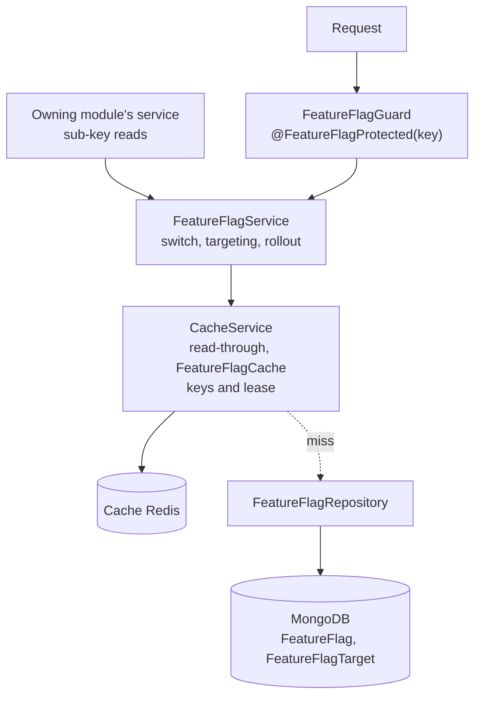

# Feature Flag

This page explains how the `feature-flag` module gates routes and code paths, for a developer who gates a feature or changes how a flag is evaluated.

## Table of Contents

- [Related Documents](#related-documents)
- [Overview](#overview)
- [Evaluation](#evaluation)
- [Targeting](#targeting)
- [Rollout percentage](#rollout-percentage)
- [Caching](#caching)

## Related Documents

- [Authorization][ref-doc-concept-authorization]: where the flag guard sits in the guard pipeline
- [Cache][ref-doc-concept-cache]: the read-through, the lease, and the invalidation the flag cache uses
- [Queue][ref-doc-concept-queue]: the outbox row that invalidates a flag after an update
- [MFA][ref-doc-concept-mfa]: the `mfa` flag, the one flag that switches a security control
- [Workspace][ref-doc-concept-workspace]: the `workspace` flag and its sub-keys
- [Feature Flag Guide][ref-doc-guide-feature-flag]: gate a route or a sub-feature
- [Feature Flag Reference][ref-doc-reference-feature-flag]: every seeded flag, its sub-keys, and the update rules
- [Configuration Reference][ref-doc-reference-configuration-feature-flag]: the `featureFlag` keys
- [Status Codes][ref-doc-reference-status-codes-feature-flag]: the code and message of each exception named here

## Overview

A route reaches `FeatureFlagService` through `FeatureFlagGuard`, and the module that owns a behavior reaches it for a sub-key. The service reads the flag through the cache and falls back to MongoDB on a miss. The decisions it makes are in [Evaluation](#evaluation).

- A flag is a row with a `key`, an `isEnable` switch, a `rolloutPercent` from 0 to 100, an allow-list of user ids (`targetUserIds`), and flat `metadata` of typed sub-keys.
- A flag answers one question: is this feature on for this caller. It is no authentication step and no authorization boundary, because the anonymous identifier is client-supplied and anyone can fake it. The `mfa` flag alone switches a security control ([MFA][ref-doc-concept-mfa]).
- Flags are seeded and never created or deleted through the API. Every key is an `EnumFeatureFlagKey` member the code names, so the seed writes one row for each key the code reads. An admin updates the values of an existing flag.
- A route is gated by `@FeatureFlagProtected(key)`. Code that reads a sub-key (a limit, a lock duration, an on/off switch of one sub-feature) calls the flag service from the module that owns the behavior.

## Evaluation

`@FeatureFlagProtected(key)` takes one `EnumFeatureFlagKey` member and mounts `FeatureFlagGuard`. The decorator checks its argument when the route is decorated, so a key that is empty or holds a dot (`FeatureFlagKeyEmptyException`, `FeatureFlagKeyNestedException`) fails the boot.

The decorator sits above `@AuthJwtAccessProtected()`, so the API key guard runs first, then the JWT guard, which writes the actor id to the request store (`RequestActorStoreKey`), and then the flag guard, which reads it. A signed-in caller is one whose JWT guard wrote the actor id. An anonymous caller is any other, a route with no JWT decorator included; there the decorator keeps its slot directly above `@RequestThrottleProtected({ route })` and `@ApiKeyProtected()`. A route behind a flag answers before the user guard loads the user ([Authorization][ref-doc-concept-authorization-pipeline]). The full order is in [Decorators and Guards Reference][ref-doc-reference-decorators-and-guards-order].

`FeatureFlagService.validateFeatureFlag` decides:

1. It reads the flag through the cache. A key with no row answers `FeatureFlagNotConfiguredException` (500), a deployment defect that reports to Sentry.
2. A flag with `isEnable` false answers `FeatureFlagDisabledException` (404). The switch outranks the allow-list and the rollout.
3. A signed-in caller passes when `targetUserIds` holds the id, and otherwise falls to the rollout bucket of the user id.
4. An anonymous caller passes at `rolloutPercent` 100 without an identifier, and below that falls to the bucket of the `x-anonymous-id` header.
5. Every refusal is the same `FeatureFlagDisabledException`, so a gated feature answers as if it does not exist.

The guard reads and validates the header on every request, and the service uses it only for an anonymous caller. A value is valid when it is 1 to `featureFlag.anonymous.idMaxLength` characters of ASCII letters, digits, `-`, and `_` (`FeatureFlagAnonymousIdRegex`). An absent or invalid value is treated as no identifier and never reaches the hash, a log, or a cache key. An anonymous caller below 100 with no valid identifier is refused.

**Sub-keys.** The decorator never reads `metadata`. The module that owns a behavior reads its sub-key where the behavior runs, ignoring rollout and targeting:

- `isMetadataAllowed` answers `true` only for an enabled flag whose sub-key is `true`, and throws `FeatureFlagNotConfiguredException` when the flag has no row.
- `validateFeatureFlagMetadata` throws `FeatureFlagDisabledException` when `isMetadataAllowed` is `false`.
- `getMetadataNumber` returns the stored number whatever `isEnable` says, and throws `FeatureFlagNotConfiguredException` for a missing row, a missing sub-key, or a value that is not a number. The seeded row holds each number and no config key repeats it, so an operator tunes a limit, an attempt budget, or a lock duration through the admin metadata update with no deploy.

A service reads a number before its use case opens the transaction.

**The `mfa` flag.** It is the one flag that also switches a security control. With it off, or with a method's sub-key off, a stored factor is neither offered nor accepted, and a user with no factor left that applies signs in with no MFA challenge, as an account with MFA off. The flag switches enrolled factors off so that turning MFA off stops challenging users who already enrolled ([MFA][ref-doc-concept-mfa]).

## Targeting

`targetUserIds` is an allow-list of users who always receive the feature. A targeted user passes at `rolloutPercent` 0.

- It applies to a signed-in caller only. An anonymous caller never matches it.
- The list is stored as `FeatureFlagTarget` rows and answered as `targetUserIds`.
- An admin update replaces the whole list. An id that no user row holds answers `UserNotFoundException` before the transaction opens.
- Per-user rollout belongs in this list and in `rolloutPercent`, never in the metadata.

## Rollout percentage

`rolloutPercent` opens a flag to a fixed share of callers, and the same caller always lands on the same side:

1. `HelperHashService.sha256Hash` hashes `{key}:{identifier}`.
2. The first 8 hex characters of the digest, read as a base-16 integer and taken modulo 100, give a bucket from 0 to 99.
3. The caller passes when the bucket is below `rolloutPercent`.

The key salts the hash, so a user inside the 30 percent of one flag is not inside the 30 percent of another. A signed-in caller's identifier is the user id, and the `x-anonymous-id` header is ignored for them. An anonymous caller lands in the same bucket while it keeps sending the same value.

## Caching

`FeatureFlagService.getByKey` reads the flag through `CacheService.readThrough` under the key `featureFlag.keyPattern` (`FeatureFlag:{key}`) with the TTL `featureFlag.cacheTtlInMs`, and takes a lease on `featureFlag.leaseKeyPattern` so a slow reader cannot write a value that an update already replaced ([readThrough and TTLs][ref-doc-concept-cache-readthrough]).

- A key with no row returns `null` and stores nothing.
- The sub-key methods read the same cached row through `getByKey`, so a sub-key goes stale the same way.
- The status update replaces `isEnable`, `rolloutPercent`, and `targetUserIds` together, and the metadata update replaces the sub-key values. Each writes the row and adds `CacheQueue.invalidateEffect` for the entry key and the lease key in the same transaction. After the commit the `cache` queue deletes both ([Invalidation through the outbox][ref-doc-concept-cache-invalidation]).
- Between the commit and the job, the old entry is still served, and never past `featureFlag.cacheTtlInMs`, the TTL the entry is written with. The next read after the job misses and loads the row again.
- A cache Redis error answers 503 `RedisUnavailableException`, and a flag lookup has no fail-open path. During the outage every flagged route and every sub-key read answers 503 before any row is read, so no route passes, and a missing row answers 503 too.

<!-- REFERENCES -->

[ref-doc-concept-authorization]: authorization.md
[ref-doc-concept-authorization-pipeline]: authorization.md#guard-pipeline
[ref-doc-concept-cache]: cache.md
[ref-doc-concept-cache-readthrough]: cache.md#readthrough-and-ttls
[ref-doc-concept-cache-invalidation]: cache.md#invalidation-through-the-outbox
[ref-doc-concept-queue]: queue.md
[ref-doc-concept-mfa]: mfa.md
[ref-doc-concept-workspace]: workspace.md
[ref-doc-guide-feature-flag]: ../guides/feature-flag.md
[ref-doc-reference-decorators-and-guards-order]: ../reference/decorators-and-guards.md#decorator-order
[ref-doc-reference-feature-flag]: ../reference/feature-flag.md
[ref-doc-reference-configuration-feature-flag]: ../reference/configuration.md#featureflag
[ref-doc-reference-status-codes-feature-flag]: ../reference/status-codes.md#feature-flag
