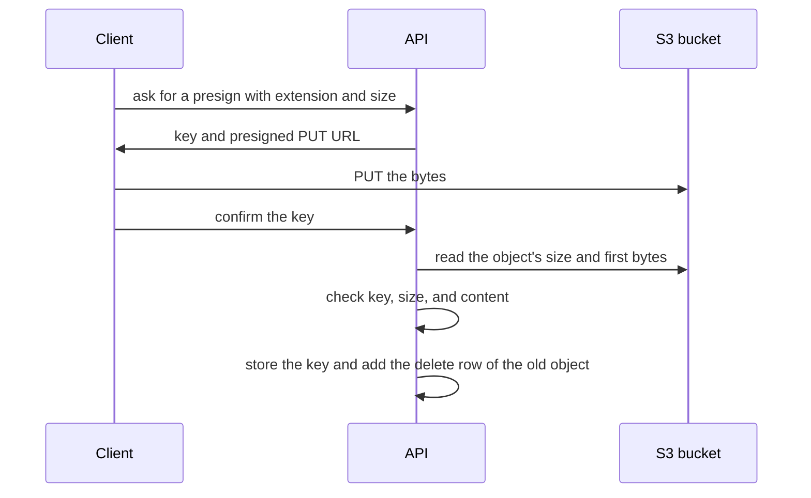

# File Upload

This page explains how a file reaches the application, for a developer who adds an upload route or an import.

## Table of Contents

- [Related Documents](#related-documents)
- [Overview](#overview)
- [Multipart transport](#multipart-transport)
- [CSV pipe chain](#csv-pipe-chain)
- [CSV export](#csv-export)
- [Presigned upload](#presigned-upload)
- [Replaced object cleanup](#replaced-object-cleanup)

## Related Documents

- [File Upload Guide][ref-doc-guide-file-upload]: add a multipart upload, a CSV import, or a presigned upload
- [File Upload Reference][ref-doc-reference-file-upload]: the decorators, pipes, extensions, presign options, and errors
- [Request Validation][ref-doc-concept-request-validation]: how a validation issue becomes a message, which an import reuses per row
- [Response][ref-doc-concept-response]: the file response of an export
- [Queue][ref-doc-concept-queue]: the outbox row that deletes a replaced object
- [Dependencies][ref-doc-dependencies-optional]: how an unset S3 adapter answers
- [Production][ref-doc-production-cloud]: the bucket, its policy, and the IAM setup

## Overview

- The kit has three parts: `FileService`, the decorators and pipes under `src/common/file/`, and `AwsS3Service` under `src/common/aws/`. A feature uses them and never builds an S3 client of its own.
- A file reaches the application one of two ways. A multipart upload sends the bytes through the API, which validates them and a feature stores them in S3 through `AwsS3Service.putItem`. A presigned upload sends the bytes from the client straight to S3, and the API only signs the request and checks the result.
- A CSV import is a multipart upload whose parsed rows go through a validation pipe. It parses the file and stores nothing.
- The diagram shows the presigned upload, the longer flow.

## Multipart transport

A multipart route carries one upload decorator, and its file parameter carries the validation pipes.

- `FileUploadSingle`, `FileUploadMultiple`, and `FileUploadMultipleFields` apply a multer interceptor, the Swagger `multipart/form-data` body, and `FileUploadErrorInterceptor`. A single upload reads the `file` field and a multiple upload reads `files`, and a route can name another field. The size limit is 10 MB per file and a multiple upload takes up to 3 files unless the route passes its own limits.
- `FileUploadErrorInterceptor` maps a multer or busboy error to a typed exception: a file over the size limit answers 413, and a file count, an unexpected field, or a malformed multipart body answers 422.
- Validation is a pipe on `@UploadedFile(...)`, never an `if` in a controller or service. `FileRequiredPipe()` rejects an empty upload, and `FileExtensionPipe([...])` takes the allow-list of extensions the route accepts. A controller never reads `file.buffer`.
- An upload route carries `@RequestTimeout(RequestUploadTimeout)`, a longer timeout than the default.
- A multi-file upload is validated element by element, and one rejected file rejects the request.

`FileExtensionPipe` checks the name and then the bytes:

1. It reads the extension from `originalname` and checks it against the route's allow-list.
2. It sniffs the type from the buffer with `file-type`, through `FileService.isContentOfExtension`. The sniffed type passes only when it is one of the signatures that `FileExtensionContract` lists for the declared extension.
3. `csv` and `hbs` have no signature. An empty sniff passes only for an extension with no signatures, and any sniffed type passes only when it is in the extension's list, so a sniffed binary type is rejected for `csv` and `hbs`.

The signature check is the one content check: the application runs no malware scan. An uploadable extension needs a row in `FileExtensionContract` before a route can accept it. Every failure of the name or of the bytes throws `FileExtensionInvalidException`, which answers 415.

## CSV pipe chain

A CSV import validates a file in four pipes, in this order:

1. `FileRequiredPipe()` rejects a missing file with `FileRequiredException`, which answers 422.
2. `FileExtensionPipe([EnumFileExtensionDocument.csv])` checks the name and the bytes.
3. `FileCsvParsePipe` requires a non-empty `.csv`: a zero-byte file throws `FileRequiredException` (422) and another extension throws `FileExtensionInvalidException` (415). It then parses the file with `FileService.readCsv`. The file uses `;` as its delimiter and a header row, empty lines are skipped, and an empty cell becomes `null`.
4. `FileCsvValidationPipe(schema, { maxDataImportConfigKey })` validates every row against a request schema.

The validation pipe checks the file as a whole before the rows:

- A file with no data rows throws `FileRequiredExtractFirstException`, and more rows than the cap throws `FileExceedMaxDataImportException`. Both answer 422 at once, with no row validation. The cap is `file.maxDataImport`, or the key the route names, such as `user.maxDataImport`.
- The pipe validates rows in batches of `file.importValidationConcurrency`. The batches run in turn, and the rows inside one batch run concurrently.
- It collects every row failure before it throws. Every row that fails is collected with its zero-based row index and its issues, and one `FileImportException` carries the whole list. It answers 422 and `AppValidationImportFilter` renders it with the same issue-to-message mapping as a request body ([Issue to message mapping][ref-doc-concept-request-validation-mapping]).
- The pipe takes config keys and not values, because a decorator runs before config resolves.

`@FileImportSingle()` replaces `@FileUploadSingle()` on an import route and adds the two import errors to the Swagger document: `FileImportException` (`importInvalid`) and `FileExceedMaxDataImportException` (`exceedMaxDataImport`).

## CSV export

`FileService.writeCsv` writes the CSV of an export with the same `;` delimiter and escapes formula cells, so a cell that starts like a spreadsheet formula is written as text.

## Presigned upload

The browser sends the bytes to S3 directly, so the API never proxies a large file. The profile photo is the reference flow, and the term-policy content upload uses the same mechanism against the private bucket.

1. The client asks for a presign with an extension and a size. The service refuses a size above `user.photo.maxSizeInBytes`, builds a random key under `users/{userId}/profile/` (`user.uploadPhotoProfilePathPattern`), and calls `AwsS3Service.presignPutItem` for the public bucket. The signed request is valid for `aws.s3.presignExpiresInSeconds`.
2. The response carries the key, the mime type, the extension, the presigned URL, and the expiry. The signature covers `content-type`, `content-length`, and `host`, so the client PUTs with `content-type` set to exactly the returned mime type and no other signed header. Encryption at rest is the bucket default.
3. The client PUTs the bytes to S3 and then sends the key to the API.
4. The confirm request carries the key. The service checks the key and the object before it writes anything:
    - The key must sit under the user's own profile path, or the request answers 400 with `UserPhotoKeyInvalidException`. A key with no uploaded object answers the same.
    - It reads the object's metadata (`checkItem`) and its first bytes (`getItemBytes`, `FileSniffSizeInBytes` long) in parallel. The size is the one S3 reports, never one the request states.
    - It checks the size first, then the first bytes against the extension with `FileService.isContentOfExtension`.
    - An object refused for its size or its content, public or private, gets a delete row in a transaction that holds that row alone, because the client has already put the object in the bucket. Then the request answers 400 with `UserPhotoSizeExceededException` or 415 with `UserPhotoContentInvalidException`.
    - `UserProfileService.checkPhotoProfile` reads, `isPhotoProfileRejected` decides, `deleteRejectedPhotoInTx` adds the row, and `UserUpdatePhotoProfileUseCase` sequences them.
5. One transaction stores the photo on the user, adds the activity entry, and adds the delete row of the previous photo ([Replaced object cleanup](#replaced-object-cleanup)).

The term-policy content upload confirms the same way against the private bucket, in the create, update-content, and add-content flows. The confirm body is `{ language, key }`, and the stored size is the one S3 reports. `TermPolicyContentService.checkContent` reads, `TermPolicyUtil.isContentRejected` decides, and `deleteRejectedContentInTx` adds one delete row holding the refused keys only, so a create with several contents keeps the accepted ones. A key outside the policy path or with no uploaded object throws `TermPolicyContentKeyInvalidException`. The presign request keeps `size`, which the service checks against `termPolicy.content.maxSizeInBytes` before it signs.

A presign is a credential. It travels in the response and nowhere else, and it expires after `aws.s3.presignExpiresInSeconds`. An unset S3 adapter makes `presignPutItem` return `null`, and the service throws `AwsS3NotConfiguredException` (HTTP 501): a presign never succeeds without S3.

## Replaced object cleanup

Deleting an S3 object is a side effect, so it is an outbox row of the module that owns the object ([Queue][ref-doc-concept-queue-outbox]).

- The row joins the transaction of the database write that replaces or deletes the object. When no other write happens, as for a presigned object refused for its size or its content, the use case opens a transaction for the delete row alone.
- A user's previous profile photo is deleted this way once a new one replaces it, and a replaced or deleted term-policy content object likewise. `UserQueue.deletePhotoEffect` and `TermPolicyQueue.deleteContentEffect` build the rows, and their processors call the S3 delete.
- A service adds a photo delete only for a key under the user's own profile path (`UserProfileService.isPhotoProfileKeyOwned`).
- An export file needs no delete row. It sits under `<aws.s3.temporaryPath>/` in the private bucket, and one bucket lifecycle rule expires everything under that path after `aws.s3.temporaryExpiresInDays`.

<!-- REFERENCES -->

[ref-doc-guide-file-upload]: ../guides/file-upload.md
[ref-doc-reference-file-upload]: ../reference/file-upload.md
[ref-doc-concept-request-validation]: request-validation.md
[ref-doc-concept-request-validation-mapping]: request-validation.md#issue-to-message-mapping
[ref-doc-concept-response]: response.md#pagination-and-file-responses
[ref-doc-concept-queue]: queue.md
[ref-doc-concept-queue-outbox]: queue.md#outbox-row-in-the-transaction
[ref-doc-dependencies-optional]: dependencies.md#optional-adapters
[ref-doc-production-cloud]: ../production.md#cloud-setup
