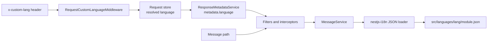

# I18n

This page explains how the application picks a language for a request and turns a message path into text, for a developer who adds a message or reads a localized response.

## Table of Contents

- [Related Documents](#related-documents)
- [Overview](#overview)
- [Language resolution](#language-resolution)
- [Message paths](#message-paths)
- [Where messages resolve](#where-messages-resolve)

## Related Documents

- [I18n Guide][ref-doc-guide-i18n]: add a message or a language
- [Request Validation][ref-doc-request-validation-mapping]: the issue-to-message mapping for validation errors
- [Response][ref-doc-response]: the success message and its placeholders
- [Error Handling][ref-doc-error-handling]: the exception message and its placeholders
- [HTTP Contract][ref-doc-http-contract]: the `x-custom-lang` header and the `language` metadata field
- [Request Pipeline][ref-doc-request-pipeline]: the middleware that resolves the language

## Overview



- Messages come from [nestjs-i18n][ref-nestjs-i18n] over JSON files in `src/languages/<language>/`, one file per module prefix.
- English is the only language the project ships, and it is the default.
- A message is addressed by a path, never written in code, so the same path resolves in every language and a sentence changes in a JSON file with no code change. A response, an exception, and a validation issue each carry a path, and `MessageService` resolves it in the language of the request.
- `MessageModule` is global, so any service, filter, or interceptor injects `MessageService` with no local import.

## Language resolution

`RequestCustomLanguageMiddleware` runs in the middleware chain and resolves the language once per request (`src/common/request/middlewares/request.custom-language.middleware.ts`).

The language comes from the explicit `x-custom-lang` header and not from `Accept-Language`, so a client sets it on purpose and a browser default never changes it.

1. It starts from the default language, `message.defaultLanguage`.
2. It reads the `x-custom-lang` header. Of a list separated by `,` or `;` it takes the first entry, drops a subtag after `-` or `_` (so `en-US` is `en`), trims it, and lower-cases it.
3. It keeps the value only when it is in `message.availableLanguages`, which is every member of `EnumMessageLanguage`. Any other value leaves the default.
4. It writes the result to the request store and rewrites the header to the resolved value.

`ResponseMetadataService` reads the language from the store, falls back to the default when the store holds a value outside the enum, and reports it as `metadata.language` and as the `x-custom-lang` response header. Every message of that response resolves in that language.

`MessageModule` also configures nestjs-i18n with a header resolver on `x-custom-lang`, the default language as the fallback language, and a `<language>-*` fallback per available language. The loader watches `src/languages/` for changes.

- `MessageService.setMessage` always passes an explicit language, and it first maps a language outside `message.availableLanguages` to the default. The middleware has already removed the subtag and checked the enum, so the header resolver never picks the language and the regional `<language>-*` fallback never fires on a request. They are a second guard behind the middleware.
- The fallback language does apply to a missing key. When a key is missing in a language other than the default, nestjs-i18n answers the default language's text. When it is missing in the default language, the answer is the path itself.

## Message paths

A path is the file name plus the nested key: `user.error.notFound` resolves to the `error.notFound` entry of `src/languages/<language>/user.json`.

- The first segment is the file name, camelCase, matching the module (`featureFlag.json`, `termPolicy.json`). Every other segment is camelCase, and the HTTP status keys of `http.json` (`http.404`) are the exception because `AppHttpFilter` reads them by status.
- A success message sits at the top level of its file, keyed by the action. A sub-resource adds one level.
- An error message sits under `error`, and queue text sits under `queue`.
- A placeholder is written `{name}` and filled from `messageProperties`. The same placeholders appear in every language file for a key.
- A key exists in every language directory. A key missing from a language other than the default shows the default language's text, a key missing from the default language shows the path string, and nothing fails at build time.
- A flat key such as `"error.notFound"` does not resolve.

This is the shape of a module's file (`src/languages/en/role.json`, an excerpt):

```json
{
    "error": {
        "notFound": "Sorry, we couldn't find the requested role.",
        "exist": "A role with this name already exists."
    }
}
```

The path `role.error.notFound` resolves to the first entry.

Email and term-policy bodies are templates, and a log line is not a message. Neither goes through the language files.

## Where messages resolve

`MessageService.setMessage(path, options)` is the one entry point (`src/common/message/services/message.service.ts`). It takes the language from `options.customLanguage`, checks it against the available languages, falls back to the default, and calls the i18n translator with the placeholders.

- The exception filters resolve `exception.messagePath` with `exception.messageProperties`, in the language of the response metadata. `AppHttpFilter` resolves `http.{status}`.
- `ResponseInterceptor` and `ResponsePaginationInterceptor` resolve the path from the route decorator, or from the use case's `metadata.messagePath` when it returns one, with `metadata.messageProperties` as the placeholders.
- `MessageService.setValidationMessage` resolves each validation issue, and `setValidationImportMessage` does the same per row of an import. The lookup order is in [Request Validation][ref-doc-request-validation-mapping].
- A text for an internal reader, such as a job's return value, a job failure, or a side-effect description, does not follow the request language, because a worker has no request. It resolves in `message.defaultLanguage`.
- A path with no entry in the default language resolves to the path itself, so a typo shows in the response and the call still succeeds.

<!-- REFERENCES -->

[ref-nestjs-i18n]: https://nestjs-i18n.com
[ref-doc-guide-i18n]: ../guides/i18n.md
[ref-doc-request-validation-mapping]: request-validation.md#issue-to-message-mapping
[ref-doc-response]: response.md
[ref-doc-error-handling]: error-handling.md
[ref-doc-http-contract]: ../reference/http-contract.md
[ref-doc-request-pipeline]: request-pipeline.md
