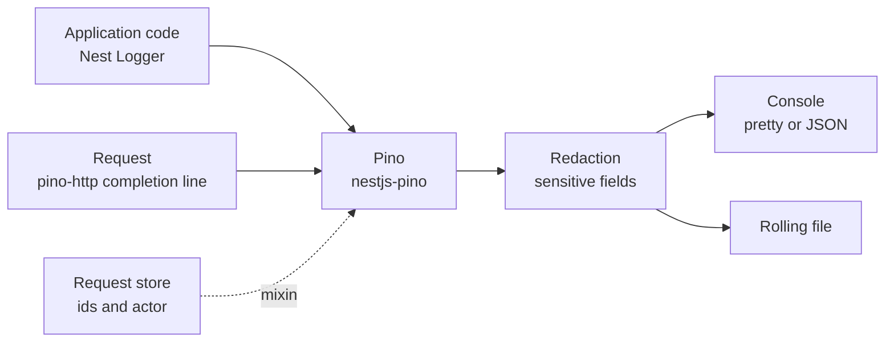

# Logging

This page explains how the application writes logs, for a developer who adds a log line or reads one in production.

## Table of Contents

- [Related Documents](#related-documents)
- [Overview](#overview)
- [Logger handover](#logger-handover)
- [Request logs and request id](#request-logs-and-request-id)
- [Redaction](#redaction)
- [Boot and seed failures](#boot-and-seed-failures)

## Related Documents

- [Logging Reference][ref-doc-reference-logging]: the levels, the redacted fields, and the fields of a log record
- [Sentry][ref-doc-concept-sentry]: what reaches Sentry and how events are scrubbed
- [Middleware][ref-doc-reference-middleware]: the request id middleware and the Pino HTTP middleware
- [Error Handling][ref-doc-concept-error-handling]: which failures the filters log
- [Configuration Reference][ref-doc-reference-configuration-logger]: the `logger` keys
- [Production][ref-doc-production-observability]: JSON logs and Sentry rates in production

## Overview



- Application code logs through Nest's `Logger`, and `LoggerModule.forRoot()` puts Pino (`nestjs-pino`) behind it. `LoggerOptionService` builds the options once.
- `logger.enabled` switches logging on, and `logger.level` sets the threshold. With `LOGGER_ENABLED` off Pino's level is the string `silent`, which is not an `EnumLoggerLevel` member, and Pino drops every line, a `fatal` one included.
- A level says who must act: `fatal` means the process cannot continue, `error` means someone must look, `warn` means degraded but handled, `info` is a lifecycle fact, and `debug` and `trace` are detail.
- The output goes to a pretty console when `logger.prettyEnabled` is on, to a rolling file when `logger.fileEnabled` is on, and to standard output as JSON when neither is on. The file is `./logs/api.log` (`logger.filePath`), rotated daily or at 10 MB.
- A log record is one flat object with a fixed set of fields ([Logging Reference][ref-doc-reference-logging-fields]).

## Logger handover

The application creates its Pino logger while it boots, so Nest buffers what it logs until Pino is ready.

- `NestFactory.create` receives `ConfigureOptions` with `bufferLogs: true`, `logger: ['fatal']`, and `abortOnError: false`. `abortOnError: false` makes Nest throw a boot error, so it reaches `.catch(bootstrapFailed)`. With `true`, Nest ends the process itself.
- With `bufferLogs`, Nest buffers every log call at every level. Before Pino takes over, the default logger prints only `fatal`, and the lines below `fatal` are dropped when the buffer is replayed through it.
- `configure(app)` calls `app.useLogger(app.get(Logger))`, where `Logger` is the class from `nestjs-pino`. From then on the buffered lines replay through Pino at `LOGGER_LEVEL`. A replay empties the buffer, so a line prints once.
- The seed entry does the same: `CommandFactory.createWithoutRunning` receives the same three options, then `app.useLogger(app.get(Logger))` and `app.flushLogs()` run before the command, so the buffered lines print before the command starts.
- A failure that happens before the handover still reaches the process output, because `bootstrapFailed` logs it ([Boot and seed failures](#boot-and-seed-failures)).

## Request logs and request id

Every log line a request causes carries `requestId`, `correlationId`, and `userId`.

- The Pino `mixin` reads them from the request store (`RequestIdStoreKey`, `RequestCorrelationIdStoreKey`, `RequestActorStoreKey`). A line outside a request, or before the JWT guard runs, carries `null` for the missing value. `userId` holds the actor from `RequestActorStoreKey`, which the JWT access and refresh guards write, so it is `null` on a public route and in a job.
- `RequestModule.forRoot()` comes before `LoggerModule.forRoot()` in `CommonModule`, so the request store wraps the completion line that `pino-http` writes.
- A request id and a correlation id are the inbound `x-request-id` and `x-correlation-id` headers when they match the allowed pattern, and a new UUID v7 otherwise ([Request ID][ref-doc-reference-middleware-request-id]).

The access log is one completion line per request, written only when `logger.accessLogEnabled` is on.

- `logger.excludedRoutes` skips the liveness route, the health routes, `/metrics`, `/favicon.ico`, the Swagger prefix, and `/`. `LoggerUrlUtil.matchesPatterns` compares the path in lower case. A pattern matches exactly, as a prefix when it ends in `*`, or as a glob when it holds an inner `*`.
- The request serializer logs the method, the user agent, the content type, the client IP, and the referer reduced to its origin with its dynamic path segments replaced by `[REDACTED]`. The route is the route template when the router matched one, and otherwise the URL with every dynamic path segment replaced by `[REDACTED]`.
- Query, headers, and the values of the route params are redacted. A request or response body is never logged.
- The response serializer logs the status code, the content length, the response time, and redacted headers.

The exception filters add the failures. `AppGeneralFilter` and `AppHttpFilter` log one `error` line for every 5xx and report it to Sentry. `AppGeneralFilter`, `AppHttpFilter`, and `AppValidationFilter` log one `warn` line for a 401, 403, 413, 415, 422, or 429 refusal, and no filter logs any other 4xx ([Error Handling][ref-doc-concept-error-handling]).

## Redaction

`LoggerSensitiveFields` (`src/common/logger/constants/logger.constant.ts`) is the one list of sensitive keys, and every credential key the application adds joins it. Two mechanisms redact by that list:

1. Pino's `redact` option takes each key under each container path (`req`, `res`, `request`, and `response`, each with `headers`, `query`, `params`, or `body` where it applies) and writes `[REDACTED]` in place. No serializer emits a body, so the `body` paths have nothing to match.
2. `LoggerUtil.redactValue` redacts the same keys, case-insensitively, in the extra data of a record and in the request and response serializers. It goes five levels deep (`LoggerRedactMaxDepth`), counting from the value handed to it. An object at the fifth level is replaced whole with `[REDACTED]`, an array is cut after ten items with a marker holding its length, and a `Buffer` becomes `{ buffer: '[BUFFER]' }`.

`LoggerUtil.sanitizeMessage` is a separate step that uses no key list. It cleans a message string: it removes ANSI sequences, the decoration characters `~` and `→`, line numbers at the start of a line, and runs of whitespace. It runs on the record's message, on the error message, and on each string value inside `redactValue`.

An error is serialized to `type`, `message`, `code`, `statusCode`, and `stack`, plus its `cause` chain. The chain stops at five levels, with the same constant and its own counter, and a deeper cause is left out. A cause that is not an `Error` goes through `redactValue`.

The same constants feed the Sentry scrub, so a key added once is redacted in both places ([Sentry][ref-doc-concept-sentry-scrubbing]).

## Boot and seed failures

Both entry points end in the same handler:

```typescript
import '@instrument';

const { bootstrapApplication, bootstrapFailed } = await import('@bootstrap');

bootstrapApplication().catch(bootstrapFailed);
```

This is `src/main.ts`. `src/migration.ts` is the same file with `bootstrapMigration`.

- `bootstrapFailed` (`src/bootstrap.ts`) logs one `fatal` line under the `Bootstrap` context, flushes the logger, calls `Sentry.captureException` and `Sentry.flush` directly, and exits with code 1. It uses Sentry directly because it runs outside the Nest container. With `LOGGER_ENABLED` off and Pino in place, the `fatal` line is dropped, and the Sentry report and the exit code 1 still run.
- An invalid environment value or an unreachable MongoDB, cache Redis, or queue Redis fails inside `bootstrapApplication` and takes this path. All three Redis clients connect before the application boots.
- The seed runner sets nest-commander's `serviceErrorHandler`, whose default exits 0 on a failure. The handler rethrows an `AppBaseException` and wraps any other error in an `AppUnknownException` described `Running the migration command failed`, so a failed seed reaches `bootstrapFailed` and the process exits 1.

<!-- REFERENCES -->

[ref-doc-reference-logging]: ../reference/logging.md
[ref-doc-reference-logging-fields]: ../reference/logging.md#log-record-fields
[ref-doc-concept-sentry]: sentry.md
[ref-doc-concept-sentry-scrubbing]: sentry.md#scrubbing
[ref-doc-reference-middleware]: ../reference/middleware.md
[ref-doc-reference-middleware-request-id]: ../reference/middleware.md#request-id
[ref-doc-concept-error-handling]: error-handling.md
[ref-doc-reference-configuration-logger]: ../reference/configuration.md#logger
[ref-doc-production-observability]: ../production.md#observability
