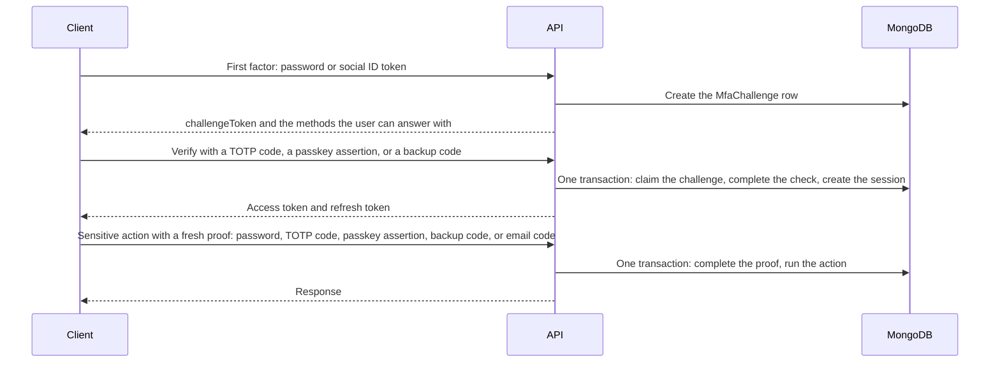

# MFA

This page explains multi-factor authentication, for a developer who changes a factor, a challenge, or a re-authentication flow.

## Table of Contents

- [Related Documents](#related-documents)
- [Overview](#overview)
- [TOTP](#totp)
- [Passkeys](#passkeys)
- [Challenge at login](#challenge-at-login)
- [Reauthentication](#reauthentication)
- [Backup codes](#backup-codes)
- [Attempts and lockout](#attempts-and-lockout)
- [Admin reset](#admin-reset)

## Related Documents

- [Authentication][ref-doc-concept-authentication]: the first factor and the session a verified challenge creates
- [Session][ref-doc-concept-session]: the sessions a factor change revokes
- [User][ref-doc-concept-user]: the password lock and the flows that re-authenticate
- [Passkeys Guide][ref-doc-guide-passkeys]: set up the relying party locally, register a passkey, and sign in with it
- [Feature Flag][ref-doc-feature-flag]: the `mfa` and `loginWithPasskey` flags
- [Configuration Reference][ref-doc-reference-configuration-mfa]: the `mfa` keys
- [Production][ref-doc-production-variables]: the passkey client files a mobile client needs
- [Status Codes][ref-doc-reference-status-codes-mfa]: the code and message of each exception named here

## Overview

The diagram shows a login that stops at an MFA challenge and a sensitive action that needs a fresh proof.

- Two factors exist: TOTP, one per user, and passkeys, up to the `passkeyMaxPerUser` metadata of the `mfa` flag. A biometric such as Face ID or a fingerprint is a passkey. SMS is not a factor.
- MFA is opt-in per user. A factor is effective when the user enrolled it and the `mfa` flag allows it (`totpAllowed`, `passkeyAllowed`), and MFA is on while one is effective. A user may enroll both and picks one per challenge.
- Backup codes recover either factor. Every user has one `Mfa` row, created with the user: the attempt counter, the lock, and the backup codes.
- The `mfa` module owns the factors, the challenge, and the attempt budget. The `user` module's use cases call it for login, password reset, and re-authentication.
- Every `/shared/mfa/*` route carries `@FeatureFlagProtected(EnumFeatureFlagKey.mfa)`, and enrolling a factor also needs its `...Allowed` metadata. The login verify route carries no flag, and with the flag off a pending challenge answers `MfaNotEnabledException` at step 2 of the verify call.

## TOTP

`MfaTotp` holds one row per user. `secret` is the confirmed authenticator and `pendingSecret` is a setup that is not confirmed yet.

1. Setup needs a re-authentication. It draws a secret of `mfa.totp.secretLength` characters, stores it encrypted as `pendingSecret`, and answers the secret with an `otpauth` URL for the authenticator app. Setup is refused while a confirmed secret exists (`MfaTotpAlreadyEnabledException`, 400, `52606`).
2. Enable needs a re-authentication too. It takes a code from the app and checks it against `pendingSecret`. A user who never ran setup answers `MfaTotpSetupRequiredException` (400, `52608`).
3. A matching code moves `pendingSecret` into `secret`, resets the attempt budget, and applies the backup-code rule below.
4. Disable needs a re-authentication. It deletes the row, revokes every session but the caller's, and empties the backup codes when TOTP was the last factor.

Enrolling a factor while the user holds no backup codes (the first factor, or after every code is spent) writes a fresh set and answers it once. Enrolling while codes remain keeps them.

The code check:

- The algorithm is SHA-1 with `mfa.totp.digits` digits and a `mfa.totp.periodInSeconds` step. `mfa.totp.window` (1) is backward only: codes up to that many steps earlier are accepted, and a future step's code is not.
- `MfaTotp.lastUsedStep` accepts each step once, so a replayed code is refused at completion with `MfaInvalidException` (401, `52600`) and counts no attempt, because the completion transaction aborts.
- The issuer shown in the app is `MFA_TOTP_ISSUER`.

The secret is stored encrypted with AES-256-GCM, keyed by `MFA_TOTP_ENCRYPTION_SECRET` (48 random bytes as 64 base64url characters, a root secret separate from `APP_ENCRYPTION_SECRET`) with the user id as authenticated data, so a secret copied onto another row does not decrypt. A secret that fails to decrypt answers `MfaTotpSecretUnavailableException` (409, `52609`) and is reported to Sentry as an operator fault. A root has no rotation path: replacing it invalidates every stored secret.

## Passkeys

A passkey is a WebAuthn credential, handled by `@simplewebauthn/server` with user verification required, so one passkey combines possession with a biometric or PIN, which is why it stands alone as a proof. A resident key is required because the passwordless sign-in options name no credential, and the attestation conveyance is `none`. The relying party is `MFA_PASSKEY_RP_ID`, named by `APP_NAME`.

Registration is two calls:

1. The first call answers the creation options and a `challengeToken`, an `MfaChallenge` row of purpose `registration` that expires after `mfa.challengeExpiresInMs` like every challenge. The options exclude the credentials the user already holds.
2. The second call needs a re-authentication. It sends the challenge token, a name, and the credential the authenticator made. The service checks the limit, verifies the registration response (origin, challenge, RP id, user verification), and refuses a credential id that is already registered. It stores the credential id, the public key as base64url, the counter, the transports, the device type, and whether it is backed up. The public key is not a secret and is stored plain.
3. A list that holds `passkeyMaxPerUser` passkeys answers `MfaPasskeyLimitException` (400, `52611`). A known credential id answers `MfaPasskeyAlreadyRegisteredException` (409, `52612`). A response that fails verification, or an origin outside the list, answers `MfaPasskeyInvalidException` (401, `52610`).
4. The backup-code rule above applies: the first factor of a user writes the codes and answers them once.

The origin of an attestation or an assertion is read from its `clientDataJSON` and matched against `MFA_PASSKEY_ORIGINS`: an exact origin, `https://*.<domain>` for a name under the RP id, `android:apk-key-hash:<hash>`, or `*`, accepted outside production only, which admits any origin. The matched origin is passed to the library as the expected origin. `AppEnvSchema` refuses any other shape at boot, and a `*` entry in production. The shapes: [Configuration Reference][ref-doc-reference-configuration-triggers].

An assertion passes only when its counter rose above the stored one: a counter that did not rise marks a cloned authenticator, so the assertion is a mismatch. A stored and an asserted counter of 0, which authenticators that keep no counter send, also passes. Renaming a passkey needs no proof. Deleting one needs a re-authentication, revokes every session but the caller's, and empties the backup codes when it was the last factor.

A passkey also signs a user in without a password when `loginWithPasskey` is on: [Login methods][ref-doc-concept-authentication-login]. Registration reads the `mfa` flag and never `loginWithPasskey`. A mobile client needs two files served from the RP id domain: [Production][ref-doc-production-variables].

## Challenge at login

A login whose first factor passes and whose user has an effective factor answers a challenge in place of tokens.

- The challenge is an `MfaChallenge` row of purpose `login`, created in the login transaction. The token is 48 random characters, and the row holds only its SHA-256 hash.
- The row seals what the session needs later: the device identity, the client kind, and the login method. The device push token is stored encrypted with `APP_ENCRYPTION_SECRET` and the user id as authenticated data.
- It expires after `mfa.challengeExpiresInMs`. The daily `purgeExpired` job of the `mfa` queue (`mfa.purgeExpiredCron`) deletes it `mfa.challengeRetentionInMs` after that.
- The response lists the `methods` the user can finish with: `totp` and `passkey` for each effective factor, and `backupCode` while codes remain. A passkey method comes with the WebAuthn request options.

`UserLoginVerifyMfaUseCase` finishes the login:

1. It reads the live challenge. A missing, expired, used, or wrong-purpose token answers `MfaChallengeInvalidException` (401, `52601`).
2. It loads the user and the factor state at once. A missing user answers `UserNotFoundException`, an inactive one `UserInactiveForbiddenException` (403, `51007`), and an unverified one `UserEmailNotVerifiedException` (403, `51015`). No effective factor answers `MfaNotEnabledException` (400, `52602`).
3. `MfaService.check` verifies the chosen method and writes nothing. A missing `method` answers `MfaMethodRequiredException` (400, `52604`). A method the flag switches off, the user has not enrolled, or a backup code with none left answers `MfaMethodUnavailableException` (400, `52605`). Neither counts an attempt.
4. A mismatch is counted in a transaction of its own and answers `MfaInvalidException` (401, `52600`), `MfaPasskeyInvalidException`, and the failure that reaches `mfaMaxAttempts` answers `MfaAttemptMaxException` (403, `52603`).
5. A match runs one transaction. It claims the challenge with a guarded update, resets the budget, stamps the TOTP step or the passkey counter, or removes the used backup code, adds the `userMfaVerified` entry, and creates the session as any login does.

A password reset follows the same shape with a `resetPassword` challenge when the account has MFA on: it proves one effective factor (a TOTP code or a passkey) or a backup code.

## Reauthentication

A sensitive action asks for a fresh proof before it runs. The actions are `deleteSelf`, `changePassword`, `mfaTotpSetup`, `mfaTotpEnable`, `mfaTotpDisable`, `mfaBackupCodeRegenerate`, `mfaPasskeyRegister`, `mfaPasskeyDelete`, `mobileNumberAdd`, `mobileNumberUpdate`, `mobileNumberDelete`, `sessionRevoke`, and `deviceRemove`. Logout of the caller's own session asks for none. The proof means an access token alone cannot change a credential, a factor, or a session.

The proof depends on the account:

- An account with MFA on sends a TOTP code or a backup code, beside its password when it has one.
- For any action, one passkey assertion is the whole proof, with no password or code beside it. Its challenge is an `MfaChallenge` row of purpose `reauthentication`, expiring after `mfa.challengeExpiresInMs`, and one action claims it. With `passkeyAllowed` off the proof answers `MfaMethodUnavailableException`.
- `mfaTotpEnable` proves the new authenticator and skips the MFA proof once the password check passed. An account with no password and MFA on sends a passkey or a backup code there.
- An account with no password and no MFA proves itself with an email code bound to the action. The code works once within `verification.expiresInMinutes` and stays valid after a wrong attempt. Asking for one is refused for an account with a stronger proof (`UserReauthenticationOtpNotAllowedException`, 400, `51027`). A request with no code answers `UserReauthenticationOtpRequiredException` (400, `51029`) and a wrong code `UserReauthenticationOtpInvalidException` (400, `51030`), counted on no budget.

Each flow runs the checks in its use case before its work. The password check and the MFA check write nothing, and each mismatch counts on its own budget. The flow then completes each proof it checked first inside its one transaction.

## Backup codes

- A user gets `mfa.backupCodes.count` codes of `mfa.backupCodes.length` uppercase alphanumeric characters. They are shown once.
- Only Argon2id hashes are stored, in `Mfa.backupCodes`. Enrolling a factor while the user holds no codes (the first factor, or after every code is spent) writes a fresh set and answers it once. Enrolling while codes remain keeps them. The last factor's removal empties them.
- A code is consumed by its matched hash with a guarded write against the codes the transaction read, so one code cannot be spent twice.
- A re-authenticated user regenerates the whole set. Regenerating needs MFA on (`MfaNotEnabledException` otherwise, before any proof) and replaces the whole set, whether codes remain or not.
- The status read answers how many codes remain, never the codes.

## Attempts and lockout

One budget covers every MFA method in every flow (login, password reset, re-authentication), so switching methods earns no extra tries. Only `MfaService` counts.

1. A flow first asserts that no lock is running. It checks the credential without writing, so a mismatch is the one path that writes.
2. A mismatch is counted in a transaction of its own that adds the `userMfaVerificationFailed` entry. It commits on its own because the request then throws, so the count survives the failed request.
3. The failure that reaches `mfaMaxAttempts`, a metadata key of the `mfa` flag, zeroes the counter and sets `Mfa.lockedUntil` to `mfaLockDurationInMinutes` ahead, another metadata key of the same flag. The same transaction adds the `userMaxMfaAttemptReached` entry and the mandatory `loginLocked` notification.
4. While the lock runs, every MFA check answers `MfaAttemptMaxException` (403, `52603`).
5. A match, which a running lock never reaches, resets the counter and clears an ended lock.

A lock touches no status, session, or device, and it ends with the clock. A status change to `active` clears it; a locked user stays `active`, so that reaches only an `inactive` user. An active user's lock ends with the clock or an admin MFA reset. The password lock is a separate budget on the user row: [Status and lockout][ref-doc-concept-user-lockout].

## Admin reset

An admin resets the MFA of a user who lost the factors.

1. The use case refuses the admin's own account, a target the admin does not outrank, and a blocked target (`UserNotSelfException`, 400, `51001`; `RoleRankForbiddenException`, 403, `50504`; `UserBlockedInvalidException`, 400, `51006`). It answers `MfaNotEnabledException` for a user with no stored factor, whatever the flag says.
2. It reads the recipient snapshot for the notification before the transaction opens.
3. One transaction deletes the TOTP row and every passkey, empties the backup codes, the counter, and the lock, and revokes every session of the user. It adds the `resetMfaByAdmin` notification, the actor entry `adminUserMfaReset`, and the target entry `userMfaResetByAdmin`.
4. The next login of the user asks for no MFA, and the user may enroll again.

<!-- REFERENCES -->

[ref-doc-concept-authentication]: authentication.md
[ref-doc-concept-authentication-login]: authentication.md#login-methods
[ref-doc-concept-session]: session.md
[ref-doc-concept-user]: user.md
[ref-doc-concept-user-lockout]: user.md#status-and-lockout
[ref-doc-guide-passkeys]: ../guides/passkeys.md
[ref-doc-feature-flag]: feature-flag.md
[ref-doc-reference-configuration-mfa]: ../reference/configuration.md#mfa
[ref-doc-reference-configuration-triggers]: ../reference/configuration.md#integration-triggers
[ref-doc-production-variables]: ../production.md#variables-set-by-hand
[ref-doc-reference-status-codes-mfa]: ../reference/status-codes.md#mfa
