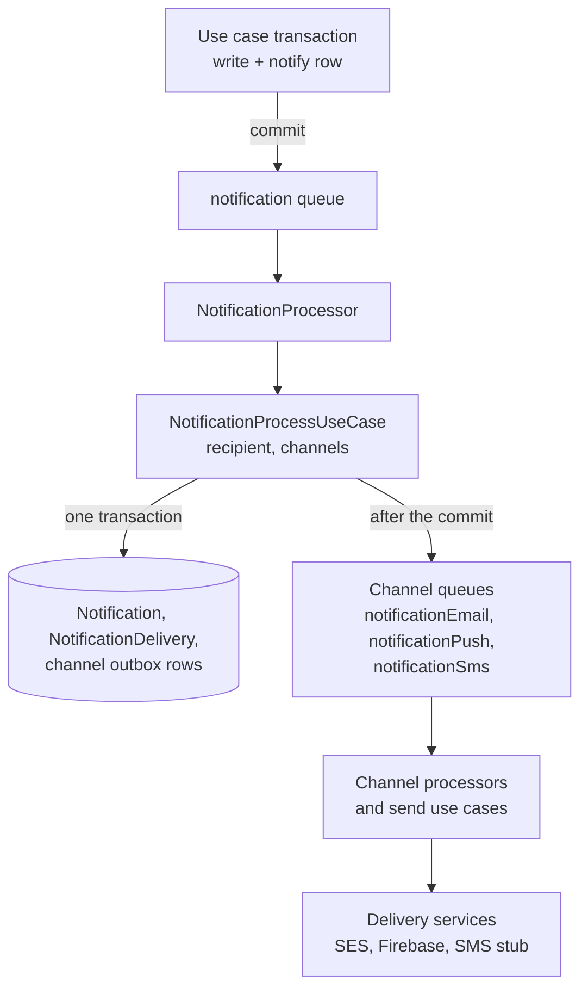

# Notification

This page explains the `notification` module, including the email channel, for a developer who produces a notification, changes how one is delivered, or reads how a recipient and a payload are handled.

## Table of Contents

- [Related Documents](#related-documents)
- [Overview](#overview)
- [Recipient and snapshot](#recipient-and-snapshot)
- [Orchestration and steps](#orchestration-and-steps)
- [Email channel](#email-channel)
- [Push channel and tokens](#push-channel-and-tokens)
- [Payload encryption](#payload-encryption)
- [Term-policy publication](#term-policy-publication)

## Related Documents

- [Queue][ref-doc-concept-queue]: the outbox row, the enqueue after the commit, the job ids, and the retries
- [Device][ref-doc-concept-device]: the push tokens an ownership holds
- [Term Policy][ref-doc-concept-term-policy]: the publish job that feeds the publication email
- [Dependencies][ref-doc-concept-dependencies]: the SES and Firebase adapters and the answer while they are unset
- [Security][ref-doc-concept-security]: the AES-256-GCM encryption the payloads use
- [Notification Guide][ref-doc-guide-notification]: add a notification kind
- [Email Template Guide][ref-doc-guide-email-template]: edit a template and sync it to SES
- [Notification Reference][ref-doc-reference-notification]: the kinds, types, channels, templates, and settings
- [Queue Reference][ref-doc-reference-queue]: the notification queues, jobs, job ids, and priorities
- [Configuration Reference][ref-doc-reference-configuration-notification]: the `notification` and `email` keys
- [Status Codes][ref-doc-reference-status-codes-notification]: the code and message of each exception named here

## Overview

The diagram shows how a `notify` row becomes a notification and its channel jobs.

- A notification is an outbox row added in the transaction of the write that causes it: `NotificationQueue.notify(kind, context)`. A request never sends inline ([Queue][ref-doc-concept-queue-outbox]).
- `NotificationProcessor` takes the `notify` job from the `notification` queue and hands it, with the outbox row id and the payload, to `NotificationProcessUseCase`.
- The context holds the subject's ids and the values a template needs. It never holds a plain recipient, address, or token: the three snapshot kinds carry the address and the tokens sealed in `context.snapshot` ([Recipient and snapshot](#recipient-and-snapshot)).
- Three channels send through a job: email through SES, push through Firebase, and SMS through a stub adapter with no provider wired. The `inApp` and `silent` channels are delivered at creation: they only record a delivery row.
- `NotificationKindContract` holds one row of data per `EnumNotificationKind`: the type, the `priority`, whether the kind is mandatory, the title and body message paths, the channels, the `queuePriority`, the secret fields, the job key pattern, and the field lists a template, a push text, and a date format read. No service or use case exists per kind.
- `priority` is the `EnumNotificationPriority` stored on the `Notification` row. `queuePriority` is the BullMQ priority of the kind's jobs ([Queue Reference][ref-doc-reference-queue-priorities]).
- The channels are two lists. A pending channel is one a job sends (`email`, `push`, `sms`), and a delivered channel is recorded at creation (`inApp`, `silent`).
- Each channel has its own queue, queue class, and processor beside the `notification` queue: `notificationEmail`, `notificationPush`, and `notificationSms`.
- Every notification queue dedupes by the `jobId`, which is the row's business key, and never uses BullMQ `deduplication`.
- A request whose purpose is an email asserts that SES is configured first and answers `AwsSesNotConfiguredException` (501) when it is not. A request whose email is a notice beside its work asserts nothing, and the email is skipped while SES is unset ([Dependencies][ref-doc-concept-dependencies]).

## Recipient and snapshot

`NotificationProcessUseCase` resolves the recipient on the first attempt, so the producer carries no recipient.

1. One parallel read loads the active user, the user's notification settings, and the device tokens of the user's non-revoked ownerships that hold a live session.
2. A missing or inactive user writes no row and sends nothing.
3. `NotificationUtil.resolveChannels` computes the channels. An empty result writes no row and sends nothing.
4. A kind whose channels hold `sms` takes the number from the active mobile `Verification` row the producer names in `context.verificationId` (`UserVerificationService.getOneActiveMobileRecipient`). A used or expired row gives none.
5. The use case encrypts the address, the tokens, and the number, and records the recipient and the notification id on the outbox row through `OutboxService.replaceData`. A later attempt reuses the recorded recipient and id.

`resolveChannels` starts from the kind's pending channels followed by its delivered channels:

- A mandatory kind, or a kind whose type `NotificationSettingContract` does not list, keeps the whole list.
- Any other kind loses each channel the user disabled for the kind's type, when the contract lists that channel for the type. `silent` is listed for no type.
- When only `silent` is left, the result is empty: no row and no send.

A user's settings are one stored row per channel and type, created with the user. An update changes that row.

**Snapshot.** A producer passes `snapshot` on three kinds only: `temporaryPasswordByAdmin`, `resetPassword`, and `resetMfaByAdmin`. Their flows revoke the user's sessions, and a revoked session leaves no device token to read, so the producer's use case reads the tokens of the devices with a live session before it opens its own transaction (the one that revokes) and seals the address and the tokens with `NotificationUtil.sealSnapshot`. A job with a snapshot skips the resolve and takes every channel of the kind, because the three kinds are mandatory.

**Invitee with no account.** `NotificationEmailQueue.notifyUnregisteredInvite` adds an effect on the email queue directly. It writes no `Notification` row and reads no setting.

## Orchestration and steps

After the recipient, one transaction creates the `Notification` row and adds the channel rows:

- The `Notification` row has the id generated and recorded on the outbox row before the transaction (step 5 of [Recipient and snapshot](#recipient-and-snapshot)), so a retry reuses it. It also has the kind's type and priority, the title and body message paths, and `metadata` built from the context fields the kind names plus the username.
- It has one `NotificationDelivery` row per channel in the resolved list. A delivered channel, `inApp` or `silent`, is stamped with `processedAt` and `sentAt` at creation and needs no job. A pending channel starts with no timestamp. A retry finds the row with its delivery rows already created and skips them (`createIfAbsentInTx`).
- It adds one outbox row per channel with `addManyInTx`, keyed by `notification.idempotencyKey.stepPattern` (`{process}-{notificationId}`, filled with the channel's send process and the notification id), so one row exists per channel per notification and a retry adds no second row ([Queue][ref-doc-concept-queue-outbox]): email when the channels hold `email`, push when they hold `push` and the recipient has a token, and SMS when they hold `sms` and the recipient has a number.

A channel use case picks its values from the context by the kind's contract row. `templateFields` name the SES template data, `metadataFields` name the push text properties, and `username` joins both. `dateFields` name the context fields that hold an ISO date. `Notification.metadata` keeps them as ISO, and `NotificationUtil` formats them to RFC 2822 only for text a person reads: the SES template data, the push properties, and the list's title and body properties.

Step state between attempts lives in the outbox row. A channel use case records `completedSteps` through `OutboxService.replaceData` with the whole payload, so a retry skips each completed step: the email job has `sendEmail`, and the push job has `updateProcessAt`, `sendMulticast`, and `updateSentAt`. A missing delivery row on a push step throws `NotificationPushDeliveryNotFoundException`, and a value that fails to open throws `HelperDecryptFailedException`. No retry heals either failure, so both are unrecoverable: the processor base turns them into BullMQ's `UnrecoverableError` and the job fails without a retry.

- `processResult` is the one kind through which an async process tells its admin the outcome. It carries a status, a title, a description, and an optional sealed link, and its template colors the status bar.
- The SMS adapter is a stub with no provider wired: `NotificationSmsDeliveryService` logs the kind and the number masked to its last three digits and returns.
- A user lists notifications in the `inApp` channel, marks one or all as read, and reads and updates the settings through the shared routes. A list leaves out the types the user muted in `inApp`: a notification recorded before the mute keeps its `inApp` delivery row, because the resolve drops `inApp` for new notifications only, so the list query (rows with an `inApp` delivery whose type is not muted) hides the earlier ones. A secret in a row's metadata is censored.

## Email channel

`NotificationEmailProcessSendUseCase` sends one email:

1. When SES is unset it returns a message with no result, stamps nothing, and sends nothing, and the job completes. The email delivery row keeps no `processedAt` or `sentAt`.
2. Unless `sendEmail` is recorded, it stamps `processedAt` on the email delivery row.
3. It decrypts the address with the user id as authenticated data, opens the sealed fields, and builds the template data from `templateFields`.
4. It sends the SES template named after the kind from `email.noReplyAddress`. The data merges `homeName` (`frontend.name`), `supportEmail` (`email.supportAddress`), and `homeUrl` (`frontend.baseUrl`) under the template data.
5. It records `sendEmail` after the SES call returns, then stamps `sentAt`. A failure between the send and the record repeats the send on the retry. Only the publication pipeline guards a second email ([Term-policy publication](#term-policy-publication)).

The email processor's limiter matches the SES sending quota (`AwsSesRateLimitPerDuration` per `AwsSesRateLimitDurationInMs`).

`NotificationEmailProcessSendUnregisteredUseCase` sends the invite of an address with no account. It opens the address and the link with the invite reference as authenticated data and sends the `workspaceInvite` template, with the address standing in for the username ([Workspace][ref-doc-concept-workspace-delivery]).

Each kind has one SES Handlebars template of the kind's name, registered in `NotificationTemplateService`. A seed command upserts the templates in SES ([Email Template Guide][ref-doc-guide-email-template]).

## Push channel and tokens

A push token belongs to a device ownership ([Device][ref-doc-concept-device]). `NotificationPushProcessSendUseCase` sends one push:

1. When Firebase is unset it returns a message, stamps nothing, and sends nothing, and the job completes. The push delivery row keeps no timestamp.
2. Unless `updateProcessAt` is recorded, it stamps `processedAt` on the push delivery row. The step is recorded on the outbox row with the send's outcome.
3. It builds the title and body from the kind's message paths with the metadata as properties and calls `NotificationPushDeliveryService.sendMulticast`, which calls `FirebaseService.sendMulticast`. `FirebaseService` splits the tokens into batches of `FirebaseMaxSendPushBatchSize` (500) and takes no batch size from the caller.
4. A token Firebase rejects as invalid is a failure token. A token that failed for a retryable code, with no code, or in a rejected batch is a pending token, one a push retry sends to again. Both stay encrypted in the row as `encryptedFailureTokens` and `encryptedPendingTokens`.
5. A pending token fails the `sendMulticast` step with a retrying `QueueException`, and the retry sends only to the pending tokens.
6. When none is pending, one transaction stamps `sentAt` and `failureTokenCount`, the number of invalid tokens, on the delivery row and clears the invalid tokens from the user's devices.

The push processor's limiter matches the Firebase quota (`FirebaseMaxRateLimitPerDuration`).

A token is cleared by logout, a device refresh, a removed ownership, self-deletion, a provider rejection, and the stale-token job. `NotificationPushQueue` declares that job as a scheduler on `notification.push.cleanupStaleTokensCron`, in `app.timezone`. It clears the tokens idle past `notification.push.staleTokenThresholdInMs` through `DeviceService.cleanupStaleNotificationTokens`.

## Payload encryption

`Outbox.data` is readable in the database, so whoever builds a payload encrypts each sensitive field. `NotificationUtil` seals with `HelperEncryptionService.aes256Encrypt` and `app.encryptionSecret` ([Cryptography used][ref-doc-concept-security-cryptography]):

- The sealed fields are the kind's `secrets` (a password, a link, a one-time code), the recipient address, the device tokens, and the mobile number. A sealed field is named `encrypted<Field>`.
- `NotificationQueue.notify` seals the kind's `secrets` against the user id when the producer adds the effect. `NotificationProcessUseCase` seals the address, the tokens, and the number when it records the recipient (`NotificationService.toRecipientRecord`). A snapshot producer seals the address and the tokens with `sealSnapshot`. `notifyUnregisteredInvite` seals against the invite reference.
- The authenticated data is the id the value belongs to: the recipient's user id, or the invite reference for an invitee with no account. A value sealed for one user fails to open in another user's job.
- Ciphertext travels unchanged. A channel use case decrypts right before its SES or FCM call, and an email value goes into the template data only.
- A value that fails to open (`HelperDecryptFailedException`) fails the job without a retry, as above.
- A secret stays sealed in `Notification.metadata` and is censored before a response carries it.

## Term-policy publication

A publication is a broadcast, so it keeps its own pipeline. The `term-policy` module owns the recipient markers, the fan-out, and the `publish` job ([Term Policy][ref-doc-concept-term-policy-publish]). The notification module owns the `Notification` and `NotificationDelivery` rows, the batch job, and the SES send. The publish job creates each page's rows through `NotificationService.createManyInTx`, called by `TermPolicyProcessPublishUseCase`.

- Each page of recipients adds one `publishTermPolicy` batch job on the `notificationEmail` queue, built by `NotificationEmailQueue.emailPublishTermPolicyEffect`. It carries the batch id, the sender, and one entry per recipient with the address sealed against that recipient's user id. The job key is `notification.idempotencyKey.termPolicyBatchPattern`, or `notification.idempotencyKey.termPolicyBatchResendPattern` carrying the fresh nonce of an admin resend.
- `NotificationEmailProcessPublishTermPolicyUseCase` runs it. It returns when SES is unset. It claims the recipients with `claimedAt` and a claim nonce, which keeps delivery to at most once per recipient and marks this job's claim apart from the resend nonce in the job key, and sends one bulk SES call with `NotificationEmailDeliveryService.sendPublishTermPolicy`.
- One transaction holds `TermPolicyRecipientService.markSentInTx`, which marks each recipient sent, and `NotificationService.markEmailSentInTx`, which stamps `sentAt` on its email delivery row.
- A definite failure is a recipient SES reports as failed: it is released, and the job throws a retrying `QueueException`. An unknown outcome, such as a thrown send or a status count that differs from the recipient count, throws `NotificationEmailDeliveryUnknownException` with the claim kept, which fails without a retry, so no recipient gets a second email. When a failed recipient and an unknown status both happen, the `QueueException` wins. A mark or release that fails is an unknown outcome and wins over both.

<!-- REFERENCES -->

[ref-doc-concept-queue]: queue.md
[ref-doc-concept-queue-outbox]: queue.md#outbox-row-in-the-transaction
[ref-doc-concept-device]: device.md
[ref-doc-concept-term-policy]: term-policy.md
[ref-doc-concept-term-policy-publish]: term-policy.md#publishing-and-the-email-fan-out
[ref-doc-concept-dependencies]: dependencies.md#optional-adapters
[ref-doc-concept-security]: security.md
[ref-doc-concept-security-cryptography]: security.md#cryptography-used
[ref-doc-concept-workspace-delivery]: workspace.md#invites
[ref-doc-guide-notification]: ../guides/notification.md
[ref-doc-guide-email-template]: ../guides/email-template.md
[ref-doc-reference-notification]: ../reference/notification.md
[ref-doc-reference-queue]: ../reference/queue.md
[ref-doc-reference-queue-priorities]: ../reference/queue.md#priorities
[ref-doc-reference-configuration-notification]: ../reference/configuration.md#notification
[ref-doc-reference-status-codes-notification]: ../reference/status-codes.md#notification
