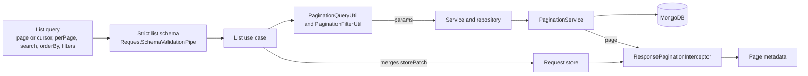

# Pagination

This page explains how the list routes page their results, for a developer who builds or consumes a list.

## Table of Contents

- [Related Documents](#related-documents)
- [Overview](#overview)
- [Offset and cursor](#offset-and-cursor)
- [Cursor sealing and keyset](#cursor-sealing-and-keyset)
- [Ordering presets](#ordering-presets)
- [Query to store to metadata](#query-to-store-to-metadata)

## Related Documents

- [Pagination Guide][ref-doc-guide-pagination]: build an offset or cursor list route
- [Pagination Reference][ref-doc-reference-pagination]: the query parameters, limits, metadata fields, and service methods
- [Request Validation][ref-doc-request-validation]: the strict list query schemas
- [Response][ref-doc-response]: the interceptor that builds the page metadata
- [HTTP Contract][ref-doc-http-contract]: the envelope a page rides in
- [Status Codes][ref-doc-reference-status-codes]: the pagination errors
- [Database][ref-doc-concept-database]: the Prisma statements behind a repository

## Overview



- A list route validates its query with a strict schema, so a key the schema does not name, such as `where`, `select`, or `include`, answers 422.
- A use case turns the validated query into database parameters with `PaginationQueryUtil` and `PaginationFilterUtil`, and it records what the client asked for in the request store.
- A repository passes those parameters to `PaginationService` with the Prisma delegate of its model, and the service reads one page.
- The interceptor combines the page with the recorded list state into the response metadata.

## Offset and cursor

The route scope decides the strategy: every `/admin` list pages by offset, and every list of the other scopes pages by cursor.

- An offset list addresses a page by number, reports `count` and `totalPage`, and moves forward and back. An insert or a delete during paging can shift a row across pages, and a deep page makes the database skip rows.
- A cursor list addresses a page by a sealed token, moves forward only, and reports no `count` and no `totalPage` unless the repository asks for a count. The keyset position holds under concurrent writes, and every page costs the same.

- A client never chooses the strategy and never asks for a count. A count on a cursor page is a repository-side argument.
- Offset pages reach at most row 2000. The page number is capped at 20 and `perPage` at 100: a `page` of 21 answers 422 with `PaginationPageExceedsMaximumException` and is never clamped to 20. `totalPage` reports at most 20 while `count` stays the real count. An offset list narrows and browses, and it never scans a whole collection.
- A route that returns a bounded whole set, such as the policies of one role, takes no pagination.
- Both strategies append an `id` tiebreaker to the sort, so rows that share a sort value keep one order from page to page.
- Both strategies search with a case-insensitive `contains` across the route's search fields, for a `search` of at most 100 characters.

## Cursor sealing and keyset

A cursor is an opaque token. A client sends back the `nextCursor` it received, unchanged.

- The token holds exactly two things: the sort values of the last row of the page, and a fingerprint of the query it was issued for. `PaginationCursorUtil.seal` encrypts them with AES-256-GCM under the pagination purpose and the app encryption secret, so a client can neither read nor change it.
- The fingerprint is the first 16 hex characters of a SHA-256 over the canonical form of the endpoint's cursor scope, every filled query field except `cursor`, `perPage`, and `orderBy`, and the resolved sort. Search and filter values count, and the server's own `where` (an owner id or a workspace) does not.
- A cursor is therefore bound to its endpoint, its filters, its search, and its sort. The token holds the position of the last row inside one result set, and a changed filter, search, or sort is another result set, so the same position would skip or repeat rows. Changing any of them answers 422 with `PaginationInvalidCursorPaginationParamsException`. The client then sends no cursor and starts again from the first page, because the server never resets a cursor itself. `perPage` may change between pages.
- Each cursor endpoint has its own `<Module><Endpoint>CursorScope` constant, so a token from one endpoint answers 422 at another.

`PaginationService.cursor` opens the token once per request, in this order:

1. A token that does not decrypt or parse throws `PaginationFailedToDecodeCursorException`.
2. A fingerprint that differs from the recomputed one throws `PaginationInvalidCursorPaginationParamsException`.
3. Values whose fields differ from the fields of the sort throw `PaginationInvalidCursorDataException`.

Before that, `PaginationQueryUtil` trims the cursor, treats a blank one as absent, and checks its length (at most 2560 characters) and its characters (`A-Za-z0-9_.-`).

The read is a keyset read. The service never uses Prisma's `cursor` argument or `skip`:

- It turns the decoded values and the sort into an `OR` of comparisons. For each sort term it asks for rows equal on the earlier terms and greater (ascending) or lower (descending) on that term.
- It joins that filter to the route's `where` with `AND`.
- It reads `limit + 1` rows, so the extra row tells whether a next page exists, and it seals the last row of the page into `nextCursor`.
- A last row that left the `where` or was deleted moves no page boundary, because the position is a set of values and not a row id.

Every field of every preset on a cursor route is immutable and never null on a row the route returns. A row whose sort value can change between pages would move under the keyset, and no tiebreaker repairs that. A preset that sorts a mutable field, such as `updatedAt`, `lastActiveAt`, or a resent `expiredAt`, belongs to an offset route. A null sort value on the last row throws `PaginationInvalidCursorDataException`.

## Ordering presets

A client never names a field or a direction. It names one preset that the backend defines.

- A list module defines one `<Module>OrderBy` constant that maps each member of a string enum to an array of sort terms, and each term is one field with one direction. A preset can hold several terms, and its name says what the order means: `latest`, `name`, `recentlyJoined`.
- The list schema accepts one of the preset names or an empty string. Any other value, and a repeated parameter, answers 422 from zod.
- The use case passes the constant and a required default preset to `PaginationQueryUtil`. An empty or absent `orderBy` takes the default. A read that skips `PaginationQueryUtil` and passes no sort gets `createdAt` descending.
- The constant is checked at compile time against the model's scalar fields, so a term cannot name a field the model lacks.
- The response reports the preset used as `metadata.orderBy` and the allowed names as `metadata.availableOrderBy`. The tiebreaker never shows in the metadata.

This is the preset constant of the role module (`src/modules/role/constants/role.list.constant.ts`):

```typescript
export const RoleOrderBy = {
    [EnumRoleOrderBy.latest]: [
        {
            [Prisma.RoleScalarFieldEnum.createdAt]:
                EnumPaginationOrderDirectionType.desc,
        },
    ],
    [EnumRoleOrderBy.name]: [
        {
            [Prisma.RoleScalarFieldEnum.name]:
                EnumPaginationOrderDirectionType.asc,
        },
    ],
} as const satisfies IPaginationOrderByPresets<
    Prisma.RoleScalarFieldEnum,
    EnumRoleOrderBy
>;
```

## Query to store to metadata

The use case is the only place that connects the query, the store, and the service. This is the offset list of roles (`src/modules/role/use-cases/role.get-list-offset-by-admin.use-case.ts`):

```typescript
const { params, storePatch } = this.paginationQueryUtil.offset(query, {
    availableSearch: RoleDefaultAvailableSearch,
    orderBy: RoleOrderBy,
    defaultOrderBy: EnumRoleOrderBy.latest,
});
const type = this.paginationFilterUtil.inEnum(
    Prisma.RoleScalarFieldEnum.type,
    query.type,
    RoleDefaultType
);
this.requestStoreService.merge(PaginationStoreKey, {
    ...storePatch,
    filters: {
        ...storePatch.filters,
        ...(type?.storeFilter ?? {}),
    },
});
```

- `PaginationQueryUtil.offset` and `.cursor` validate `page` and `perPage`, build the search `where`, resolve the preset, and return the `params` for the repository and a `storePatch`. The util injects no store.
- `PaginationFilterUtil` builds the typed filters: `equalBoolean`, `equalString`, `equalNumber`, `notEqual`, `inEnum`, `ninEnum`, and `dateBetween`. Each returns a `where` fragment and a `storeFilter`, or `null` when the query value is blank. A value outside an enum or a malformed number, boolean, or date throws a `PaginationFilterInvalidValue` exception, and the fragments join the route's own `where`.
- The use case merges the `storePatch` and the `storeFilter` fragments into the request store, which holds the search term, the filters, the preset name, and the allow-lists for the response.
- The store never reaches a service or a repository, and a filter is never a raw string or an object a client builds.
- The repository calls `paginationService.offset` or `.cursor` with its delegate, the params, and the model's `select` constant. The select keeps credential columns out of a paginated read, and the count query ignores it, so a narrow projection never changes the total.
- `ResponsePaginationInterceptor` merges the page and the store state into the metadata. A paginated route that stored no state answers 500 with `RequestContextMissingException`.
- The pagination metadata appears on success only.

<!-- REFERENCES -->

[ref-doc-guide-pagination]: ../guides/pagination.md
[ref-doc-reference-pagination]: ../reference/pagination.md
[ref-doc-request-validation]: request-validation.md
[ref-doc-response]: response.md
[ref-doc-http-contract]: ../reference/http-contract.md
[ref-doc-reference-status-codes]: ../reference/status-codes.md
[ref-doc-concept-database]: database.md
