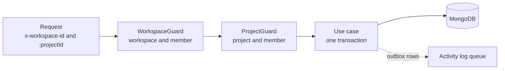

# Project

This page explains the `project` module, for a developer who changes project access, project membership, or what happens when a project is deleted.

## Table of Contents

- [Related Documents](#related-documents)
- [Overview](#overview)
- [Projects inside a workspace](#projects-inside-a-workspace)
- [Membership and peers](#membership-and-peers)
- [Slug](#slug)
- [Soft delete](#soft-delete)

## Related Documents

- [Workspace][ref-doc-concept-workspace]: the workspace that scopes every project, its roles, and its guard
- [Authorization][ref-doc-concept-authorization]: where the project guard sits in the guard pipeline
- [Feature Flag][ref-doc-concept-feature-flag]: the `workspace` flag that gates the user routes
- [Pagination][ref-doc-concept-pagination]: the cursor lists on the `/user` routes and the offset list on the admin route
- [Database][ref-doc-concept-database]: the generated unique values behind the slug
- [Route Protection Guide][ref-doc-guide-route-protection]: put the project guard on a route
- [Decorators and Guards Reference][ref-doc-reference-decorators-and-guards]: the decorator order, the store keys, and the missing-entry exceptions
- [Activity Log Reference][ref-doc-reference-activity-log]: the entries each action writes
- [Database Reference][ref-doc-reference-database]: the project models
- [Configuration Reference][ref-doc-reference-configuration-project]: the `project` keys
- [Status Codes][ref-doc-reference-status-codes-project]: the code and message of each exception named here

## Overview

- A project is a unit of work inside one workspace. A project route is reached through its workspace: the caller names the workspace in the `x-workspace-id` header and the project in the `:projectId` path parameter. There is no project header.
- A project has its own members and its own roles, `admin`, `member`, and `viewer` (`EnumProjectMemberRole`), independent of the workspace role.
- The module owns `Project` and `ProjectMember`. The fields are in `prisma/schema.prisma`.
- A flow runs controller, use case, service, repository, and the use case opens the one transaction. Each activity entry is an outbox row added in it ([Queue][ref-doc-concept-queue-outbox]).

## Projects inside a workspace

`@ProjectProtected(...roles)` mounts `ProjectGuard`, which runs after `@WorkspaceProtected()`:

1. It reads the workspace context the workspace guard stored. An empty store answers `WorkspaceGuardMissingException` (403), so a route that stacks the guards in the wrong order fails on every request.
2. It reads the `:projectId` route parameter. A route with no such parameter answers `RequestContextMissingException` (500).
3. One read loads the live project of that workspace with the caller's member row. A malformed id, an unknown id, a soft-deleted project, and a project of another workspace answer the same `ProjectNotFoundException` (404), so a caller cannot tell "not yours" from "does not exist".
4. With roles listed:
    - A workspace `owner` or `admin` passes with or without a member row. This is the workspace bypass (`ProjectBypassRoles`).
    - Anyone else needs a member row (`ProjectMemberForbiddenException`, 403) whose role is in the list (`ProjectRoleForbiddenException`, 403).
5. With no roles listed, a member row is required and the bypass does not apply. Only the leave route lists no roles. Every other project route lists roles (the read and the member list list all three), so the bypass reaches them.

The guard stores the project and the member under `ProjectContextStoreKey`, and `@ProjectContext()` reads them. `projectMember` is `null` when the bypass let a workspace admin in without a row. A use case that needs a real row asks for it (`assertMember`) and answers `ProjectMemberNotFoundException` when there is none ([Decorators and Guards Reference][ref-doc-reference-decorators-and-guards-project]).

Access by operation:

- The project list is open to any workspace member and returns live projects only. A workspace `owner` or `admin` sees every project, and anyone else sees only the projects they belong to.
- Create and delete are workspace-level operations: they need the workspace role `owner` or `admin` (an `owner` passes every workspace role list), and both pass the project guard on delete through the bypass. A create writes the project and its entry and no member row. The creator, a workspace `owner` or `admin`, reaches the project through the bypass.
- Reading a project and its members is open to the three project roles. Updating the project, its slug, and its members needs the project role `admin` or the bypass.
- Leaving needs a real member row. Leave lists no roles, so the guard answers `ProjectMemberForbiddenException` (403) to a caller with no member row, a bypassing workspace admin included.
- A project update is a full replace: the body carries the `name` and a `description` that is `null` to clear it.

The `/admin` scope is read-only and carries no flag, no workspace guard, and no project guard. It is behind `@RoleProtected()` and a `project` policy, lists projects across every workspace with an optional workspace filter, and reads any project by id, soft-deleted ones included.

## Membership and peers

Every project member is already a workspace member. Assigning a user resolves their `WorkspaceMember` row in the project's workspace and answers `WorkspaceMemberNotFoundException` (404) when there is none. The check runs at assign time only, and a user already on the project answers `ProjectMemberAlreadyAssignedException`.

The peer rule answers `ProjectMemberPeerForbiddenException` (403) when the caller's workspace role is neither `owner` nor `admin` and any role involved in the operation is `admin`:

| Operation   | Roles the rule reads                       |
| ----------- | ------------------------------------------ |
| Assign      | The requested role                         |
| Update role | The target's current role and the new role |
| Remove      | The target's role                          |
| Leave       | None. The caller's own row is deleted      |

- Removing yourself is refused for every caller, a workspace `owner` or `admin` included, by a check that runs before the peer rule and answers the same exception: use leave.
- A project `admin` can manage `member` and `viewer` rows. Creating an `admin`, or acting on one, needs a workspace `owner` or `admin`.
- Nothing counts the remaining admins, so the last project `admin` can leave and a project can end with no members. A workspace `owner` or `admin` still reaches it through the bypass.
- A member row is hard-deleted. A workspace leave or member removal deletes the user's project rows in that workspace ([Workspace][ref-doc-concept-workspace-roles]).
- An assign, a role update, and a removal write an entry for the caller and, when the target is someone else, a second entry for the target. A removal always writes both because removing yourself is refused. A leave writes one entry.

## Slug

- Creation always generates the slug. The use case draws `project.slugMaxAttempts` candidates, each `project.slugPrefix` followed by random lower-case letters and digits, the whole slug `project.slugMaxLength` characters long, and tries one per transaction. A collision (`ProjectSlugAlreadyExistsException`) moves to the next candidate, and running out answers `AppUnknownException` ([Generated unique values][ref-doc-concept-database-generated]).
- A client chooses a slug through the slug update route only. The slug matches `ProjectSlugRegex` (`src/modules/project/constants/project.constant.ts`: lower-case letters, digits, and `-`) and fits `project.slugMaxLength`, else `ProjectSlugInvalidException`. A collision answers `ProjectSlugAlreadyExistsException` with no retry.
- The slug is unique per workspace. A soft delete rewrites it to `project.deletedSlugPattern` (`deleted-{id}`), so a deleted project frees its slug.

## Soft delete

`ProjectSoftDeleteUseCase` runs one transaction:

1. It sets `deletedAt` and `deletedBy` on a live project and rewrites its slug.
2. It clears the project and its role from the workspace's pending invites, so an invite that named the project still joins the workspace.
3. It adds the `projectDeleted` entry.

Member rows stay, and no route restores a project. A deleted project answers `ProjectNotFoundException` to the guard. A workspace soft delete soft-deletes its live projects (slug rewritten, member rows kept) in chunks of `project.delete.chunkSize` ([Workspace][ref-doc-concept-workspace-soft-delete]).

<!-- REFERENCES -->

[ref-doc-concept-workspace]: workspace.md
[ref-doc-concept-workspace-roles]: workspace.md#roles-and-ownership
[ref-doc-concept-workspace-soft-delete]: workspace.md#soft-delete
[ref-doc-concept-authorization]: authorization.md#workspace-and-project-gates
[ref-doc-concept-feature-flag]: feature-flag.md
[ref-doc-concept-pagination]: pagination.md
[ref-doc-concept-queue-outbox]: queue.md#outbox-row-in-the-transaction
[ref-doc-concept-database]: database.md
[ref-doc-concept-database-generated]: database.md#generated-unique-values
[ref-doc-guide-route-protection]: ../guides/route-protection.md
[ref-doc-reference-decorators-and-guards]: ../reference/decorators-and-guards.md
[ref-doc-reference-decorators-and-guards-project]: ../reference/decorators-and-guards.md#projectprotectedroles
[ref-doc-reference-activity-log]: ../reference/activity-log.md
[ref-doc-reference-database]: ../reference/database.md
[ref-doc-reference-configuration-project]: ../reference/configuration.md#project
[ref-doc-reference-status-codes-project]: ../reference/status-codes.md#project
