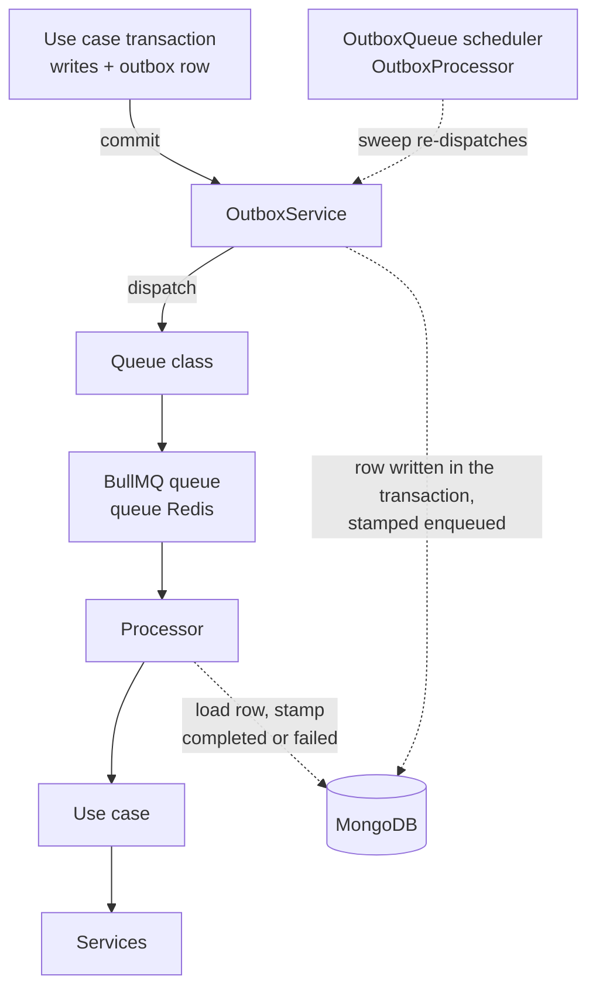

# Queue

This page explains how the application runs background work through the outbox and BullMQ, for a developer who causes a side effect or reads a failed job.

## Table of Contents

- [Related Documents](#related-documents)
- [Overview](#overview)
- [Outbox row in the transaction](#outbox-row-in-the-transaction)
- [Enqueue after commit](#enqueue-after-commit)
- [Queue classes](#queue-classes)
- [Processor to use case](#processor-to-use-case)
- [Job ids and dedupe](#job-ids-and-dedupe)
- [Retries and unrecoverable failure](#retries-and-unrecoverable-failure)
- [Scrubbing outbox rows](#scrubbing-outbox-rows)

## Related Documents

- [Queue Guide][ref-doc-guide-queue]: add a queue, a processor, and an outbox effect
- [Queue Reference][ref-doc-reference-queue]: every queue, job, id pattern, and option
- [Database][ref-doc-concept-database]: the transaction an outbox row joins
- [Cache][ref-doc-concept-cache]: the `cache` queue and the invalidation effect
- [Dependencies][ref-doc-dependencies-required]: how a queue Redis outage answers
- [Architecture][ref-doc-architecture]: where a processor sits among the layers
- [Configuration Reference][ref-doc-reference-configuration-queue]: the `queue` and `outbox` keys

## Overview

The diagram shows how a committed outbox row reaches its processor, and where the row is stamped on the way.

- A MongoDB write and a Redis enqueue cannot commit together, so the effect rides the transaction as a row, and the enqueue waits for the commit. A job never runs against a write that is uncommitted or rolled back.
- A side effect is one of a closed list: a notification, an activity entry, a cache invalidation or session purge, and an S3 object delete. A route can also hand its whole action to a job.
- Every effect is an `Outbox` row written in the transaction of the write that causes it. After the commit the row is dispatched to its BullMQ queue, and a processor runs it through a use case. When the use case succeeds, the processor base stamps the row `completed`.
- A flow never leaves part of its own writes to a queued job. What it queues is a side effect, and a job that pages an unbounded collection is one flow in its processor use case.
- The outbox is the one mechanism for a job a write causes. A scheduler is the one job with no row, because a clock triggers it. Every `apis` instance serves HTTP and runs the workers, so any instance takes any job.

## Outbox row in the transaction

The caller builds an effect through the queue class of the module that owns the job, and adds it to the transaction it already holds.

- An effect (`IOutboxEffect`) has a `queue`, a `name`, a `data` payload, a `priority`, and an `idempotencyKey` that is a string or `null`.
- `OutboxService.addInTx(tx, effect)` and `addManyInTx(tx, effects)` buffer the rows per `tx` and return their ids. They open no transaction. A `DatabaseService.beforeCommit` callback writes the whole buffer with one `createMany` on that `tx` ([Transactions][ref-doc-concept-database-transactions]).
- An action whose only write is a side effect still opens a transaction for the row. Every effect's row is written in the transaction of its causing write.
- A rolled-back transaction discards the buffer and runs no dispatch, because the hooks run only after a commit.
- A flow adds its effects side by side in one call, and no send queues another send.
- A sensitive payload field, such as a password, a link, a one-time code, or a recipient address, is encrypted by whoever builds the payload, because `Outbox.data` is readable in the database.
- The `Outbox` row keeps the payload, `status` (`pending`, `enqueued`, `completed`, or `failed`), `attempts`, `lastError`, and the stamps `enqueuedAt`, `sweptAt`, `completedAt`, `failedAt`, and `scrubbedAt`. A row is never deleted ([Scrubbing outbox rows](#scrubbing-outbox-rows)).

## Enqueue after commit

`OutboxService` registers an `afterCommit` callback on the transaction that dispatches the rows buffered in this transaction from memory, with no re-read. A stored `pending` row that a keyed add answered is dispatched from the stored row.

- `dispatch` groups the rows by queue and resolves each queue class through `ModuleRef` from the row's `queue` name. Every queue class is provided under its queue's enum value, so the outbox imports no module's queue class.
- `QueueBase.enqueue(rows)` adds one job per row in a single `addBulk`. The job carries `{ outboxId }` only, its `jobId` is the row's `idempotencyKey`, and its priority is the row's.
- A successful enqueue stamps the rows `enqueued`.
- Dispatch never throws and never changes the response. A failed enqueue leaves the row `pending` and logs one `warn` with the `OutboxDispatchWarnKey` key, a connection error included, and nothing goes to Sentry. The `warn` is enough because the sweep re-dispatches the row. The request answers as if the enqueue had worked ([Dependencies][ref-doc-dependencies-required]).

The sweep recovers what dispatch missed. `OutboxQueue` declares it as a job scheduler that ticks every `outbox.sweepIntervalInMs`, and `OutboxService.onApplicationBootstrap` calls `sweep()` directly on every instance at boot. Each run does four things, in this order:

1. It reads up to `outbox.sweepBatch` rows that stayed `pending` longer than `outbox.pendingAfterInMs`, and up to `outbox.sweepBatch` rows `enqueued` longer than `outbox.enqueuedAfterInMs`.
2. It stamps `sweptAt` on every row those two reads returned. Each read takes the rows swept longest ago first, never-swept rows before them.
3. It looks up the job of each `enqueued` row through `QueueBase.getJobState`. A `completed` job stamps the row `completed`, a `failed` job stamps it `failed` with its `attemptsMade` and `failedReason`, and any other state leaves it.
4. It re-dispatches the `pending` rows, which recovers a row an instance left behind when it died after its commit, together with each `enqueued` row whose job is missing.

## Queue classes

The module that owns a job owns its queue and its queue class.

- The feature names each queue in an `Enum<Module>Queue` whose value is the Redis queue name, and registers it in its module with `BullModule.registerQueueAsync` and its own queue factory. The `cache` and `outbox` queues belong to the kit.
- A queue factory returns the `defaultJobOptions` of its queue from its module's `<namespace>.queue.*` keys (`notification.queue.*`, `session.queue.*`, `outbox.queue.*`): `maxAttempts`, `keepLogs`, the two removal ages, and `backoffDelayInMs` as an exponential backoff. A module with several queues has one `<concern>BackoffDelayInMs` per further queue (`notification.queue.emailBackoffDelayInMs`). `queue.job.*` holds only the shared defaults `QueueModule.forRoot()` sets.
- The queue class (`queues/<module>.queue.ts`) extends `QueueBase`. It is the module's side-effect entry: it builds the module's effects (`<action>Effect`), inherits `enqueue` and `getJobState`, and declares the module's recurring jobs.
- A service or a use case of any module injects a queue class by its class, which is the one class a service injects from a module on its own level or above.
- A recurring job is an entry in the queue class's `schedulers()`: an id, repeat options, and a job template. `QueueBase.onModuleInit` upserts the declared schedulers and removes every other scheduler of the queue. A scheduler is one BullMQ entry in Redis, so one instance runs each tick however many instances run. A recurring job is the one job with no outbox row, because a clock triggers it and not a write.
- Each module purges its own expired rows with a daily `purgeExpired` job on its own queue (`<namespace>.purgeExpiredCron`): the `activityLog`, `session`, `mfa`, and `passwordHistory` queues, and the `userAuth` queue for verification and forgot-password rows. The `outbox` queue declares `scrubExpired` beside its sweep: it scrubs its rows and never purges them ([Scrubbing outbox rows](#scrubbing-outbox-rows)).
- The BullMQ producer client is `RedisQueueClient` with `enableOfflineQueue: false`, so an enqueue against a down Redis rejects fast. Workers run on `RedisQueueWorkerClient`, which keeps the offline queue and sets `maxRetriesPerRequest: null`: during a queue Redis outage a worker command waits in memory and runs when the connection returns. The sweep is itself a scheduler on that Redis, so it resumes only after Redis returns, and a row left `pending` waits until then. BullBoard shows every queue ([Installation][ref-doc-installation]).

## Processor to use case

A processor is the entry of a job and holds no logic.

- `@QueueProcessor(Enum<Module>Queue.<member>, options?)` marks the class, which extends `QueueProcessorBase`. Each worker runs one job at a time, and the email and push processors add a limiter that matches their provider's rate.
- `QueueProcessorBase.process(job)` writes job log lines (never `job.data`), loads the `Outbox` row of a job that carries an `outboxId`, and calls `handle(job, data, outboxId)` with the row's data. A job scheduler tick carries no `outboxId` and passes `job.data` and `null`.
- A subclass switches on `job.name` against the module's process enum and awaits one use case's `execute`. The use case runs the whole job as one flow, calling each module's services itself, and returns an `IQueueResponse` with a message built from `<module>.queue.*`.
- An unknown job name throws a fatal `QueueException` from `throwUnknownProcess`. A payload the processor rejects throws `UnrecoverableError` from `throwUnrecoverable`.
- A kit processor (`CacheProcessor`, `OutboxProcessor`) awaits its kit service, not a use case.
- A feature processor's constructor takes its own feature's use cases only. The base injects `SentryService`, `MessageService`, `CacheService`, and `OutboxService` by property.

A job may run again after a retry, a BullBoard re-run, or an operator action, so every handler decides the same way on every attempt. A handler with no per-step state that commits once records its result on its outbox row in that transaction and, on a later run, returns the recorded result and writes nothing. A handler with step state patches the row with `OutboxService.replaceDataInTx` inside the step's transaction.

## Job ids and dedupe

`idempotencyKey` on the row is also the BullMQ `jobId`, and `(queue, name, idempotencyKey)` is unique on the `Outbox` model.

- Most effects pass `null`, and the row's own id becomes the key, so every effect is its own job.
- An effect carries a business key only when a duplicate that the normal flow produces must collapse into one job. The key is a config pattern with the process in it, because the `jobId` space is per queue: `{process}-{notificationId}` for a notification channel step ([Queue Reference][ref-doc-reference-queue-ids]).
- `addInTx` is `addManyInTx` for one effect, so both dedupe alike. `addManyInTx` returns the id of an existing row for an effect whose key the transaction already buffered or whose stored row exists. It reads stored rows by key on the `tx` (`findManyByIdempotencyKeysInTx`), inserts nothing for that effect, and dispatches a stored row still `pending` from the data the stored row holds.
- BullMQ ignores an add while a job with that id exists, until retention removes it. A job that retention removed looks missing, so the sweep dispatches its row again. That is safe because every handler gives the same result on every run.
- No producer reads, retries, or removes a job. The sweep reads a job state, and `QueueBase.onModuleInit` removes a stale scheduler.

## Retries and unrecoverable failure

- A job runs up to `<namespace>.queue.maxAttempts` times with an exponential backoff from its queue factory. A completed job is kept for `<namespace>.queue.removeOnCompleteAgeInSeconds` and a failed one for `<namespace>.queue.removeOnFailAgeInSeconds`.
- The processor base catches every failure. It logs the failure and one error line, and stamps the row `failed` on the last attempt or on an unrecoverable error. A retrying job stays `enqueued`. A stamp that fails logs one `warn` and leaves the job's outcome as it is, and the sweep reconciles the row later.
- A `QueueUnrecoverableException` or a `HelperDecryptFailedException` becomes BullMQ's `UnrecoverableError` with the original as `cause`, so the job fails with no further attempt. A use case throws the first when no retry can fix the failure.
- `QueueException` carries a `message`, an `isFatal` flag (default `false`), and the `rawError`. `QueueUnrecoverableException` defaults `isFatal` to `true`, and `throwUnknownProcess` throws a `QueueException` with `isFatal` `true`. `isFatal` is the Sentry switch only: it never changes how retries run. The base rethrows a `QueueException`, an `AppBaseException`, and an `UnrecoverableError` as they are, and wraps anything else in a fatal `QueueException` with the `queue.error.unknown` message.
- `onFailed` reports to Sentry once, when the job will not retry: on the last attempt or on an `UnrecoverableError`. It skips a `QueueException` whose `isFatal` is `false`, itself or as the `cause`. An unrecoverable failure therefore reaches Sentry unless its exception sets `isFatal` to `false` ([Sentry][ref-doc-concept-sentry]).
- A cache Redis error inside a job throws `RedisUnavailableException`, which extends `AppBaseException` and which the base rethrows unchanged, so BullMQ retries the job.

## Scrubbing outbox rows

The payload of an `Outbox` row of any queue can hold personal data: the sealed fields of a notification, and an activity entry's request log (IP address, user agent, location) in plain. The row does not keep the payload for good.

- The `outbox` queue's `scrubExpired` job runs daily (`outbox.scrubExpiredCron`, `0 4 * * *`, in the `app.timezone` zone). `OutboxProcessor` calls `OutboxService.scrubExpired`, which scrubs with one `updateMany` every row that is `completed` or `failed`, has no `scrubbedAt`, and has an `updatedAt` older than `outbox.retentionInMs` (30 days). The scrub itself moves `updatedAt`, and `scrubbedAt` keeps the row out of a second pass.
- A scrubbed row has `data` `{}`, `lastError` `null`, and `scrubbedAt` set to the scrub time. The row is never deleted: its queue, name, key, status, attempts, and stamps stay, so its `idempotencyKey` keeps deduplicating. This matters for a row with a business key; a row whose key is its own id matches nothing else.
- The retention is longer than every queue's `removeOnCompleteAgeInSeconds` and `removeOnFailAgeInSeconds`, since completed rows are scrubbed too. No BullMQ job, completed or failed, outlives its row's payload, so a re-run from BullBoard never reads a scrubbed row: the recorded result of a handler sits in the row's `data`.

<!-- REFERENCES -->

[ref-doc-guide-queue]: ../guides/queue.md
[ref-doc-reference-queue]: ../reference/queue.md
[ref-doc-reference-queue-ids]: ../reference/queue.md#job-ids
[ref-doc-concept-database]: database.md
[ref-doc-concept-database-transactions]: database.md#transactions
[ref-doc-concept-cache]: cache.md
[ref-doc-concept-sentry]: sentry.md
[ref-doc-dependencies-required]: dependencies.md#required-mongodb-and-redis
[ref-doc-architecture]: architecture.md
[ref-doc-installation]: ../getting-started/installation.md#7-check-it-works
[ref-doc-reference-configuration-queue]: ../reference/configuration.md#queue
