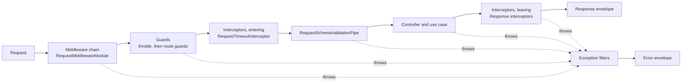

# Request Pipeline

This page explains the path every HTTP request takes and where each kit component sits on it, for a developer who adds a route or a middleware.

## Table of Contents

- [Related Documents](#related-documents)
- [Overview](#overview)
- [Middleware chain](#middleware-chain)
- [Guards](#guards)
- [Validation pipe](#validation-pipe)
- [Handler and use case](#handler-and-use-case)
- [Interceptors](#interceptors)
- [Filters](#filters)
- [Request store](#request-store)

## Related Documents

- [Middleware Reference][ref-doc-reference-middleware]: each middleware and interceptor with its order, config key, and behavior
- [Security][ref-doc-security]: headers, rate limiting, CORS, and the request timeout
- [Request Validation][ref-doc-request-validation]: the global pipe and the schemas it checks
- [Response][ref-doc-response]: how the interceptors build the envelope
- [Error Handling][ref-doc-error-handling]: the filter chain that answers a failure
- [HTTP Contract][ref-doc-http-contract]: the envelope, metadata, and headers every response carries
- [Authorization][ref-doc-authorization]: the guards a route stacks
- [Architecture][ref-doc-architecture]: the layers behind the handler

## Overview



- A request passes through six stages in Nest's fixed order: middleware, guards, interceptors on the way in, pipes, the handler, and interceptors on the way out.
- A stage that throws hands the error to the exception filters, which build the error envelope.
- The kit registers its own components once, so a route that adds nothing still gets the request id, the security headers, the per-IP rate limit, the validation, the timeout, and the error envelope.
- A route opts in to the rest: guards through its `*Protected` decorators, a per-route or per-user limit through `@RequestThrottleProtected`, and the success envelope through `@Response` or `@ResponsePagination`. `@ResponseFile` answers the file bytes with no envelope.

## Middleware chain

`RequestMiddlewareModule` applies one chain to every route in `configure`. Each entry is an `@Injectable` middleware class, and the array order is the run order (`src/common/request/request.middleware.module.ts`):

```typescript
consumer
    .apply(
        RequestRequestIdMiddleware,
        RequestRequestLogMiddleware,
        RequestHelmetMiddleware,
        RequestBodyParserMiddleware,
        RequestCorsMiddleware,
        RequestUrlVersionMiddleware,
        RequestResponseTimeMiddleware,
        RequestCustomLanguageMiddleware,
        RequestCompressionMiddleware
    )
    .forRoutes('{*wildcard}');
```

- Two middlewares run before the chain and are mounted by global modules: the HTTP middleware of `nestjs-pino`, and `ClsMiddleware`, which `RequestModule` mounts through `ClsModule.forRoot` and which opens the request store. The store therefore exists when the first chain middleware writes to it.
- `WorkspaceModule` mounts one more middleware, `WorkspaceIdMiddleware`, on every route from its own `configure`. Nest registers the middleware of global modules first and then the other modules by distance from the root, so it runs after the whole chain, never inside it. It copies the `x-workspace-id` header into the request store and validates nothing: the workspace guard resolves the id later.
- A middleware every route needs joins the array in `RequestMiddlewareModule` at the position its reads and writes require. A middleware one feature needs is mounted by that feature's module in its own `configure`, as `WorkspaceIdMiddleware` is.
- The request id comes first, so every log line and error response of the request carries it. Helmet runs before the body parser, so a body the parser rejects still answers with the security headers.
- `configure(app)` in `src/configure.ts` mounts no middleware. It attaches the Pino logger, sets the global prefix, sets Express `trust proxy`, turns `x-powered-by` off, and enables URI versioning. The NestJS body parser is off (`bodyParser: false` in `ConfigureOptions`), so `RequestBodyParserMiddleware` is the only parser.
- A body-parser failure becomes a typed exception: status 413 maps to `RequestPayloadTooLargeException`, 415 to `RequestUnsupportedMediaTypeException`, and any other 4xx to a `RequestValidationException` with an `invalid_format` issue on `body`.
- Each middleware, its config key, and its behavior: [Middleware Reference][ref-doc-reference-middleware].

## Guards

Two global guards run before any handler guard. Both come from `RequestMiddlewareModule` as `APP_GUARD` providers, so they count a request before any work of a route's own guards starts:

- `RequestThrottleDefaultGuard` counts every request against the per-IP limit, with no opt-in.
- `RequestThrottleRouteGuard` applies a route tier when the handler carries one.

After them, the guards a route mounts through its `*Protected` decorators run: API key, JWT, user, role, policy, term-policy acceptance, workspace, and project. Each one loads what it checks into the request store, so a later guard and the handler read it from there and never load it a second time.

- The user limiter is not global. `@RequestThrottleProtected({ user: true })` mounts `RequestThrottleUserGuard` on the handler, directly above the JWT decorator, so it runs right after the JWT guard. It reads the user id the JWT guard stored in the request store and counts by it.
- A guard that depends on the store entry of an earlier guard throws a guard-only exception when the entry is empty: the exception its subject's module owns for a missing context, such as `WorkspaceGuardMissingException` (403) or `UserGuardMissingException` (401). The exception marks a route whose guard stack is incomplete or misordered, and it surfaces on the request, because nothing checks the stack when the route is decorated. The user limiter alone answers a missing user id with `RequestContextMissingException` (500).
- A decorator argument error throws when the decorator is evaluated, so the boot fails.
- The per-route and per-user rate limits: [Security][ref-doc-security-rate-limiting].
- What each guard checks: [Authorization][ref-doc-authorization].

## Validation pipe

`RequestModule.forRoot()` registers `RequestSchemaValidationPipe` once as the `APP_PIPE`. It validates the body and the path params of every handler against the zod schema bound on the parameter, and a query when a schema is bound.

- A body or path param with no schema throws `RequestSchemaMissingException`, so a route cannot skip validation.
- A failed schema throws `RequestValidationException`, which carries the raw issues for `AppValidationFilter`.
- The mechanism, the strict schemas, and the issue-to-message mapping: [Request Validation][ref-doc-request-validation].

## Handler and use case

A controller method returns one use case's `execute`. The pipe has already replaced each bound parameter with its parsed value, and the request contexts a guard stored reach the controller through parameter decorators.

- The use case runs the flow: it calls services, opens the transaction when the flow needs one, and returns the data and the optional response metadata, `IResponseReturn`, `IResponsePaginationReturn`, or `IResponseFileReturn`.
- A processor calls a use case the same way, but a job has no request, so it has no middleware, guards, pipe, or request store.
- The layers behind the handler: [Architecture][ref-doc-architecture].

## Interceptors

One interceptor is global, and the rest ride on route decorators.

- `RequestTimeoutInterceptor` is an `APP_INTERCEPTOR` registered by `RequestModule.forRoot()`. It fails a handler that outlasts `request.timeoutInMs` with `RequestTimeoutException`, and `@RequestTimeout` sets another limit for one route.
- `@Response` mounts `ResponseInterceptor`, `@ResponsePagination` mounts `ResponsePaginationInterceptor`, and `@ResponseFile` mounts `ResponseFileInterceptor`. Each turns the handler's return into the response, validates the data against the route's schema, resolves the message, and sets the metadata headers.
- A route with a multipart upload also mounts the upload interceptors of the file kit.
- How the response interceptors build the envelope: [Response][ref-doc-response].

## Filters

Four exception filters are registered as `APP_FILTER` providers in `src/app/app.module.ts`. A thrown error reaches the most specific matching filter, and every filter builds the same error envelope.

- The filters, their order, and the typed exceptions they render: [Error Handling][ref-doc-error-handling].
- The envelope and its headers: [HTTP Contract][ref-doc-http-contract].

## Request store

`RequestStoreService` (`src/common/request/services/request.store.service.ts`) wraps `nestjs-cls`, which keeps one store per request in `AsyncLocalStorage`. Middleware, guards, and interceptors write to it, and guards, filters, interceptors, the kit's services, the logger, and the parameter decorators read from it. A list use case writes to it too, and no feature service, use case, or processor reads it.

- The kit's middleware write the request id, the correlation id, the request log (user agent, IP address, and geo-location, resolved once), the resolved language, and the resolved API version.
- `WorkspaceIdMiddleware` writes the raw `x-workspace-id` header, which the workspace guard reads.
- The JWT guards write the acting user id, which the per-user limiter, the audit stamping of the database client, and the logger read.
- Each feature module owns its own context: its guard or middleware translates a credential or header into a typed context under a store key the module declares.
- A parameter decorator such as `@RequestContext()` or `@AuthJwtAccessContext()` reads the store for the handler. The controller passes the contexts down to the use case and its services as typed parameters. A repository receives what it needs as method parameters.
- A job runs outside any request, so no store is active in a worker. A value a job needs crosses the boundary as data on its payload.
- A paginated list's use case merges the page state (`storePatch`) into the store, and `ResponsePaginationInterceptor` reads it to build the metadata ([Pagination][ref-doc-pagination]).

<!-- REFERENCES -->

[ref-doc-reference-middleware]: ../reference/middleware.md
[ref-doc-security]: security.md
[ref-doc-security-rate-limiting]: security.md#rate-limiting
[ref-doc-request-validation]: request-validation.md
[ref-doc-response]: response.md
[ref-doc-error-handling]: error-handling.md
[ref-doc-http-contract]: ../reference/http-contract.md
[ref-doc-authorization]: authorization.md#guard-pipeline
[ref-doc-architecture]: architecture.md
[ref-doc-pagination]: pagination.md
