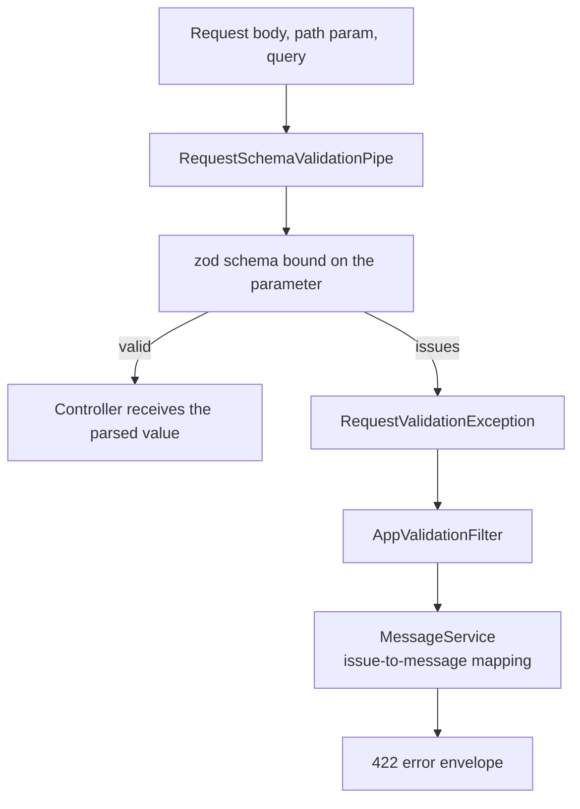

# Request Validation

This page explains how a request is validated and how a validation failure becomes an error response, for a developer who writes routes or reads a 422.

## Table of Contents

- [Related Documents](#related-documents)
- [Overview](#overview)
- [The global pipe](#the-global-pipe)
- [Strict schemas](#strict-schemas)
- [Issue to message mapping](#issue-to-message-mapping)

## Related Documents

- [Schema Guide][ref-doc-guide-schema]: write the request and response schemas of a route
- [Request Pipeline][ref-doc-request-pipeline]: where the pipe sits on a request
- [Response][ref-doc-response]: the outbound mirror of the strict request schema
- [Error Handling][ref-doc-error-handling]: the filter that answers a validation failure
- [HTTP Contract][ref-doc-http-contract]: the error envelope and its `errors` array
- [I18n][ref-doc-i18n]: the message files the mapping reads
- [API Documentation][ref-doc-api-documentation]: the OpenAPI document built from the same schemas
- [Pagination][ref-doc-pagination]: the list query schemas
- [File Upload][ref-doc-concept-file-upload]: the pipes that validate an upload and a CSV import

## Overview

The diagram shows how the pipe validates a request shape and how a failure becomes a 422 envelope.



- Every request shape is a [zod][ref-zod] schema. The schemas reach NestJS through the [Standard Schema][ref-standard-schema] interface, so the pipe validates against whatever schema the parameter binds.
- The same schema produces the OpenAPI document through [zod-openapi][ref-zod-openapi], so the validated contract and the documented contract are one definition.
- A schema both checks and normalizes: trimming and lower-casing run in the schema, so every layer below the controller sees one canonical value.
- Which fields a caller may send on a route is the request schema of that route, and which fields a caller reads is its response schema. Both are declared per route, so a field exists on a route only where its schema names it.

## The global pipe

`RequestSchemaValidationPipe` extends the framework's `StandardSchemaValidationPipe` and is the one `APP_PIPE`, registered in `RequestModule.forRoot()` (`src/common/request/request.module.ts`):

```typescript
{
    provide: APP_PIPE,
    useClass: RequestSchemaValidationPipe,
},
```

The subclass adds three rules to the framework pipe (`src/common/request/pipes/request.schema-validation.pipe.ts`):

- It fails closed on `body` and `param`. An argument of either kind that arrives with no schema throws `RequestSchemaMissingException`, so the handler never receives an unchecked value. A `query` with no schema passes: the handler receives Express's parsed query object as sent, with string or array values and nothing checked. Every route that reads a query binds a schema, and the pipe does not enforce it.
- It stamps an empty issue path with the bound argument name, or with the argument kind when the binding has no name, before it builds the exception. A named parameter such as `@Param('roleId', ...)` reports `errors[].property` as `roleId`. A root issue on a whole body or whole query binding, such as an unknown key, reports `body` or `query`.
- It strips the keys `__proto__`, `prototype`, and `constructor` from the value, nested objects included, before it validates. The strip is silent, and the keys are gone before a strict object looks at the value, so a request that carries one fails no check for it.

A failed validation throws `RequestValidationException` with the raw `StandardSchemaV1.Issue[]`. The error body carries the application `statusCode` `50300`, and `AppValidationFilter` answers HTTP 422 ([Error Handling][ref-doc-error-handling]).

The body parser also reports a malformed body as a `RequestValidationException` with one `invalid_format` issue on `body`, so a body that does not parse takes the same path.

## Strict schemas

A request schema is the contract of its route, and the kit holds every schema to the same shape.

- A request schema is `z.strictObject` at the root, so an unknown key is a validation error, and a caller learns that a field was not accepted and never assumes it was saved. No request schema declares a nested object today; one that does is a `z.strictObject` too. The only keys dropped without an error are the three prototype keys the pipe strips. A response schema is `z.object`, the lenient mirror that strips a key it does not declare, so a column added to a model never leaks ([Response][ref-doc-response]).
- A field carries its constraints: `.min()`, `.max()`, `.regex()`, or `z.enum()`. A bare `z.string()` is unvalidated wire input, and every string and array has an upper bound.
- Free text a person types, such as a name, a description, or a message, is trimmed and lower-cased at the boundary with `.trim().toLowerCase()`, so a workspace typed `Acme Team` is stored as `acme team`. A value the application compares or matches without regard to case, such as a username, an email address, or a role name, takes the same two calls. A device name is client-reported and is only trimmed, so a device model keeps its case. A secret, a token, and a regex-bounded value are taken as sent.
- Every field carries `.meta({ description, example })`, which is the source of the OpenAPI description.
- `.optional()` marks an optional field. The request DTO is the one layer where `undefined` is legal.
- An update body is a full replace. Every editable field is required, a nullable field takes `null` to clear it, and a field left out answers 422.
- A check too detailed for a chained method is a zod schema constant in `src/common/request/validations/` or in the module's `validations/` folder. A validation file exports schema constants only, and custom logic sits inside the chain (`superRefine`, `transform`, `preprocess`, or a `pipe` callback).
- The kit's validations cover MongoDB ids, required strings, email addresses, and the environment formats (booleans, encryption secrets, URLs, trusted proxies, SES identities, and optional values).
- `RequestEmailSchema` walks an address part by part and reports the i18n path of the first rule that fails under `request.error.email.*`, so a client learns which rule broke.

The strict request schema and the stripping response schema close the same gap from both sides: no key enters a route through a bound schema unless the schema names it, and nothing leaves a route unless its response schema names it. A query bound to no schema is the one input the pipe leaves open.

## Issue to message mapping

`MessageService` (`setValidationMessage`) turns each issue into an entry of the `errors` array in the error body (`src/common/message/services/message.service.ts`). An entry has three fields, declared in `src/common/message/interfaces/message.interface.ts`:

```typescript
export interface IMessageValidationError {
    key: string;
    property: string;
    message: string;
}
```

Each field is derived per issue:

1. `key` is the issue `code` in camelCase, so `too_small` becomes `tooSmall`. An issue with no string `code` takes the key `custom`.
2. `property` is the issue `path` joined with dots, so a nested field reads `address.street`. An empty path becomes `Unknown`. The pipe stamps a root issue with the argument name or kind first, so a pipe failure never reaches that fallback.
3. `message` is resolved in two lookups:
    - The issue's own `message` is translated first. When the schema raised a message path such as `request.error.email.invalid`, the translation is the answer.
    - When the translation comes back unchanged, which means the text is no path, the message is looked up under `request.error.{key}`, so a plain zod issue still gets a localized sentence. A custom message written as plain text, not as a path, is therefore discarded and the `request.error.{key}` sentence answers instead.
4. Both lookups fill `{property}` with the last segment of the path.

The language is the request language ([I18n][ref-doc-i18n-resolution]). The message files that hold the lookups sit in `src/languages/en/request.json`:

```json
{
    "error": {
        "tooSmall": "{property} is shorter than the minimum allowed.",
        "invalidFormat": "{property} does not match the expected format.",
        "custom": "{property} failed a validation rule."
    }
}
```

Those entries are an excerpt of the `error` object in that file, which also holds one entry per remaining zod issue code, the keys of the request exceptions (`validation`, `schemaMissing`, `contextMissing`, `payloadTooLarge`, `unsupportedMediaType`), the named rule keys (`isAfterNow` and the `*OtherProperty` comparisons), and the nested `email` group.

A file import returns the same entries per row. `AppValidationImportFilter` catches `FileImportException` and calls `setValidationImportMessage`, which maps each row's issues the same way and answers `{ row, errors }` entries ([CSV pipe chain][ref-doc-concept-file-upload-csv]).

<!-- REFERENCES -->

[ref-zod]: https://zod.dev
[ref-zod-openapi]: https://github.com/samchungy/zod-openapi
[ref-standard-schema]: https://standardschema.dev
[ref-doc-guide-schema]: ../guides/schema.md
[ref-doc-request-pipeline]: request-pipeline.md
[ref-doc-response]: response.md
[ref-doc-error-handling]: error-handling.md
[ref-doc-http-contract]: ../reference/http-contract.md
[ref-doc-i18n]: i18n.md
[ref-doc-i18n-resolution]: i18n.md#language-resolution
[ref-doc-api-documentation]: api-documentation.md
[ref-doc-pagination]: pagination.md
[ref-doc-concept-file-upload]: file-upload.md
[ref-doc-concept-file-upload-csv]: file-upload.md#csv-pipe-chain
