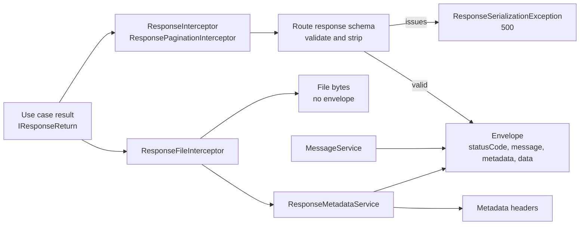

# Response

This page explains how a handler's return value becomes the response, for a developer who adds a route or reads what a client receives.

## Table of Contents

- [Related Documents](#related-documents)
- [Overview](#overview)
- [Response schemas and fail-closed strip](#response-schemas-and-fail-closed-strip)
- [The interceptor](#the-interceptor)
- [Pagination and file responses](#pagination-and-file-responses)

## Related Documents

- [HTTP Contract][ref-doc-http-contract]: the success envelope, its metadata, and the headers
- [Schema Guide][ref-doc-guide-schema]: write the response schema of a route and bind it
- [Request Validation][ref-doc-request-validation]: the strict inbound mirror of the response schema
- [Request Pipeline][ref-doc-request-pipeline]: where the interceptors sit on a request
- [Error Handling][ref-doc-error-handling]: the error envelope a failed route answers
- [I18n][ref-doc-i18n]: how the message path becomes a sentence
- [Pagination][ref-doc-pagination]: the list state behind a paginated response
- [API Documentation][ref-doc-api-documentation]: the OpenAPI response each decorator publishes
- [File Upload][ref-doc-file-upload]: the upload side of the file kit

## Overview



- A controller returns what its use case returns. The use case wraps its payload in `IResponseReturn`, and a route's decorator turns that into the response.
- Three decorators select the interceptor: `@Response` for one payload, `@ResponsePagination` for a page of items, and `@ResponseFile` for a CSV or PDF download. The first two answer the envelope, and the file interceptor answers the file bytes.
- The route's schema decides which fields leave the API, the route's message path decides the sentence, and `ResponseMetadataService` supplies the metadata and the headers.
- Every JSON response, success or error, carries the same metadata block. Every response, a file download included, carries the same metadata headers ([HTTP Contract][ref-doc-http-contract]).

## Response schemas and fail-closed strip

A route declares the shape of its payload on the decorator, and the interceptor validates the payload against it before the response leaves.

- Every response schema is a `z.object`, so a key the schema does not declare is stripped. A column added to a database model stays out of the response until a schema declares it. The request schema is the strict mirror: a caller is told about a key it sends in error, while a response strips because the caller sent nothing to correct.
- A field is hidden by leaving it out. A schema that shows a field on one route builds from the shared one with `.extend()`, and one that drops a field derives with `.omit()`. There is no exclusion decorator.
- A nested object is a named schema referenced from its parent, and it strips its own undeclared keys the same way.
- Serialization fails closed. A payload that the schema rejects, and a handler that returns data on a route with no schema, both throw `ResponseSerializationException` (`51900`, HTTP 500). The failure is a server defect, and sending the unvalidated payload would leak a field the schema never approved, so the request fails and the issues ride in `rawError` to the log and Sentry.
- `@Response(messagePath)` with no schema declares a route that returns no data. Its body carries `statusCode`, `message`, and `metadata` only.
- The fields a caller can read on a route are the fields of that route's response schema, and the fields it can write are those of its request schema. Both are declared per route, and the strict request schema mirrors the stripping response schema ([Request Validation][ref-doc-request-validation]).
- A response schema carries no transform that hides a value for one audience. Where an audience sees less, such as a censored email address outside the admin scope, the use case shapes the data before it returns it.

A schema file exports the schema constant and the type inferred from it, and it composes from a base. This is the role schema, which extends the shared database schema (`src/modules/role/dtos/role.dto.ts`):

```typescript
export const RoleSchema = DatabaseResponseSchema.omit({
    deletedAt: true,
    deletedBy: true,
}).extend({
    name: z.string().meta({
        description: 'Name of role',
        example: faker.person.jobTitle(),
    }),
    /* description, type, and policies follow */
});
```

## The interceptor

`ResponseInterceptor` (`src/common/response/interceptors/response.interceptor.ts`) maps the handler's resolved return value to the response. For each request it:

1. Reads the message path and the schema that `@Response` stored on the handler.
2. Builds the metadata through `ResponseMetadataService.create()`.
3. Validates `data` against the schema through the Standard Schema interface, when the return carries a payload.
4. Resolves the message through `MessageService.setMessage` in the request language, filling the placeholders from `metadata.messageProperties`.
5. Writes the metadata headers, sets the HTTP status, and returns `{ statusCode, message, metadata, data }`. A route with no payload omits `data`.

The status follows the handler:

- The HTTP status and the body `statusCode` default to the Express response status: `201` for a `POST`, `200` otherwise, or the value of `@HttpCode`. A success `statusCode` is therefore an HTTP status in the default case.
- A use case overrides either at runtime through `metadata.httpStatus` and `metadata.statusCode` on its return, so the two can differ. Only the database health route does this, and it sets both to 503.
- A use case replaces the declared message path through `metadata.messagePath`, and it fills the placeholders of a message through `metadata.messageProperties`.

The decorator carries the path, and the use case returns the values that fill it. This use case returns the `count` that fills the `{count}` placeholder of `notification.markAllAsRead` (`src/modules/notification/use-cases/notification.mark-all-as-read.use-case.ts`):

```typescript
return {
    metadata: {
        messageProperties: {
            count,
        },
    },
};
```

`ResponseMetadataService` is shared by the three response interceptors and the four exception filters, so a success and a failure carry the same metadata. `create()` reads the language, the version, the request id, and the correlation id from the request store and the current time from `HelperDateService`, and `setHeaders` mirrors the result onto the response headers.

## Pagination and file responses

`@ResponsePagination` takes the schema of one item and wraps the page around it. `ResponsePaginationInterceptor` serializes each row against that schema, then builds the page metadata.

- The use case returns the page that `PaginationService` produced, which holds `type`, `data`, `perPage`, `hasNext`, and the offset or cursor fields.
- The interceptor reads the list state a use case merged into the request store, which holds the search term, the filters, the sort preset, and the allow-lists. A paginated route that left no state throws `RequestContextMissingException`.
- The page and the list state land in `metadata`, beside the base metadata, and `data` is the array of serialized rows ([Pagination][ref-doc-pagination]).
- A result with a wrong shape throws `ResponsePaginationShapeInvalidException` or `ResponsePaginationTypeInvalidException`, both 500.

`@ResponseFile` serves a download from a CSV string or a PDF buffer. `ResponseFileInterceptor` answers a `StreamableFile` and no envelope.

- It rejects a missing or malformed payload with `ResponseFileDataInvalidException` (`51903`).
- It rejects a CSV with more rows than the route's row cap, and any file larger than `file.maxSizeExportInBytes`, with a 422 `file` exception. The route names its row cap by config key, and `file.maxDataExport` is the default.
- The filename is the one the use case returns, or the `response.filenameExportPattern` pattern filled with the current timestamp and the extension. The response carries `Content-Disposition: attachment` and a media type taken from the filename.
- The metadata headers are set on a download as on any other response.

<!-- REFERENCES -->

[ref-doc-http-contract]: ../reference/http-contract.md
[ref-doc-guide-schema]: ../guides/schema.md
[ref-doc-request-validation]: request-validation.md
[ref-doc-request-pipeline]: request-pipeline.md
[ref-doc-error-handling]: error-handling.md
[ref-doc-i18n]: i18n.md
[ref-doc-pagination]: pagination.md
[ref-doc-api-documentation]: api-documentation.md
[ref-doc-file-upload]: ../file-upload.md
