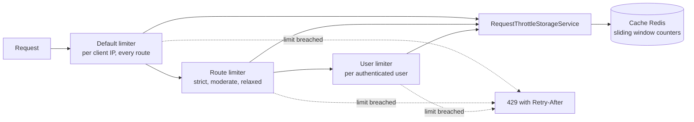

# Security

This page explains the protections the request kit applies to every route and the cryptography the application uses, for a developer who configures or audits them.

## Table of Contents

- [Related Documents](#related-documents)
- [Overview](#overview)
- [Headers](#headers)
- [Rate limiting](#rate-limiting)
- [CORS](#cors)
- [Environment protection](#environment-protection)
- [Request timeout](#request-timeout)
- [Cryptography used](#cryptography-used)

## Related Documents

- [Request Pipeline][ref-doc-request-pipeline]: where the middleware, guards, and interceptors below sit on a request
- [Middleware Reference][ref-doc-reference-middleware]: the order and config key of each middleware
- [Configuration Reference][ref-doc-reference-configuration-request]: the `request` keys and their environment variables
- [Production][ref-doc-production]: the proxy, CORS, and TLS settings a deployment sets
- [Dependencies][ref-doc-dependencies]: how the rate limiter answers when the cache Redis is down
- [Error Handling][ref-doc-error-handling]: how a refused request is logged and answered
- [Authentication][ref-doc-authentication]: tokens, sessions, passwords, and API keys
- [Authorization][ref-doc-authorization]: roles, policies, and the guards that enforce them
- [Logger][ref-doc-logger]: redaction of sensitive fields in logs and Sentry payloads

## Overview



- Every API response carries the security headers, and every route sits behind the per-IP rate limit. The Swagger documentation routes carry two headers and no rate limit. A route adds a stricter tier or a per-user limit by decorator.
- The allowed origins are an explicit list. The boot refuses a wildcard origin and an unset trusted proxy list in production.
- A route can be limited to one environment, and every handler has a time limit.
- Secrets, tokens, and one-time codes are hashed or encrypted before they are stored, and the algorithms are fixed in the helper kit.
- Controls in the authentication area follow the OWASP Application Security Verification Standard 5.0, level 2.

## Headers

`RequestHelmetMiddleware` runs on every route and sets the headers below. The API answers JSON and file downloads, never a browsing document, so the options hold the headers that still apply to those bodies and turn off the ones that govern how a browser renders a page (`src/common/request/middlewares/request.helmet.middleware.ts`).

- `Cache-Control: no-store`
- `Content-Security-Policy: default-src 'none'; base-uri 'none'; object-src 'none'; frame-ancestors 'none'`
- `Referrer-Policy: no-referrer`
- `Cross-Origin-Resource-Policy: same-origin`
- `Strict-Transport-Security: max-age=31536000; includeSubDomains`
- `X-Content-Type-Options: nosniff`
- `X-Download-Options: noopen`
- `X-Frame-Options: DENY`
- `X-Permitted-Cross-Domain-Policies: none`

- `Strict-Transport-Security` is the one value driven by config: `request.helmet.maxAgeInSeconds` is the `max-age`, and `request.helmet.includeSubDomainsEnabled` and `request.helmet.preloadEnabled` add the two directives.
- The Cross-Origin-Opener-Policy, Origin-Agent-Cluster, DNS-prefetch-control, and X-XSS-Protection headers are off.
- No response carries `X-Powered-By`: `configure(app)` disables it in Express, and the Helmet options set `xPoweredBy: false`.
- The Swagger routes register before the module middleware, so `src/swagger.ts` sets a CSP that allows the Swagger UI assets (`RequestHelmetCspDocDirectives`) and the same referrer policy on the documentation prefix itself. Those two are the only security headers the Swagger routes carry. The documentation is built only outside production.
- The Swagger routes are no Nest controllers, so the global throttle guards never run on them: they have no rate limit.

## Rate limiting

Three limiters run independently on a request. Each keeps its own counter, its own block, and its own response headers, and all three store their counters in the cache Redis, so the limits hold across every `apis` instance.

- The `default` limiter counts the client IP on every route with no opt-in. It allows 300 requests per 60 seconds and blocks for 60 seconds on a breach.
- The `user` limiter counts the authenticated user id on a route that sets `user: true`. It allows 100 requests per 60 seconds and blocks for 60 seconds.
- The `route` limiter counts the client IP per handler on a route that names a tier. The tiers are `strict` (5 requests per 60 seconds), `moderate` (20), and `relaxed` (60), and each blocks for 5 minutes.

- Every number lives in `request.throttle` in `src/configs/request.config.ts`. A route decorator carries a switch or a tier name, never a number: `@RequestThrottleProtected({ user: true, route: EnumRequestThrottleRoute.strict })`.
- `RequestThrottleDefaultGuard` and `RequestThrottleRouteGuard` are global guards, so a flood is rejected before any guard a route mounts does its work, a database read included.
- `RequestThrottleUserGuard` is mounted by the decorator on the handler, directly above the JWT decorator, so it runs after the JWT guard. It counts by the acting user id that the JWT guard stored, and it throws `RequestContextMissingException` when no user id is stored.
- The `route` tracker is `{tier}:{Controller}.{handler}:{ip}`, so the same client has a separate counter on each handler.
- `RequestThrottleDefaultGuard` extends the `@nestjs/throttler` guard, which counts the hit through the storage service and writes the default limiter's headers. `RequestThrottleService.evaluate` does the same for the `route` and `user` limiters: it counts the hit, sets `Retry-After`, throws `ThrottlerException` on a block, and writes the rate-limit headers. `AppHttpFilter` renders the exception as a 429.

The client IP is `req.ip` under Express `trust proxy`, which `configure(app)` sets from `app.http.trustedProxies` (`APP_HTTP_TRUSTED_PROXIES`).

- The value is a list of trusted networks: the presets `loopback`, `linklocal`, and `uniquelocal`, IP addresses, or CIDRs. It is never a hop count and never `true`.
- Unset, it trusts no proxy, so `req.ip` is the direct peer and a client cannot forge it through `X-Forwarded-For`. Production requires it.
- Behind a CDN or edge proxy, the proxy's networks must be listed. Without them every client shares the proxy's address and one rate-limit bucket.

`RequestThrottleStorageService` implements the Throttler storage with one Lua script per check against the cache Redis connection. The algorithm is an exact sliding window log, which counts the requests of the last window and so allows no double burst across a window boundary:

- Each allowed request is appended to a sorted set scored by the Redis clock.
- Entries older than the window are trimmed on every check.
- A rejected request is not recorded, so a client that keeps hitting a blocked route cannot extend its own window.
- A breach sets a block key for the limiter's block duration. While it exists every request is rejected with the remaining time, and nothing is counted.

The keys come from three patterns in `request.throttle`:

```typescript
keyPattern: 'Request:Throttle:{name}:{tracker}',
blockKeyPattern: 'Request:Throttle:Block:{name}:{tracker}',
sequenceKeyPattern: 'Request:Throttle:Seq:{name}:{tracker}',
```

Those lines come from `src/configs/request.config.ts`. `{name}` is `default`, `user`, or `route`.

- The `@nestjs/throttler` guard behind the default limiter writes `X-RateLimit-Limit`, `X-RateLimit-Remaining`, and `X-RateLimit-Reset`. `RequestThrottleService.evaluate` writes the same three with a `-route` or `-user` suffix.
- `Retry-After` is unsuffixed, in seconds, and set when any limiter blocks. A blocked request carries `Retry-After` and no `X-RateLimit-*` headers of the limiter that blocked it; a limiter that already admitted the request leaves its headers on the response.
- All of them are in `request.cors.exposedHeaders`, so a browser client can read them across origins.
- A Redis error in the storage throws `RedisUnavailableException`, which answers 503 ([Dependencies][ref-doc-dependencies-required]): the cache Redis is a required dependency and it is down. A script reply in an unexpected shape means Redis answered, so the limiter logs a warning and lets the request through and refuses no traffic over a counting fault.

## CORS

`RequestCorsMiddleware` answers cross-origin requests from the allowed origins in `request.cors.allowedOrigins`, filled from `REQUEST_CORS_ALLOWED_ORIGINS`.

- A request with no `Origin` header passes.
- An origin that is not `http` or `https`, or that carries a path, query, or fragment, is refused.
- A pattern is a host, optionally with a scheme and a port. A pattern with no scheme matches `http` and `https`. A pattern with no port matches the default port of the scheme, so `example.com` does not match `example.com:3000`.
- A pattern of the form `*.example.com` matches any subdomain and the base domain.
- A `*` entry allows every origin and turns credentials off. Any other list allows credentials. The boot refuses `*` in production.
- The allowed methods, allowed request headers, exposed response headers, and the preflight `max-age` (one day) come from `request.cors`. A preflight answers 204.
- A new `x-*` header the API reads or writes is added to the allowed or exposed list in `src/configs/request.config.ts`.

## Environment protection

`@RequestEnvProtected(...environments)` limits a route to the listed `EnumAppEnvironment` values. `RequestEnvGuard` compares them with `app.env`, and a request in any other environment throws `RequestEnvNotAllowedException`. It answers 404 with the generic not-found message, the same as an unknown route, so a client in another environment cannot tell the route exists.

- The decorator throws `RequestEnvProtectedEmptyException` when it is called with no environment, so the boot fails.
- The decorator is available to any route. No route uses it today.

## Request timeout

`RequestTimeoutInterceptor` fails a handler that runs longer than `request.timeoutInMs` (30 seconds) with `RequestTimeoutException`, which answers 408.

- `@RequestTimeout('1m')` sets another limit for one handler, in the [ms][ref-ms] format. The routes that accept an upload use `RequestUploadTimeout`, one minute.
- The limit starts when the handler runs. The middleware and the guards run before it and are not counted.

## Cryptography used

Every use of `node:crypto` goes through the `Helper*` services in `src/common/helper/`, which wrap it. JWT signing and verification are the one exception: `AuthJwtService` calls `JwtService` of `@nestjs/jwt`, and the Passport strategies verify tokens against the JWKS.

- Access tokens are signed with ES256 (ECDSA with SHA-256), live one hour, and verify against a JWKS ([RFC 7518][ref-rfc-7518], [RFC 7519][ref-rfc-7519]).
- Refresh tokens are signed with ES512 (ECDSA with SHA-512), live 30 days, and verify against a JWKS. The two token kinds have separate keys and algorithms, so a key for one never verifies the other.
- Passwords and backup codes are hashed with argon2id: 19 MiB of memory, 2 passes, 1 lane, a 16-byte salt, and a 32-byte tag.
- Authenticator codes are TOTP with SHA-1, 6 digits, a 30-second period, and one step of drift ([RFC 6238][ref-rfc-6238]).
- Verification tokens, reset tokens, session `jti` digests, challenge tokens, and API key hashes are stored as SHA-256 digests, and a digest is compared with `timingSafeEqual`.
- Every generated token, code, and secret draws from `randomBytes` or `randomInt` of `node:crypto`.
- A value that must be read back is encrypted with AES-256-GCM, described below. A value that is only compared is stored as its digest.
- `MFA_TOTP_ENCRYPTION_SECRET` seals the authenticator (TOTP) secrets. `APP_ENCRYPTION_SECRET` seals everything else that is encrypted: pagination cursors, notification payloads (the recipient email address, mobile number, and device tokens), the push token of an MFA challenge, and the email address of an admin import row.
- An encrypted value gets its own key. `HelperEncryptionService.aes256Encrypt` derives a 32-byte key with HKDF-SHA-256 from the root secret, a random 16-byte salt, and a purpose string. It uses a random 12-byte IV and a 16-byte authentication tag, and it binds a context string as authenticated data.
- The purpose names one use, such as `PaginationCursor`. The context is the owning id, or a fixed string where the value has no owner: a cursor token has none.
- A root secret is 48 random bytes written as 64 base64url characters. `pnpm generate:secret:encryption` creates both.
- A root has no rotation path: a payload names no key, so replacing a root makes what it sealed unreadable.
- A sensitive field never reaches a log line or a Sentry payload: `LoggerSensitiveFields` lists the redacted keys, and the Pino `redact` option, `LoggerUtil`, and the scrubbers in `src/instrument.ts` apply the list. See [Logger][ref-doc-logger].

<!-- REFERENCES -->

[ref-rfc-7518]: https://datatracker.ietf.org/doc/html/rfc7518
[ref-rfc-7519]: https://datatracker.ietf.org/doc/html/rfc7519
[ref-rfc-6238]: https://datatracker.ietf.org/doc/html/rfc6238
[ref-ms]: https://github.com/vercel/ms
[ref-doc-request-pipeline]: request-pipeline.md
[ref-doc-reference-middleware]: ../reference/middleware.md
[ref-doc-reference-configuration-request]: ../reference/configuration.md#request
[ref-doc-production]: ../production.md
[ref-doc-dependencies]: dependencies.md
[ref-doc-dependencies-required]: dependencies.md#required-mongodb-and-redis
[ref-doc-error-handling]: error-handling.md
[ref-doc-authentication]: ../authentication.md
[ref-doc-authorization]: ../authorization.md
[ref-doc-logger]: ../logger.md
