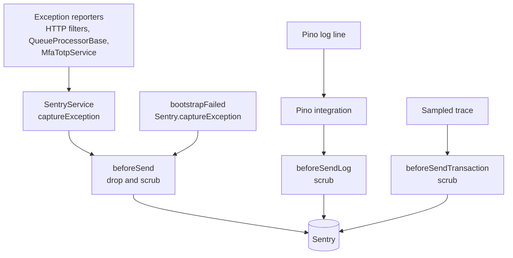

# Sentry

This page explains how the application reports errors and logs to Sentry, for a developer who adds a report or reads one.

## Table of Contents

- [Related Documents](#related-documents)
- [Overview](#overview)
- [Logs and Issues](#logs-and-issues)
- [What gets reported](#what-gets-reported)
- [Scrubbing](#scrubbing)

## Related Documents

- [Logging][ref-doc-concept-logging]: the log pipeline Sentry Logs forward, and the redaction both share
- [Logging Reference][ref-doc-reference-logging]: the list of redacted keys
- [Error Handling][ref-doc-concept-error-handling]: the filters that report a 5xx
- [Queue][ref-doc-concept-queue-retries]: when a failed job reports
- [Dependencies][ref-doc-dependencies-optional]: Sentry among the optional integrations
- [Configuration Reference][ref-doc-reference-configuration-sentry]: the `sentry` keys
- [Production][ref-doc-production-observability]: the fixed production log levels and the sampling variables

## Overview

The diagram shows what reaches Sentry and the scrubbing hook each path passes.

- Sentry is an optional integration. `SENTRY_DSN` turns it on, and with no DSN the application never calls `Sentry.init`, so every `SentryService` call sends nothing.
- `src/instrument.ts` is the first import of `src/main.ts` and `src/migration.ts`. It reads the app, logger, and Sentry config, builds the scrubbing utilities, and initializes Sentry before any application code loads.
- `SentryModule.forRoot()` is a global kit module that provides and exports `SentryService`, the one way to report from code inside the Nest container. `bootstrapFailed` runs outside the container and reports on its own.
- `Sentry.init` runs with the environment (`app.env`), the release (`app.version`), stack traces attached, and `sendDefaultPii` off. The keys `sentry.tracesSampleRate` and `sentry.profilesSampleRate` set sampling, and `sentry.maxBreadcrumbs`, `sentry.normalizeDepth`, and `sentry.maxValueLength` bound what an event carries.
- `Sentry.init` adds Node profiling and the Pino integration to Sentry's default integrations.

## Logs and Issues

Sentry receives two kinds of data from the application:

- Issues are captured exceptions and messages. An issue carries the stack, the scrubbed request, and the breadcrumbs.
- Logs are Pino log lines that the Pino integration forwards. In production the integration sends `warn`, `error`, and `fatal` lines. Every other environment sends every level from `trace` up.
- `beforeSend` drops an issue whose level is `info` or `debug`. Outside production those levels still reach Sentry as logs. In production the Pino integration forwards only `warn`, `error`, and `fatal`, so an `info` or `debug` line never reaches Sentry.

## What gets reported

`SentryService` has three methods: `captureException(exception, captureContext | null)`, `captureMessage(message, level)`, and `log(level, message, attributes | null)`. Each one catches a failure of Sentry itself and logs it as an error, so a Sentry outage never fails a request.

These are every caller. No file calls `SentryService.captureMessage` or `SentryService.log`:

- `AppGeneralFilter` and `AppHttpFilter` report an exception whose HTTP status is 500 or higher. A 4xx answer is a refusal that leaves one `warn` log, and it is not reported.
- `QueueProcessorBase.onFailed` reports a failed job once, on its last attempt, tagged with `job.name` and carrying the job id, name, and attempts as context. It skips a `QueueException` whose `isFatal` is `false`.
- `MfaTotpService.readSecret` reports a TOTP secret that fails to decrypt, an operator fault the client sees as a non-5xx answer.
- `bootstrapFailed` calls `Sentry.captureException` and `Sentry.flush` itself, because it runs outside the Nest container ([Logging][ref-doc-concept-logging-boot]).

`beforeSend` then returns `null` for each event below, and Sentry does not send it:

- An event for a non-fatal `QueueException`.
- An event whose request URL matches `logger.excludedRoutes`.
- An event that carries a request and a `contexts.response.status_code` below 500. An event without both is not dropped on status, which is why a report from `MfaTotpService.readSecret` still reaches Sentry.
- An event whose level is `info` or `debug`.

The trace sampler returns 0 for a request or transaction on an excluded route, and `sentry.tracesSampleRate` for every other one.

## Scrubbing

Every outbound item passes a scrubber from `SentryUtil` before it leaves the process: `scrubEvent` in `beforeSend`, `scrubEvent` again in `beforeSendTransaction`, `scrubBreadcrumb` in `beforeBreadcrumb`, and `scrubLog` in `beforeSendLog`. A scrubber uses the same `LoggerSensitiveFields` list and `[REDACTED]` marker as the logger ([Logging][ref-doc-concept-logging-redaction]).

- The request URL, the transaction name, and each span description keep their static path segments and replace every other segment with `[REDACTED]`. The query string and the fragment are removed. What counts as a static segment: [Logging Reference][ref-doc-reference-logging-masked].
- A request header whose name is on the sensitive list is redacted, and every cookie value is redacted.
- A request body is parsed when it is JSON and redacted by key. A form body is redacted by key, including keys such as `user[password]`. Any other body becomes `[REDACTED]`.
- Trace, span, and breadcrumb data replace the dynamic segments of their URL fields, delete their query and fragment fields, redact their body fields, and redact a header attribute whose header is sensitive.
- `extra` and every context are redacted by key, to a depth of ten levels. The constant `LoggerSentryRedactMaxDepth` sets the ten, and a deeper object becomes `[REDACTED]`. `sentry.normalizeDepth` is a separate option: it bounds how deep Sentry serializes an event.
- Log attributes are redacted by key and scrubbed like trace data. `scrubLog` leaves the log message as it is; the message redaction Pino applies is in [Logging][ref-doc-concept-logging-redaction].

<!-- REFERENCES -->

[ref-doc-concept-logging]: logging.md
[ref-doc-concept-logging-boot]: logging.md#boot-and-seed-failures
[ref-doc-concept-logging-redaction]: logging.md#redaction
[ref-doc-reference-logging]: ../reference/logging.md#redacted-keys
[ref-doc-reference-logging-masked]: ../reference/logging.md#masked-route-segments
[ref-doc-concept-error-handling]: error-handling.md
[ref-doc-concept-queue-retries]: queue.md#retries-and-unrecoverable-failure
[ref-doc-dependencies-optional]: dependencies.md#optional-adapters
[ref-doc-reference-configuration-sentry]: ../reference/configuration.md#sentry
[ref-doc-production-observability]: ../production.md#observability
