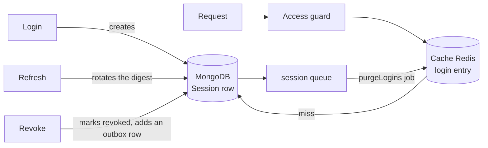

# Session

This page explains what a session is and how the application ends one, for a developer who revokes sessions from a new flow or debugs a token that is still accepted.

## Table of Contents

- [Related Documents](#related-documents)
- [Overview](#overview)
- [Two stores](#two-stores)
- [Lifecycle and revocation](#lifecycle-and-revocation)
- [Per-request check](#per-request-check)

## Related Documents

- [Authentication][ref-doc-concept-authentication]: how a login creates a session and how a refresh rotates it
- [Cache][ref-doc-concept-cache-session]: the read-through mechanism behind the login entry
- [Queue][ref-doc-concept-queue]: the outbox row and the job that purges the entry
- [Device][ref-doc-concept-device]: the ownership every session belongs to
- [User][ref-doc-concept-user]: the account status the guard checks beside the session
- [MFA][ref-doc-concept-mfa]: the factor changes that revoke sessions
- [Activity Log][ref-doc-activity-log]: the entries a revoke writes
- [Configuration Reference][ref-doc-reference-configuration-session]: the `session` keys
- [Status Codes][ref-doc-reference-status-codes-session]: `SessionNotFoundException` and `SessionRevokedException`

## Overview

- A session is one sign-in of one user on one device. Its row in MongoDB is the source of truth.
- The cache Redis holds a login entry per session that the guard reads on every request, so the check does not read MongoDB each time.
- A session ends by revocation, by its expiry, or by idling past the idle limit. A revoked session stops passing once the purge job deletes its entry.
- A device ownership holds one live session, and a device holds one signed-in user: [Device][ref-doc-concept-device-one-user].

## Two stores

The `Session` row holds the facts of one sign-in:

- `userId` and `deviceOwnershipId`, the owner and the device the session signed in from.
- `jtiDigest`, the SHA-256 digest of the current token `jti`. The `jti` itself is never stored. The pair `(userId, jtiDigest)` is unique. The token digest and the constant-time compare are in [Cryptography used][ref-doc-concept-security-crypto].
- `ipAddress`, `userAgent`, and `geoLocation`, resolved once from the login request.
- `expiredAt`, the login time plus the refresh token lifetime. A refresh never moves it.
- `lastActiveAt`, stamped when the session is created and by each refresh. An access request stamps nothing.
- `isRevoked`, `revokedAt`, and `revokedById`, set by a revoke.

A session is live while it is not revoked, `expiredAt` has not passed, and `lastActiveAt` is within `session.idleTimeoutInMs`. A session idles when no refresh runs within that limit, however many access requests it served. The login-entry loader, the active-session list, and the refresh rotation carry the three conditions; a revoke write tests `isRevoked: false` only.

The login entry is the cache side:

- The key is `User:{userId}:Session:{sessionId}` (`session.keyPattern`) and the value is `{ jtiDigest }`.
- `SessionService.isLoginActive` reads it through the cache with a loader that reads the live row. The entry lives for `session.loginCacheTtlInMs`, which is shorter than the access token lifetime, and takes no lease. An expired or idle session keeps passing until its entry TTL ends. The next miss finds no live row and caches nothing.
- A refresh writes no entry. The mechanism is in [Session login entry][ref-doc-concept-cache-session].

The daily `purgeExpired` job of the `session` queue deletes a session row `session.retentionInMs` after its `expiredAt`, revoked or not. Its cron is `session.purgeExpiredCron`. `session.retentionInMs` stays no shorter than `analytic.maxWindowInMs`, because the analytic repositories read sessions over that window. Each other module purges its own expired rows on its own queue ([Queue][ref-doc-concept-queue-purge]).

## Lifecycle and revocation

A session passes through four events:

1. A login creates it ([Login methods][ref-doc-concept-authentication-login]).
2. A refresh rotates its digest ([Refresh rotation and jti][ref-doc-concept-authentication-refresh]).
3. Expiry or idling ends it without any write. The row stays until the retention purge, and its login entry keeps passing until the entry TTL ends.
4. A revoke ends it at once.

A revoke is one transaction owned by the use case of the flow that causes it:

1. A `SessionService` `*InTx` method marks the rows revoked with a guarded write that carries `isRevoked: false`. It sets `revokedAt` and `revokedById`. `revokedById` is the user whose action caused the revoke: the caller or the admin; the session's own user for a replayed token or a self-deletion; the signing-in user for a login on a shared device.
2. The same method adds the purge row, `SessionQueue.purgeLoginsEffect`, to the transaction. The activity entries of the flow join it too.
3. After the commit the outbox enqueues a `purgeLogins` job at high priority on the `session` queue ([Queue][ref-doc-concept-queue-outbox]).
4. The job carries the user id and the exact session refs the revoke returned. It invalidates those login keys and nothing else, never a key pattern, so a login made after the revoke keeps its key.

A revoke reaches the guard when the job runs. Until then the entry keeps passing, and the entry TTL bounds that window. A revoke write ignores the expiry and idle conditions, except the revoke of a replayed refresh token, which carries them, so a replayed token on an expired or idle session revokes nothing.

These events revoke sessions:

- A password change revokes every session but the caller's. A password reset and an admin-issued temporary password revoke every session.
- Logout revokes the current session. A user revokes one of their own sessions after a re-authentication, and an admin revokes one session or every session of a user ranked below them.
- An admin status change to `blocked` or `inactive` revokes every session of the user.
- Self-deletion revokes every session in the deletion job's transaction.
- Disabling TOTP and deleting a passkey revoke every session but the caller's. An admin MFA reset revokes every session.
- A replayed refresh token revokes its session.
- Removing a device ownership revokes the sessions of that ownership.
- A login on an ownership revokes the user's earlier sessions on it, and a login on a device another user is signed in to revokes that user's unrevoked sessions. Each affected user gets one activity entry under its own action and no notification.

Each admin session-revoke route refuses a target the admin does not outrank (`RoleRankForbiddenException`, 403, `50504`) and a blocked target (`UserBlockedInvalidException`, 400, `51006`). The revoke of every session of a user refuses the admin's own account (`UserNotSelfException`, 400, `51001`) and answers `SessionNotFoundException` (404, `50400`) when the user has no unrevoked session. The revoke of one session answers `50400` when no unrevoked session of that user matches.

## Per-request check

`AuthJwtAccessStrategy` runs this check after the token verifies:

1. It validates that the payload carries the user id as `sub`, a session id, and a `jti`.
2. `SessionService.isLoginActive` computes the digest of the token `jti` and reads the login entry through the cache.
3. No entry, because the loader found no live row, means the session is not live.
4. A hit is compared with the token digest using a constant-time comparison. A match passes.
5. A hit with a different digest is invalidated and read through once more, and the answer is the second read. This covers the window after a refresh: the old access token passes while the entry holds the old digest, until the new token's first request reloads the entry or the entry TTL ends.
6. A session that is not live answers `SessionRevokedException` (401, `50401`).

- A Redis error during the read answers `RedisUnavailableException` (503, `52400`): the cache Redis is a required dependency ([Dependencies][ref-doc-dependencies-required]).
- The check reads the session only. `@UserProtected()` re-reads the user on every request and rejects a blocked, inactive, or deleted account even while a session is live ([Decorators and Guards Reference][ref-doc-reference-decorators-user]).
- A request carrying a refresh token reads no login entry at its guard. The refresh rotation is its only session check.

<!-- REFERENCES -->

[ref-doc-concept-authentication]: authentication.md
[ref-doc-concept-authentication-login]: authentication.md#login-methods
[ref-doc-concept-authentication-refresh]: authentication.md#refresh-rotation-and-jti
[ref-doc-concept-cache-session]: cache.md#session-login-entry
[ref-doc-concept-queue]: queue.md
[ref-doc-concept-security-crypto]: security.md#cryptography-used
[ref-doc-concept-queue-outbox]: queue.md#outbox-row-in-the-transaction
[ref-doc-concept-queue-purge]: queue.md#queue-classes
[ref-doc-concept-device]: device.md
[ref-doc-concept-device-one-user]: device.md#one-signed-in-user-per-device
[ref-doc-concept-user]: user.md
[ref-doc-concept-mfa]: mfa.md
[ref-doc-activity-log]: ../reference/activity-log.md
[ref-doc-reference-configuration-session]: ../reference/configuration.md#session
[ref-doc-reference-status-codes-session]: ../reference/status-codes.md#session
[ref-doc-dependencies-required]: dependencies.md#required-mongodb-and-redis
[ref-doc-reference-decorators-user]: ../reference/decorators-and-guards.md#userprotected
