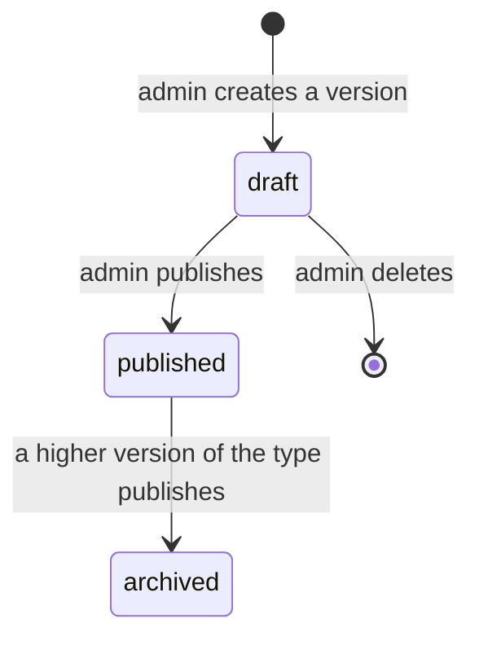

# Term Policy

This page explains the term-policy module, for a developer who publishes a legal document or protects a route with the acceptance gate.

## Table of Contents

- [Related Documents](#related-documents)
- [Overview](#overview)
- [Types and versions](#types-and-versions)
- [Status lifecycle](#status-lifecycle)
- [Publishing and the email fan-out](#publishing-and-the-email-fan-out)
- [Acceptance at sign-up and per request](#acceptance-at-sign-up-and-per-request)

## Related Documents

- [Authorization][ref-doc-concept-authorization]: where the acceptance guard sits in the stack
- [User][ref-doc-concept-user]: the sign-up that records acceptances
- [File Upload][ref-doc-concept-file-upload-presign]: the presigned upload the content uses
- [Queue][ref-doc-concept-queue]: the outbox, the job ids, and the retries behind the `termPolicy` queue
- [Notification][ref-doc-notification]: the email channel that sends the publication email
- [Analytic][ref-doc-analytic]: the acceptance-rate metrics
- [Dependencies][ref-doc-concept-dependencies]: the 501 a route answers while S3 or SES is unset
- [Seeded rows][ref-doc-reference-database-termpolicy]: the four policies a seed writes
- [Route Protection Guide][ref-doc-guide-route-protection]: put the gate on a route
- [Configuration Reference][ref-doc-reference-configuration-term-policy]: the `termPolicy` keys
- [Status Codes][ref-doc-reference-status-codes-term-policy]: the code and message of each exception named here

## Overview

- A term policy is a versioned legal document of one type. Its content is a Handlebars file per language, stored in S3.
- A user accepts a policy version, and the acceptance is a row. The user row holds no acceptance flag.
- `@TermPolicyAcceptanceProtected()` rejects a request until the user has accepted the latest published version of each required type.
- Publishing a version emails every active user who existed at `publishedAt`. A new `termsOfService` or `privacy` version makes every user pending again, those being the types the guard and the pending list check.

## Types and versions

`EnumTermPolicyType` has four members: `termsOfService`, `privacy`, `cookies`, and `marketing`.

- A type has many versions, and the pair `(type, version)` is unique (`TermPolicyExistException`, 409, `51501`).
- The default required types are `termsOfService` and `privacy` (`TermPolicyDefaultRequiredTypes`). `cookies` and `marketing` are consents a user chooses.
- Acceptance is one `TermPolicyUserAcceptance` row per user and policy version.
- A version holds one content entry per language, each with its S3 key, size, and the bucket it sits in (`access`). Two entries with one language answer `TermPolicyLanguageDuplicateException` (400, `51502`).

The content goes through the presigned upload ([Presigned upload][ref-doc-concept-file-upload-presign]):

1. An admin asks for a presign with the type, the version, the language, and the `size`. The size is checked against `termPolicy.content.maxSizeInBytes` (`TermPolicyContentSizeExceededException`, 400, `51511`), and the API derives the key `term-policies/{type}/v{version}/{language}-{random}.hbs` itself. The presign is for the private bucket, and a presign for an existing version that is not a draft answers `TermPolicyStatusInvalidException` (400, `51505`).
2. The client PUTs the file to S3.
3. The create, update-content, and add-content requests carry `{ language, key }` and no size. The service reads the object's size and first bytes from S3 and stores the size S3 reports.
4. A key outside the policy path, or an object that is not in the bucket, answers `TermPolicyContentKeyInvalidException` (400, `51512`). An oversize object answers `51511`, and an object that is not a Handlebars template answers `TermPolicyContentTypeInvalidException` (415, `51513`).
5. A create that refuses an object answers the refusal and creates no policy. Each refused object gets its delete row in a transaction that holds it alone, and the accepted objects stay in the bucket so the admin can retry with their keys.

Adding a language that exists answers `TermPolicyContentExistException` (409, `51507`). Updating or removing a language the draft lacks answers `TermPolicyContentNotFoundException` (404, `51506`). A replaced or removed object, and the objects of a deleted draft, get a `deleteContent` job on the `termPolicy` queue, which deletes the exact keys from the private bucket.

Every route that touches content needs S3. Without it a route answers `AwsS3NotConfiguredException` (501). Removing content and deleting a draft run without S3: they still add the `deleteContent` row, and the job deletes nothing while S3 is unset.

## Status lifecycle

A policy is `draft`, `published`, or `archived`.

- A draft is visible to admins only. Its content can be added, replaced, and removed, and the whole draft can be deleted. The files sit in the private bucket.
- A published policy cannot be edited or deleted. Its `contents` point at the public bucket, and it is visible to every user. It is the latest published version of its type.
- Publishing archives the published lower versions of the same type. A version lower than an already published version of its type answers `51505` and stays a draft.
- An archived policy is left out of the public list, the pending list, and the guard, which read only `published` rows. It cannot be edited, deleted, resent, or given a new presign. An admin list shows it with the `archived` filter.
- Reading a content as an admin signs a GET for the bucket the stored content names, so a draft reads from the private bucket and a published policy from the public one.

## Publishing and the email fan-out

Publish (`TermPolicyPublishByAdminUseCase`) is two steps:

1. `preparePublishByAdmin` runs before the transaction. The policy must exist (`TermPolicyNotFoundException`, 404, `51500`) and be a draft (`TermPolicyStatusInvalidException`, 400, `51505`), its stored contents must be valid and not empty (`TermPolicyContentEmptyException`, 400, `51508`), S3 must be configured, and no higher version of the type may be published. It then copies each content to the public bucket. The copy is S3 work kept out of the database transaction, and a failed copy leaves the draft a draft. A transaction that fails after the copy leaves the public objects under the version's public path, and the next publish writes the same keys.
2. One transaction runs a guarded update that matches the policy only while it is a draft. It sets `status` to `published`, stamps `publishedAt`, and rewrites `contents` to the public items. It archives the lower published versions of the type, and adds the `publish` job row and the `adminTermPolicyPublished` entry.

The guarded update lets one of two concurrent publishes commit. After the commit the outbox enqueues the job with the id `publish-{termPolicyId}`. The id keys the outbox row, so a publication has one job, and a resend adds its own job under a fresh nonce ([Job ids and dedupe][ref-doc-concept-queue-dedupe]).

The `publish` job (`TermPolicyProcessPublishUseCase`) fans out the email:

- It pages the active users, status `active` and not deleted, created at or before `recipientCutoffAt`, the `publishedAt` the job carries. The cutoff is `publishedAt` because a user created later accepts the version at sign-up. It reads `email.batchSize` users per page by `id` cursor.
- Per page, one transaction creates a `Notification` row and a `TermPolicyRecipient` marker for each user who has none, and adds one email batch job row for the new recipients. The marker is unique per user and policy, so a repeated page cannot send twice.
- The page re-queues, in its own transaction and under their existing batch id, the markers an earlier run left unsent and unclaimed. A marker created in the same page is not re-queued, so no batch is added twice.
- A user created after the cutoff, a deleted user, and a user whose status is not `active` are outside the recipient set.

How the email job claims, sends, and retries, and how the payload is encrypted: [Notification][ref-doc-notification-publication].

Resend recovers a publication email. An admin can resend a published policy. Its only work is the email, so it asserts SES first and answers `AwsSesNotConfiguredException` (501), then `51505` for any other status. Publish's email is a notice beside the status change, and without SES its sends do nothing ([Dependencies][ref-doc-concept-dependencies]). One transaction adds a `publish` job whose id holds a fresh `resendNonce`, so it differs from `publish-{termPolicyId}`, and the `adminTermPolicyEmailResent` entry. The job carries the policy's stored `publishedAt` as the cutoff, creates rows for the active users that have none, and re-queues the rows still unsent and unclaimed. A row already sent or claimed stays.

## Acceptance at sign-up and per request

Sign-up, credential and social alike, records acceptances in the creation transaction:

- It takes the latest published version of `termsOfService` and `privacy`, plus `cookies` and `marketing` when the body consents.
- A required type with no published version answers `TermPolicyRequiredNotPublishedException` (500, `51510`), a setup gap that reports to Sentry. The guard has nothing to compare for such a type and passes. An optional type with none is dropped.
- An admin-created or imported user carries no acceptance. Their first guarded request answers `TermPolicyRequiredInvalidException` (403, `51504`) until they accept through the accept route.

The guard (`TermPolicyGuard`) reads the user the user guard stored:

1. The required types are the default types, `termsOfService` and `privacy`: no route passes decorator arguments, so the guard and the pending list both check the defaults.
2. One read takes the latest published policy of each required type with the user's acceptance rows.
3. Any such policy with no acceptance of the user answers `TermPolicyRequiredInvalidException` (403, `51504`).
4. A required type with no published version has nothing to accept, so it passes.

Publishing a version writes no user field. The next guarded request of every user finds a new latest version without an acceptance, so a new version needs a new acceptance.

A user accepts through a route that names only the type. The server resolves the latest published version of that type, and one transaction inserts the acceptance, the `userAcceptTermPolicy` notification row, and the `userTermPolicyAccepted` entry. Accepting a version twice answers `TermPolicyAlreadyAcceptedException` (400, `51503`), and a type with no published version answers `TermPolicyNotFoundException` (404, `51500`).

Every signed-in route carries the acceptance guard except four, so a user with pending policies reaches them: the accept route, the pending list, refresh, and logout. The pending list always checks the default types and answers the `id`, `type`, and `version` of each policy still to accept.

<!-- REFERENCES -->

[ref-doc-concept-authorization]: authorization.md#term-policy-gate
[ref-doc-concept-user]: user.md#sign-up-and-personal-workspace
[ref-doc-concept-file-upload-presign]: file-upload.md#presigned-upload
[ref-doc-concept-queue]: queue.md
[ref-doc-concept-queue-dedupe]: queue.md#job-ids-and-dedupe
[ref-doc-concept-dependencies]: dependencies.md#optional-adapters
[ref-doc-notification]: ../notification.md
[ref-doc-notification-publication]: ../notification.md#term-policy-publication-email
[ref-doc-analytic]: ../analytic.md
[ref-doc-reference-database-termpolicy]: ../reference/database.md#termpolicy
[ref-doc-guide-route-protection]: ../guides/route-protection.md
[ref-doc-reference-configuration-term-policy]: ../reference/configuration.md#termpolicy
[ref-doc-reference-status-codes-term-policy]: ../reference/status-codes.md#term-policy
