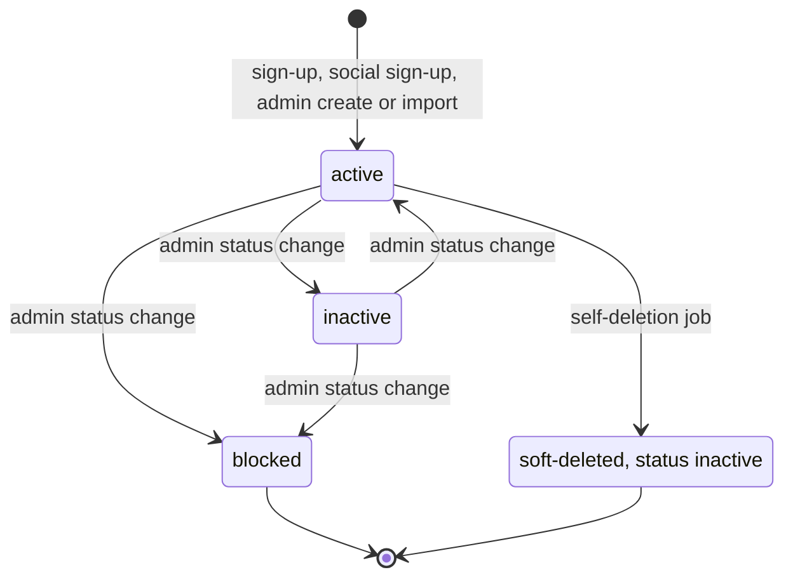

# User

This page explains the account lifecycle of the `user` module, for a developer who changes a sign-up, password, status, or deletion flow.

## Table of Contents

- [Related Documents](#related-documents)
- [Overview](#overview)
- [Sign-up and personal workspace](#sign-up-and-personal-workspace)
- [Email and mobile verification](#email-and-mobile-verification)
- [Profile](#profile)
- [Password, reset, and history](#password-reset-and-history)
- [Status and lockout](#status-and-lockout)
- [Self-deletion and purge](#self-deletion-and-purge)
- [Import and export by admin](#import-and-export-by-admin)

## Related Documents

- [Authentication][ref-doc-concept-authentication]: the sign-in flows and the password checks
- [Session][ref-doc-concept-session]: the sessions a password change, a status change, and a deletion revoke
- [MFA][ref-doc-concept-mfa]: the factors, the MFA lock, and the re-authentication proof
- [Device][ref-doc-concept-device]: the ownerships a deletion revokes
- [Authorization][ref-doc-concept-authorization]: the role a user holds and the guard that checks the account
- [Term Policy][ref-doc-concept-term-policy]: the acceptances a sign-up records
- [Workspace][ref-doc-workspace]: the personal workspace and the invites a sign-up uses
- [File Upload][ref-doc-concept-file-upload]: the profile photo upload and the CSV import
- [Notification][ref-doc-notification]: the emails these flows send
- [Activity Log][ref-doc-activity-log]: the entries these flows write
- [Configuration Reference][ref-doc-reference-configuration-user]: the `user`, `verification`, and `forgotPassword` keys
- [Status Codes][ref-doc-reference-status-codes-user]: the code and message of each exception named here

## Overview

- A user has one status, `active`, `inactive`, or `blocked`, and the guard of every signed-in route reads it.
- `blocked` is final: no admin action touches a blocked user. `inactive` is reversible.
- The module groups its use cases by flow. Sign-in is in [Authentication][ref-doc-concept-authentication]. Sign-up, admin create, and import share the registration service.
- Passwords, factors, sessions, and devices are owned by their own modules. A use case of the `user` module calls their services in one transaction.
- Contact values are censored in every response outside the `/admin` scope. The `/admin` scope answers the full value.

## Sign-up and personal workspace

Sign-up (`UserSignUpUseCase`) is behind the `signUp` flag and needs SES, because it sends a verification email. With SES unset the request answers `AwsSesNotConfiguredException` (501).

The body carries the email, the username, the password, the country, the client kind, the two optional consents `cookies` and `marketing`, an optional display name, and an optional invite token. Before the transaction opens, one parallel batch checks:

- the invite, when a token is present, and the email it names
- the default role, `user.default.role`
- that the email and the username are free. A username passes its pattern, a whole-word bad-word list, and the unique check.
- the latest published term policies of `termsOfService` and `privacy`, plus `cookies` and `marketing` when accepted
- the country
- the password policy ([Password checks][ref-doc-concept-authentication-password])

One transaction, with the timeout `user.createTimeoutInMs`, then writes:

1. The user row, unverified, with the default role.
2. An empty `Mfa` row, a password history row of type `signUp`, and the default notification settings.
3. A workspace. Without an invite the user gets a personal workspace named from `workspace.personalNamePattern` with a random slug, and the slug candidates are drawn up front, up to `workspace.slugMaxAttempts`. A collision moves to the next candidate, and running out answers `AppUnknownException`. With an invite the user joins the invited workspace, and the invite's project and role when it names them.
4. The term-policy acceptances of the types above.
5. The outbox rows: the welcome notification, the verification email, and the activity entries.

Social sign-up writes the same rows without a password, a password history row, or a verification email, adds the `UserSocial` link, and sends the `welcomeSocial` notification. An admin create and an import also write a personal workspace, and the user is verified at create.

## Email and mobile verification

- A verification is a `Verification` row. The token or code is stored as its SHA-256 hash, so reading the database yields no usable token, and the row expires after `verification.expiresInMinutes`.
- The email link carries a `verification.tokenLength` token, and `verification.linkPattern` builds it. A used, expired, or unknown token answers `UserTokenInvalidException` (400, `51016`). An already verified user answers `UserEmailAlreadyVerifiedException` (400, `51017`).
- A verified email sets `isVerified`, adds the `verifiedEmail` notification, and writes the `userEmailVerified` entry in one transaction.
- Resending the email answers 200 in every account state and sends only to an active, unverified account outside `verification.resendInMinutes`. The answer says nothing about whether an account exists. A credential login that matches an unverified account sends the same email and answers `UserEmailNotVerifiedException` (403, `51015`) whether or not the email went out.
- An admin-created or imported user is verified at create. A social login verifies an unverified account in place.
- A mobile number is added after a re-authentication. Its phone code must belong to the user's country list, and the number must be unused. Verification sends a code of `verification.otpLength` digits, and a send inside the resend window (`verification.resendInMinutes`) answers 200 and sends nothing. A wrong, expired, or used code answers `UserTokenInvalidException` (400, `51016`), a verified number `UserMobileNumberAlreadyVerifiedException` (400, `51032`), and an unknown number `UserMobileNumberNotFoundException` (404, `51004`). Updating the number or its phone code clears the verification and marks its unused codes used.

## Profile

- Updating the profile is a full replace: the display name, which accepts `null`, and the gender.
- A user claims a new username through its own route. The same checks as sign-up apply.
- The profile photo uses the presigned upload: the client asks for a presign, puts the bytes in S3, and confirms the key. The service reads the object's size and first bytes from S3, deletes an object it refuses, and queues the delete of a replaced photo ([Presigned upload][ref-doc-concept-file-upload-presign]). A multipart route also exists.
- Adding, changing, and deleting a mobile number are re-authenticated actions ([Reauthentication][ref-doc-concept-mfa-reauthentication]).
- Deleting a mobile number soft-deletes the row: `deletedAt` and `deletedBy` are set, `number` is rewritten to `user.deletedMobileNumberPattern` (`deleted-{id}`), and the number's unused verification codes are marked used. The unique key frees the old number, so the user can add it again. Every read of a number filters `deletedAt: null`. The route answers no data.
- The email is not editable. The profile read returns the censored email and the account's own mobile numbers, censored too.

## Password, reset, and history

A password is hashed with Argon2id and checked by `AuthPasswordService` ([Password checks][ref-doc-concept-authentication-password]). These rules apply on every write:

- A new password may not match a history row inside `auth.password.periodInDays`. `PasswordHistoryMustNewException` (400, `52700`) answers a reuse. Sign-up, change, reset, and an admin write each add a history row.
- A password the user sets never expires. Only a temporary password an admin issued expires, `auth.password.temporaryExpiresInMs` after issue. An expired password answers `UserPasswordExpiredException` (403, `51010`) on a credential login and at the user guard, until the user resets it. A social login skips the check.
- Every password write marks the user's unused reset requests used, so an older reset link cannot overwrite the new password.

Change password (`UserChangePasswordUseCase`) is a re-authenticated action. The new password passes the policy and the history check, the write adds a history row, every session but the caller's is revoked, and the `userPasswordChanged` entry and a notification join the transaction. An account with no password, such as a social sign-up, sets its first password through the same flow.

Forgot and reset are public:

1. Forgot and reset sit behind the `changePassword` flag and its `forgotAllowed` metadata, and forgot needs SES. Forgot answers 200 in every account state, so the answer says nothing about whether an account exists. It sends only to an active account outside `forgotPassword.resendInMinutes`. A new request replaces the user's unused ones.
2. The email link holds a token of `forgotPassword.tokenLength` characters. The row stores only its SHA-256 hash and expires after `forgotPassword.expiresInMinutes`.
3. Reset takes the token and the new password, runs the password policy and the history check, and answers `51016` for an unknown token. An account with MFA on also proves one factor, so access to the inbox alone does not take over an account with MFA on. A passkey proof comes from a `resetPassword` challenge the client asks for first.
4. One transaction marks the request used, writes the password and its history row, revokes every session, and adds the `userPasswordReset` entry and a notification. A used or expired token answers `51016`.

An admin issues a password in two places. A created or imported user gets a random temporary password of `auth.password.temporaryLength` characters, which reaches only the account's inbox. An admin password update issues a new temporary password and revokes every session of the target. Admin create, import, admin password update, and export each need SES and answer `AwsSesNotConfiguredException` (501) before any read.

## Status and lockout

The guard of a signed-in route (`UserGuard`, mounted by `@UserProtected()`) re-reads the user on every request, never from a cache, so a status change applies on the next request:

- A user row that is gone, which includes a soft-deleted user, answers `UserAccountNotFoundException` (401, `51019`).
- A blocked user answers `UserBlockedForbiddenException` (403, `51008`). Any other status that is not `active` answers `UserInactiveForbiddenException` (403, `51007`).
- The guard answers `UserEmailNotVerifiedException` (403, `51015`) on every `@UserProtected()` route, because the decorator's `isVerified` defaults to `true` and no route passes `false`. It answers `51010` only for a token whose `loginWith` is `credential`. The credential login answers `51015` too, after the password matched.

An admin changes a status. The use case refuses the admin's own account, a target the admin does not outrank, and a blocked target (`UserBlockedInvalidException`, 400, `51006`). Setting the status a user already holds answers `UserStatusInvalidException` (400, `51005`), and the write is guarded on the current status.

- A change to `inactive` or `blocked` revokes every session of the user in the same transaction.
- A change to `active` resets the password counter and lock, and the MFA counter and lock. A reactivation is `inactive` to `active`: a locked user stays `active`, so an admin clears an active user's lock only through `inactive` and then `active`, and the `inactive` step revokes every session.
- The transaction adds the actor and target entries, and the `adminAllSessionsRevoked` and `userAllSessionsRevokedByAdmin` pair when a session was revoked.

Failed attempts lock a credential for a while without changing the status:

- `User.passwordAttempt` counts failed password checks of a login and of a re-authentication. The failure that reaches `passwordMaxAttempts`, a metadata of the `loginWithCredential` flag, zeroes the counter and sets `passwordLockedUntil` to `passwordLockDurationInMinutes` ahead.
- The same transaction adds the `userMaxPasswordAttemptReached` entry and the mandatory `loginLocked` notification.
- While the lock runs, a password check answers `UserPasswordAttemptMaxException` (403, `51011`) before it compares anything. The password lock ends with the clock, a password write, or an admin status change from `inactive` to `active`. Once the lock has run out, a match resets the counter.
- The lock touches no status, session, or device. The MFA budget has its own lock: [Attempts and lockout][ref-doc-concept-mfa-lockout].

## Self-deletion and purge

A user deletes their own account through a re-authenticated action. An `admin` or `superAdmin` account answers `UserDeleteSelfForbiddenException` (403, `51026`), and a user who owns a workspace with other members answers `WorkspaceOwnerTransferRequiredException` (400, `51624`) until ownership is transferred.

1. The use case validates, then consumes the re-authentication proof and adds the `deleteSelf` outbox row in one transaction. It answers with no data, and the account and its sessions stay live until the job commits.
2. The job runs one transaction. It soft-deletes the workspaces the user owns alone, cancels the user's join requests, revokes the invites addressed to the email, and removes the user's workspace and project memberships, social links, MFA rows, and password history, and soft-deletes the user's mobile numbers the same way as the delete route.
3. The same transaction revokes every session, revokes every device ownership and clears its push token, and rewrites `email` and `username` to `deleted.<id>`, a value no sign-up accepts. That frees both for a new registration. It clears the credential and personal columns, sets the status `inactive`, and soft-deletes the row.
4. It adds the photo delete row, the `userAllSessionsRevoked`, `userSelfDeleted`, and `workspaceDeleted` entries. After the commit it soft-deletes the projects of the deleted workspaces in chunks, which is why self-deletion is a job.

A daily job, `purgeExpired` on the `userAuth` queue, deletes the verification rows and the forgot-password rows that have expired (`UserPasswordService.purgeExpiredForgotPasswords`). Its cron is `user.purgeExpiredCron`. The session, MFA challenge, and password history rows are purged by the `session`, `mfa`, and `passwordHistory` queues ([Lifecycle and revocation][ref-doc-concept-session-lifecycle]).

## Import and export by admin

Both are jobs. Each route validates, adds an outbox row, and answers an `outboxId`.

- Import takes a CSV of at most `user.maxDataImport` rows. A route-level check reports every invalid row, every taken email, and every taken username in one answer ([CSV pipe chain][ref-doc-concept-file-upload-csv]). The job writes every row in one transaction (`user.createBulkTimeoutInMs`) and retries a slug collision. An email or username taken after the route check fails the whole import: nothing is created, the admin gets an error `processResult`, and the job stops without retry. The job creates each user as an admin create does: verified, a temporary password that reaches only that inbox, a personal workspace, and no term-policy acceptance. The admin is notified when it ends.
- Export takes the status, role, and country filters. The route checks the cap before the job and refuses a result above `user.maxDataExport` rows with `FileExceedMaxDataExportException` (422, `50104`). The job writes a CSV to the private bucket under the temporary path, and the admin's email carries a download link that expires after `user.export.presignExpiresInSeconds`.
- A user created by an admin or an import has no acceptance row, so their first guarded request answers `TermPolicyRequiredInvalidException` (403, `51504`) until they accept through the accept route ([Term Policy][ref-doc-concept-term-policy-guard]).

<!-- REFERENCES -->

[ref-doc-concept-authentication]: authentication.md
[ref-doc-concept-authentication-password]: authentication.md#password-checks
[ref-doc-concept-session]: session.md
[ref-doc-concept-session-lifecycle]: session.md#lifecycle-and-revocation
[ref-doc-concept-mfa]: mfa.md
[ref-doc-concept-mfa-reauthentication]: mfa.md#reauthentication
[ref-doc-concept-mfa-lockout]: mfa.md#attempts-and-lockout
[ref-doc-concept-device]: device.md
[ref-doc-concept-authorization]: authorization.md
[ref-doc-concept-term-policy]: term-policy.md
[ref-doc-concept-term-policy-guard]: term-policy.md#acceptance-at-sign-up-and-per-request
[ref-doc-concept-file-upload]: file-upload.md
[ref-doc-concept-file-upload-presign]: file-upload.md#presigned-upload
[ref-doc-concept-file-upload-csv]: file-upload.md#csv-pipe-chain
[ref-doc-workspace]: workspace.md
[ref-doc-notification]: notification.md
[ref-doc-activity-log]: ../reference/activity-log.md
[ref-doc-reference-configuration-user]: ../reference/configuration.md#user
[ref-doc-reference-status-codes-user]: ../reference/status-codes.md#user
