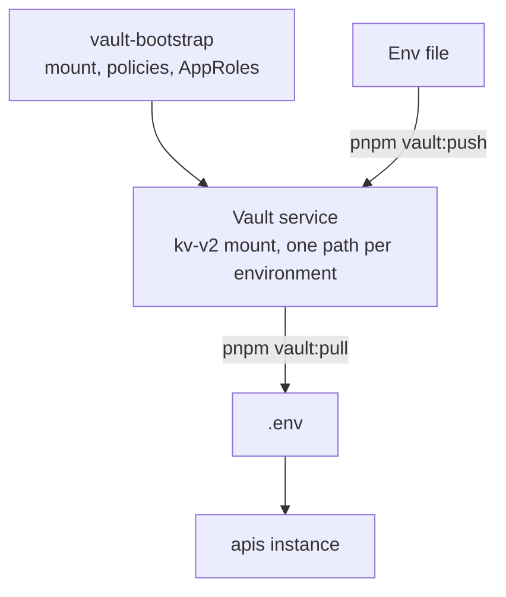

# Vault

This page explains how the bundled HashiCorp Vault setup works, for a developer or operator who keeps secrets in Vault and renders them into `.env`.

## Table of Contents

- [Related Documents](#related-documents)
- [Overview](#overview)
- [Containers and bootstrap](#containers-and-bootstrap)
- [KV layout](#kv-layout)
- [The helpers](#the-helpers)

## Related Documents

- [Vault Guide][ref-doc-guide-vault]: starting Vault, pushing, pulling, and resetting
- [Production][ref-doc-production-vault]: running Vault as a network service several hosts reach
- [Configuration][ref-doc-concept-configuration]: how the application reads the pulled `.env`
- [Configuration Reference][ref-doc-reference-configuration]: the keys an env file holds

## Overview

The diagram shows how an env file moves into Vault and back out to the application.

- Vault is optional. It stores one env file per environment and renders it back to a file on demand.
- The application never connects to Vault. It reads the `.env` that `pnpm vault:pull` wrote.
- The `vault` and `vault-bootstrap` services exist in `ci/docker-compose.yml` under the `vault` profile. They start only when the command names the profile.
- `pnpm vault:push` and `pnpm vault:pull` are helpers that run on the host Vault runs on. Delivering an env file to another host, and Vault in local development, are the developer's or the deployment's.
- The helpers run on the Vault host because the Vault container publishes no port, and the root token and the AppRole credential files exist only in `generated/vault/` on that host. Each helper reaches Vault through `docker compose exec` into the container.

## Containers and bootstrap

The `vault` service runs `hashicorp/vault` from `ci/docker-compose.yml`:

- `ci/vault/entrypoint.sh` starts `vault server -config=/vault/config.hcl` in the background and waits for the API.
- On a fresh volume it runs `vault operator init` with one key share and a threshold of one, and writes the output to `generated/vault/init.json`. On every cold boot it unseals Vault with the key in that file.
- `ci/vault/config.hcl` sets file storage at `/vault/file`, a TCP listener on `0.0.0.0:8200` with TLS off, and the UI on. The `vault_data` volume holds the storage.
- The service joins `vault-network` under the alias `vault` and publishes no port.
- Its health check calls `/v1/sys/health`, so a dependent service waits until Vault is unsealed.

The `vault-bootstrap` service runs `ci/vault/bootstrap.sh` once and exits. The script is idempotent:

1. It reads the root token from `init.json`.
2. It enables a kv-v2 mount at `ack-nestjs-boilerplate/` when missing.
3. It enables AppRole auth when missing.
4. For each environment it writes a read-only policy from `ci/vault/policies/<environment>-ro.hcl` and creates an AppRole bound to that policy with a 5 minute token TTL and a 15 minute maximum.
5. It writes each role's `role_id` and `secret_id` to `generated/vault/<environment>.approle`.

Bootstrap writes no secret. Each path starts empty and an operator fills it with `pnpm vault:push`.

## KV layout

- The mount is the project, `ack-nestjs-boilerplate`, and each environment is a path under it: `production`, `staging`, and `development`.
- One secret holds one env file: each `KEY=value` line is one field.
- A policy grants `read` on `ack-nestjs-boilerplate/data/<environment>` and `read` and `list` on its metadata path, and nothing else. An environment's AppRole reads its own path only.
- The bootstrap script reads `KV_MOUNT` (default `ack-nestjs-boilerplate`) and `KV_ENVS` (default `production staging development`). A second project takes its own `KV_MOUNT` and policy files.

## The helpers

Both helpers run from the repository root on the host Vault runs on. Each takes the environment as an argument and defaults none, so no run touches a path by accident.

- `pnpm vault:push <environment> <env-file>` replaces the environment's path with the keys of an env file.
    - A blank line and a `#` line are skipped, and a value is taken as written after the first `=`.
    - The write needs a token that can write. The policies are read-only, so the helper authenticates as root. The root token sits in `generated/vault/init.json` on the host, and the helper reads it from `/vault/init/init.json` inside the container, so the token never appears on the host command line and is never printed.
    - The data goes to `vault kv put` on standard input, so no value is parsed as an argument.
- `pnpm vault:pull <environment> [out-file]` renders the path to an env file, `.env` by default.
    - It logs in with the environment's AppRole credentials from `<environment>.approle`, never the root token, and reads with the scoped token.
    - It flattens the secret to `KEY=value` lines with Node and writes a temporary file first, then moves it into place, so a failed read never truncates an existing file. The file is mode 600.
- Both helpers call `docker compose --env-file .env.docker -f ci/docker-compose.yml --profile vault exec -T vault ...` and reach Vault on the container's loopback, `VAULT_ADDR_INTERNAL`, default `http://127.0.0.1:8200`.

The unseal key, the root token, and the AppRole credentials stay in `generated/vault/` on the Vault host, which holds them next to the data. What a deployment prepares to reach Vault from other hosts: [Vault as a network service][ref-doc-production-vault].

<!-- REFERENCES -->

[ref-doc-guide-vault]: ../guides/vault.md
[ref-doc-production-vault]: ../production.md#vault-as-a-network-service
[ref-doc-concept-configuration]: configuration.md
[ref-doc-reference-configuration]: ../reference/configuration.md
