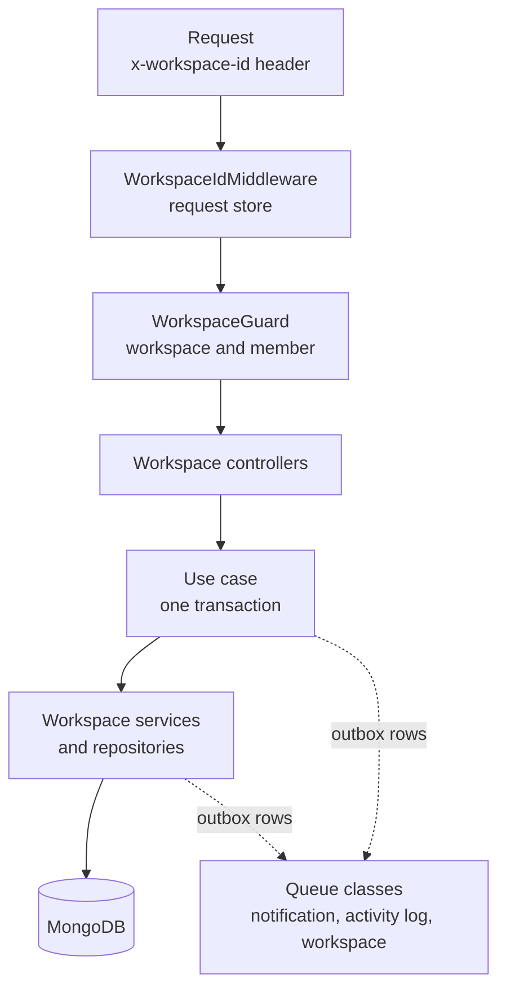

# Workspace

This page explains the `workspace` module, for a developer who changes how a request is scoped to a workspace, how members join and leave, or how a workspace is deleted.

## Table of Contents

- [Related Documents](#related-documents)
- [Overview](#overview)
- [Active workspace selection](#active-workspace-selection)
- [Roles and ownership](#roles-and-ownership)
- [Personal workspace](#personal-workspace)
- [Invites](#invites)
- [Join requests](#join-requests)
- [Slug](#slug)
- [Soft delete](#soft-delete)

## Related Documents

- [Project][ref-doc-concept-project]: the projects that live inside a workspace
- [Authorization][ref-doc-concept-authorization]: where the workspace guard sits in the guard pipeline
- [User][ref-doc-concept-user]: the sign-up that writes the personal workspace and redeems an invite token
- [Feature Flag][ref-doc-concept-feature-flag]: the `workspace` flag and its sub-keys
- [Queue][ref-doc-concept-queue]: the outbox rows and the `workspace` queue behind the effects and the sweeps below
- [Notification][ref-doc-concept-notification]: the invite, join request, and answer messages
- [Analytic][ref-doc-concept-analytic]: the workspace metrics
- [Database][ref-doc-concept-database]: the generated unique values behind the slug
- [Route Protection Guide][ref-doc-guide-route-protection]: put the workspace guard on a route
- [Decorators and Guards Reference][ref-doc-reference-decorators-and-guards]: the decorator order, the store keys, and the missing-entry exceptions
- [Activity Log Reference][ref-doc-reference-activity-log]: the entries each action writes
- [Feature Flag Reference][ref-doc-reference-feature-flag]: the `workspace` flag sub-keys and their bounds
- [Database Reference][ref-doc-reference-database]: the four workspace models
- [Configuration Reference][ref-doc-reference-configuration-workspace]: the `workspace` keys
- [Status Codes][ref-doc-reference-status-codes-workspace]: the code and message of each exception named here

## Overview

A request that names a workspace passes the middleware and the guard, then the controller hands it to a use case, which opens the one transaction. The services write the rows, and the use case and the services add the outbox rows.

- A workspace is the tenancy boundary. Every user belongs to at least one, because a sign-up writes a personal workspace or joins the invited one.
- A workspace-scoped `/user` or `/shared` route names its workspace in the `x-workspace-id` header, never in the path.
- The module owns four models: `Workspace`, `WorkspaceMember`, `WorkspaceInvite`, and `WorkspaceJoinRequest`. The fields are in `prisma/schema.prisma`.
- A flow runs controller, use case, service, repository. The use case opens the one transaction, and each notification and activity entry is an outbox row added in it, by the use case or by a service that injects the queue class ([Queue][ref-doc-concept-queue-outbox]).
- The `workspace` flag gates every user and public route of the module. An `/admin` route carries no flag and no workspace guard: it is behind `@RoleProtected()` for a platform admin and a `workspace` policy, and takes the workspace id from the path. Admin routes list and read workspaces and their members, and transfer ownership.

## Active workspace selection

1. `WorkspaceIdMiddleware` copies the `x-workspace-id` header into the request store under `WorkspaceIdStoreKey`, or `null` when the header is absent. It validates nothing.
2. `WorkspaceGuard`, mounted by `@WorkspaceProtected(...roles)`, reads that key and the user context, and one read loads the live workspace with the caller's member row:
    - A missing user context answers `UserGuardMissingException` (401).
    - An absent or empty header answers `WorkspaceHeaderMissingException` (400).
    - A malformed id, an unknown id, and a soft-deleted workspace answer the same `WorkspaceNotFoundException` (404), so a caller cannot tell the cases apart.
    - A caller with no member row answers `WorkspaceMemberForbiddenException` (403).
    - With roles listed, a role outside the list answers `WorkspaceRoleForbiddenException` (403). An `owner` passes every role list. A route that lists `owner` alone (the ownership transfer and the delete) admits the owner only.
3. The guard stores the workspace, the member, and the id under `WorkspaceContextStoreKey`. The controller reads them with `@WorkspaceContext()`, and a use case takes the row from the context and never reads it again, because the guard read it on this request ([Decorators and Guards Reference][ref-doc-reference-decorators-and-guards-workspace]).

Switching is a stored preference. `WorkspaceSwitchUseCase` runs the same membership check on the id in the body, then writes `lastWorkspaceId` and `lastWorkspaceChangedAt` on the user and a `workspaceSwitched` entry in one transaction. It does not change how a request is scoped: the client still sends the header on every workspace-scoped call. A login hands the client the stored id only while the user still holds a member row in a live workspace.

Five `/user` routes carry no workspace guard, because they act across workspaces or before membership exists: the workspace list, create, switch, the invite claim, and the join request create.

## Roles and ownership

A member has the role `owner`, `admin`, or `member` (`EnumWorkspaceMemberRole`). A workspace has exactly one `owner`, and a create makes the caller its `owner`.

| Role | May |
| --- | --- |
| `member` | Read the workspace, list members, leave |
| `admin` | Everything a `member` may, and update the workspace, its visibility, and its slug, manage members, and manage invites and join requests |
| `owner` | Everything an `admin` may except leave, and transfer ownership and soft-delete the workspace |

- A workspace update is a full replace. The body carries the `name` and a `description` that is `null` to clear it.
- A role update and a member removal load the target through `getPeerTarget`. A member id that is not in the workspace answers `WorkspaceMemberNotFoundException` (404). Every other refusal is `WorkspaceMemberPeerForbiddenException` (403): the target is the caller (use leave), the target is an `owner`, or the caller and the target are both `admin`. The check reads the target's current role only, never the new role.
- A role update assigns `admin` or `member`. No route assigns `owner` except the transfer. An `admin` may promote a `member` to `admin`, and from then on only the `owner` changes or removes that `admin`.
- A transfer of ownership (`WorkspaceTransferOwnershipUseCase`) checks before it writes, in parallel: the target is not the caller (`WorkspaceSelfTransferException`), is a member (`WorkspaceMemberNotFoundException`), is an active user (`WorkspaceTransferTargetInactiveException`), and owns fewer workspaces than the cap (`WorkspaceCapReachedException`). One transaction then promotes the target and demotes the caller to `admin`. The promote matches a target that is not `owner` while the caller's row is still `owner`, and the demote matches the caller's row as `owner`, so a transfer that loses a race fails and writes nothing.
- A platform admin transfer (`WorkspaceTransferOwnershipByAdminUseCase`) makes the same checks (the target is not the current owner, is a member, is an active user, and is under the cap) and the same promote and demote: the previous owner becomes `admin`. It runs behind the `workspace` `update` policy and writes three entries: one for the platform admin, one for the previous owner, and one for the new owner.
- Leave (`WorkspaceLeaveUseCase`) refuses an `owner` with `WorkspaceLastOwnerException` (400), so an `owner` transfers first and then leaves as an `admin`. Otherwise one transaction hard-deletes the member row and the caller's project memberships in that workspace, and sets the user's `lastWorkspaceId` to `null`, stamping `lastWorkspaceChangedAt`, when it names the workspace. A member removal runs the same cleanup for the removed member and also revokes the pending invite addressed to the removed member's email.
- The cap is the `maxWorkspacesPerUser` sub-key of the `workspace` flag ([Feature Flag Reference][ref-doc-reference-feature-flag-workspace]). It counts the caller's `owner` memberships of live workspaces, and a create and the target of a transfer check it. A sign-up, an invite claim, and a join request accept do not.
- Account deletion soft-deletes the workspaces the user owns when nobody else is a member. An owned workspace with another member answers `WorkspaceOwnerTransferRequiredException` (400), so the owner transfers first ([User][ref-doc-concept-user-deletion]).

## Personal workspace

A sign-up, a social sign-up, a platform admin create, and a platform admin import write a personal workspace in their creation transaction, named from `workspace.personalNamePattern`, with the user as its `owner`. A sign-up or a social sign-up that carries a valid invite token joins the inviting workspace and gets no personal one. The creation flow, its slug candidates, and the invite redemption are in [User][ref-doc-concept-user-signup].

## Invites

An invite is addressed to an email, so it works whether or not the address has an account. The routes are behind the `invitationAllowed` sub-key of the `workspace` flag: the invite list, create, resend, revoke, claim, and preview, and a sign-up that carries an invite token.

**Create** (`WorkspaceCreateInviteUseCase`) needs SES and answers `AwsSesNotConfiguredException` (501) first when it is unset ([Dependencies][ref-doc-concept-dependencies]). The body carries the email, the workspace role (`admin` or `member`), an optional project and project role, and an optional `expiryDuration` of 3, 7, 14, or 30 days.

- The lifetime defaults to the `inviteExpiresInDays` sub-key of the flag.
- A project and a project role come together or not at all (`WorkspaceInviteRoleRequiredException`), and the project belongs to this workspace (`WorkspaceInviteProjectMismatchException`).
- An address that already belongs to a member answers `WorkspaceMemberAlreadyExistsException`.
- Before the transaction one parallel batch looks up the project and the active user of the email, and draws the invite id, the nonce, and the lifetime.
- The token is a random value of `workspace.invite.tokenLength` characters, and only its SHA-256 hash is stored. The plain token exists only in the links of the message.
- The `reference` is `WIN-` and random characters. A collision on it retries up to `workspace.invite.referenceMaxAttempts` times, each attempt in its own transaction, and running out answers `AppUnknownException` ([Generated unique values][ref-doc-concept-database-generated]).
- The `nonce` keeps one pending invite per address in a workspace: a pending invite holds the SHA-256 hash of `{workspaceId}:{email}`, so a second one collides (`WorkspaceInviteDuplicateException`). An invite that leaves `pending` takes the hash of its own id, which frees the pair.
- The response shows a censored email.

**Delivery.** One token yields two links: the claim link from `workspace.invite.linkPattern` and the sign-up link from `workspace.invite.signUpLinkPattern`, both filled from `frontend.baseUrl`.

- An address whose account is active gets the `workspaceInvite` notification with the claim link, through `NotificationQueue.notify`.
- An address with no active account (no account, or one that is not active) gets an email effect on the notification email queue with the sign-up link. The address and the link are encrypted with the invite reference as their context, and the effect writes no `Notification` row, since no user owns it ([Notification][ref-doc-concept-notification-email]).
- Both are outbox rows in the create transaction, beside the activity entries, and both send the `workspaceInvite` template.

**Resend** applies to a pending, unexpired invite. It rotates the token, the reference, and the expiry, and sends again. The lifetime comes from the body's `expiryDuration`, else from the flag. A resend whose invite is not pending answers `WorkspaceInviteAlreadyProcessedException`, an expired one `WorkspaceInviteInvalidException`, and an unknown id `WorkspaceInviteNotFoundException`. **Revoke** turns a pending invite into `revoked`.

**Pending guard.** Every write that ends the pending state matches `status: pending` in its statement. The single-invite writes (revoke, resend, claim, and the accept at sign-up) answer `WorkspaceInviteAlreadyProcessedException` when the statement matches nothing, because another request got there first. The bulk writes (a member removal, a join accept, a workspace delete, an account deletion, and the sweep) change only the rows still pending.

**Claim** (`WorkspaceClaimInviteUseCase`) is for a signed-in user.

- The token hashes to a pending, unexpired invite on a live workspace, and the invite email matches the caller's email case-insensitively. Any miss answers `WorkspaceInviteInvalidException`, so a caller learns nothing about the invite.
- A caller who is already a member answers `WorkspaceMemberAlreadyExistsException`.
- One transaction accepts the invite, creates the member with the invite's role, creates the project membership when the invite carries one, cancels the caller's pending join request to that workspace, writes `lastWorkspaceId` and `lastWorkspaceChangedAt` as a switch does, and adds the entries: `workspaceInviteAccepted` for the caller and, when the inviter is another user, `workspaceInviteAcceptedByInvitee` for the inviter.

**Preview** is a public route that takes the token and shows the workspace name, the inviter name, the offered role, and the expiry. An unknown, expired, or non-pending token answers the same `WorkspaceInviteInvalidException`.

**Expiry sweep.** The `workspace` queue declares two schedulers, `expireStaleInvites` and `expireStaleJoinRequests`, on the cron `workspace.invite.expirySweepCron`, which also run at boot. Each flips every `pending` row past its `expiredAt` to `expired`, in chunks of `workspace.invite.expireChunkSize` and `workspace.joinRequest.expireChunkSize` ([Queue Reference][ref-doc-reference-queue]).

## Join requests

A user asks to join a public workspace (`isPublic`), and an `owner` or `admin` decides. The routes are behind the `joinRequestAllowed` sub-key, and so is the public preview route, which shows a public workspace by its slug.

- **Create** (`WorkspaceCreateJoinRequestUseCase`) takes the workspace id in the body. An unknown or deleted workspace answers `WorkspaceNotFoundException`. A private one answers `WorkspaceNotPublicException`. A caller who is a member answers `WorkspaceJoinRequestAlreadyMemberException`. A second pending request from the same user answers `WorkspaceJoinRequestDuplicateException`, through a nonce built like the invite's from `{workspaceId}:{userId}`.
- A request expires after the `joinRequestExpiresInDays` sub-key, and the sweep above flips it to `expired`.
- The create transaction adds one `workspaceJoinRequest` notification per reviewer, each carrying the review link from `workspace.joinRequest.reviewLinkPattern`, and the `workspaceJoinRequested` entry. The reviewers are the `owner` and `admin` members of the workspace.
- **Accept** always creates a `member`. One transaction marks the request `accepted` with the reviewer and the time, creates the member, revokes the pending invite addressed to the requester's email in that workspace, and adds the `workspaceJoinAccepted` notification and the entry pair. It does not move the requester's `lastWorkspaceId`: the requester switches by choice.
- **Reject** needs a `rejectReasonCode` from `EnumWorkspaceJoinRejectReason`. It marks the request `rejected` and adds the `workspaceJoinRejected` notification, which carries the code and its localized label, and the entry pair.
- A request that is not pending answers `WorkspaceJoinRequestAlreadyProcessedException`. An id outside the workspace answers `WorkspaceJoinRequestNotFoundException`.
- A pending request becomes `canceled` when the workspace is soft-deleted, when its requester claims an invite to that workspace, and when the requester's account is deleted. One already past `expiredAt` becomes `expired` on those paths.
- A requester has no route to withdraw a request.

## Slug

- Creation always generates the slug. The use case draws `workspace.slugMaxAttempts` candidates, each `workspace.slugPrefix` followed by random lower-case letters and digits, the whole slug `workspace.slugMaxLength` characters long, and tries one per transaction. A collision on the slug (`WorkspaceSlugAlreadyExistsException`) moves to the next candidate, and running out answers `AppUnknownException` ([Generated unique values][ref-doc-concept-database-generated]).
- A client chooses a slug through the slug update route only. The slug matches `WorkspaceSlugRegex` (`src/modules/workspace/constants/workspace.constant.ts`: lower-case letters, digits, and `-`) and fits `workspace.slugMaxLength`, else `WorkspaceSlugInvalidException`. A collision answers `WorkspaceSlugAlreadyExistsException` with no retry.
- The slug is unique across every workspace. A soft delete rewrites it to `workspace.deletedSlugPattern` (`deleted-{id}`), so a deleted workspace frees its slug.

## Soft delete

The delete route (`owner` only) opens one transaction that holds one outbox row, the `softDelete` effect of the `workspace` queue, and answers the row's id. The job does the work because a workspace can hold an unbounded number of projects ([Queue][ref-doc-concept-queue-outbox]).

`WorkspaceProcessSoftDeleteUseCase` runs the job:

1. One transaction, with the timeout `workspace.delete.timeoutInMs`, sets `deletedAt` and `deletedBy` on the workspace and rewrites its slug, revokes its pending invites (`expired` for one already past its expiry), cancels its pending join requests, and adds the `workspaceDeleted` entry.
2. Then it soft-deletes the workspace's live projects in chunks of `project.delete.chunkSize`, one write per chunk, until none is left ([Project][ref-doc-concept-project-soft-delete]).

Member rows stay. A deleted workspace answers `WorkspaceNotFoundException` to every guard and lookup, and no route restores it. Until the job's first transaction commits, the workspace stays live.

<!-- REFERENCES -->

[ref-doc-concept-project]: project.md
[ref-doc-concept-project-soft-delete]: project.md#soft-delete
[ref-doc-concept-authorization]: authorization.md#workspace-and-project-gates
[ref-doc-concept-user]: user.md
[ref-doc-concept-user-signup]: user.md#sign-up-and-personal-workspace
[ref-doc-concept-user-deletion]: user.md#self-deletion-and-purge
[ref-doc-concept-feature-flag]: feature-flag.md
[ref-doc-concept-queue]: queue.md
[ref-doc-concept-queue-outbox]: queue.md#outbox-row-in-the-transaction
[ref-doc-concept-notification]: notification.md
[ref-doc-concept-notification-email]: notification.md#email-channel
[ref-doc-concept-analytic]: analytic.md
[ref-doc-concept-database]: database.md
[ref-doc-concept-database-generated]: database.md#generated-unique-values
[ref-doc-concept-dependencies]: dependencies.md#optional-adapters
[ref-doc-guide-route-protection]: ../guides/route-protection.md
[ref-doc-reference-decorators-and-guards]: ../reference/decorators-and-guards.md
[ref-doc-reference-decorators-and-guards-workspace]: ../reference/decorators-and-guards.md#workspaceprotectedroles
[ref-doc-reference-activity-log]: ../reference/activity-log.md
[ref-doc-reference-feature-flag]: ../reference/feature-flag.md
[ref-doc-reference-feature-flag-workspace]: ../reference/feature-flag.md#workspace
[ref-doc-reference-database]: ../reference/database.md
[ref-doc-reference-queue]: ../reference/queue.md
[ref-doc-reference-configuration-workspace]: ../reference/configuration.md#workspace
[ref-doc-reference-status-codes-workspace]: ../reference/status-codes.md#workspace
