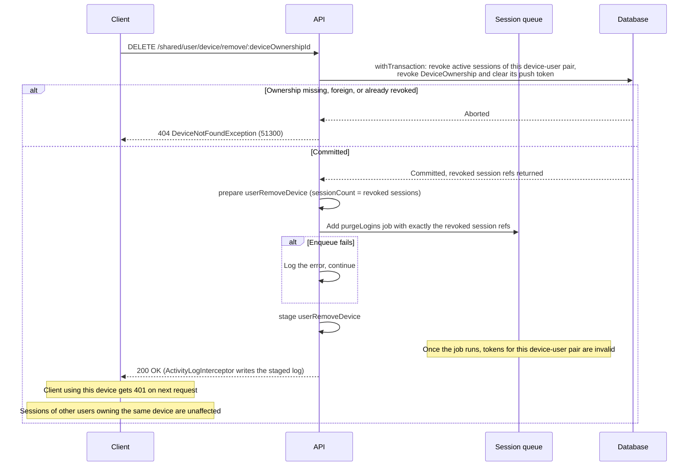

# Device Documentation

Device lives in `src/modules/device`.

## Overview

- Devices are the clients users log in from.
- Each device is identified by a `fingerprint`.
- A device can be owned by multiple users through `DeviceOwnership`.

- A device holds one signed-in user at a time: a login revokes the unrevoked sessions of every other user who owns the same device ([One Signed-In User per Device](#one-signed-in-user-per-device)).
- The push token and its provider live on `DeviceOwnership`, one per user-device pair.

When a device ownership is removed:

- all unrevoked sessions for that device-user pair are revoked in the database
- the purge of the revoked session keys is enqueued after the commit, and the job that deletes them logs the client out

Other paths:

- Account self-deletion and the credential or two-factor lockout each revoke every non-revoked ownership of the user and clear the push token of each of those ownerships.
- Logout revokes the current session and clears the push token of the non-revoked ownership behind the token's `deviceOwnershipId`.
- When no non-revoked ownership exists, the logout push token step logs a warning and the session revoke still commits.
- The session purge job also clears the push token of every non-revoked ownership of its user that holds no live session.

Repository boundary:

- `DeviceRepository` is the only class that writes `Device` rows
- `DeviceAnalyticRepository` is the only class that reads them directly
- `DeviceOwnershipRepository` and `DeviceOwnershipAnalyticRepository` issue statements only against `DeviceOwnership`, and reach `Device` fields through a relation `include`, `select`, or filter
- `DeviceDomain` composes the two repositories and opens the transaction for a write that touches both models
- `DeviceHttpService` and `UserAuthHttpService` open the transactions that span devices and sessions

## Related Documents

- [Authentication Documentation][ref-doc-authentication]: Sessions and JWT
- [Authorization Documentation][ref-doc-authorization]: Policy on device endpoints
- [Notification Documentation][ref-doc-notification]: Push tokens on devices

## Table of Contents

- [Overview](#overview)
- [Related Documents](#related-documents)
- [Device Model](#device-model)
- [DeviceOwnership Model](#deviceownership-model)
- [Device-Session Relationship](#device-session-relationship)
- [One Signed-In User per Device](#one-signed-in-user-per-device)
- [What Happens When a Device Ownership is Removed](#what-happens-when-a-device-ownership-is-removed)
- [Account Self-Deletion](#account-self-deletion)
- [Refreshing Device Info](#refreshing-device-info)
- [Endpoints](#endpoints)
    - [Shared (User Self-Service)](#shared-user-self-service)
    - [Admin](#admin)
- [Policy Control](#policy-control)

## Device Model

A Device represents a physical or virtual client.

- It is identified by a globally unique `fingerprint`.
- Multiple users can own it.

**Fields:**

- `fingerprint`: Globally unique identifier for the device.
    - The frontend generates this value and sends it with every login request.
    - The device row is upserted on it.
    - It is not sent on refresh, which identifies the device from the `deviceOwnershipId` in the access token.
    - The recommended library is [FingerprintJS](https://fingerprint.com) (or its open-source variant [`@fingerprintjs/fingerprintjs`](https://github.com/fingerprintjs/fingerprintjs)).
- `name`: Human-readable device name (optional, e.g. `"iPhone 15"`, `"Chrome on Windows"`).
    - Login keeps the stored name when the request sends none.
    - Refresh writes the name as given, and `null` clears it.
- `platform`: Platform of the device. See `EnumDevicePlatform` below
- `lastActiveAt`: Stamped on login and on device refresh.

`DeviceResponseSchema` declares neither `fingerprint` nor any push field, so neither reaches a response payload nor the OpenAPI schema.

The push token belongs to the ownership, so two users of one device hold separate tokens:

- `notificationToken`: FCM/APNs push token (optional).
    - Login sets it when the request carries one.
    - `POST /shared/user/device/refresh` writes it as given, and `null` clears it.
    - Login and refresh clear the same token from every other user's ownership.
    - A producer reads it when it enqueues a notification: the tokens of the user's non-revoked ownerships that hold a live session go into the job as sealed values, and the push channel opens them to send (see [Notification Documentation][ref-doc-notification]).
- `notificationProvider`: Derived from `platform` and the token. See `EnumDeviceNotificationProvider` below.
- The token is cleared on:
    - logout
    - device removal
    - account self-deletion
    - the credential or two-factor lockout
    - the session purge job, for an ownership with no live session
    - the stale-token cleanup cron
    - the invalid-token cleanup job, which runs after a push provider rejects a token

### Enums

**`EnumDevicePlatform`**

| Value     | Description      |
| --------- | ---------------- |
| `ios`     | Apple iOS device |
| `android` | Android device   |
| `web`     | Web browser      |

**`EnumDeviceNotificationProvider`**

- It is derived from `platform`, on login and on every refresh.
- It stays `null` for the `web` platform and when no token is stored.
- The `DeviceOwnership` row stores it next to the token.

| Value  | Platform  | Description                     |
| ------ | --------- | ------------------------------- |
| `fcm`  | `android` | Firebase Cloud Messaging        |
| `apns` | `ios`     | Apple Push Notification Service |

## DeviceOwnership Model

The `DeviceOwnership` model represents the relationship between a `User` and a `Device`. It tracks:

- Which device a user owns (`deviceId`, `userId`), unique per pair
- Revocation status and history (`isRevoked`, `revokedAt`, `revokedById`)
- `lastActiveAt` for that device-user pair, stamped on login, on device refresh, and on logout
- The push token and its provider (`notificationToken`, `notificationProvider`)
- Biometric fields (`biometricEnabled`, `biometricToken`, `biometricType`, `biometricEnabledAt`), reset when a login re-activates a revoked ownership

A login on a revoked ownership re-activates the same row and counts as a new device for the new-device notification.

Session vocabulary on this page:

- A live session is neither revoked nor expired. `activeSessionCount` in a response is computed per read by a `_count` on `sessions`, counting live sessions only.
- An unrevoked session has `isRevoked: false`, whatever its `expiredAt`. Every revoke path filters on that alone, so it also revokes a session that has expired without being marked revoked.

## Device-Session Relationship

- Each `Session` record has a required `deviceOwnershipId` field pointing to a `DeviceOwnership`.
- One device-user pair can have **only one active session** at a time: a login revokes the pair's earlier unrevoked sessions.
- One device has **one signed-in user** at a time: a login revokes the unrevoked sessions of every other user's non-revoked ownership of that device.

```
User
 └── DeviceOwnership (N per user, one per owned device)
       ├── Device (shared across multiple users via other ownerships)
       └── Session[] (max 1 active per device-user pair)

Device
 └── DeviceOwnership[] (can be owned by multiple users)
       └── Session[] (per ownership; live on one ownership at a time)
```

When listing devices, the API shows only the devices owned by the user, with session information for their specific ownership.

## One Signed-In User per Device

A login runs `UserAuthHttpService.createTokenAndSession` for credential login, social login, and two-factor verification (`loginVerifyTwoFactor`).

- Social login includes the first login that signs the user up: the sign-up completes first, then the same login path issues the session.
- A login whose account has two-factor enabled issues no session until `loginVerifyTwoFactor` succeeds.
- `loginSetupTwoFactor`, which completes a two-factor setup that a login started, enables two-factor and returns backup codes. It calls neither `createTokenAndSession` nor any session code, so it revokes nothing. The session comes from the later `loginVerifyTwoFactor`.

Inside its transaction the login:

1. Upserts the device and the caller's ownership.
2. Revokes the caller's earlier unrevoked sessions on that ownership, unless the ownership is new.
3. Reads the ids of every other user's non-revoked ownership of the same device (`DeviceDomain.getOtherOwnershipIdsByDeviceInTx`). Several users can qualify.
4. Revokes every unrevoked session on those ownerships (`SessionDomain.revokeByDeviceOwnershipIdsInTx`: `isRevoked: false`, expiry ignored), and groups the revoked refs by user.
5. Creates the new session.

After the commit:

1. The login writes the new session key and enqueues one `purgeLogins` job per affected user with that user's exact revoked refs.
2. It stages one `userRevokeSessionByDeviceLogin` row per affected user, with `userId` set to the affected user, `createdBy` set to the logging-in user, and the metadata `actorUserId` and `sessionCount`.
3. The logging-in user's own login row is unchanged.

An affected user is a user whose unrevoked sessions on the device this login revoked, at least one. A previous owner whose ownership holds no unrevoked session is not affected: it gets no `purgeLogins` job and no activity row.

An enqueue failure of a `purgeLogins` job is a side effect:

- The failure is logged and reported, and the login still succeeds.
- Keys that were never deleted keep passing the session check until their TTL expires.

Outcomes for an affected user:

- Their `DeviceOwnership` stays active, so the device stays in their list with no live session.
- Their tokens fail with `SessionRevokedException` once the purge job runs.
- No notification goes to them.

Push to an affected user stops and the token is cleared at different moments:

1. From the commit, no push reaches them: a producer selects tokens only from ownerships that hold a live session, and the commit revoked theirs.
2. The token is cleared in the login transaction when the new user's request carries the same token (`clearTokenFromOtherUsersInTx`).
3. Otherwise the purge job clears it later, because the ownership holds no live session.

## What Happens When a Device Ownership is Removed

Removing a device ownership (device per user) is composed by `DeviceHttpService.remove` (self-service) and `DeviceHttpService.removeByAdmin` (admin).

- `removeByAdmin` first checks that the admin outranks the target user's role.
- One `withTransaction`, opened by `DeviceHttpService`, lands the database effects atomically.
- An ownership that does not exist, belongs to another user, or is already revoked answers `DeviceNotFoundException` (404, `51300`). The transaction aborts and nothing changes.
- A write conflict inside the transaction answers the same `DeviceNotFoundException`.
- Both paths then follow one order: commit, prepare the activity rows, enqueue the session purge, stage the rows.

Steps:

1. **Revokes the active sessions** for that device-user pair (`SessionDomain.revokeByDeviceOwnershipInTx`).
    - It sets `isRevoked: true`, `revokedAt: now`, and `revokedById` and `updatedBy` to the acting user.
    - The call returns the refs of the sessions it revoked.
2. **Updates the `DeviceOwnership` record** (`DeviceDomain.removeOwnershipInTx`).
    - It marks the record revoked: `isRevoked: true`, `revokedAt: now`, and `revokedById` set to the acting user (the owner on the self-service path, the admin on the admin path).
    - It clears the ownership's `notificationToken` and `notificationProvider`.
    - The ownership record is retained for audit trail, and its own `lastActiveAt` is left at the value of the last real activity.
    - The shared `Device` row is untouched, and other users' ownerships of the device keep their tokens and sessions.
3. **Prepares the activity rows** after the commit.
    - `sessionCount` in the metadata is the number of sessions step 1 revoked.
4. **Enqueues the purge of the revoked session keys** (`SessionQueue.purgeLogins`).
    - The `purgeLogins` job on the `session` queue carries exactly the refs returned in step 1, and its processor deletes those keys, so any later request carrying those tokens gets 401 once the job has run.
    - An enqueue failure is logged and reported, and the removal still succeeds.
    - Keys that were never deleted keep passing the session check until their TTL expires.
5. **Stages the activity rows** with `ActivityLogDomain.stagePrepared` after the enqueue.
    - `ActivityLogInterceptor` writes them after the handler returns.

The rows depend on the path:

| Path | Rows |
| --- | --- |
| Self-service (`remove`) | `userRemoveDevice`; `userId` and `createdBy` are the device owner |
| Admin (`removeByAdmin`), another user's device | `adminDeviceRemove` on the admin, plus `userRemoveDeviceByAdmin` on the device owner with `createdBy` set to the admin |
| Admin (`removeByAdmin`), the admin's own device | `adminDeviceRemove` only |

`userRemoveDevice` carries:

- `deviceOwnershipId`
- `deviceId`
- `sessionCount`

`adminDeviceRemove` carries:

- `targetUserId`
- `targetUsername`
- `deviceOwnershipId`
- `deviceId`
- `timestamp`
- `sessionCount`

`userRemoveDeviceByAdmin` carries `actorUserId` in place of the two target keys. See [Activity Log][ref-doc-activity-log].



## Account Self-Deletion

`DELETE /user/user/self/delete` runs `UserHttpService.deleteSelf`, whose transaction calls `DeviceDomain.revokeAllByUserInTx`:

- `DeviceOwnershipRepository.revokeAllByUserInTx` marks every ownership of the user that is not yet revoked as revoked (`isRevoked: true`, `revokedAt: now`, `revokedById` and `updatedBy` set to the user).
- The same statement clears `notificationToken` and `notificationProvider` on each of those ownerships.

Outcomes:

- Other users' ownerships of the same device keep their tokens.
- This path writes no device activity row.
- The session side of the same transaction: [Authentication][ref-doc-authentication].

The lockout job (`UserProcessorService.lockout`) is the second caller of `DeviceDomain.revokeAllByUserInTx`, inside its own transaction, with the user as the revoking actor ([Authentication][ref-doc-authentication]).

## Refreshing Device Info

`POST /shared/user/device/refresh` updates the device the caller's access token already points at.

- The body (`DeviceRefreshRequestDto`) requires `name`, `platform`, and `notificationToken`.
    - `name` and `notificationToken` accept `null`, which clears the stored value.
- It omits `fingerprint`, because the ownership is taken from the `deviceOwnershipId` claim in the token.
- The refresh is a full replace: every body field is written as given.
- The ownership is looked up first. One that does not exist, belongs to another user, or is already revoked produces a 404 with status code `51300` (`EnumDeviceStatusCodeError.notFound`).
- `notificationProvider` is re-derived from the `platform` and the token in the body and written on the `DeviceOwnership` row.
- `name`, `platform`, and `lastActiveAt` are written on the shared `Device` row.
- `lastActiveAt`, `notificationToken`, and `notificationProvider` are written on the `DeviceOwnership`.
- A non-null token is cleared from every other user's ownership in the same transaction.
- `DeviceDomain.refresh` opens `withTransaction` around `DeviceOwnershipRepository.refreshInTx` (which returns the device id), `DeviceRepository.refreshInTx`, and the token clear. A write conflict answers the 404.
- `DeviceHttpService.refresh` prepares `userDeviceRefresh` and stages it after the domain call returns.
- The refresh write leaves `lastLoginAt` and `lastIPAddress` on `User` untouched. The login path stamps those.
- The handler returns `200 OK` with no data payload.

## Endpoints

### Shared (User Self-Service)

| Method | Path | Description |
| --- | --- | --- |
| `GET` | `/shared/user/device/list` | List own active devices (cursor-based, ordered by `createdAt`); each entry carries `activeSessionCount` and an `isCurrentDevice` flag matched against the calling session |
| `POST` | `/shared/user/device/refresh` | Update device info (name, push token, platform); returns no data |
| `DELETE` | `/shared/user/device/remove/:deviceOwnershipId` | Remove own device; revokes its sessions of the caller |

### Admin

| Method | Path | Description |
| --- | --- | --- |
| `GET` | `/admin/user/:userId/device/list` | List a user's devices, revoked ones included (offset-based, orderable by `createdAt` or `lastActiveAt`), filterable by `isRevoked`. The query loads no sessions, so `isCurrentDevice` is `false` on every entry |
| `DELETE` | `/admin/user/:userId/device/remove/:deviceOwnershipId` | Remove a user's device; revokes that user's sessions on it |

Both lists validate `orderBy` in their request schema:

- The shared cursor list accepts `createdAt`.
- The admin offset list accepts `createdAt` and `lastActiveAt`.
- A field or direction outside that list answers `422` with status code `50300` (`request.error.validation`).
- The response metadata names the accepted fields in `availableOrderBy`.

## Policy Control

Device endpoints are protected using `EnumPolicySubject.device`. Admin endpoints carry both `user` (read) and `device` (read/delete) abilities:

```typescript
// Admin list devices
@PolicyProtected(
    { subject: EnumPolicySubject.user, action: [EnumPolicyAction.read] },
    { subject: EnumPolicySubject.device, action: [EnumPolicyAction.read] }
)

// Admin remove device
@PolicyProtected(
    { subject: EnumPolicySubject.user, action: [EnumPolicyAction.read] },
    { subject: EnumPolicySubject.device, action: [EnumPolicyAction.read, EnumPolicyAction.delete] }
)
```

- Shared (user self-service) endpoints carry `@ApiKeyProtected()`, `@AuthJwtAccessProtected()`, `@UserProtected()`, and `@TermPolicyAcceptanceProtected()`.
- They carry no policy subject check, since users can only manage their own devices.
- The admin endpoints add `@RoleProtected(EnumRoleType.admin)` on top of the policy abilities.

<!-- REFERENCES -->

[ref-doc-authentication]: authentication.md
[ref-doc-authorization]: authorization.md
[ref-doc-notification]: notification.md
[ref-doc-activity-log]: activity-log.md
