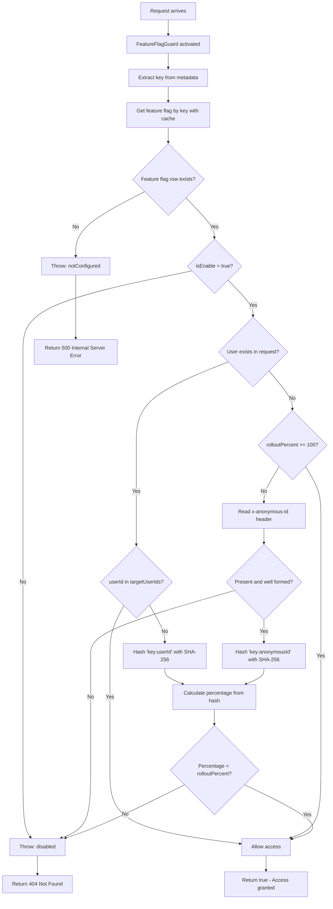

# Feature Flag Documentation

Feature Flag lives in `src/modules/feature-flag`.

## Overview

- Flags gate routes and code paths.
- Targeting uses rollout percentage, a per-user allow-list (`targetUserIds`), and metadata sub-keys.
- Results are cached.

## Related Documents

- [Cache Documentation][ref-doc-cache]: Flag result caching
- [Authorization Documentation][ref-doc-authorization]: Decorator stack with `@FeatureFlagProtected`

## Table of Contents

- [Overview](#overview)
- [Related Documents](#related-documents)
- [Features](#features)
- [Flow](#flow)
- [Usage](#usage)
    - [With Decorators](#with-decorators)
    - [With FeatureFlagCache](#with-featureflagcache)
- [Metadata](#metadata)
- [Targeting](#targeting)
- [Rollout Percentage](#rollout-percentage)
- [Caching](#caching)
- [Routes](#routes)
- [Restrictions](#restrictions)

## Features

Feature flags provided in `src/migration/data/migration.feature-flag.data.ts`:

| Key | Description | Rollout | Metadata |
| --- | --- | --- | --- |
| `loginWithGoogle` | Enable login with Google | 100% | `signUpAllowed: true` |
| `loginWithApple` | Enable login with Apple | 100% | `signUpAllowed: true` |
| `loginWithCredential` | Enable login with Credential | 100% | - |
| `signUp` | Enable user sign up | 100% | - |
| `changePassword` | Enable change password feature | 100% | `forgotAllowed: true` |
| `workspace` | Enable the workspace and project router surface, including invitation and join request | 100% | `invitationAllowed: true`, `joinRequestAllowed: true` |

## Flow

The `FeatureFlagGuard` validates feature flag status before allowing route access.

The guard takes a bare flag key and never reads metadata.

`@FeatureFlagProtected()` validates the key when the decorator is evaluated, before any request arrives:

- An empty key or an empty segment throws `FeatureFlagKeyEmptyException`.
- A key containing a dot throws `FeatureFlagKeyNestedException`.

Both extend `AppUnknownException`, so a bad route fails the boot.



Every denial (a disabled flag, a lost rollout bucket, an anonymous caller below 100% without a valid `x-anonymous-id`) throws `FeatureFlagDisabledException`:

- HTTP 404
- status code `disabled` (50601)
- message `featureFlag.error.disabled`

A key with no flag row throws `FeatureFlagNotConfiguredException`:

- HTTP 500
- status code `notConfigured` (50603)
- message `featureFlag.error.notConfigured`
- The missing key rides in `rawError` for the log and Sentry, never in the response.

A route behind a disabled flag answers as if it does not exist. A route whose key has no flag row is a deployment defect and answers 500.

`FeatureFlagNotFoundException` (404, `notFound`, 50600) belongs to the admin update routes, which look a flag up by id.

## Usage

### With Decorators

- `@FeatureFlagProtected()` provides no authentication.
- Authentication comes from the guards stacked with it.
- A flag is never an authorization boundary.

`@FeatureFlagProtected()` takes a **bare flag key**:

- A key containing a dot is rejected with `FeatureFlagKeyNestedException` when the decorator is evaluated.
- An empty key or segment is rejected with `FeatureFlagKeyEmptyException` when the decorator is evaluated.
- Metadata sub-keys are asserted in the owning domain, not by the decorator (see [Metadata](#metadata)).

```typescript
@Response('user.loginWithSocialGoogle', { schema: UserLoginResponseSchema })
@AuthSocialGoogleProtected()
@FeatureFlagProtected('loginWithGoogle')
@ApiKeyProtected()
@Post('/login/social/google')
async loginWithGoogle(
  @AuthJwtPayload<IAuthSocialPayload>('email') email: string,
  @Body({ schema: UserCreateSocialRequestSchema }) body: UserCreateSocialRequestDto
): Promise<IResponseReturn<IUserLoginOutcome>> {
  return this.userAuthHttpService.loginWithSocial(
    email,
    EnumUserLoginWith.socialGoogle,
    body
  );
}

@Response('user.forgotPassword')
@FeatureFlagProtected('changePassword')
@ApiKeyProtected()
@Post('/password/forgot')
async forgotPassword(
  @Body({ schema: UserForgotPasswordRequestSchema }) body: UserForgotPasswordRequestDto
): Promise<IResponseReturn<void>> {
  await this.userPasswordHttpService.forgotPassword(body);

  return {};
}
```

`forgotAllowed` on `changePassword` is asserted inside the password domain, not by the decorator.

`@FeatureFlagProtected()` sits **above** `@AuthJwtAccessProtected()` in the decorator stack.

- NestJS evaluates stacked decorators bottom-up, so the decorator nearest the HTTP method runs first.
- Sitting above the JWT decorator is what makes the flag guard run _after_ the JWT strategy has populated `request.user`.
- Without that ordering the guard never sees a user and always takes the anonymous branch, making `targetUserIds` and any rollout below 100% inert.

See [Authorization Documentation][ref-doc-authorization] for the full stack.

### With FeatureFlagCache

`FeatureFlagDomain` is the read-through reader. `FeatureFlagCache` is the Redis store behind it, and both are exported by `FeatureFlagDomainModule`. `UserAuthHttpService` reads social sign-up metadata through the domain:

```typescript
const featureFlag = await this.featureFlagDomain.getMetadataByKey<{
    [EnumFeatureFlagMetadataKey.signUpAllowed]: boolean;
}>(featureFlagKey);
```

- `FeatureFlagDomain.getByKey` returns the cached flag, else reads the database row and caches it (see [Caching](#caching)).
- `FeatureFlagDomain.getMetadataByKey` returns the metadata of that flag, or `null` when the flag or its metadata is absent.
- `FeatureFlagDomain` calls `FeatureFlagCache.deleteFeatureFlag` after an admin update.
- `FeatureFlagUtil` sits beside it and holds `isMetadataValid`, the shape check the domain applies on a metadata update, and `isInRollout`.

## Metadata

Metadata on a single flag:

```typescript
// Feature flag with metadata
{
  key: 'changePassword',
  isEnable: true,
  metadata: {
    forgotAllowed: true
  }
}
```

**Constraints:**

- No nested objects
- Supported value types: `boolean`, `number`, `string`, and homogeneous `string[]` or `number[]`
- Arrays are homogeneous. A mixed array (`[1, 'a']`), a nested array, and `boolean[]` are rejected
- An array value is data only, never a gate value. A nested-key gate (below) resolves to a boolean
- Metadata keys are camelCase, matching `/^[a-z][a-zA-Z0-9]*$/`
- Metadata keys cannot be added or removed: an update must carry the same keys and value types as the stored metadata
- A value is never empty: an empty string and an empty array are rejected
    - On the update route the request schema rejects them first and answers a validation error (422, `50300`).
    - `FeatureFlagUtil.isMetadataValid` also returns `false` for them, which the domain maps to 50602 (below). The route never reaches that check with an empty value.
- Only values can be modified. On update, an array value cannot change element type (`string[]` to `number[]` is rejected)
- A metadata update that passes the schema but breaks the key or type match, or targets a flag with no stored metadata, throws `FeatureFlagInvalidMetadataException` (400, `invalidMetadata`, 50602, `featureFlag.error.invalidMetadata`)

**Metadata sub-key gating:**

A metadata sub-key is asserted in the owning domain, not by the route decorator. The domain calls `FeatureFlagDomain.validateFeatureFlagMetadata(key, metadataKey)` at the point in the flow where the sub-key governs the behaviour:

```typescript
await this.featureFlagDomain.validateFeatureFlagMetadata(
    'changePassword',
    'forgotAllowed'
);
```

It throws:

| Condition                       | statusCode      | HTTP |
| ------------------------------- | --------------- | ---- |
| flag row is missing             | `notConfigured` | 500  |
| flag is disabled                | `disabled`      | 404  |
| metadata value is not a boolean | `disabled`      | 404  |
| boolean is `false`              | `disabled`      | 404  |

- Metadata is per-feature config (small on/off and typed values).
- For per-user targeting use `targetUserIds` (see [Targeting](#targeting)), not metadata.

## Targeting

`targetUserIds` is an allow-list of user ids that always receive the feature, bypassing the rollout percentage.

```typescript
{
  key: 'newFeature',
  targetUserIds: ['userIdA', 'userIdB'],
  rolloutPercent: 30
}
```

1. Only evaluated when the request has an authenticated user.
2. If `userId` is in `targetUserIds`, access is granted and rollout is skipped.
3. Otherwise the user falls back to rollout percentage.
4. Anonymous requests (no user) skip targeting and go straight to the anonymous rollout branch (see [Rollout Percentage](#rollout-percentage)).

- `targetUserIds` is admin-editable via `PATCH /admin/feature-flag/update/:featureFlagId/status` and defaults to empty.
- The same body carries `isEnable`, `rolloutPercent` (integer 0 to 100), and `targetUserIds`. All three are required, and each replaces the stored value.
- `targetUserIds` holds 24-character hexadecimal user ids. Send `[]` to clear the list.

## Rollout Percentage

Controls gradual feature deployment using deterministic hashing:

```typescript
{
  key: 'newFeature',
  rolloutPercent: 30  // 30% of users get access
}
```

Percentage calculation:

1. The flag key and the caller identifier are combined and hashed with SHA-256 (`HelperHashService.sha256Hash('key:identifier')`).
2. The first 8 hex characters of the digest, read as an integer, modulo 100 give the percentage (0-99).
3. The percentage is compared against `rolloutPercent`.

Properties:

- The same identifier always gets the same result per flag.
- Salting by flag key keeps each flag independent (a user in flag A's 30% is not automatically in flag B's 30%).

**Authenticated callers** use `userId` as the identifier. Rollout runs only when the user is not in `targetUserIds`.

**Anonymous callers** are handled separately:

- `rolloutPercent >= 100` passes without any identifier.
- Below 100, the identifier comes from the `x-anonymous-id` request header.
    - The constant `FeatureFlagAnonymousIdHeaderName` in `src/modules/feature-flag/constants/feature-flag.constant.ts` names the header.
    - Its max length (`idMaxLength`, 100) and allowed charset (`idRegex`, `/^[a-zA-Z0-9-_]+$/`) live in `src/configs/feature-flag.config.ts`.
- The evaluation **fails closed** with 404 (`disabled`) when that header is absent, empty, over length, or does not match the pattern.
- An anonymous caller lands in the same bucket only while it sends the same `x-anonymous-id`.

## Caching

Feature flags are cached. Configuration in `src/configs/feature-flag.config.ts`:

```typescript
{
  keyPattern: 'FeatureFlag:{key}',
  cacheTtlInMs: ms('1h'),
  leaseKeyPattern: 'FeatureFlag:Lease:{key}',
  leaseTtlInMs: ms('10s'),
  anonymous: {
    idMaxLength: 100,
    idRegex: /^[a-zA-Z0-9-_]+$/
  }
}
```

**Cache operations:**

- Key format: `FeatureFlag:{key}`.
- On a miss, `FeatureFlagDomain.getByKey` takes a read lease (`FeatureFlag:Lease:{key}`, `SET NX PX`, 10 seconds) before it reads the database row.
- Only the reader that holds the lease writes the entry. The write and the lease release run in one script that checks the lease token, so a stale reader never overwrites a newer entry.
- A reader that fails to take the lease still returns the database row and skips the cache write.
- An admin update deletes the entry and its lease.
- A cache read, lease, or write failure is logged and falls through to the database, so a cache outage never breaks evaluation.
- A cache delete failure throws, so the admin update answers an error rather than leave a stale entry behind a committed write.
- There is no fail-open:
    - a flag key with no row still returns 500 (`notConfigured`)
    - a disabled flag still returns 404 (`disabled`)

See [Cache Documentation][ref-doc-cache] for cache system details.

## Routes

| Method | Path | Scope |
| --- | --- | --- |
| `GET` | `/system/feature-flag/list` | System API key lists the flags (cursor) |
| `GET` | `/admin/feature-flag/list` | Admin lists the flags (offset), `search` on `key`, `orderBy` on `createdAt` or `key` |
| `PATCH` | `/admin/feature-flag/update/:featureFlagId/status` | Admin updates `isEnable`, `rolloutPercent`, and `targetUserIds` |
| `PUT` | `/admin/feature-flag/update/:featureFlagId/metadata` | Admin replaces the metadata values |

- The system list route carries `ApiKeySystemProtected()` only: an `x-api-key` of type `system`. It needs no JWT, role, or policy ability.
- The admin routes carry `@RoleProtected(EnumRoleType.admin)`, so the signed-in user must hold the admin role. They also need the `featureFlag` policy: `read` for the list, `read` and `update` for both updates.
- Every path starts with the global prefix `/api`. With `URL_VERSIONING_ENABLE=true` the version segment `/v1` follows it, so the system list is `/api/v1/system/feature-flag/list`. See [Environment][ref-doc-environment] for the flag.

## Restrictions

- Feature flags cannot be added via admin API
- Feature flags cannot be deleted
- Metadata keys cannot be modified (add/remove)
- Only values can be updated: `isEnable`, `rolloutPercent`, `targetUserIds`, metadata values

<!-- REFERENCES -->

[ref-doc-cache]: cache.md
[ref-doc-authorization]: authorization.md
[ref-doc-environment]: environment.md
