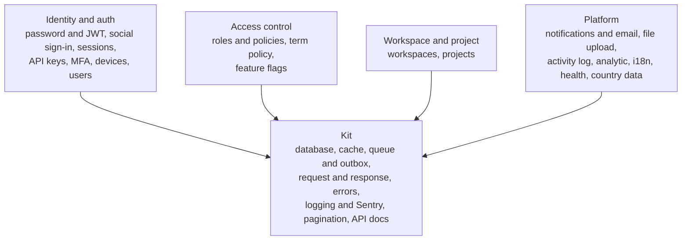

# Features

This page summarizes every feature and points to its pages, for a reader who decides what the boilerplate gives them or looks for where a feature is documented.

## Table of Contents

- [Related Documents](#related-documents)
- [Overview](#overview)
- [Identity and auth](#identity-and-auth)
- [Access control](#access-control)
- [Workspace and project](#workspace-and-project)
- [Platform](#platform)
- [Kit](#kit)

## Related Documents

- [Documentation Index][ref-doc-readme]: every page, by folder
- [Architecture][ref-doc-architecture]: how the layers, levels, and modules fit together
- [Installation][ref-doc-installation]: running the application locally

## Overview

The diagram shows the four domain groups, each built on the kit.

- The features sit in four domain groups: identity and auth, access control, workspace and project, and platform. Each group is built on the kit, which holds the shared infrastructure.
- Every feature follows one shape: Controller or Processor, Use case, Service, and a Repository where it stores data.
- Each entry below ends with the pages that cover the feature.

## Identity and auth

Password and JWT:

- A user signs in with email and password. The API issues an ES256 access token and an ES512 refresh token, verified against JWKS files, and rotates the refresh token on every refresh.
- A password keeps a history, an admin-issued temporary password expires, and a budget of failed attempts locks password sign-in for a while.
- Needed when clients sign in with credentials and call the API with bearer tokens.
- Pages: [Authentication][ref-doc-concept-authentication], [Route Protection Guide][ref-doc-guide-route-protection].

Social sign-in:

- Google and Apple ID tokens sign a user in. The token carries a nonce the API issued, and an unset provider answers 501.
- Needed when users sign in with a Google or Apple account.
- Pages: [Authentication][ref-doc-concept-authentication], [Social Sign-In Guide][ref-doc-guide-social-sign-in].

Sessions:

- Each login creates a session row in MongoDB and a login entry in Redis that the guard checks on every request. A password change, logout, device removal, status change, or refresh-token reuse revokes sessions.
- Needed when you list or revoke signed-in clients, or decide what ends a login.
- Pages: [Session][ref-doc-concept-session].

API keys:

- A route checks the `x-api-key` header. A default key serves public routes and a system key serves operator routes such as health. An admin soft-deletes a key, and the entries it caused stay listable.
- Needed when a route must identify the calling application, or an operator calls a system route.
- Pages: [API Key][ref-doc-concept-api-key].

MFA:

- A user enrolls TOTP, passkeys, or both, and holds backup codes. A login challenge, a password reset, and a re-authentication each ask for one proof, and failed attempts lock the factor for a while.
- A passkey alone can sign a user in when the `loginWithPasskey` flag allows it.
- Needed when an account needs a second proof at login, at a password reset, or before a sensitive action.
- Pages: [MFA][ref-doc-concept-mfa], [Passkeys Guide][ref-doc-guide-passkeys].

Devices:

- A device is a client identified by a fingerprint. Users own it through a device ownership, which carries the push token, and a device holds one signed-in user at a time.
- Needed when a push token or the one-user-per-device rule matters.
- Pages: [Device][ref-doc-concept-device].

Users:

- Sign-up, email and mobile verification, forgot password, profile, and self-deletion are user flows. An admin creates, imports, and exports users, and an import reports every invalid row at once.
- Needed when you manage accounts, import or export users, or change a user flow.
- Pages: [User][ref-doc-concept-user], [File Upload][ref-doc-concept-file-upload].

## Access control

Roles and policies:

- Roles rank `superAdmin`, `admin`, then `user`. An admin role holds policies, and CASL turns them into abilities that a route checks with its subject and action.
- Needed when a route needs a permission check beyond signing in.
- Pages: [Authorization][ref-doc-concept-authorization], [Role Guide][ref-doc-guide-role], [Decorators and Guards Reference][ref-doc-reference-decorators-and-guards].

Term policy:

- Legal documents are versioned, their content lives in S3, and publishing a version emails the users. A guard asks a user to accept the latest published version of each required type.
- Needed when users must accept a legal document before they continue.
- Pages: [Term Policy][ref-doc-concept-term-policy].

Feature flags:

- A flag turns a route or a sub-feature on or off, targets user ids, rolls out to a percentage, and carries metadata the feature reads. Results are cached.
- Needed when a feature needs a runtime switch or a gradual rollout.
- Pages: [Feature Flag][ref-doc-concept-feature-flag], [Feature Flag Guide][ref-doc-guide-feature-flag], [Feature Flag Reference][ref-doc-reference-feature-flag].

## Workspace and project

Workspaces:

- Every user belongs to at least one workspace, personal by default. A request selects the active workspace with the `x-workspace-id` header.
- Members hold roles, an invite adds an email address, and a join request asks to enter a public workspace. Ownership rules stop a workspace from ending with nobody in charge.
- Needed when data belongs to a team or to a user's own space.
- Pages: [Workspace][ref-doc-concept-workspace].

Projects:

- A project belongs to one workspace and carries its own members with the roles `admin`, `member`, and `viewer`. A workspace owner or admin reaches every project of the workspace.
- Needed when work inside a workspace needs its own members and roles.
- Pages: [Project][ref-doc-concept-project].

## Platform

Notifications and email:

- A notification goes out over email, push, in-app, and silent channels, filtered by each user's settings per type and channel. The silent channel records the notification and delivers nothing to the user. Email uses SES templates and push uses Firebase.
- A notification is an outbox row written with the action that causes it, and BullMQ jobs deliver it step by step so a retry skips finished steps.
- Needed when a user must hear about an event by email, push, or inside the app.
- Pages: [Notification][ref-doc-concept-notification], [Notification Guide][ref-doc-guide-notification], [Email Template Guide][ref-doc-guide-email-template], [Notification Reference][ref-doc-reference-notification].

File upload:

- A file reaches S3 through a multipart request, with its extension and content signature checked, or through a presigned URL the client uses directly. A CSV import validates every row and reports all failures together.
- Needed when users upload files or an admin imports a CSV.
- Pages: [File Upload][ref-doc-concept-file-upload], [File Upload Guide][ref-doc-guide-file-upload], [File Upload Reference][ref-doc-reference-file-upload].

Activity log:

- An audited action adds its entry as an outbox row in the action's transaction, and a queue job writes the row after the commit. An action one user takes on another writes a row for the actor and a row for the target. Each row records the API key of its request, and a daily job deletes rows older than a year.
- Needed when you audit what a user or an admin did.
- Pages: [Activity Log][ref-doc-concept-activity-log], [Activity Log Guide][ref-doc-guide-activity-log], [Activity Log Reference][ref-doc-reference-activity-log].

Analytic:

- Admins read dashboard metrics, anomaly summaries, and fraud reports, and workspace admins read the metrics of their workspace. The routes only report and change nothing.
- Needed when admins need dashboards or anomaly and fraud signals.
- Pages: [Analytic][ref-doc-concept-analytic].

i18n:

- Messages resolve through `nestjs-i18n` from JSON files in `src/languages/`. The `x-custom-lang` header selects the language, and English is the one shipped.
- Needed when a message must follow the language of the caller.
- Pages: [I18n][ref-doc-concept-i18n], [I18n Guide][ref-doc-guide-i18n].

Health:

- Four system routes report MongoDB, Redis, the queue, S3, SES, Firebase, Sentry, Google, Apple, the JWKS endpoints, and the instance itself.
- Needed when an operator checks that the dependencies and the instance are healthy.
- Pages: [Health checks][ref-doc-dependencies-health].

Country data:

- A seeded country table serves one public route behind the default API key. It returns countries by cursor, ordered by creation time, name, or alpha-2 code, each with its id, name, alpha-2 and alpha-3 codes, continent, timezone, and phone codes.
- Sign-up, social sign-in, profile, and mobile number flows check that the country id the client sends names a stored country. A mobile number's phone code belongs to the list of the country the request names.
- A user import reads the `user.default.country` alpha-2 code, resolves it to a country id, and stores that country on every imported user.
- Needed when a client offers a country or phone code picker, or a flow stores a user's country.
- Pages: [Architecture: modules and their domains][ref-doc-architecture-modules].

## Kit

Database:

- Prisma runs on a MongoDB replica set. A use case opens the transaction of a flow, the client stamps audit fields, and a repository maps database errors to typed exceptions.
- Needed when you write a flow that changes more than one table.
- Pages: [Database][ref-doc-concept-database], [Module Guide][ref-doc-guide-module], [Seed Guide][ref-doc-guide-seed], [Database Reference][ref-doc-reference-database], [Helper Reference][ref-doc-reference-helper].

Cache:

- Redis holds cache entries with a TTL, read through a loader on a miss and invalidated by an outbox job.
- Needed when a read is expensive and may be a little stale.
- Pages: [Cache][ref-doc-concept-cache].

Queue and outbox:

- BullMQ runs background jobs on the queue Redis. A side effect is an outbox row committed with the action, the enqueue follows the commit, and a sweep re-dispatches rows that were never enqueued. A daily job scrubs the payload of old finished rows, and each module purges its own expired rows with a daily job on its own queue.
- Needed when work must run in the background after a write commits.
- Pages: [Queue][ref-doc-concept-queue], [Queue Guide][ref-doc-guide-queue], [Queue Reference][ref-doc-reference-queue].

Request and response:

- Every request and response shape is a zod schema. A global pipe validates what comes in and an interceptor serializes what goes out. The request kit also sets the security headers, rate limits every route, checks CORS origins, and enforces a time limit per handler.
- Needed when you add a route and the shapes it takes and returns.
- Pages: [Request Pipeline][ref-doc-concept-request-pipeline], [Request Validation][ref-doc-concept-request-validation], [Response][ref-doc-concept-response], [Security][ref-doc-concept-security], [Schema Guide][ref-doc-guide-schema], [HTTP Contract][ref-doc-reference-http-contract], [Middleware Reference][ref-doc-reference-middleware].

Errors:

- Every failure is a typed exception with its own status code and message. A chain of exception filters turns it into one error body.
- Needed when a failure needs its own status code and message.
- Pages: [Error Handling][ref-doc-concept-error-handling], [Status Code Guide][ref-doc-guide-status-code], [Status Codes][ref-doc-reference-status-codes].

Logging and Sentry:

- Pino writes structured logs with request ids and redacts sensitive fields. Sentry, when a DSN is set, receives 5xx errors, failed jobs, traces, and logs with credentials scrubbed.
- Needed when you trace a request or report an error.
- Pages: [Logging][ref-doc-concept-logging], [Sentry][ref-doc-concept-sentry], [Logging Reference][ref-doc-reference-logging].

Pagination:

- List routes page by offset for admins and by cursor elsewhere, with ordering presets and filters.
- Needed when a route returns a list.
- Pages: [Pagination][ref-doc-concept-pagination], [Pagination Guide][ref-doc-guide-pagination], [Pagination Reference][ref-doc-reference-pagination].

API docs:

- Swagger and `generated/swagger.json` come from the route decorators and the same zod schemas. The document is the endpoint list.
- Needed when you document a route.
- Pages: [API Documentation][ref-doc-concept-api-documentation], [API Documentation Guide][ref-doc-guide-api-documentation].

<!-- REFERENCES -->

[ref-doc-readme]: readme.md
[ref-doc-architecture]: concepts/architecture.md
[ref-doc-architecture-modules]: concepts/architecture.md#modules-and-their-domains
[ref-doc-installation]: getting-started/installation.md
[ref-doc-concept-authentication]: concepts/authentication.md
[ref-doc-concept-session]: concepts/session.md
[ref-doc-concept-api-key]: concepts/api-key.md
[ref-doc-concept-mfa]: concepts/mfa.md
[ref-doc-concept-user]: concepts/user.md
[ref-doc-concept-device]: concepts/device.md
[ref-doc-guide-route-protection]: guides/route-protection.md
[ref-doc-guide-social-sign-in]: guides/social-sign-in.md
[ref-doc-guide-passkeys]: guides/passkeys.md
[ref-doc-concept-file-upload]: concepts/file-upload.md
[ref-doc-guide-file-upload]: guides/file-upload.md
[ref-doc-reference-file-upload]: reference/file-upload.md
[ref-doc-concept-authorization]: concepts/authorization.md
[ref-doc-concept-term-policy]: concepts/term-policy.md
[ref-doc-guide-role]: guides/role.md
[ref-doc-reference-decorators-and-guards]: reference/decorators-and-guards.md
[ref-doc-concept-feature-flag]: concepts/feature-flag.md
[ref-doc-concept-workspace]: concepts/workspace.md
[ref-doc-concept-project]: concepts/project.md
[ref-doc-concept-notification]: concepts/notification.md
[ref-doc-concept-activity-log]: concepts/activity-log.md
[ref-doc-concept-analytic]: concepts/analytic.md
[ref-doc-guide-feature-flag]: guides/feature-flag.md
[ref-doc-guide-notification]: guides/notification.md
[ref-doc-guide-email-template]: guides/email-template.md
[ref-doc-guide-activity-log]: guides/activity-log.md
[ref-doc-reference-feature-flag]: reference/feature-flag.md
[ref-doc-reference-notification]: reference/notification.md
[ref-doc-reference-activity-log]: reference/activity-log.md
[ref-doc-dependencies-health]: concepts/dependencies.md#health-checks
[ref-doc-concept-database]: concepts/database.md
[ref-doc-guide-module]: guides/module.md
[ref-doc-guide-seed]: guides/seed.md
[ref-doc-reference-database]: reference/database.md
[ref-doc-reference-helper]: reference/helper.md
[ref-doc-concept-cache]: concepts/cache.md
[ref-doc-concept-queue]: concepts/queue.md
[ref-doc-guide-queue]: guides/queue.md
[ref-doc-reference-queue]: reference/queue.md
[ref-doc-concept-logging]: concepts/logging.md
[ref-doc-concept-sentry]: concepts/sentry.md
[ref-doc-reference-logging]: reference/logging.md
[ref-doc-concept-i18n]: concepts/i18n.md
[ref-doc-guide-i18n]: guides/i18n.md
[ref-doc-concept-request-pipeline]: concepts/request-pipeline.md
[ref-doc-concept-request-validation]: concepts/request-validation.md
[ref-doc-concept-response]: concepts/response.md
[ref-doc-concept-security]: concepts/security.md
[ref-doc-guide-schema]: guides/schema.md
[ref-doc-reference-http-contract]: reference/http-contract.md
[ref-doc-reference-middleware]: reference/middleware.md
[ref-doc-concept-error-handling]: concepts/error-handling.md
[ref-doc-guide-status-code]: guides/status-code.md
[ref-doc-reference-status-codes]: reference/status-codes.md
[ref-doc-concept-pagination]: concepts/pagination.md
[ref-doc-guide-pagination]: guides/pagination.md
[ref-doc-reference-pagination]: reference/pagination.md
[ref-doc-concept-api-documentation]: concepts/api-documentation.md
[ref-doc-guide-api-documentation]: guides/api-documentation.md
