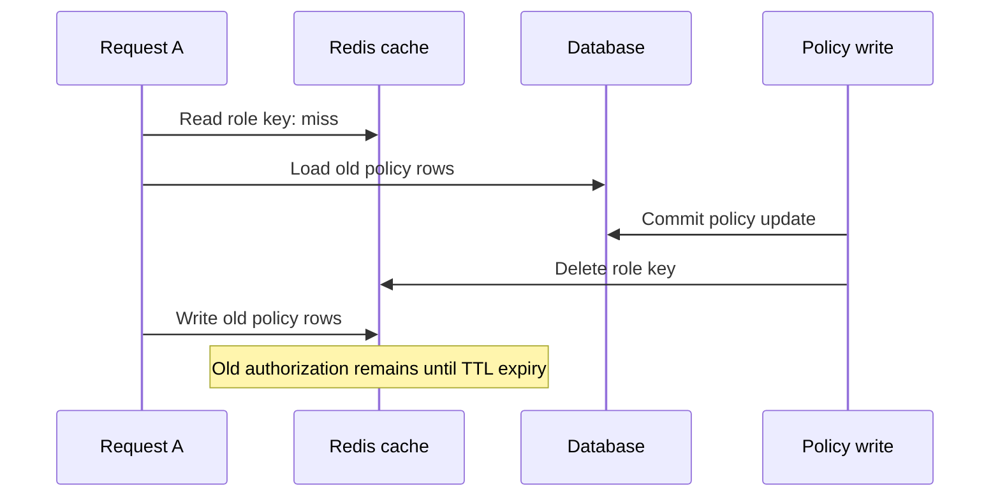

# CASL Authorization Policy Cache Design

<!-- cspell:ignore dbgenerated revisioned -->

## Purpose

This document records the current policy-cache behavior, its correctness risks, and the long-term
design for retaining Redis caching without allowing stale policy rows to remain authoritative. The
ability continues to be built from every role present in the request context. Route role-scope
selection is outside this document.

The cache stores raw policy rows. Placeholder resolution and CASL ability construction happen after
the cache read, so cached rows remain reusable across users, workspaces, and projects.

## Current Cache

`PolicyCache` stores one entry per role:

```text
Policy:Role:{roleId} -> raw policy rows
```

The current entry contains the persisted subject, actions, conditions, inversion, and reason. It
does not contain a request-specific ability or resolved placeholder values.

The read-through flow is:

1. Deduplicate requested role IDs.
2. Read all role keys with one multi-key cache operation.
3. Query the policy repository once for missed roles.
4. Group the result by role ID.
5. Cache every missed role, including roles with an empty policy list.
6. Return the policy rows in the requested role order.

The configured TTL is five minutes. Cache read and write failures fall through to the database
result. A cache deletion failure rejects the policy mutation after the database mutation has
completed.

## Current Findings

### Stale Refill Race

Cache invalidation can race with an in-flight cache miss:



Deleting the key does not prevent a request that already loaded old rows from repopulating it.
Revoked permissions can therefore remain effective for the cache TTL.

### Invalidation Failure After Commit

Policy create, update, and delete perform the database mutation before deleting the cache key. If
Redis deletion fails:

- The caller receives an error even though the database mutation committed.
- Retrying a create can insert a duplicate policy.
- The old cached grant can continue authorizing requests.
- Activity-log staging can be skipped because invalidation occurs before staging completes.

Cache invalidation is therefore part of the current request's success path, but it cannot roll back
the database write that precedes it.

### Writers Outside the Invalidation Path

Administrative policy methods invalidate their role key. Direct policy writes performed by seed
processes do not clear the affected keys. Role deletion also does not clear the role's policy key
before the role and its policies are deleted.

Every policy writer must participate in the same consistency protocol. Relying on the five-minute
TTL for a writer that skipped invalidation leaves stale authorization active by design.

### Cache Stampede

Concurrent requests that miss the same role all query the database and write the same cache key.
This increases database and Redis load during expiry or invalidation. It does not change the
authorization result, but it weakens the cache under burst traffic.

### Positive Properties

The current cache has several properties worth preserving:

- Raw conditions are cached before placeholder resolution.
- Cache entries are independent of user, workspace, and project context.
- Duplicate role IDs are removed before cache access.
- Empty policy lists are cached.
- A cache read failure falls through to the authoritative database.
- A cache write failure still returns the authoritative database result.

## Long-Term Design

The durable solution is a transactional policy revision combined with revisioned cache keys. Cache
deletion becomes an optimization rather than the authorization correctness mechanism.

### Role Revision

Add a monotonically increasing revision to the role that owns the policy rows:

```prisma
model Role {
  id             String @id @default(dbgenerated("uuidv7()")) @db.Uuid
  policyRevision Int    @default(0)

  // existing fields and relations
}
```

The revision changes in the same database transaction as every policy mutation. A successful policy
write therefore produces one authoritative pair:

```text
role policies = revision N + 1
role policyRevision = N + 1
```

If the transaction rolls back, neither the policy rows nor the revision changes.

### Transactional Writes

Policy creation should increment the owning role revision in the same transaction:

```ts
await this.databaseService.withTransaction(async tx => {
    const policy = await this.policyRepository.createInTx(tx, roleId, dto);

    await this.roleRepository.incrementPolicyRevisionInTx(tx, roleId);

    return policy;
});
```

The same sequence applies to policy update and delete. The domain owns the transaction, while the
repositories own the Prisma statements.

Seed replacement also increments each affected role revision in its seed transaction. Role deletion
does not need a cache delete for correctness because the deleted role ID and its revisioned keys
become unreachable. UUID role IDs are not reused.

### Revisioned Cache Keys

The cache key includes the role revision:

```text
Policy:Role:{roleId}:Revision:{policyRevision}
```

The cache API receives role references rather than bare role IDs:

```ts
type PolicyRoleReference = Readonly<{
    roleId: string;
    policyRevision: number;
}>;

type PolicyCacheEntry = Readonly<{
    roleId: string;
    policyRevision: number;
    policies: IPolicyRule[];
}>;
```

The current request already resolves the user, workspace member, and project member records before
the policy ability guard runs. Their role relations can include `policyRevision`, or the role
references can be loaded in one repository query before the cache read.

```ts
const roleReferences: PolicyRoleReference[] = [
    { roleId: user.roleId, policyRevision: user.role.policyRevision },
    ...(workspaceMember
        ? [
              {
                  roleId: workspaceMember.roleId,
                  policyRevision: workspaceMember.role.policyRevision,
              },
          ]
        : []),
    ...(projectMember
        ? [
              {
                  roleId: projectMember.roleId,
                  policyRevision: projectMember.role.policyRevision,
              },
          ]
        : []),
];
```

The policy cache then reads the exact revision requested:

```ts
private toKey(reference: PolicyRoleReference): string {
    return `Policy:Role:${reference.roleId}:Revision:${reference.policyRevision}`;
}

async getByRoleReferences(
    references: PolicyRoleReference[]
): Promise<IPolicyRule[]> {
    const unique = this.deduplicateReferences(references);
    const hits = await this.readMany(unique);
    const missing = unique.filter(reference => !hits.has(this.toKey(reference)));

    if (missing.length > 0) {
        const loaded = await this.loadMissingRevisions(missing);
        await this.writeMany(loaded);
        return this.flatten(unique, hits, loaded);
    }

    return this.flatten(unique, hits, new Map());
}
```

An in-flight request may still use the revision it read before a policy transaction committed. That
is an ordinary request boundary. A request that reads the new revision can never read the old
revisioned cache key as its current policy source.

The stale refill race becomes harmless:

```text
Request A reads revision 4 and loads old policies
Policy write commits revision 5
Request A writes key Revision:4
Later requests read revision 5 and use key Revision:5
```

Old keys can expire naturally. Deleting them asynchronously reduces storage but is not required for
authorization correctness.

### Cache Failure Semantics

The long-term failure rules are:

| Operation | Failure behavior |
| --- | --- |
| Cache read | Log and load the requested revision from the database |
| Cache write | Log and return the database result |
| Revision increment | Fail the transaction and roll back the policy mutation |
| Old-key cleanup | Log and continue; cleanup is not authoritative |
| Database policy load | Propagate the failure; do not use an older cached revision |

There is no post-commit cache deletion on the critical mutation path. This prevents a Redis outage
from turning a committed policy mutation into an API error and prevents cache deletion from being
mistaken for transactional invalidation.

### Stampede Control

Revisioned keys solve freshness but do not prevent concurrent misses. Add a per-role single-flight
mechanism:

- Coalesce requests within one application process with a `Map<string, Promise<...>>`.
- Use a short Redis lock for cross-process misses when the database load is expensive.
- Re-read the versioned cache key after acquiring the lock because another process may already have
  populated it.
- Release the lock with a compare-and-delete operation so one process cannot delete another process'
  lock.
- If lock acquisition fails, briefly wait and retry the cache before falling back to a direct
  database load.

Illustrative cross-process flow:

```ts
const key = this.toKey(reference);
const cached = await this.cache.get<PolicyCacheEntry>(key);
if (cached?.policyRevision === reference.policyRevision) {
    return cached.policies;
}

const lockToken = randomUUID();
const acquired = await this.redis.set(
    `${key}:lock`,
    lockToken,
    { NX: true, PX: 5_000 }
);

if (!acquired) {
    await this.waitForCacheFill(key);
    return this.getRevisionOrLoad(reference);
}

try {
    const afterLock = await this.cache.get<PolicyCacheEntry>(key);
    if (afterLock?.policyRevision === reference.policyRevision) {
        return afterLock.policies;
    }

    const policies = await this.policyRepository.findManyByRoleIds([
        reference.roleId,
    ]);
    await this.cache.set(key, {
        roleId: reference.roleId,
        policyRevision: reference.policyRevision,
        policies,
    });

    return policies;
} finally {
    await this.releaseLockIfOwned(`${key}:lock`, lockToken);
}
```

The lock is a performance control only. It must never be used as the source of authorization
correctness. A lock timeout or Redis outage falls back to the database and never uses an older
revision.

## Required Writer Coverage

The revision update applies to every path that changes policy visibility:

- Policy create.
- Policy update.
- Policy delete.
- Seed replacement and seed removal.
- Role deletion, if role revisions or policy rows are retained during the transaction.
- Any future administrative or internal policy writer.

The policy repository and role repository should expose transaction-aware methods so the domain can
keep the policy mutation and revision increment in one transaction:

```ts
interface IPolicyRepository {
    createInTx(
        tx: IDatabaseTransactionClient,
        roleId: string,
        dto: PolicyCreateRequestDto
    ): Promise<Policy>;
}

interface IRoleRepository {
    incrementPolicyRevisionInTx(
        tx: IDatabaseTransactionClient,
        roleId: string
    ): Promise<void>;
}
```

Direct database writes that bypass this protocol are not supported because they can change policy
rows without advancing the revision.

## Verification Scenarios

Tests cover:

- Cache hits return raw policy rows for the exact role revision.
- A revision increment makes the previous cache key unreachable to new requests.
- An in-flight load of revision `N` cannot satisfy a request for revision `N + 1`.
- Policy mutation and revision increment roll back together.
- Cache read failure loads from the database.
- Cache write failure does not fail a successful policy mutation.
- Old-key cleanup failure does not affect authorization or the policy mutation response.
- Seed replacement advances every affected role revision.
- Role deletion does not leave a reachable role reference using an old key.
- Concurrent misses are coalesced per role revision.
- Placeholder resolution happens after raw policy retrieval and remains request-specific.

## Related Documentation

- [CASL authorization policy specification](./casl-authorization-policy-spec.md)
- [CASL authorization enforcement matrix](./casl-authorization-enforcement-matrix.md)
