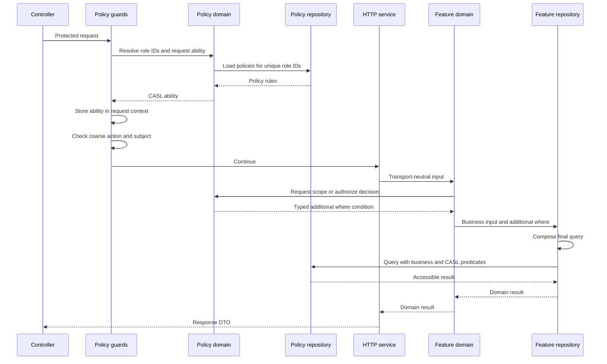

# CASL Authorization Policy Implementation Specification

<!-- cspell:ignore dbgenerated revisioned revisioning -->

## Status

This document defines the desired authorization architecture for database-backed CASL policies.
It is an implementation specification, not a description of the current implementation.

The companion [authorization enforcement matrix](./casl-authorization-enforcement-matrix.md)
maps application operations to their action, subject, enforcement point, and denied result.

## Context

The application uses role assignments to load policy rows and builds one CASL ability for each
request. Policy rules can constrain access by platform, workspace, project, membership, or record
attributes.

The target design keeps three concerns separate and exposes one small authorization API:

1. Policy storage expresses roles, actions, subjects, and arbitrary CASL Prisma conditions.
2. `PolicyAbilityDomain.authorize` evaluates one type, record, or prospective-record decision.
3. `PolicyAbilityDomain.scope` produces a typed query predicate for database-backed operations.
4. Repositories compose the predicate with their database queries.

Raw Prisma filters do not cross the HTTP service boundary. Persisted policy conditions are resolved
inside the policy ability layer before a typed predicate reaches a domain and repository. Redis is
not part of policy resolution.

## Goals

- Apply attribute-based access control with CASL and `@casl/prisma`.
- Store fully customizable policy conditions in the database.
- Build one deterministic, fail-closed ability per request.
- Generate `accessibleBy` conditions through `PolicyAbilityDomain.scope` and pass them to repositories.
- Enforce record authorization in the database query that reads or mutates the record.
- Distinguish coarse permission denial from an inaccessible resource.
- Reuse repository methods for authorized requests and trusted internal operations.
- Preserve the existing `Role: update` policy-administration permission.

## Non-Goals

- Field-level CASL permissions.
- PostgreSQL row-level security.
- A request-aware Prisma extension that injects authorization automatically.
- Arbitrary non-JSON policy values.
- Delegated-administration grant ceilings.

## Security Properties

The desired implementation has these properties:

- A request ability contains rules from the caller's resolved platform, workspace, and project
  roles only.
- Missing condition context never broadens an allow rule.
- An unresolved inverted rule becomes an unconditional deny.
- Inverted rules are applied after allow rules so explicit denial wins.
- Authorized reads and mutations include the CASL predicate in the database operation.
- Collection endpoints return only accessible rows.
- An inaccessible individual row is indistinguishable from a missing row.
- Trusted internal operations can omit the additional authorization condition.
- Policy changes take effect on the next ability build without a Redis invalidation window.

## Target Architecture

```text
Controller
  -> HTTP Service
      -> Domain Service
          -> PolicyAbilityDomain
          -> Repository
              -> DatabaseService
```

HTTP services translate transport DTOs and responses. Feature domain services own business decisions
and choose the authorization operation. `PolicyAbilityDomain` exposes the request-scoped ability
through two application methods: `authorize` for one type, record, or prospective-record decision,
and `scope` for a typed database predicate. Repositories own final Prisma query composition and
transactions.



## Policy Data Model

Persisted policies store the CASL Prisma condition as JSON. The application owns a finite set of
standalone placeholder tokens, and resolves those tokens from the current request context while
building the request ability.

Role records, role assignments, and policy rows are database data. Seed data supplies the initial
role catalog, while request ability construction loads the roles and policies that apply to the
current request.

```prisma
model Policy {
  id        String   @id @default(dbgenerated("uuidv7()")) @db.Uuid
  roleId    String   @db.Uuid
  subject   EnumPolicySubject
  action    EnumPolicyAction[]
  conditions Json?
  inverted  Boolean  @default(false)
  reason    String?

  createdAt DateTime @default(now())
  createdBy String?  @db.Uuid
  updatedAt DateTime @updatedAt
  updatedBy String?  @db.Uuid

  role Role @relation("RolePolicy", fields: [roleId], references: [id], onDelete: Cascade)

  @@index(fields: [roleId, subject])
  @@map("policies")
}
```

## Condition Resolution

Policy conditions remain arbitrary JSON objects compatible with CASL Prisma query conditions. The
condition may contain nested objects, arrays, logical operators, relation filters, scalar values,
and application-defined fields supported by the target Prisma model.

The condition vocabulary is not represented by a finite profile registry. CASL receives the
condition stored on the policy after placeholder resolution and evaluates that concrete rule.

The application owns the placeholder vocabulary. The initial registry contains these standalone
tokens:

| Placeholder | Request value |
| --- | --- |
| `${userId}` | Authenticated user ID |
| `${workspaceId}` | Resolved workspace ID, when present |
| `${projectId}` | Resolved project ID, when present |

Placeholders are resolved recursively at any JSON depth. A string is a placeholder only when the
whole value matches `${name}`. Other strings remain literal values. Embedded interpolation such as
`prefix-${userId}` is not performed.

```ts
type PolicyContext = Readonly<{
    userId: string;
    workspaceId?: string;
    projectId?: string;
}>;

type PolicyPlaceholderValues = Readonly<
    Partial<Record<EnumPolicyConditionPlaceholder, string>>
>;

const placeholders: PolicyPlaceholderValues = {
    [EnumPolicyConditionPlaceholder.userId]: context.userId,
    [EnumPolicyConditionPlaceholder.workspaceId]: context.workspaceId,
    [EnumPolicyConditionPlaceholder.projectId]: context.projectId,
};
```

The resolver does not interpret policy meaning or validate a condition against a subject. It only
replaces registered placeholder values. A recognized placeholder without a request value and an
unknown `${...}` token are unresolved.

## Ability Construction

`PolicyAbilityFactory` converts database rows into CASL rules. It receives the concrete request
placeholder values for the current request.

```ts
public build(
    rules: IPolicyRule[],
    placeholders: PolicyPlaceholderValues
): PolicyAbility {
    const { can, cannot, build } = new AbilityBuilder<PolicyAbility>(
        createPrismaAbility
    );

    const orderedRules = rules.toSorted(
        (left, right) => Number(left.inverted) - Number(right.inverted)
    );

    for (const rule of orderedRules) {
        const conditions = rule.conditions === null
            ? undefined
            : this.resolveConditions(rule.conditions, placeholders);

        if (rule.conditions !== null && !conditions) {
            if (rule.inverted) {
                cannot(rule.action, rule.subject).because(rule.reason ?? undefined);
            }

            continue;
        }

        const ruleBuilder = rule.inverted
            ? conditions
                ? cannot(rule.action, rule.subject, conditions)
                : cannot(rule.action, rule.subject)
            : conditions
              ? can(rule.action, rule.subject, conditions)
              : can(rule.action, rule.subject);

        if (rule.reason) {
            ruleBuilder.because(rule.reason);
        }
    }

    return build();
}
```

The unresolved-placeholder behavior is intentionally asymmetric:

| Rule | Unresolved placeholder |
| --- | --- |
| Allow | Rule is omitted |
| Inverted deny | Unconditional deny is emitted |

Policy creation and update do not validate placeholder names or CASL field/operator compatibility.
Ability construction remains the runtime boundary: malformed or CASL-incompatible condition data
is an internal policy configuration error and never becomes an unconditional allow.

## Request Ability Lifecycle

Policy rows are loaded through the revision-aware policy cache. Role references are deduplicated
before the cache query, and each reference carries the policy revision that identifies the
authoritative row set.

```ts
public async findManyByRoleReferences(
    references: PolicyRoleReference[]
): Promise<IPolicyRuleWithRole[]> {
    const uniqueReferences = this.deduplicateReferences(references);

    if (uniqueReferences.length === 0) {
        return [];
    }

    return this.policyCache.getByRoleReferences(uniqueReferences);
}
```

The ability guard resolves the applicable role references, loads their policies once, builds the
ability, and stores it in request context. If stacked guards execute for the same request, they
reuse the stored ability.

```ts
const currentAbility = this.requestStoreService.get<PolicyAbility>(
    PolicyAbilityStoreKey
);

if (currentAbility !== null) {
    return currentAbility;
}

const roleReferences = this.policyRoleResolver.resolve(requestContext);
const policies = await this.policyDomain.findManyByRoleReferences(
    roleReferences
);
const placeholders = this.policyPlaceholderResolver.resolve(requestContext);
const ability = this.policyAbilityFactory.build(policies, placeholders);

this.requestStoreService.set(PolicyAbilityStoreKey, ability);
return ability;
```

An absent ability after the authorization guards have run is an internal configuration error, not
an authorization denial.

## Authorization API

The application has one policy decision primitive and one query-scoping primitive. They use the same
request ability and must not be repeated for the same operation.

### `authorize`

`authorize(action, target)` throws `PolicyForbiddenException` when CASL denies the target. The target
may be a subject name for a type-level check or a CASL-tagged object for an existing or prospective
record:

```ts
public authorize(
    action: EnumPolicyAction,
    target: PolicyAbilitySubject
): void {
    const ability = this.getAbility();

    ForbiddenError.from(ability).throwUnlessCan(action, target);
}
```

The production method maps CASL's `ForbiddenError` to the application's
`PolicyForbiddenException`, including the denied subject, action, and optional rule reason.

```ts
this.policyAbilityDomain.authorize(
    EnumPolicyAction.update,
    subject(EnumPolicySubject.Project, project)
);
```

Creation does not need a separate `authorizeCreate` method. It uses the same method with the
attributes that will be persisted:

```ts
this.policyAbilityDomain.authorize(
    EnumPolicyAction.create,
    subject(EnumPolicySubject.Project, {
        workspaceId,
        name,
        slug,
    })
);
```

The prospective object must contain every attribute used by its stored condition. If a
relation-backed condition cannot be evaluated from the object, use `scope` in the repository query
instead.

### `scope`

`scope(action, subject)` returns the typed `accessibleBy` predicate for a Prisma model subject. The
domain passes it to the repository, which composes it with business filters:

```ts
const where = this.policyAbilityDomain.scope(
    EnumPolicyAction.read,
    EnumPolicySubject.Project
);

const projects = await this.projectRepository.findMany(params, where);
```

Use `scope` for collections, single-record lookups, updates, and deletes. The predicate must be part
of the final query or mutating statement. Do not call `authorize` first and then perform an unscoped
database operation.

### Route decorator

`@PolicyProtected` is the policy requirement decorator. It builds or reuses the request ability and
performs the inexpensive type-level capability check. It accepts one or more requirements because a
route may need more than one capability:

```ts
@PolicyProtected({
    subject: EnumPolicySubject.Project,
    action: [EnumPolicyAction.read],
})
```

Its implementation is equivalent to:

```ts
export function PolicyProtected(
    ...requirements: IPolicyRequired[]
): MethodDecorator {
    return applyDecorators(
        UseGuards(PolicyAbilityGuard, PolicyGuard),
        SetMetadata(PolicyRequiredMetaKey, requirements),
        DocPolicyErrorResponses.forbidden,
        DocPolicyErrorResponses.predefinedNotFound
    );
}

export function PolicyAbility(): MethodDecorator {
    return applyDecorators(UseGuards(PolicyAbilityGuard));
}
```

The scope-specific names `PlatformPolicyProtected`, `WorkspacePolicyProtected`, and
`ProjectPolicyProtected` are removed. `PolicyAbility` builds the ability without enforcing
a declared capability.
`RequireAccess` is not introduced: authentication, workspace/project resolution, membership, feature
flags, terms acceptance, and CASL remain separate decorators because they are separate decisions.

## Implementation Cleanup Inventory

The final authorization surface has one generic route decorator, two ability-domain operations, and
one revision-aware raw-policy cache. The following symbols are removed after their call sites and
specifications use the target API.

### Delete after call-site migration

| Current surface | Cleanup |
| --- | --- |
| `PlatformPolicyProtected`, `WorkspacePolicyProtected`, `ProjectPolicyProtected` | Delete the scope-specific wrappers. Use `PolicyProtected` with the generated `EnumPolicySubject`. |
| `WorkspacePolicyProtected` and `ProjectPolicyProtected` imports in workspace/project decorators | Delete the policy-wrapper exports and retain only context and membership decorators. |
| `EnumPolicyPlatformSubject`, `EnumPolicyWorkspaceSubject`, `EnumPolicyProjectSubject`, and `PolicySubject` | Delete the TypeScript-only subject subsets. Persisted and route subjects use `EnumPolicySubject`. |
| `PolicyAbilityDomain.accessibleWhere` | Delete after all collection, lookup, update, and delete callers use `scope`. |
| `PolicyAbilityDomain.assertCan` | Delete after object and prospective-record callers use `authorize`. |
| Public `PolicyAbilityDomain.assertCanEvery` | Delete as a public operation. Move requirement aggregation into `PolicyGuard` or a private guard helper. |
| The flat scalar `conditions` schema and the unknown-placeholder refinement in `PolicyCreateRequestSchema` | Delete. Request DTOs accept arbitrary JSON-compatible CASL conditions; runtime placeholder resolution remains in the ability factory. |
| `PolicyCache.deleteCacheByRoleId` | Delete. Revision changes make post-commit cache deletion unnecessary for authorization correctness. |
| `PolicyCache.getByRoleIdsAndCache` | Delete the bare-role cache API and replace it with a role-reference API carrying `roleId` and `policyRevision`. |
| `PolicyDomain` calls to `deleteCacheByRoleId` | Delete. Policy mutation and role-revision updates execute in one database transaction. |
| `Policy:Role:{roleId}` as the policy cache key | Delete the unversioned key format. Use `Policy:Role:{roleId}:Revision:{policyRevision}`. |

Any condition-profile registry such as `conditionResolvers`, `PolicyConditionResolver`, or a finite
`EnumPolicyCondition` is outside the final design. If such an artifact exists in an implementation
branch, delete it rather than adapting it into the policy read path.

### Rename or replace at call sites

| Current surface | Target surface |
| --- | --- |
| `PolicyAbilityDomain.accessibleWhere` | `PolicyAbilityDomain.scope` |
| `PolicyAbilityDomain.assertCan` | `PolicyAbilityDomain.authorize` |
| `PolicyDomain.findManyByRoleIds(...roleIds)` | A role-reference method that passes policy revisions to `PolicyCache` |
| `PolicyCache.getCacheByRoleIds` and `setCacheByRoleIds` | Revision-aware multi-key read and write helpers |
| `PolicyGuard` metadata lookup for `PolicyRequiredMetaKey` | Retain the policy requirement metadata key |
| `policy.keyPattern` value | The revisioned policy cache key pattern |

### Retain

These classes and services remain part of the final architecture:

- `PolicyAbilityFactory`, including recursive placeholder resolution and fail-closed rule handling.
- `PolicyAbilityGuard`, which builds one ability from all role references present in request context.
- `PolicyGuard`, which evaluates the requirements declared by `PolicyProtected`.
- `PolicyAbility`, which builds or reuses the request ability without enforcing a capability.
- `PolicyAbilityDomain`, exposing `authorize` and `scope`.
- `PolicyDomain` and `PolicyRepository`, including transaction-aware policy writes.
- `PolicyCache`, storing raw policy rows by role revision.
- `EnumPolicyConditionPlaceholder`, `isPolicyPlaceholder`, and the placeholder value resolver.
- `PolicyAbilityStoreKey`, which identifies the request-scoped ability.
- `PolicyForbiddenException`, `PolicyPredefinedNotFoundException`, and the policy documentation
  error responses.
- The official CASL Prisma extension and explicit `accessibleBy` predicate generation.

The cleanup does not delete feature HTTP services or repositories. Their authorization calls are
migrated from `accessibleWhere` and `assertCan` to `scope` and `authorize`; their business methods
and repository boundaries remain.

## Domain Enforcement

Feature domain services obtain a typed CASL condition and pass it to the repository as an additional
`where` condition. HTTP services do not build CASL conditions or inspect Prisma filters.

```ts
public async findOneById(id: string): Promise<Project> {
    const where = this.policyAbilityDomain.scope(
        EnumPolicyAction.read,
        EnumPolicySubject.Project
    );
    const project = await this.projectRepository.findOneById(id, where);

    if (!project) {
        throw new ProjectNotFoundException();
    }

    return project;
}
```

Object assertions through `authorize` remain useful for prospective records, already-loaded scalar
records, and business transitions. Query-oriented relation conditions use repository filtering.

### Prospective Create

A create operation checks the attributes of the record that is about to exist. Denial is a coarse
authorization failure and returns `403`.

```ts
public async create(
    input: IProjectCreate,
    actorId: string
): Promise<Project> {
    const prospectiveProject = subject(EnumPolicySubject.Project, {
        workspaceId: input.workspaceId,
        createdBy: actorId,
    });

    this.policyAbilityDomain.authorize(
        EnumPolicyAction.create,
        prospectiveProject
    );

    return this.projectRepository.create(input, actorId);
}
```

## Repository Enforcement

Repositories accept an optional, model-typed additional `where` condition. They do not import CASL,
inspect abilities, or distinguish authorization conditions from other caller-provided constraints.
Request-driven domain methods pass the result of `PolicyAbilityDomain.scope`. Trusted system and
processor domain methods call the same repository operation without that condition. Repositories do
not import CASL or build policy decisions.

```ts
public async findMany(
    filter: ProjectListFilter,
    additionalWhere?: Prisma.ProjectWhereInput
): Promise<Project[]> {
    return this.databaseService.project.findMany({
        where: {
            AND: [
                additionalWhere ?? {},
                this.buildWhere(filter),
            ],
        },
        orderBy: { createdAt: 'desc' },
    });
}
```

When present, the additional condition is the first entry in `AND` as a consistent repository
convention. The installed CASL query extension handles the special condition generated for a fully
denied query.

### Record Lookup

```ts
public async findOneById(
    id: string,
    additionalWhere?: Prisma.ProjectWhereInput
): Promise<Project | null> {
    return this.databaseService.project.findFirst({
        where: {
            AND: [
                additionalWhere ?? {},
                { id },
            ],
        },
    });
}
```

The domain maps `null` to the feature's not-found exception. It does not perform an unfiltered
existence probe because that would reveal whether an inaccessible record exists.

### Atomic Mutation

The final update or delete statement includes the CASL predicate. A read-then-write flow does not
rely on authorization performed only by the initial read.

```ts
public async updateById(
    id: string,
    data: Prisma.ProjectUpdateInput,
    additionalWhere?: Prisma.ProjectWhereInput
): Promise<Project | null> {
    const result = await this.databaseService.project.updateMany({
        where: {
            AND: [
                additionalWhere ?? {},
                { id },
            ],
        },
        data,
    });

    if (result.count === 0) {
        return null;
    }

    return this.databaseService.project.findUnique({ where: { id } });
}
```

Operations with multiple writes use a transaction and reapply the CASL predicate to the final
protected mutation. Unique-field changes may require a repository-specific transaction strategy,
but authorization remains part of the mutating statement.

### Nested Authorization

When the protected subject is related to the queried model, the repository nests the additional
condition under the relation. Examples include:

- Policy administration lists `Policy` rows through an accessible `Role` relation.
- Device ownership lists apply `DeviceOwnership` authorization directly.

The enforcement matrix records each nested or direct repository target.

### Trusted Calls

Flows without a user request ability, such as initial data seeding, queue processors,
authentication bootstrap, and internal integrity checks, reuse the same repository methods without
an additional authorization condition. The calling domain method and entry point identify the
trusted use case; the repository does not duplicate the query under a system-specific method name.

## Prisma Extension Decision

The database client retains the official CASL extension:

```ts
return this.$extends(auditExtension).$extends(createCaslExtension());
```

The extension normalizes CASL's impossible-query shape so Prisma returns no rows instead of raising
a validation error. Authorization predicates are still created explicitly with `accessibleBy` in
`PolicyAbilityDomain` and passed to repositories as additional `where` conditions.

A custom Prisma query extension is not used for automatic authorization because it would need
request context, action and subject inference, nested-operation handling, and an explicit bypass
protocol. Prisma query extensions do not cover every nested write, so such an extension would create
a false sense of complete enforcement. Explicit condition generation keeps the boundary reviewable.

References:

- [CASL Prisma integration](https://github.com/stalniy/casl/tree/master/packages/casl-prisma)
- [Prisma query extensions](https://www.prisma.io/docs/orm/prisma-client/client-extensions/query)

## Policy Authoring Validation

Policy create and update validate the structural fields required to persist a policy:

```ts
this.policyValidator.validate({
    subject: input.subject,
    actions: input.action,
    inverted: input.inverted,
});
```

Validation covers:

- Whether the role scope can grant the selected subject.
- Whether the selected actions are valid for that subject.
- Whether a policy retains at least one action.

`conditions` is accepted as JSON and stored with the policy without placeholder-catalog or
subject-specific Prisma validation. The ability builder resolves placeholders and CASL validates
the resulting rule at runtime. Policy conditions that cannot produce a valid CASL rule raise an
internal policy configuration error and never become an unconditional allow.

Policy create, update, and delete remain protected by `Role: update` against the policy's target
role. This allows a role administrator to author grants equivalent to or greater than their current
permissions when they can update the role. The risk is accepted for this design. Strict least-
privilege delegation requires a future root-only policy-administration subject or a grant-ceiling
check.

## Denied Results

| Situation | Result |
| --- | --- |
| Guard-level action or subject denial | `403 PolicyForbiddenException` |
| Prospective create denial | `403 PolicyForbiddenException` |
| Existing record excluded by a CASL condition | Feature-specific `404` |
| Collection item excluded by a CASL condition | Item is absent from the collection |
| Missing request ability after protected routing | Internal configuration error |
| Unresolved placeholder in an allow condition | Allow rule is omitted |
| Unresolved placeholder in an inverted condition | Unconditional deny is emitted |
| Invalid persisted CASL condition | Internal policy configuration error |

`PolicyForbiddenException` includes the missing action and subject and uses the matching CASL rule's
reason when one is available. Record operations do not disclose that a row exists outside the
caller's authorization scope.

## Policy Cache Boundary

The policy layer retains a raw policy-row cache keyed by role and policy revision. Cached rows keep
persisted conditions and placeholders. Request-specific placeholder resolution and CASL ability
construction happen after the cache read, so cached rows remain reusable across requests.

Cache revisioning, transaction boundaries, failure semantics, seed coverage, role deletion, and
stampede control are defined in the [CASL authorization cache design](./casl-authorization-cache.md).

## Migration

Policy schema changes preserve the `conditions Json?` field. Existing condition objects remain
stored as policy data, including nested relation filters and application placeholders. No condition
classification or profile conversion is required.

Seed data supplies the initial roles and policies with their complete CASL conditions. Policy rows
created or updated through the API use the same JSON shape. Ability construction resolves the
application-owned placeholders when the policy is used for a request.

When other policy schema changes are introduced, the generated Prisma client and policy read/write
surfaces are updated together. Existing conditions are retained during that migration, and an
unknown placeholder remains data that fails closed at ability construction.

The owner applies the schema with `pnpm db:migrate`. Until that step runs, runtime code generated
from the new schema cannot operate against the existing database shape.

## Test Strategy

Behavior changes follow test-first implementation. Unit specifications cover:

- Recursive resolution of registered placeholders in objects and arrays.
- Literal values and arbitrary nested CASL condition shapes.
- Allow-rule omission when required context is absent.
- Unconditional deny generation when inverted-rule context is absent.
- Unknown placeholder handling.
- Allow-before-deny ordering.
- Invalid persisted condition handling.
- Unique role-ID loading and request ability reuse.
- Domain prospective-subject checks.
- Domain mapping of authorized lookup misses to feature `404` exceptions.
- Policy-authoring validation and accepted `Role: update` behavior.

Repository integration coverage verifies generated query behavior for:

- Accessible and inaccessible collections.
- Direct record lookup.
- Nested relation authorization.
- Atomic update and delete predicates.
- Impossible CASL queries handled by `createCaslExtension()`.
- Concurrent scope changes between preliminary reads and final mutations.

Every operation in the enforcement matrix has at least one allowed case and one denied case. Routes
with record conditions also have an inaccessible-existing-record case.

## Acceptance Checklist

- [ ] `Policy.conditions` stores arbitrary JSON-compatible CASL conditions.
- [ ] Registered placeholders resolve recursively at ability-build time.
- [ ] Unknown or unavailable placeholders fail closed.
- [ ] Policy definitions validate structural role, subject, and action fields without restricting condition JSON.
- [ ] Ability construction is deterministic and fail-closed.
- [ ] One ability is built and reused per protected request.
- [ ] Raw policy caching uses role revisions and cache deletion is not an authorization correctness boundary.
- [ ] HTTP services contain no Prisma authorization filters.
- [ ] `PolicyAbilityDomain.authorize` is the only object/prospective authorization operation.
- [ ] `PolicyAbilityDomain.scope` is the only database predicate operation.
- [ ] User-request domain methods pass CASL-generated conditions to repositories.
- [ ] Collection, record, update, and delete queries include CASL predicates.
- [ ] Prospective creates are checked before persistence.
- [ ] Inaccessible existing records return feature-specific `404` responses.
- [ ] Policy routes use `@PolicyProtected` or `@PolicyAbility`; no scope-specific policy decorators or `RequireAccess` exist.
- [ ] Trusted internal flows reuse repository methods without an authorization condition.
- [ ] Every enforcement-matrix row has allowed and denied test coverage.
- [ ] Targeted tests, typecheck, lint, and spell checks pass.

## Related Documentation

- [Authorization documentation](../authorization.md)
- [CASL authorization cache design](./casl-authorization-cache.md)
- [Authorization enforcement matrix](./casl-authorization-enforcement-matrix.md)
