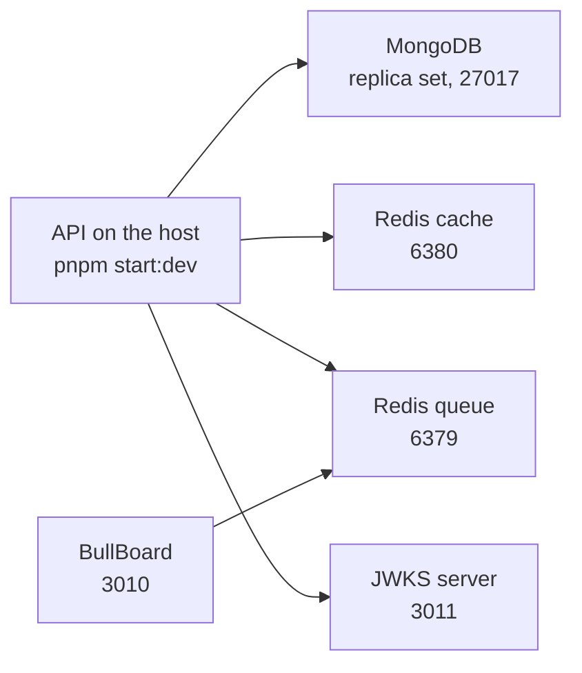

# Installation

This tutorial takes a newcomer from a fresh clone to a running API on a local machine, with the dependencies in Docker.

## Table of Contents

- [Related Documents](#related-documents)
- [Prerequisites](#prerequisites)
- [1 Clone and install](#1-clone-and-install)
- [2 Create .env.docker](#2-create-envdocker)
- [3 Generate keys and .env](#3-generate-keys-and-env)
- [4 Start the dependencies](#4-start-the-dependencies)
- [5 Push the schema and seed](#5-push-the-schema-and-seed)
- [6 Run the API](#6-run-the-api)
- [7 Check it works](#7-check-it-works)
- [What you have now](#what-you-have-now)
- [Troubleshooting](#troubleshooting)
- [Next](#next)

## Related Documents

- [Commands Reference][ref-doc-reference-commands]: every `pnpm` script and Compose command
- [Configuration Reference][ref-doc-reference-configuration]: every `.env` key and every `DOCKER_*` variable
- [Hosted Dependencies Guide][ref-doc-guide-hosted-dependencies]: the same run against hosted MongoDB and Redis, without Docker
- [Architecture][ref-doc-architecture]: how the source tree is organized
- [Production][ref-doc-production]: running the application on a deployed host

## Prerequisites

- [Node.js][ref-nodejs] 26.13.x+.
- [pnpm][ref-pnpm] 12.5.x+. `engines` and the `preinstall` guard reject npm and yarn.
- [Git][ref-git] 2.39.x+.
- [Docker][ref-docker] 28.5.x+ with Docker Compose 2.40.x+.
- Free ports on the host: `27017` (MongoDB), `6379` and `6380` (the queue and cache Redis), `3010` (BullBoard), `3011` (the JWKS server), and `3000` (the API).

## 1 Clone and install

Clone the repository, install the packages, and generate the Prisma client and the package fields:

```bash
git clone https://github.com/andrechristikan/ack-nestjs-boilerplate.git
cd ack-nestjs-boilerplate
pnpm install
pnpm generate
```

Result: `pnpm generate` ends without an error and `src/generated/prisma-client` exists.

## 2 Create .env.docker

Docker Compose reads its variables from `.env.docker`. Every variable is optional locally, so an empty file is enough:

```bash
touch .env.docker
```

- An empty value starts MongoDB and Redis without authentication, and BullBoard with the login `admin` and `admin123`.
- To turn authentication on or move a port, set a `DOCKER_*` variable: [Compose variables][ref-doc-reference-configuration-compose].

Result: the file exists in the repository root. Git ignores it.

## 3 Generate keys and .env

The script writes the JWT key pairs, the JWKS files, both encryption secrets, and the MongoDB keyfile under `keys/`. `--direct-insert` also creates `.env` from `.env.example`, leaves each optional integration blank, and writes the keys into it:

```bash
pnpm generate:secret --direct-insert
```

- `.env.example` already points at the local Compose ports: MongoDB on `27017`, the cache Redis on `6380`, the queue Redis on `6379`, and the JWKS server on `3011`.
- Both Compose files mount `keys/access-jwks.json`, `keys/refresh-jwks.json`, and `keys/mongo-keyfile`, and a missing file stops the start.
- Every run replaces the keys. New JWT keys invalidate every issued token, and new encryption secrets leave existing ciphertext undecryptable, so back up `keys/` and `.env` before you run it again.

Result: `keys/` holds the PEM files, `access-jwks.json`, `refresh-jwks.json`, `encryption-secret.env`, and `mongo-keyfile`, and `.env` exists with mode 600.

## 4 Start the dependencies



Start the `deps` profile of the local Compose file:

```bash
docker compose --env-file .env.docker --profile deps up -d
```

Check that every service is healthy. MongoDB takes a minute or two to initiate its replica set:

```bash
docker compose --env-file .env.docker --profile deps ps
```

Result: `mongo`, `redis-queue`, `redis-cache`, `bullboard`, and `jwks-server` report `healthy`.

## 5 Push the schema and seed

Apply the Prisma schema to MongoDB, build the seed commands, and seed the initial rows, including the API keys:

```bash
pnpm db:migrate
pnpm migration:build
pnpm migration:seed
```

Result: `pnpm db:migrate` reports the schema applied, and each seed logs its rows. A seed that throws exits with code 1 after one `FATAL [Bootstrap]` line.

## 6 Run the API

```bash
pnpm start:dev
```

The command stays in the foreground and prints the log, so leave it running and open a second terminal for the next step.

Result: the log prints `App URL` with `http://localhost:3000/api`, and a type check runs beside the watcher.

## 7 Check it works

In a second terminal, call the liveness route, which needs no API key:

```bash
curl -i http://localhost:3000/api/public/hello
```

- The route answers 200 with the date, the application name, and a message.
- Swagger is at `http://localhost:3000/docs`.
- BullBoard is at `http://localhost:3010`. Log in with `admin` and `admin123`, or the values of `DOCKER_BULLBOARD_USERNAME` and `DOCKER_BULLBOARD_PASSWORD`.

## What you have now

- MongoDB as a replica set, two Redis instances, a JWKS server, and BullBoard, running in Docker.
- A seeded database.
- The API on port 3000 with live reload.

## Troubleshooting

- A port is in use: Compose publishes `27017`, `6379`, `6380`, `3010`, and `3011`, so a process already on one blocks the start. `DOCKER_MONGO_PORT` moves MongoDB, and the port in `DATABASE_URL` then changes to match.
- `host.docker.internal` does not resolve on the host: MongoDB reports it as the replica set member host, so the driver connects to that name. Add `127.0.0.1 host.docker.internal` to the host's `/etc/hosts`. The containers need no entry.
- A bind mount error names a file under `keys/`: the file does not exist. Run `pnpm generate:secret --direct-insert`.
- The replica set is still starting: wait for `mongo` to report `healthy`.
- `SCRAM failure: Authentication failed` from Prisma: `DOCKER_MONGO_ROOT_PASSWORD` turned authentication on and `DATABASE_URL` carries no credentials, or its `authSource` is wrong. Write `mongodb://<user>:<password>@localhost:27017/ACKNestJs?authSource=admin&retryWrites=true&w=majority&replicaSet=rs0`, with `<user>` the value of `DOCKER_MONGO_ROOT_USERNAME`. With an application user (`DOCKER_MONGO_APP_*`), `authSource` is that user's database.
- `NOAUTH Authentication required` in the log: a Redis password is set and the URL carries none. Write `redis://:<password>@localhost:6380/0` and `redis://:<password>@localhost:6379/0`.
- A `$` in a `DOCKER_*` password makes the stored password and the one in the URL differ: Compose interpolates `$` in the values it reads from `.env.docker`, and the application reads `.env` literally. Percent-encode a special character in a URL password.
- The `apis` profile container resets connections on port 3000 or cannot reach MongoDB, Redis, or the JWKS server: the container mounts the same `.env`, and `.env.example` writes `localhost`, which inside the container is the container itself. Set `APP_HTTP_HOST=0.0.0.0` and write `host.docker.internal` in `DATABASE_URL`, both Redis URLs, and the two JWKS URIs. The container resolves that name to the host through `extra_hosts`, and the published ports answer there. Skip this entry when `pnpm start:dev` runs the API on the host.

## Next

- Look up a command: [Commands Reference][ref-doc-reference-commands].
- Read how the code is organized: [Architecture][ref-doc-architecture].
- Look up a setting: [Configuration Reference][ref-doc-reference-configuration].
- Run without Docker: [Hosted Dependencies Guide][ref-doc-guide-hosted-dependencies].
- Deploy: [Production][ref-doc-production].

<!-- REFERENCES -->

[ref-nodejs]: https://nodejs.org
[ref-pnpm]: https://pnpm.io
[ref-git]: https://git-scm.com
[ref-docker]: https://docs.docker.com
[ref-doc-reference-commands]: ../reference/commands.md
[ref-doc-reference-configuration]: ../reference/configuration.md
[ref-doc-reference-configuration-compose]: ../reference/configuration.md#compose-variables
[ref-doc-guide-hosted-dependencies]: ../guides/hosted-dependencies.md
[ref-doc-architecture]: ../concepts/architecture.md
[ref-doc-production]: ../production.md
