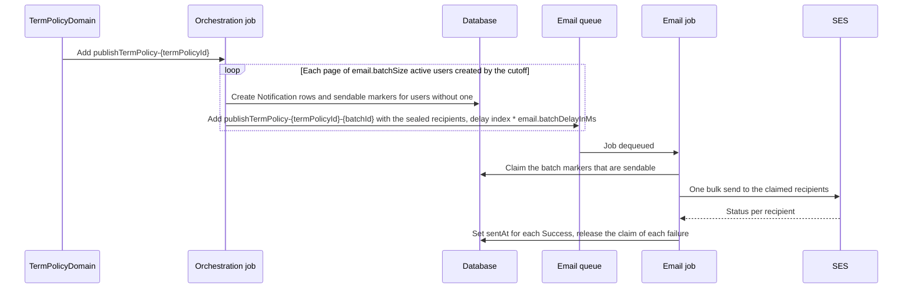
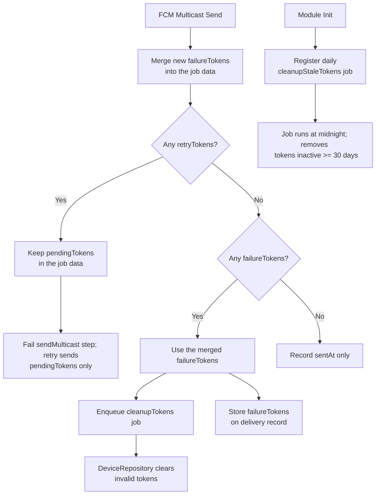

# Notification Documentation

Notification lives in `src/modules/notification`.

## Overview

Three BullMQ queues: orchestration, email, and push.

Key features:

- **Multi-Channel Delivery**: `email`, `push`, `inApp`, and `silent` channels
- **Queue-Based Processing**: Three separate BullMQ queues for orchestration, email, and push, each fed by its own `@Injectable()` queue class in `src/modules/notification/queues/`
- **User Preference Control**: Per type+channel opt-in/out settings for each user, resolved once at enqueue into the job's recipient snapshot
- **Recipient Snapshot**: every orchestration job except the term-policy publication and resend jobs carries who receives it, at which address, on which channels, and to which device tokens, so a processor never re-reads the user
- **AWS SES Email Templates**: Handlebars `.hbs` templates synced to SES, see [Email Documentation][ref-doc-email]
- **Firebase FCM Push**: Multicast delivery with batch chunking, rate limiting, and stale token cleanup
- **Step-Tracked Jobs**: a job records the steps it completed in its own data, so a retry skips the steps recorded as completed
- **Delivery Tracking**:
    - `silent` and `inApp` deliveries are pre-marked at creation time.
    - `push` deliveries record `processedAt` once per job, then `sentAt` and `failureTokens` as the processor runs, and `sentAt` waits until no token is pending retry.
    - `email` deliveries carry no timestamps at all.

## Related Documents

- [Authentication][ref-doc-authentication]: Session management and push token linking
- [Email][ref-doc-email]: SES templates, sync command, and send mapping
- [Third-Party Integration][ref-doc-third-party]: Firebase and AWS SES credentials and the unconfigured state
- [Queue][ref-doc-queue]: Background job processing
- [Configuration][ref-doc-configuration]: App configuration
- [Environment][ref-doc-environment]: Environment variables

## Table of Contents

- [Overview](#overview)
- [Related Documents](#related-documents)
- [Notification Types and Priorities](#notification-types-and-priorities)
- [Notification Channels](#notification-channels)
- [Queue Architecture](#queue-architecture)
    - [Recipient Snapshot](#recipient-snapshot)
    - [Orchestration Queue](#orchestration-queue)
    - [Step Tracking](#step-tracking)
    - [Email Queue](#email-queue)
    - [Push Queue](#push-queue)
    - [Payload Encryption](#payload-encryption)
    - [Job Payloads](#job-payloads)
    - [Term-Policy Publication Email](#term-policy-publication-email)
- [Push Notifications](#push-notifications)
    - [Push Token Management](#push-token-management)
    - [Token Cleanup Strategy](#token-cleanup-strategy)
    - [Retrying Transient Failures](#retrying-transient-failures)
    - [FCM Rate Limiting](#fcm-rate-limiting)
- [Email Notifications](#email-notifications)
- [Delivery Tracking](#delivery-tracking)
- [User Notification Settings](#user-notification-settings)
- [Shared HTTP Endpoints](#shared-http-endpoints)

## Notification Types and Priorities

Defined in `EnumNotificationType`:

| Type | Description |
| --- | --- |
| `userActivity` | General activity events (welcome, email verified, etc.) |
| `securityAlert` | Security-sensitive events (new device login, password change, 2FA reset) |
| `marketing` | Promotional and marketing messages |
| `transactional` | System-driven transactional events (e.g., term policy published) |

Defined in `EnumNotificationPriority`:

| Priority   | Description                                 |
| ---------- | ------------------------------------------- |
| `low`      | Low-priority, non-urgent notifications      |
| `normal`   | Standard informational notifications        |
| `high`     | Important events requiring prompt attention |
| `critical` | Security or time-sensitive events           |

## Notification Channels

Each notification record carries one or more `NotificationDelivery` rows, one per channel. Available channels:

| Channel | Delivery | `processedAt` / `sentAt` |
| --- | --- | --- |
| `email` | Via AWS SES (queued) | Never set. The email channel domains send through SES and do not touch the delivery record |
| `push` | Via Firebase FCM (queued) | Set by the push channel domains: `processedAt` once per job before the first send, `sentAt` once the send completes with no token pending retry |
| `inApp` | In-application UI | Pre-filled at notification creation time |
| `silent` | No external delivery; record-only | Pre-filled at notification creation time |

A notification can target multiple channels simultaneously. `NotificationKindContract` (`src/modules/notification/contracts/notification.kind.contract.ts`) declares which channels an event carries, with one entry per `EnumNotificationKind`, holding:

- the type
- the priority
- the i18n title and body keys
- two channel lists: `pendingChannels` and `deliveredChannels`

`NotificationRepository` reads that entry and creates a delivery row for each of its channels that is also in the recipient's resolved `channels` (see [Recipient Snapshot](#recipient-snapshot)). The `verificationEmail` row of the `welcome` job is the exception: it takes every channel of its kind.

> **`inApp` and `silent` are considered immediately "delivered"**:
>
> - They sit in `deliveredChannels`, so their `processedAt` and `sentAt` are both stamped at creation time in the repository.
> - No separate queue job is needed for them.
> - `email` and `push` sit in `pendingChannels` and go through the async queue.

## Queue Architecture

The notification module uses **three dedicated BullMQ queues**, each with its own processor:

```
NotificationQueue       → EnumQueue.notification       → NotificationProcessor
NotificationEmailQueue  → EnumQueue.notificationEmail  → NotificationEmailProcessor
NotificationPushQueue   → EnumQueue.notificationPush   → NotificationPushProcessor
```

### Recipient Snapshot

The producer takes the delivery decision once, at enqueue, and the job carries it. `NotificationRecipientDomain.getRecipient(user, kind)` builds the snapshot (`INotificationRecipient`):

- `userId`, `email`, and `username` of the recipient
- `notificationTokens`: the distinct device tokens of the user's ownerships that are not revoked and whose device holds a token, read through `DeviceDomain.getOwnershipsWithNotificationToken()`
- `channels`: the channels left for the kind after the user's settings, from `NotificationUtil.resolveChannels`

The domain reads the user's settings and the device tokens concurrently.

`NotificationUtil.resolveChannels(kind, settings)` resolves the channels in this order:

1. It starts from the kind's `pendingChannels` followed by its `deliveredChannels` in `NotificationKindContract`.
2. A kind with `isMandatory` set, or whose type `NotificationSettingContract` does not list, returns that list as it is. The settings do not apply to it and step 4 never runs. Every kind has a pending channel other than `silent`, so that list never holds `silent` alone.
3. Any other kind loses each channel that the settings disable. A setting disables a channel when its type is the kind's type, `isActive` is false, and `NotificationSettingContract` lists the channel for that type. `silent` is listed for no type, so a setting never removes it.
4. When no channel other than `silent` is left, which includes the case where nothing is left, the result is an empty list: no channel and no notification row. Only a kind of a listed type reaches this, and no kind has the `marketing` type, so it is a `userActivity` kind. Its channels other than `silent` are all among `email`, `inApp`, and `push`, which the type lists, so a user who disables them all leaves `silent` alone.

`verificationEmail` is the only mandatory kind.

#### Which jobs carry the snapshot

A snapshot job is a job on the orchestration queue whose payload holds `recipient`. Every process on that queue is one except `publishTermPolicy` and `resendPublishTermPolicy`.

The sealed snapshot (`INotificationRecipientEncryptedPayload`) holds `encryptedEmail`, `username`, `encryptedNotificationTokens`, and `channels`. It has no `userId`: the plain snapshot's `userId` becomes the job's top-level `userId`, which is also the authenticated data of the sealed email and tokens (see [Payload Encryption](#payload-encryption)).

These jobs carry no snapshot:

- The orchestration `publishTermPolicy` and `resendPublishTermPolicy` jobs. They take no snapshot because they page every active user (see [Term-Policy Publication Email](#term-policy-publication-email)).
- The email `publishTermPolicy` batch job. It carries `recipients`, each with its own sealed address.
- The email `workspaceInviteUnregistered` job. The invitee has no account, so there are no settings, tokens, or notification row.
- The push `cleanupTokens` and `cleanupStaleTokens` jobs. They notify no one.

The email and push jobs that a snapshot job enqueues carry a `send` object with the address or tokens copied from the snapshot, not the snapshot itself.

#### How the snapshot travels

1. The domain that raises the event reads the snapshot before any write that does not depend on it, then passes it to the queue class.
2. `NotificationQueue` seals the email address and every device token (see [Payload Encryption](#payload-encryption)) and sets the result as `recipient` in the job data.
3. The orchestration domain reads `recipient.channels`, `username`, and the sealed fields from the job. It reads no user, setting, or device.

What the orchestration domain does with it:

- An empty `channels` list ends the job with a skip message: no `Notification` row and no channel job. `welcome` is the exception below.
- The `Notification` row gets a delivery row for each channel of its kind that is also in `channels`.
- The email job is enqueued when `channels` holds `email`.
- The push job is enqueued when `channels` holds `push` and the snapshot holds at least one token.

#### The welcome job

The `welcome` job writes a `welcome` row and a `verificationEmail` row. Only `verificationEmail` is a mandatory kind, so the two rows follow different channel rules:

1. `recipient.channels` is resolved for the `welcome` kind.
2. The `welcome` row is written only when that list is not empty, with the channels in it.
3. The `verificationEmail` row is always written, with every channel of `NotificationKindContract.verificationEmail`.
4. The welcome email is enqueued only when `channels` holds `email`.
5. The verification email is always enqueued.

A user whose settings leave the `welcome` kind no channel therefore gets no `welcome` row and no welcome email, and still gets the `verificationEmail` row and the verification email.

### Orchestration Queue

**Queue:** `EnumQueue.notification` | **Processor:** `NotificationProcessor` | **Service:** `NotificationProcessorService`

Handles the main event orchestration:

1. `NotificationProcessor` dispatches a consumed job by name to `NotificationProcessorService`.
2. That service unwraps the job payload and hands it to the domain that owns the event.

| Domain                         | Events                                  |
| ------------------------------ | --------------------------------------- |
| `NotificationAccountDomain`    | welcome, verification                   |
| `NotificationSecurityDomain`   | passwords, two-factor, new device login |
| `NotificationTermPolicyDomain` | policy publication and acceptance       |
| `NotificationWorkspaceDomain`  | invites and join requests               |

`NotificationQueue` mints the `notificationId` with `DatabaseUtil.createId()` when it enqueues the job. The id rides in the job payload, so every retry and every channel job names the same record.

That domain then:

1. Reads the recipient snapshot from the job data.
    - An empty `channels` list ends the job with a skip message rather than an error, so the job is not retried. The `welcome` job is the exception (see [The welcome job](#the-welcome-job)).
2. Creates the `Notification` rows, with their delivery rows, through one `NotificationRepository.createMany` call, unless `createNotification` is already in `completedSteps`.
    - `createMany` runs one transaction and creates only the rows whose id does not exist yet. It returns every row, created or found.
    - A job that writes several rows passes them all in that one call. The `welcome` job writes its `welcome` row, when `channels` is not empty, and its `verificationEmail` row together.
    - A failure here ends the run with a failed `createNotification` step, and no channel job is enqueued.
3. Enqueues the `notificationEmail` / `notificationPush` jobs in one `Promise.allSettled` batch, skipping each step already in `completedSteps`.

Step 3 runs after step 2 has committed:

- A queued delivery job always references a record that exists.
- `allSettled` means one channel failing does not stop the other.
- A channel job is only added when its channel is in the snapshot `channels`, and a push job also needs at least one token. The verification email of the `welcome` job is added whatever `channels` holds.
- Each outcome is inspected: a rejected enqueue becomes a failed step (see [Step Tracking](#step-tracking)).

Jobs reach this queue through `NotificationQueue`, which deduplicates on the process name plus whatever identifies that event. Only the publication and resend jobs set a `jobId` on this queue:

| Event | Identifier |
| --- | --- |
| account and security events | the target user |
| a join request and its acceptance or rejection | the workspace and the target user |
| an invite | the invite `reference` |
| an acceptance | the target user and the term policy id |
| a publication | the term policy id, as the BullMQ `jobId` |
| a resend | the term policy id and a resend nonce, as the BullMQ `jobId` |

- The TTL is `notification.dedupTtlInMs` (1 second), so two different events for the same user never collapse into one.
- A publication sets the fixed job id `publishTermPolicy-{termPolicyId}`: BullMQ ignores a second add while that job is kept, which is 7 days after completion and 14 days after failure (`queue.job.removeOnCompleteAgeInSeconds` and `queue.job.removeOnFailAgeInSeconds` in `src/configs/queue.config.ts`).
- A resend sets the job id `resendPublishTermPolicy-{termPolicyId}-{resendNonce}`, unique per resend request, so each request adds its own job (see [Term-Policy Publication Email](#term-policy-publication-email)).

**Supported processes (`EnumNotificationProcess`):**

`EnumNotificationProcess` also names the jobs of the email queue. Every process below runs on this queue except `workspaceInviteUnregistered`, which only the email queue handles.

| Job Name | Description |
| --- | --- |
| `welcomeByAdmin` | Admin-created user welcome |
| `welcome` | Self-registered user welcome + verification email |
| `welcomeSocial` | Welcome for a user created by a social login, enqueued once that login has completed |
| `temporaryPasswordByAdmin` | Temporary password assigned by admin |
| `changePassword` | User changed their password |
| `verifiedEmail` | Email address verified |
| `verifiedMobileNumber` | Mobile number verified |
| `verificationEmail` | Standalone email verification |
| `forgotPassword` | Forgot password request |
| `resetPassword` | Password was reset |
| `newDeviceLogin` | Login detected from a new/unknown device |
| `resetTwoFactorByAdmin` | Admin reset user 2FA |
| `publishTermPolicy` | New term policy published. A bulk process: see [Term-Policy Publication Email](#term-policy-publication-email) |
| `resendPublishTermPolicy` | Publication email resent for a published term policy. A bulk process on the orchestration queue only |
| `userAcceptTermPolicy` | User accepted a term policy |
| `workspaceInvite` | Workspace invite sent to a registered user |
| `workspaceInviteUnregistered` | Workspace invite sent to an address with no account. Email queue only |
| `workspaceJoinRequest` | Workspace join request submitted |
| `workspaceJoinAccepted` | Workspace join request accepted |
| `workspaceJoinRejected` | Workspace join request rejected |

### Step Tracking

Every orchestration job except the bulk `publishTermPolicy` and `resendPublishTermPolicy` jobs, and every push job except the two token-cleanup jobs, records the steps it has finished in its own job data.

`EnumNotificationStep` names the steps:

| Step | Job | Work |
| --- | --- | --- |
| `createNotification` | orchestration | `NotificationRepository.createMany` |
| `sendEmail` | orchestration | enqueue the email job |
| `sendWelcomeEmail` | orchestration, `welcome` | enqueue the welcome email |
| `sendVerificationEmail` | orchestration, `welcome` and `verificationEmail` | enqueue the verification email |
| `sendPush` | orchestration | enqueue the push job |
| `updateProcessAt` | push | stamp `processedAt` on the push delivery |
| `sendMulticast` | push | send through FCM |
| `cleanupTokens` | push | enqueue the `cleanupTokens` job |
| `updateSentAt` | push | stamp `sentAt` and `failureTokens` on the push delivery |

How a run records progress:

1. The producer builds the payload with `completedSteps: []`. A push payload also carries `encryptedFailureTokens: null` and `encryptedPendingTokens: null`.
2. The domain skips each step already in `completedSteps` and returns an `INotificationStepResult`: a `message`, the `completedSteps`, and the `failedSteps` (each a step and an error string). A push domain adds `encryptedFailureTokens` and `encryptedPendingTokens`.
3. The processor service writes `completedSteps` back with `job.updateData` (plus `encryptedFailureTokens` and `encryptedPendingTokens` for push). It writes before it decides whether the run failed.
4. When `failedSteps` is not empty, the processor service throws `QueueException(summary, true)`. The summary reads `Notification steps failed: sendEmail:<error>, sendPush:<error>`.

Behavior of a retried run:

- A failed step does not stop its siblings: the steps of one run settle together and each outcome is read.
- BullMQ runs a job at most `queue.job.attempts` (3) times in total, the first run included, and retries each failed run until then. The retry skips every step in `completedSteps` and runs the rest.
- `updateProcessAt` is outside the step outcomes. A missing notification row makes it throw out of the domain, so the run fails with no failed step and no `completedSteps` write, and BullMQ retries the job.
- `isFatal` is `true`, so Sentry receives the report on the last attempt only.
- A crash between the commit of `createMany` and the `updateData` write leaves `completedSteps` empty. The retry calls `createMany` again, which creates nothing and does not throw.
- `updateProcessAt` runs once per job:
    - The push domain adds it to `completedSteps` once the write succeeds, and a retry skips it.
    - `processedAt` therefore holds the time of the first attempt whose write succeeded.
- A multicast whose failed tokens are all invalid is not a failed step. The invalid tokens go to `encryptedFailureTokens` and the job succeeds.
- A multicast that leaves tokens in `retryTokens` fails the `sendMulticast` step with the error `<n> tokens pending retry`. See [Retrying Transient Failures](#retrying-transient-failures).
- A skip (Firebase not initialized) returns a message with no failed step, so the job completes.

The job id of a channel job is `{notificationId}-{step}`, from `NotificationStepJobIdPattern`:

- A push job is `{notificationId}-sendPush`.
- A `cleanupTokens` job is `{notificationId}-cleanupTokens`.
- An email job for a recipient with an account is `{notificationId}-sendEmail`, `{notificationId}-sendWelcomeEmail`, or `{notificationId}-sendVerificationEmail`, by process (see [Email Queue](#email-queue)).
- BullMQ ignores an add whose job id still exists in the queue, so a retry that re-enqueues a step never doubles the job.
    - A finished job stays in the queue: each notification queue factory keeps a completed job for `queue.job.removeOnCompleteAgeInSeconds` (7 days) and a failed job for `queue.job.removeOnFailAgeInSeconds` (14 days).
    - The guarantee holds while the earlier job is kept. Once BullMQ removes it, the id can be added again.

### Email Queue

**Queue:** `EnumQueue.notificationEmail` | **Processor:** `NotificationEmailProcessor` | **Service:** `NotificationEmailProcessorService`

Rate-limited to match the AWS SES sending quota (`AwsSESRateLimitPerDuration` per `AwsSESRateLimitDurationInMs`).

`NotificationEmailProcessorService` routes each job to the email channel domain that owns it:

- `NotificationEmailAccountDomain`
- `NotificationEmailSecurityDomain`
- `NotificationEmailTermPolicyDomain`
- `NotificationEmailWorkspaceDomain`

That domain:

- opens the sealed address and any sealed field of the job just before the SES call (see [Payload Encryption](#payload-encryption))
- calls `AwsSESService.send()` or `AwsSESService.sendBulk()` using the named SES template for that event
- merges `defaultTemplateData` (`homeName`, `supportEmail`, `homeUrl`) automatically

Jobs reach this queue through `NotificationEmailQueue`:

- Every email job except the publication batch uses BullMQ's `deduplication` option, on the same identifiers the orchestration queue uses.
- A publication batch job uses a fixed BullMQ `jobId` (term policy id plus batch id, plus the resend nonce on a resend): BullMQ ignores a second add of the same id while the job is kept, which is 7 days after completion and 14 days after failure (`queue.job.removeOnCompleteAgeInSeconds` and `queue.job.removeOnFailAgeInSeconds` in `src/configs/queue.config.ts`).
- An email job for a recipient with an account also carries the step-based `jobId` `{notificationId}-{step}` (see [Step Tracking](#step-tracking)):
    - `-sendEmail` for every process except the three below.
    - `-sendWelcomeEmail` for `welcome`, with the id of the welcome row.
    - `-sendVerificationEmail` for `verificationEmail`, with the id of its own row.
    - `-sendVerificationEmail` for the second email of `welcome`, with `verificationNotificationId`, the id of the second row: `{verificationNotificationId}-sendVerificationEmail`.
- The `workspaceInviteUnregistered` job has no notification id and no step-based `jobId`.
- Both options sit on one `add`, and BullMQ ignores the add when the job id still exists or when the deduplication id is still within its TTL.

| Identifier | Processes |
| --- | --- |
| target user | account and security events |
| invite `reference` | the two invite emails |
| workspace and target user | a join request, a join acceptance, a join rejection |
| term policy id, batch id, and on a resend the resend nonce | a publication batch, as the fixed `jobId` |

Most templates use `notification.dedupTtlInMs` (1 second). A template carrying a time-limited link uses the config value matching that link's expiry or resend window instead:

| Process                | Config                      |
| ---------------------- | --------------------------- |
| `verificationEmail`    | `verification.expiredInMs`  |
| `verifiedMobileNumber` | `verification.resendInMs`   |
| `forgotPassword`       | `forgotPassword.resendInMs` |

### Push Queue

**Queue:** `EnumQueue.notificationPush` | **Processor:** `NotificationPushProcessor` | **Service:** `NotificationPushProcessorService`

Rate-limited to `FirebaseMaxRateLimitPerDuration` (500,000) per `FirebaseRateLimitDurationInMs` (60 seconds), which stays under the FCM 600k/min ceiling.

`NotificationPushProcessorService` routes each job to the push channel domain that owns it:

- `NotificationPushSecurityDomain` for the forgot-password, password, two-factor and new-device messages
- `NotificationPushWorkspaceDomain` for the invite and join-request messages
- `NotificationPushMaintenanceDomain` for the two token-cleanup jobs

The push channel domain opens the sealed device tokens just before the FCM call (see [Payload Encryption](#payload-encryption)).

**Supported push processes (`EnumNotificationPushProcess`):**

| Job Name                   | Description                                |
| -------------------------- | ------------------------------------------ |
| `newDeviceLogin`           | Push alert for new device login            |
| `forgotPassword`           | Push alert for a forgot-password request   |
| `resetPassword`            | Push alert when password is reset          |
| `resetTwoFactorByAdmin`    | Push alert when admin resets 2FA           |
| `temporaryPasswordByAdmin` | Push alert for temporary password          |
| `workspaceInvite`          | Push alert for a workspace invite          |
| `workspaceJoinRequest`     | Push alert for a workspace join request    |
| `workspaceJoinAccepted`    | Push alert when a join request is accepted |
| `workspaceJoinRejected`    | Push alert when a join request is rejected |
| `cleanupTokens`            | Remove reported invalid FCM tokens         |
| `cleanupStaleTokens`       | Clean up tokens inactive for ≥ 30 days     |

On `onModuleInit`, `NotificationPushProcessorService` calls `NotificationPushQueue.sendCleanupStaleTokens()`:

- It registers a recurring `cleanupStaleTokens` job via BullMQ `upsertJobScheduler`.
- The cron is `0 0 * * *` from `notification.push.cleanupStaleTokensCron`, in the app's configured timezone.
- The scheduler carries no `immediately` option, so the first sweep waits for the first cron tick.

### Payload Encryption

A job payload sits in Redis until a worker consumes it, so the queue classes seal every secret-bearing field before `add()`, and only the channel domain that makes the external call opens it.

Each field is sealed with `HelperEncryptionService.aes256Encrypt` under:

- `app.encryptionSecretKey` (`APP_ENCRYPTION_SECRET_KEY`)
- the purpose `NotificationPayloadEncryptionPurpose` (`notification.payload`)
- the recipient as authenticated data, so a sealed value copied into another recipient's job fails to open

| Sealed field | Plain input | Processes | Authenticated data |
| --- | --- | --- | --- |
| `encryptedEmail` | the recipient address | every orchestration job that carries a `recipient` (inside `recipient`; the `publishTermPolicy` and `resendPublishTermPolicy` jobs carry none), every email job, and each recipient of a `publishTermPolicy` batch | recipient `userId` |
| `encryptedEmail` | the invitee address | `workspaceInviteUnregistered` (email queue only) | invite `reference` |
| `encryptedNotificationTokens` | the device tokens | every orchestration job that carries a `recipient` (inside `recipient`; the `publishTermPolicy` and `resendPublishTermPolicy` jobs carry none) and every push job | recipient `userId` |
| `encryptedFailureTokens`, `encryptedPendingTokens` | the invalid and the retryable tokens of a send | push jobs, and `cleanupTokens` for the failure tokens | recipient `userId` |
| `encryptedPassword` | `password` | `welcomeByAdmin`, `temporaryPasswordByAdmin` | recipient `userId` |
| `encryptedLink` | `link` | `welcome`, `verificationEmail`, `forgotPassword` | recipient `userId` |
| `encryptedInviteAcceptLink` | `inviteAcceptLink` | `workspaceInvite` | invited `userId` |
| `encryptedInviteAcceptLink` | `inviteAcceptLink` | `workspaceInviteUnregistered` (email queue only) | invite `reference` |
| `encryptedJoinRequestReviewLink` | `joinRequestReviewLink` | `workspaceJoinRequest` | reviewer `userId` |

Who seals:

- `NotificationQueue` seals the recipient snapshot and the secret fields of the orchestration jobs. The orchestration domains pass the sealed values through to the email and push jobs unopened.
- `NotificationEmailQueue` seals the invite address and invite link of `workspaceInviteUnregistered`, which skips the orchestration queue, and the address of each recipient of a `publishTermPolicy` batch.
- `NotificationPushQueue` builds each push payload from an explicit field list (`INotification*PushPayload`) that leaves out passwords and links. The tokens ride in `send` as sealed values.
- `username` stays plain in the snapshot and in every `send`.
- The sealed type of a payload carries the `Encrypted` infix (`INotificationRecipientEncryptedPayload`, `INotificationWelcomeByAdminEncryptedPayload`).

Who opens:

- An email channel domain opens the address and the sealed link or password right before `AwsSESService.send()` or `sendBulk()`. The value goes into the send call and the template data only.
- A push channel domain opens the tokens right before `FirebaseService.sendMulticast()`. It keeps the failure and pending tokens sealed in the job data, and opens the failure tokens again to store them on the delivery record.
- `NotificationPushMaintenanceDomain` opens the failure tokens of a `cleanupTokens` job before it clears them on the devices.

A payload that fails to open (a rotated key, a tampered value, the wrong recipient) raises `HelperDecryptFailedException` (`52200`):

- Inside `handle`, `NotificationEmailProcessor` and `NotificationPushProcessor` map that to a BullMQ `UnrecoverableError`, so the job fails at once without retries.
- `NotificationEmailProcessor` maps `NotificationEmailDeliveryUnknownException` the same way, keeping the exception as the `cause`.
- `QueueProcessorBase.onFailed` counts an `UnrecoverableError` as the last attempt and reports it to Sentry.
- Every other failure fails the job and is retried. A `QueueException`, an `AppBaseException`, or an `UnrecoverableError` passes through, and anything else is wrapped in `AppUnknownException`.

### Job Payloads

Orchestration, email, and push jobs carry an envelope, and `data` holds the extra fields of the process.

- `data` is `null` when the process carries none.
- Three kinds of job have a different shape: the bulk `publishTermPolicy` and `resendPublishTermPolicy` jobs, `cleanupTokens`, and `cleanupStaleTokens`.

| Queue | Payload |
| --- | --- |
| Orchestration | `{ userId, notificationId, completedSteps, recipient, proceedBy, data }`, with `recipient` as `{ encryptedEmail, username, encryptedNotificationTokens, channels }` |
| Orchestration, `publishTermPolicy` and `resendPublishTermPolicy` (bulk) | `{ proceedBy, data: { termPolicyId, type, version, recipientCutoffAt, resendNonce } }`, with no `userId` and no `recipient`: `NotificationTermPolicyDomain.processPublishTermPolicy` pages the recipients |
| Email | `{ send: { userId, notificationId, encryptedEmail, username, cc, bcc }, data }` |
| Email, `publishTermPolicy` (bulk) | `{ data: { termPolicyId, type, version, recipientCutoffAt, resendNonce }, batchId, proceedBy, recipients }`, one job per batch of up to `email.batchSize` users, with no `send` list: `recipients` holds `{ userId, notificationId, encryptedEmail, username }` for each user of the batch |
| Email, recipient without an account | `{ send: { encryptedEmail, cc, bcc }, data }` |
| Push | `{ send: { userId, notificationId, encryptedNotificationTokens, username }, data, completedSteps, encryptedFailureTokens, encryptedPendingTokens }` |
| Push, `cleanupTokens` | `{ userId, encryptedFailureTokens }` |
| Push, `cleanupStaleTokens` | `{}` |

- `notificationId` is minted by `NotificationQueue` at enqueue. `completedSteps` starts as an empty array (see [Step Tracking](#step-tracking)).
- `resendNonce` is `null` in a `publishTermPolicy` job and a `DatabaseUtil.createId()` value in a `resendPublishTermPolicy` job. The email batch jobs of that run carry the same value.
- `recipient` is the sealed [Recipient Snapshot](#recipient-snapshot), without `userId`, which sits beside it at the top level of the job. The orchestration domain copies `encryptedEmail` and `username` into the `send` of the email job, and `encryptedNotificationTokens` and `username` into the `send` of the push job.
- The `welcome` job's `data` also carries `verificationNotificationId`, the id of the second row the job writes. The verification email job id is built from it: `{verificationNotificationId}-sendVerificationEmail`.
- `proceedBy` is the id of the user whose action raised the event.
- The orchestration domains store `proceedBy` as `createdBy` on the `Notification` row.
- Its value by process:
    - the admin for the `ByAdmin` processes
    - the publisher for `publishTermPolicy`
    - the admin who requested the resend for `resendPublishTermPolicy`
    - the inviter for `workspaceInvite`
    - the requester for `workspaceJoinRequest`
    - the reviewer for `workspaceJoinAccepted` and `workspaceJoinRejected`
    - the recipient for every self-triggered event, where it equals `userId`
- `cc` and `bcc` are always arrays, empty when there is no copy recipient.
    - The queue class puts them on the job.
    - The email channel domain passes each non-empty list to `AwsSESService.send()`.
- A bulk email job carries its recipients in the payload.
    - `NotificationEmailProcessorService` passes `data`, `batchId`, `proceedBy`, and `recipients` to the email channel domain.
    - The email channel domain claims the recipients whose marker is sendable and calls `AwsSESService.sendBulk()` once. See [Term-Policy Publication Email](#term-policy-publication-email).
- `cleanupStaleTokens` is the job the `upsertJobScheduler` call registers. Its data is an empty object, and the 30-day threshold is read from config when the job runs.
- A sealed field replaces its plain input, with the `encrypted` prefix (`encryptedPassword` for `password`, `encryptedEmail` for the address, and so on, as in [Payload Encryption](#payload-encryption)).
    - A secret process field sits inside `data`.
    - The address and the tokens sit in `recipient` and `send`.
    - Redis therefore holds only the ciphertext of each.

### Term-Policy Publication Email

Publishing a term policy queues one `publishTermPolicy` orchestration job, and an admin resend request queues one `resendPublishTermPolicy` job. Either job fans out to one email job per batch of users.

**Recipients:**

- Every user whose `status` is `active` and who is not deleted, created at or before the term policy's `publishedAt`, is a candidate. A user with any other status is not.
    - `TermPolicyDomain` sends `publishedAt` in the job data as `recipientCutoffAt`, so every attempt and every re-added batch reads the same candidate set.
- Each candidate gets at most one marker, and so one `Notification` row, per term policy.
- The user's notification setting does not apply: the row carries every channel of the kind, and the job takes no recipient snapshot.
- `TermPolicyRecipient` (collection `TermPolicyRecipients`), owned by `NotificationRepository`, holds one marker per user and term policy, unique on `termPolicyId` and `userId`.
- A marker records the `notificationId`, the `batchId`, and the `sentAt`, `claimedAt`, and `claimNonce` fields. A marker is in one of three states:
    - Sendable: `sentAt` and `claimedAt` are both null.
    - Claimed: `claimedAt` is set and `sentAt` is null. A marker stays claimed until it is marked sent or released after a definite failure.
        - An email job holds the claim.
        - The send ended with an unknown outcome.
        - The worker stalled or crashed between the claim and the `sentAt` write.
        - The release write after a failed send did not land.
        - A resend does not reach a claimed marker.
    - Sent: `sentAt` is set.



**Publish:**

1. `TermPolicyDomain` reads the policy. A `published` policy answers `400` (`statusInvalid`) and enqueues nothing.
2. A `draft` policy publishes: the contents are copied to the public bucket, then one transaction runs an `updateMany` that matches the policy only while its status is `draft`, rewrites the contents, and resets the acceptances of the policy type.
3. Publish enqueues the job through `NotificationQueue.sendPublishTermPolicy`, with the `jobId` `publishTermPolicy-{termPolicyId}` (`NotificationTermPolicyPublishJobIdPattern`).

The enqueue is a plain `add`:

- BullMQ ignores an `add` while a job holds the `jobId`. A completed job keeps its id for `queue.job.removeOnCompleteAgeInSeconds` (7 days) and a failed job for `queue.job.removeOnFailAgeInSeconds` (14 days).
- `NotificationQueue` reads no job state, retries nothing, removes nothing, and returns no result.

What the publish guarantees:

- The `updateMany` separates two concurrent publishes of one draft: one commits.
- The losing publish answers `400` (`statusInvalid`) in both cases:
    - when its `updateMany` runs after the winner commits.
    - when the two transactions overlap. MongoDB raises a write conflict (`P2034`), nothing retries it, and `TermPolicyDomain` maps `DatabaseWriteConflictException` to `TermPolicyStatusInvalidException` (see [Database][ref-doc-database]).
- A write conflict from a concurrent user write during the acceptance reset gets the same answer: the policy stays `draft`, nothing is queued, and the admin publishes again.
- A copy set that misses a language of the draft throws before the transaction. The request answers `500` and the policy stays `draft`, so a partial copy set never publishes.
- A failed queue call answers `500`.
- The marker unique on `termPolicyId` and `userId` stops a duplicate `Notification` row and a second batch for one user.
- A recipient is sent to at most once: an email job claims a marker before it sends (see the email job below).

**Resend:**

An admin resend request (`POST /admin/term-policy/resend/:termPolicyId/email`, `TermPolicyAdminController.resendEmail`) runs the fan-out again for a published policy:

1. `TermPolicyDomain.resendEmailByAdmin` reads the policy. A policy that is not `published` answers `400` (`statusInvalid`).
2. It calls `NotificationQueue.sendResendPublishTermPolicy`. That method mints a `resendNonce` with `DatabaseUtil.createId()` and adds a `resendPublishTermPolicy` job.
    - The job id is `resendPublishTermPolicy-{termPolicyId}-{resendNonce}` (`NotificationTermPolicyResendJobIdPattern`).
    - The job data carries the same `recipientCutoffAt` as the publication, and the nonce as `resendNonce`.
3. `NotificationProcessor` routes `resendPublishTermPolicy` to the same fan-out as `publishTermPolicy`.
4. The email jobs of a resend keep the job name `publishTermPolicy`. Their job id is `publishTermPolicy-{termPolicyId}-{batchId}-{resendNonce}` (`NotificationTermPolicyBatchResendJobIdPattern`).

Each request carries a new nonce, so no job id collides with an earlier run. The claim on the marker keeps delivery at most once per recipient.

**Orchestration job:**

1. Reads the recipients (`id`, `email`, `username`) of active users created at or before `recipientCutoffAt`, through `UserDomain.getListActiveRecipientCursor`, in pages of `email.batchSize`, ordered by `id` with an `id` cursor.
2. Reads the markers that already exist for the page.
3. Sorts the page:
    - A user with no marker is new.
    - A sendable marker puts its batch among the pending batches of the page.
    - A claimed or sent marker adds nothing.
4. Creates, for the new users and in one transaction, a `Notification` row each (kind `publishTermPolicy`, email delivery pending) and a sendable marker, all under one new `batchId`.
5. Adds one email job per new batch and one per pending batch.
    - The job id is `publishTermPolicy-{termPolicyId}-{batchId}`, or the resend id above when the job data carries a `resendNonce`.
    - The payload is `{ data, batchId, proceedBy, recipients }`.
    - A pending batch keeps its stored `batchId`, and its recipients are the sendable markers of that batch only.
    - The recipients come from the users of the page and, for markers on no page of this run, from `UserDomain.getManyActiveRecipientsByIds` under the same cutoff. A marker whose user is no longer active or was deleted is left out of the payload.
    - `NotificationEmailQueue` seals each recipient address, with the user id as authenticated data.
    - The delay is `index * email.batchDelayInMs`, where `index` counts the email jobs of the run across pages. The pending batches of a page take the first indexes, then the new batch.

A batch whose job was never added keeps its sendable markers, so a later attempt or a resend adds it.

Attempts:

- `NotificationQueueFactory` gives the job `queue.job.attempts` (3) attempts in total.
- The retry backoff is exponential from `queue.job.notificationBackoffDelayInMs` (3 seconds).
- Each attempt starts again from the first page, with `index` at 0.

On a new attempt:

- A user who already has a marker gets no second marker and no second `Notification` row.
- A batch with sendable markers gets its email job added again under the same job id.
    - BullMQ ignores the add while the original job exists, so the original job and its original delay stand.
    - When the original job is gone, the new job takes the delay `index * email.batchDelayInMs`.
- A batch with only claimed or sent markers adds no job.

On a resend, the fan-out starts from the first page and creates no new row for a user who already has a marker. Each batch with sendable markers gets a new email job under the new nonce.

When the job exhausts its attempts:

- Users after the failing page get no marker and no email job.
- Pages before the failing one keep their markers and email jobs.
- Nothing retries the job automatically.
- The failed job stays in the queue for `queue.job.removeOnFailAgeInSeconds` (14 days).
- `QueueProcessorBase.onFailed` reports the final failure to Sentry.
- An admin resend request runs the fan-out again.

**Email job:**

1. Completes at once when SES is unconfigured (`AwsSESService.isInitialized()` is false). No marker changes.
2. Opens the sealed address of each payload recipient.
3. Claims the sendable markers of the payload recipients in the batch: one `updateMany` sets `claimedAt` and a fresh `claimNonce` on them, then the job reads the markers that carry its nonce.
    - With none claimed, the job completes.
4. Makes one `AwsSESService.sendBulk()` call for the claimed recipients with the `publishTermPolicy` template, passing `type` and `version` as default template data.
5. Reads the SES status of each claimed recipient:
    - `Success`: sent.
    - A missing status: unknown.
    - Any other status: failed.
6. Sets `sentAt` on the sent markers, and clears `claimedAt` and `claimNonce` on the failed markers. Both writes match on the claim nonce and run together.
    - When either write fails, the job throws `AppUnknownException` and BullMQ retries it. A marker not written stays claimed.
7. Throws a fatal `QueueException` when any recipient failed. BullMQ retries the job, and the retry claims the released markers.
8. Throws `NotificationEmailDeliveryUnknownException` when any recipient is unknown and none failed.

The send ends with an unknown outcome in two more cases: `sendBulk()` throws, or the `Status` list is empty, absent, or a different length from the claimed recipients. Every claimed marker stays claimed and the job throws `NotificationEmailDeliveryUnknownException`.

On a failed or retried job:

- A marker stays claimed until it is marked sent or released after a definite failure. No other job claims a claimed marker, so a recipient is sent to at most once.
    - When the worker stalls or crashes between the claim and the `sentAt` write, the markers stay claimed and no later run sends to them.
- When a send has both failed and unknown recipients, the failed ones win: the job retries, and the unknown markers stay claimed.
- `NotificationEmailProcessor` maps `NotificationEmailDeliveryUnknownException` to a BullMQ `UnrecoverableError` that keeps the exception as its `cause`. The job gets no retry and counts as the last attempt (see [Payload Encryption](#payload-encryption)).
- `queue.job.attempts` (3) is the number of attempts in total, with an exponential backoff from `queue.job.emailBackoffDelayInMs` (10 seconds).
- A fatal `QueueException` is retried like any other failure.
- `isFatal` decides only Sentry reporting.
- `QueueProcessorBase.onFailed` reports a fatal exception after the last attempt.
- A non-fatal `QueueException` is never reported.

**Configuration:**

- `email.batchSize` is 50.
    - It is the SES cap of destinations per bulk call.
    - It is the page size of the orchestration job.
    - It is the number of recipients per email job.
- `email.batchDelayInMs` (1 second) is the step of the per-job BullMQ `delay`.

## Push Notifications

### Push Token Management

Push tokens (FCM device tokens) are part of the **Device module** (`src/modules/device`), not stored in the notification module directly.

- `NotificationRecipientDomain` reads them through `DeviceDomain.getOwnershipsWithNotificationToken()`, which calls `DeviceOwnershipRepository.findTokensByUserId()`, when the producer builds the [Recipient Snapshot](#recipient-snapshot).
- The snapshot keeps the distinct tokens, and `NotificationQueue` seals them as `encryptedNotificationTokens`.
- The orchestration domain places them on the push job as `send.encryptedNotificationTokens`.
- The push channel domain opens them and sends to the tokens it receives on the job.
- The lookup returns only device ownerships that are not revoked and whose device holds a token, so a revoked ownership never receives a push.

For push token registration, revocation, and session-linking details, see the [Device documentation][ref-doc-device].

### Token Cleanup Strategy

After each multicast send, `FirebaseService.sendMulticast()` returns `failureTokens`: the tokens that FCM identified as invalid. A token is invalid when its response error code is in `FirebaseInvalidTokenCodes`:

- `messaging/invalid-registration-token`
- `messaging/registration-token-not-registered`
- `messaging/mismatched-credential`

A response with any other code, such as `messaging/invalid-argument` for a bad payload, is a plain failure. It counts only in the `failureCount` of the result, and its token is neither purged nor retried.

The invalid tokens go through three steps:

1. Merged into the `encryptedFailureTokens` of the push job data after every send, including a send that leaves tokens pending. The job data holds them sealed. Once the `sendMulticast` step is complete, a retry of a later step reuses them without sending again.
2. Once no token is pending, queued as a `cleanupTokens` job in `EnumQueue.notificationPush` through `NotificationPushQueue.sendCleanupTokens()`.
    - The job id is `{notificationId}-cleanupTokens`. The job carries no deduplication option.
    - The payload is `{ userId, encryptedFailureTokens }`.
    - A send with no invalid token enqueues nothing.
    - `NotificationPushMaintenanceDomain.processCleanupTokens()` handles it.
    - It opens the sealed tokens and calls `DeviceDomain.cleanupNotificationTokens()`, which resolves the user's devices holding those tokens through `DeviceOwnershipRepository.findDeviceIdsByUserAndTokens()`.
    - It clears `notificationToken` and `notificationProvider` on them through `DeviceRepository.clearTokens()`.
3. Once no token is pending, opened and stored on the delivery record via `NotificationRepository.updateSentAt()` (`failureTokens` field), as plain tokens.

Stale tokens are those whose device has no `lastActiveAt` activity within `notification.push.staleTokenThresholdInMs` (30 days). The recurring `cleanupStaleTokens` job registered at startup prunes them daily:

1. `NotificationPushMaintenanceDomain` reads that config value.
2. It passes the value to `DeviceDomain.cleanupStaleNotificationTokens(thresholdInMs)`.
3. That calls `DeviceRepository.clearStaleTokens(thresholdInMs)`, which clears `notificationToken` and `notificationProvider` on every device past the threshold.



### Retrying Transient Failures

`FirebaseService.sendMulticast()` also returns `retryTokens`: the tokens whose send failed for a reason that may pass.

A token lands in `retryTokens` under one of three conditions:

1. Its response error code is in `FirebaseRetryableTokenCodes`:
    - `messaging/server-unavailable`
    - `messaging/internal-error`
    - `messaging/message-rate-exceeded`
    - `messaging/device-message-rate-exceeded`
    - `messaging/unknown-error`
    - `app/network-error`
    - `app/network-timeout`
2. Its response carries no error code.
3. The request of its chunk rejected, which puts every token of that chunk there.

A token is never in both `failureTokens` and `retryTokens`.

The push job keeps the retry tokens as `encryptedPendingTokens`, sealed:

1. `sendMulticastStep` in the push channel domain opens and sends to `encryptedPendingTokens` when the job carries them, and to all `encryptedNotificationTokens` when `encryptedPendingTokens` is `null`.
    - An empty `encryptedPendingTokens` array counts as carried: it selects no recipient, `sendMulticast()` returns without calling FCM, and the step completes.
    - The array is empty only after a send that left nothing pending.
2. It merges the new `failureTokens` into the `encryptedFailureTokens` the job already holds, without duplicates.
3. It stores the new `retryTokens` as `encryptedPendingTokens`.
4. When any token is pending, the `sendMulticast` step fails with the error `<n> tokens pending retry`. The step stays out of `completedSteps`, and BullMQ retries the job.
5. When none is pending, the step completes. Only then do `cleanupTokens` and `updateSentAt` run, so `sentAt` is stamped once nothing is pending.

A run that fails a step writes `completedSteps`, the merged `encryptedFailureTokens`, and the new `encryptedPendingTokens` back to the job data before it throws. A retry therefore sends only to the tokens still pending.

The retry schedule comes from the push queue options:

- `queue.job.attempts` (3) is the number of runs in total.
- The backoff is exponential from `queue.job.pushBackoffDelayInMs` (5 seconds).

When the attempts run out with tokens still pending:

1. The job ends failed with the last `QueueException`, whose summary reads `Notification steps failed: sendMulticast:<n> tokens pending retry`.
2. Sentry receives one report, on the last attempt only, because the exception is fatal.
3. The `cleanupTokens` step never runs, so the invalid tokens found are not purged from the devices.
4. The `updateSentAt` step never runs, so `sentAt` stays null and the delivery keeps an empty `failureTokens`.
5. The failed job keeps its data, including the pending and invalid tokens, for `queue.job.removeOnFailAgeInSeconds` (14 days). Nothing retries it afterwards.

### FCM Rate Limiting

The push processor is configured with a BullMQ rate limiter:

```typescript
@QueueProcessor(EnumQueue.notificationPush, {
    limiter: {
        max: FirebaseMaxRateLimitPerDuration,   // 500,000
        duration: FirebaseRateLimitDurationInMs, // 60,000 ms
    },
})
```

`FirebaseService.sendMulticast()` also enforces chunking:

- A per-call chunk size of at most `FirebaseMaxSendPushBatchSize` (500) tokens per FCM `sendEachForMulticast` call.
- Chunks are processed via `Promise.allSettled`.
- A chunk size outside 1 to 500 raises `FirebaseChunkSizeInvalidException` (500, `52300`).

With Firebase unconfigured:

- `FirebaseService` stays uninitialized.
- The push channel domains skip every send (see [Delivery Tracking](#delivery-tracking)).

For Firebase configuration, see [Third-Party Integration: Firebase][ref-doc-third-party].

## Email Notifications

Handlebars templates, SES sync (`templateEmailNotification`), and how channel domains call `AwsSESService`: [Email Documentation][ref-doc-email].

The email queue, rate limits, dedup, and sealed payload fields stay in this document under [Email Queue](#email-queue) and [Payload Encryption](#payload-encryption).

## Delivery Tracking

Each `Notification` record has related `NotificationDelivery` rows in `NotificationDeliveries` (one per channel, via `notificationId`). Delivery fields:

| Field | Description |
| --- | --- |
| `processedAt` | When the push job first started handling the delivery: the `updateProcessAt` step writes it once and a retry does not overwrite it. Written for `push`, pre-filled for `silent` / `inApp`, never written for `email` |
| `sentAt` | When the `updateSentAt` step ran, after a send that left no token pending retry. On a job that retried, it is the attempt that cleared the last pending token. Stays null when the attempts run out with tokens pending. Same coverage as `processedAt` |
| `failureTokens` | FCM tokens that were invalid (push channel only) |

### Immediate channels (`silent`, `inApp`)

- `silent` and `inApp` deliveries have `processedAt` and `sentAt` both pre-filled with the current timestamp **at notification creation time** inside `NotificationRepository`.
- No queue job is dispatched for them.

### Async channels (`email`, `push`)

`email` and `push` deliveries are created with no timestamps and go through the queue.

**Only the push channel writes them back.**

- The email channel domains send through SES and never read or update the delivery record.
- An `email` delivery row therefore keeps `processedAt` and `sentAt` null for its whole life.
- A null `sentAt` on an `email` row says nothing about delivery.

The push lifecycle:

```mermaid
sequenceDiagram
    participant Q as Queue
    participant P as Push channel service
    participant DB as Database
    participant FCM as Firebase

    Q->>P: Job dequeued
    P->>P: Skip when Firebase is not initialized
    P->>DB: updateProcessAt (processedAt = now), once per job
    P->>FCM: sendMulticast with the opened tokens
    FCM-->>P: result with failureTokens and retryTokens
    P->>P: Merge failureTokens into the job data
    alt Any retryTokens
        P->>Q: Keep pendingTokens, fail the sendMulticast step, retry; sentAt stays null
    else Nothing pending
        P->>Q: Add cleanupTokens job, when any token is invalid
        P->>DB: updateSentAt (sentAt = now, failureTokens)
    end
```

The skip returns a message rather than throwing, so a push job on a deployment with Firebase disabled completes instead of being retried.

- `updateProcessAt` is an `update` on the delivery row, and the push message renders from the job data. A missing notification row makes it throw, and the job retries.
- Once the write succeeds, `updateProcessAt` is in `completedSteps`, and a retry does not repeat it.
- `sendMulticast` is skipped on a retry when it is in `completedSteps`. The invalid tokens come from the job data, which holds them after a send that completed.
- A retry of a `sendMulticast` that left tokens pending sends to `pendingTokens` only.
- The `cleanupTokens` enqueue and `updateSentAt` settle together, and each is recorded on its own (see [Step Tracking](#step-tracking)).

The email lifecycle is only: job dequeued, sealed fields opened, `AwsSESService.send()` or `sendBulk()`, done.

- With SES unconfigured, both calls log a warning and return an empty output, so the job completes and no email leaves.
- A send failure of a per-recipient email job is logged and fails the job, so it retries under the queue's own retry policy. The processor wraps an untyped error in `AppUnknownException`.
- A term-policy bulk batch is the exception: a throwing `sendBulk()` is an unknown outcome and is not retried (see [Term-Policy Publication Email](#term-policy-publication-email)).
- A field that fails to open ends the job without retries (see [Payload Encryption](#payload-encryption)).

## User Notification Settings

- Users control which notification channels are active per type.
- `NotificationUserSetting` stores the settings, one row per `userId + type + channel`.
- The settings apply when a producer builds the [Recipient Snapshot](#recipient-snapshot): a channel the user disabled for the type is absent from the job's `channels`, and a change made after the enqueue does not reach a job already queued.

The settings do not apply to:

- A kind marked `isMandatory`: only `verificationEmail`, including the `verificationEmail` row of the `welcome` job.
- A kind whose type `NotificationSettingContract` does not list: every `securityAlert` and `transactional` kind.
- The `silent` channel: it is listed for no type, so a setting never removes it.
- The term-policy publication: the job takes no snapshot, and each row carries every channel of the kind.
- The `workspaceInviteUnregistered` email: the invitee has no account and so no settings.
- The two token-cleanup jobs: they notify no one.

Allowed type+channel combinations are defined in `NotificationSettingContract` (`src/modules/notification/contracts/notification.setting.contract.ts`):

| Type           | Allowed Channels         |
| -------------- | ------------------------ |
| `userActivity` | `email`, `inApp`, `push` |
| `marketing`    | `email`, `push`          |

- `NotificationDomain.updateUserSetting()` validates the requested combination before writing.
- Invalid combinations throw `NotificationInvalidTypeException` or `NotificationInvalidChannelException`.

The request DTO (`NotificationUserSettingRequestDto`) accepts:

- `type`: `userActivity` | `marketing`
- `channel`: `email` | `push` | `inApp`
- `isActive`: `boolean`

## Shared HTTP Endpoints

Under router prefix `/shared` and controller path `/notification` (plus global `/api` and version `v1`):

| Method | Path | Description |
| --- | --- | --- |
| `GET` | `/shared/notification/list` | List the caller's notifications |
| `GET` | `/shared/notification/setting/list` | List the caller's notification settings |
| `PATCH` | `/shared/notification/update/:notificationId/read` | Mark one notification read |
| `POST` | `/shared/notification/update/read` | Mark all notifications read |
| `PUT` | `/shared/notification/setting/update` | Update a type+channel setting |

The notification list is cursor-paginated:

- `orderBy` accepts `createdAt`, written `createdAt:asc` or `createdAt:desc`.
- A field outside that list answers `422` with status code `50300` (`request.error.validation`).
- The response metadata names the accepted fields in `availableOrderBy`.

<!-- REFERENCES -->

[ref-firebase]: https://firebase.google.com/docs/cloud-messaging
[ref-bullmq]: https://bullmq.io
[ref-doc-authentication]: authentication.md
[ref-doc-device]: device.md
[ref-doc-third-party]: third-party-integration.md
[ref-doc-email]: email.md
[ref-doc-queue]: queue.md
[ref-doc-database]: database.md
[ref-doc-configuration]: configuration.md
[ref-doc-environment]: environment.md
