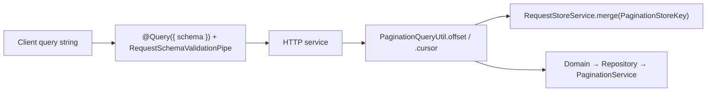

# Pagination Module Documentation

Pagination lives in `src/common/pagination`.

## Overview

Offset and cursor list helpers, plus filter and order-by parsing:

- **Offset-based pagination**: page number and limit (`/admin/**`)
- **Cursor-based pagination**: cursor tokens (every other scope)
- **Filtering**: enum, equality, date range helpers on `PaginationFilterUtil`
- **Field ordering**: each list schema validates `orderBy` against its allow-list, and `PaginationQueryUtil` parses the accepted value
- **Error handling**: the same error body as the rest of the app

Ordering support is split across three levels:

- **HTTP query level**: `orderBy` is one `field:direction` string in a single query parameter (e.g., `name:asc`, `createdAt:desc`).
    - The list request schema accepts only a field from its allow-list and a direction from `EnumPaginationOrderDirectionType`, or the empty string. Any other value answers 422.
- **Service level**: `orderBy` is always an array of order objects (`IPaginationOrderBy[]`), which is the shape Prisma receives.
- **Response metadata level**: `metadata.orderBy` is a string array in the same `field:direction` format as the query (e.g., `["createdAt:desc"]`), symmetric with `metadata.availableOrderBy`.
    - `ResponsePaginationInterceptor` performs the conversion.
    - It holds the requested order: the `orderBy` term from the request, or the default `createdAt:desc` (`PaginationDefaultOrderBy`) when the request gives no `orderBy` or an empty one.
    - A list with no sort allow-list declares no `orderBy`, so it always reports `["createdAt:desc"]`.
    - The `id` tiebreaker that `PaginationService` appends is not part of it. The requested order plus the tiebreaker is the keyset order (see [Ordering](#ordering)).
    - An empty order renders `[]` only when the HTTP service merged no pagination state into the request store.

List query parsing is zod on `@Query({ schema })` plus `PaginationQueryUtil` and `PaginationFilterUtil` in the HTTP service.

## Related Documents

- [Response Documentation][ref-doc-response]: List envelopes
- [Request Validation Documentation][ref-doc-request-validation]: Query schemas for page/limit and cursor
- [Database Documentation][ref-doc-database]: Prisma queries behind list repositories
- [Doc Documentation][ref-doc-doc]: OpenAPI for paginated routes

## Table of Contents

- [Overview](#overview)
- [Related Documents](#related-documents)
- [Table of Contents](#table-of-contents)
- [Module](#module)
    - [PaginationService](#paginationservice)
        - [Shaping the row: include or select](#shaping-the-row-include-or-select)
        - [offset()](#offset)
        - [PaginationOffsetUtil.page()](#paginationoffsetutilpage)
        - [cursor()](#cursor)
    - [Query parse (zod + PaginationQueryUtil)](#query-parse-zod--paginationqueryutil)
        - [Kit base schemas](#kit-base-schemas)
        - [PaginationQueryUtil](#paginationqueryutil)
        - [Filter helpers](#filter-helpers)
        - [Allow-lists](#allow-lists)
- [Pagination Strategies](#pagination-strategies)
    - [Choosing a Strategy](#choosing-a-strategy)
    - [Offset-Based](#offset-based)
    - [Cursor-Based](#cursor-based)
- [Filtering System](#filtering-system)
    - [Enum Filters](#enum-filters)
    - [Equality Filters](#equality-filters)
    - [Date Filters](#date-filters)
- [Ordering](#ordering)
- [Usage Examples](#usage-examples)
    - [Basic Offset Pagination](#basic-offset-pagination)
    - [Cursor Pagination](#cursor-pagination)
    - [With Filters](#with-filters)
    - [Complete Example](#complete-example)
- [Integration with Doc Module](#integration-with-doc-module)
- [Implementation Notes](#implementation-notes)
    - [Performance Considerations](#performance-considerations)

## Module

### PaginationService

Core service that pages at the database.

- Repositories call it with the Prisma delegate of the model they own (`this.databaseService.client.session`).
- HTTP services and controllers do not call it.
- `PaginationModule.forRoot()` is global and exports `PaginationService`, `PaginationQueryUtil`, `PaginationOffsetUtil`, and `PaginationFilterUtil`.

**Two tiers of parameter types.** The controller-facing types carry only what a client may influence, and the repository-facing types add what only server code may set:

| Tier | Type | Fields |
| --- | --- | --- |
| HTTP-service output of `PaginationQueryUtil` | `IPaginationQueryOffsetParams<TArgsWhere>` | `limit`, `orderBy`, `where?`, `skip` |
| HTTP-service output of `PaginationQueryUtil` | `IPaginationQueryCursorParams<TArgsWhere>` | `limit`, `orderBy`, `where?`, `cursor?`, `fingerprint` |
| Service args, produced by the repository | `IPaginationOffsetArgs<TDelegate>` | the offset params above, with `where` typed from the delegate, plus `include?` or `select?` |
| Service args, produced by the repository | `IPaginationCursorArgs<TDelegate>` | the cursor params above, with `where` typed from the delegate, plus `include?` or `select?`, and `includeCount?` |

- The util-output types take a single generic, `TArgsWhere`.
- The service-arg types take the Prisma delegate and derive `where` from its `findMany` args.
- `include`, `select` and `includeCount` exist only on the repository tier, so the util-output types cannot express them and a client cannot reach them.

#### Shaping the row: `include` or `select`

`PaginationService` intersects the repository-tier args with `IPaginationDelegateShape<TDelegate>`, a union of `{ include?: ...; select?: never }` and `{ select?: ...; include?: never }` typed from the delegate's `findMany` args.

- One call therefore carries `include` or `select`.
- A call carrying both fails `tsc`.
- `select` reaches `findMany` and nothing else.
- The count query is issued as `count({ where })`, so a narrowed projection never changes the total a page reports.
- The row type comes from `Prisma.Result` over the delegate and the chosen shape.

A read whose row is narrower than the model declares that projection once, as a `satisfies Prisma.<Model>Select` constant in the module's `constants/` folder, and pins the row type to it:

```typescript
// src/modules/session/constants/session.constant.ts
export const SessionListSelect = {
    id: true,
    userId: true,
    /* the remaining columns follow; jti is not among them */
} satisfies Prisma.SessionSelect;

// src/modules/session/interfaces/session.interface.ts
export type ISessionList = Prisma.SessionGetPayload<{
    select: typeof SessionListSelect;
}>;
```

- The `GetPayload` form ties the row type to the constant, so a column added to or removed from the projection moves the type with it.
- A nested relation takes its own select constant in the same place (`user: { select: UserRefSelect }`), and arrives narrowed the same way.

Credential columns stay out of paginated reads.

`User.password`, `Session.jti`, `ApiKey.hash`, `PasswordHistory.password` and `WorkspaceInvite.token` sit outside the select constant their module paginates with (`UserAdminListSelect`, `SessionListSelect`, `ApiKeySelect`, `PasswordHistoryListSelect`, `WorkspaceInviteUserListSelect`), so a paginated read of those models leaves the credential in the database.

**Methods:**

#### offset()

Executes offset-based pagination.

```typescript
async offset<TDelegate extends IPaginationDelegate, TShape extends IPaginationDelegateShape<TDelegate>>(
    delegate: TDelegate,
    args: IPaginationOffsetArgs<TDelegate> & TShape
): Promise<IPaginationOffsetReturn<IPaginationDelegateRow<TDelegate, TShape>>>
```

**Type Parameters:**

- `TDelegate`: the Prisma model delegate (e.g. `this.databaseService.client.user`)
- `TShape`: the `include` or `select` the caller passes; it fixes the row type of `data`

**Parameters:**

- `delegate`: the Prisma model delegate
- `args`: the `IPaginationQueryOffsetParams` the HTTP service derived, widened by the repository with `include` or `select`

**`args.orderBy` Support:**

- Always an array: `[{ createdAt: 'desc' }]`, `[{ createdAt: 'desc' }, { name: 'asc' }]`
- Before it queries, `offset()` appends `{ id: <direction> }` to the requested order, unless a term already names `id` (see the Ordering Tiebreaker in [Ordering](#ordering)).

**Default Values:**

- `orderBy`: `[{ createdAt: 'desc' }]` sorts by creation date descending
- An empty array resolves to `PaginationDefaultOrderBy`

**Returns:**

```typescript
{
    type: 'offset',
    count: number,           // Total items
    perPage: number,         // Items per page
    page: number,           // Current page
    totalPage: number,      // Total pages
    hasNext: boolean,       // Has next page
    hasPrevious: boolean,   // Has previous page
    nextPage?: number,      // Next page number (if hasNext)
    previousPage?: number,  // Previous page number (if hasPrevious)
    data: Row[]            // Paginated items
}
```

#### PaginationOffsetUtil.page()

Builds an offset return from items and a total already in hand.

```typescript
page<TReturn>(
    items: TReturn[],
    count: number,
    params: { skip: number; limit: number }
): IPaginationOffsetReturn<TReturn>
```

- `PaginationService.offset()` calls it once its count and `findMany` queries resolve.
- It is also public through `PaginationOffsetUtil`: the analytic anomaly and fraud domains compute their rows, slice `[skip, skip + limit)`, and pass the slice with the full length.
- The workspace-member, project-member, and activity-log analytic repositories do the same over grouped rows.

The page arithmetic lives here, and every offset response carries the result of it:

- `page` is 1-based: `Math.floor(skip / limit) + 1`, so the first page reports `1`
- `totalPage` is `Math.ceil(count / limit)`, so a result with no rows reports `0`
- `hasNext` is `page < totalPage`, and `hasPrevious` is `page > 1`
- `nextPage` and `previousPage` are present only when the matching flag is `true`

#### cursor()

Executes cursor-based pagination.

```typescript
async cursor<TDelegate extends IPaginationDelegate, TShape extends IPaginationDelegateShape<TDelegate>>(
    delegate: TDelegate,
    args: IPaginationCursorArgs<TDelegate> & TShape
): Promise<IPaginationCursorReturn<IPaginationDelegateRow<TDelegate, TShape>>>
```

**Type Parameters:**

- `TDelegate`: the Prisma model delegate
- `TShape`: the `include` or `select` the caller passes; it fixes the row type of `data`

**Parameters:**

- `delegate`: the Prisma model delegate
- `args`: the `IPaginationQueryCursorParams` the HTTP service derived, widened by the repository with `include` or `select`, and with `includeCount`

**`args.orderBy` Support:**

- Always an array: `[{ createdAt: 'desc' }]`

**Default Values:**

- `orderBy`: `[{ createdAt: 'desc' }]` sorts by creation date descending
- An empty array resolves to `PaginationDefaultOrderBy`
- `id` (`PaginationDefaultCursorField`) is the tiebreaker field appended to the order

**Cursor Payload:**

The cursor is an AES-256 sealed token (`PaginationCursorUtil.seal`) over a JSON object of exactly two fields:

```typescript
{
    values: Record<string, string | number | boolean | { $date: string }>, // the last row's value for each order term
    fingerprint: string // fingerprint of the query the cursor was issued for
}
```

- `values` holds one entry per term of the keyset order, tiebreaker included. A `Date` is stored as `{ $date: <ISO string> }`.
- `fingerprint` is the first 16 hex characters (`PaginationCursorFingerprintLength`) of a sha256 over the canonicalized `{ scope, filters, orderBy }`.
    - `scope` is the endpoint's `<Module><Endpoint>CursorScope` constant.
    - `filters` is every filled query field except `cursor`, `perPage`, and `orderBy` (`PaginationFingerprintExcludedFields`), so `search` and every filter field count.
    - `orderBy` is the requested order, without the tiebreaker.
    - Canonicalization sorts object keys at every depth and converts `Date` values to ISO strings, so two equivalent queries hash the same.
- The composed `where` is not carried on the wire, and the filter itself is never exposed to the client.

**Cursor Validation:**

- `PaginationQueryUtil.cursor` trims the cursor; a blank cursor counts as absent. Otherwise it runs `PaginationCursorUtil.checkFormat`, which applies two checks in this order and stops at the first failure:
    1. Length: a cursor longer than `PaginationMaxCursorLength` (2560 characters) throws `PaginationCursorTooLongException` (50203, 422).
    2. Characters: a cursor with a character outside `A-Za-z0-9_.-` throws `PaginationInvalidCursorFormatException` (50204, 422).
- `PaginationService.cursor` then opens the token, in this order:
    1. A token that does not decrypt or parse throws `PaginationFailedToDecodeCursorException` (50211, 422).
    2. A `fingerprint` that differs from the one the request recomputed throws `PaginationInvalidCursorPaginationParamsException` (50202, 422).
    3. `values` whose fields differ from the fields of the keyset order (the requested order plus the tiebreaker) throw `PaginationInvalidCursorDataException` (50210, 422). The check compares the field names only.
- A cursor is bound to the filter, the search term, the endpoint scope, and the ordering it was issued for. Changing any of them invalidates it, and the client starts again from the first page.

**Keyset Position:**

- `PaginationCursorUtil.keyset` turns the decoded `values` and the order into an `OR` of comparisons: for each term, equality on the earlier terms and `gt` (ascending) or `lt` (descending) on that term.
- `PaginationService.cursor` combines it with the request `where` as `AND [where, keyset]`.
- It reads `limit + 1` rows to decide `hasNext`.

**Tiebreaker:**

- Before it queries, `cursor()` appends `{ id: <direction> }` to the requested order, unless a term already names `id` (see the Ordering Tiebreaker in [Ordering](#ordering)). The result is the keyset order.
- The tiebreaker is what makes the position stable.
    - When the sort key is not unique (several rows sharing one `createdAt`), the cursor row has no deterministic place in the result set, and pages can repeat or skip records.
- The tiebreaker is part of the order that the cursor `values` cover.

**Returns:**

```typescript
{
    type: 'cursor',
    cursor?: string,        // Sealed cursor for the next page (present when hasNext)
    perPage: number,        // Items per page
    hasNext: boolean,       // Has next page
    count?: number,         // Total count (if includeCount: true)
    data: Row[]            // Paginated items
}
```

### Query parse (zod + PaginationQueryUtil)

List query parsing is not pipe-driven and is not on `PaginationService`.



1. Kit base schemas live under `src/common/pagination/dtos/`:
    - `PaginationOffsetQuerySchema` (`page` / `perPage` / `search`)
    - `PaginationCursorQuerySchema` (`cursor` / `perPage` / `search`)
    - `search` is trimmed and capped at `PaginationDefaultMaxSearchLength` (100) characters.
    - `search` carries generic `.meta` text in the base schemas.
    - The base schemas carry no `orderBy`, because the allowed fields differ per list.
    - `PaginationQueryUtil.offset` and `.cursor` take the base DTO type (`PaginationOffsetQueryDto`, `PaginationCursorQueryDto`) intersected with `{ orderBy?: IPaginationOrderByQuery }`.
    - `IPaginationOrderByQuery` is `string | undefined`, the zod output of the list's `orderBy` field: one `field:direction` string, the empty string (default order), or absent.
2. A module list DTO builds on a base schema.
    - It overrides the `.meta` of `search` to name its search fields, and adds its filter fields.
    - It declares `orderBy` inline over its allow-list (see [Ordering](#ordering)).
    - It drops `search` with `.omit({ search: true })` when the list has no search columns.
    - A list with no sort allow-list declares no `orderBy`, so the strict schema rejects the key.
    - Each `*.dto.ts` file holds one schema const.
3. The controller binds one `@Query({ schema })` and passes the whole DTO to the HTTP service.
4. The HTTP service calls `PaginationQueryUtil.offset` / `.cursor` (plus `PaginationFilterUtil` helpers) to produce `IPaginationQueryOffsetParams` / `IPaginationQueryCursorParams` and a `storePatch`.
    - It merges the patch into `RequestStoreService` under `PaginationStoreKey` for response metadata.
5. Domain and repository keep receiving `IPaginationQuery*Params`.
    - The repository widens them with `include` / `select` / `includeCount` and calls `PaginationService`.

- `PaginationQueryUtil` is a pure util under `src/common/pagination/utils/`. It does not inject `RequestStoreService`.
- OpenAPI for list query params comes only from the zod schema on `@Query({ schema })`.
- `@ResponsePagination` does not emit `ApiQuery` for page, cursor, `perPage`, `search`, or `orderBy`.

#### Kit base schemas

```typescript
// src/common/pagination/dtos/pagination.offset-query.dto.ts
export const PaginationOffsetQuerySchema = z.strictObject({
    page: z.coerce.number().int().optional().meta({ … }),
    perPage: z.coerce.number().int().optional().meta({ … }),
    search: z.string().trim().max(PaginationDefaultMaxSearchLength).optional().meta({ … }),
});

// src/common/pagination/dtos/pagination.cursor-query.dto.ts
export const PaginationCursorQuerySchema = z.strictObject({
    cursor: z.string().optional().meta({ … }),
    perPage: z.coerce.number().int().optional().meta({ … }),
    search: z.string().trim().max(PaginationDefaultMaxSearchLength).optional().meta({ … }),
});
```

Module example (`src/modules/user/dtos/request/user.list.request.dto.ts`):

```typescript
export const UserListRequestSchema = PaginationOffsetQuerySchema.extend({
    search: PaginationOffsetQuerySchema.shape.search.meta({
        description: `Search query, available fields: ${UserDefaultAvailableSearch.join(', ')}. …`,
        example: '',
    }),
    orderBy: z
        .union([
            z.templateLiteral([
                z.enum(UserDefaultAvailableOrderBy),
                ':',
                z.enum(EnumPaginationOrderDirectionType),
            ]),
            z.literal(''),
        ])
        .optional()
        .meta({
            description: `Order by field in \`field:direction\` format (e.g. \`${UserDefaultAvailableOrderBy[0]}:desc\`). …`,
            example: `${UserDefaultAvailableOrderBy[0]}:desc`,
        }),
    status: z.string().optional().meta({ … }),
    roleId: RequestMongoIdSchema.optional().meta({ … }),
    countryId: RequestMongoIdSchema.optional().meta({ … }),
});
```

#### PaginationQueryUtil

**Two protections** guard what a list query reaches:

| Protection | Defends against | Needs an allow-list? |
| --- | --- | --- |
| the util / zod schema admit named keys only (strict list DTO) | client-invented query keys reaching Prisma (`?where=`, `?select=`, `?include=`, `?includeCount=`) | no (unconditional) |
| the allow-lists | a client sorting or searching on a column the endpoint never sanctioned | yes |

**Absent allow-lists leave the fields out of the schema.**

- A list with no sort allow-list declares no `orderBy`, so the strict schema rejects an `orderBy` key with 422 through `RequestValidationException`, and Swagger does not advertise it.
- A list with no search columns drops `search` with `.omit({ search: true })`, so a `search` key answers 422 and there is no search predicate.
- Order falls to `PaginationDefaultOrderBy` (`createdAt` desc), and `metadata.orderBy` reports `["createdAt:desc"]`.

**A configured allow-list takes effect in two layers, each with its own job:**

- Sort is validated in zod. The list schema validates `orderBy`, and a field outside the allow-list, or a direction other than `asc` or `desc` (including a missing one), fails zod and answers 422 through `RequestValidationException`. The util has no sort exception of its own.
- Search is applied in the util. It builds a case-insensitive Prisma `contains` `OR` across `availableSearch` for a non-blank `search`, and it applies none when `availableSearch` is empty.
- The `search` length cap is a zod rule too: a `search` longer than `PaginationDefaultMaxSearchLength` (100) characters answers 422 through `RequestValidationException`.

**Options:**

1. `availableOrderBy` is required on `offset` and `cursor`; pass `[]` for a list with no sort allow-list.
2. `availableSearch` is optional and defaults to `[]`.
3. `defaultPerPage` is optional.
4. `scope` is required on `cursor`: the endpoint's `<Module><Endpoint>CursorScope` constant, which feeds the cursor fingerprint (`SessionSharedListCursorScope = 'SessionSharedListCursorScope'`).
5. The util stores `availableSearch` and `availableOrderBy` in the `storePatch`, and `ResponsePaginationInterceptor` reports them in the response metadata.

#### Filter helpers

Filter helpers on `PaginationFilterUtil` (the HTTP service chooses which to apply per field):

`equalBoolean` · `equalString` · `equalNumber` · `inEnum` · `ninEnum` · `notEqual` · `dateBetween`

Date bounds use `EnumPaginationFilterDateBetweenType` (never a raw `'start'` / `'end'` string).

- Each helper returns `{ where, storeFilter }`.
- Each helper returns `null` when the query value is absent or blank.
- The HTTP service merges `storeFilter` into the CLS patch and passes `where` fragments to the domain.

```typescript
const { params, storePatch } =
    this.paginationQueryUtil.offset<Prisma.UserWhereInput>(query, {
        availableSearch: UserDefaultAvailableSearch,
        availableOrderBy: UserDefaultAvailableOrderBy,
    });
const status = this.paginationFilterUtil.inEnum(
    Prisma.UserScalarFieldEnum.status,
    query.status,
    UserDefaultStatus
);
const roleId = this.paginationFilterUtil.equalString(
    Prisma.UserScalarFieldEnum.roleId,
    query.roleId
);
this.requestStoreService.merge(PaginationStoreKey, {
    ...storePatch,
    filters: {
        ...storePatch.filters,
        ...(status?.storeFilter ?? {}),
        ...(roleId?.storeFilter ?? {}),
    },
});
```

- Wire / query DTO param names are camelCase (`status`, `roleId`).
- The Prisma field argument at a filter-helper call site is the enum member.
- `PaginationFilterUtil` helpers are model-agnostic (`field: TField extends string`), and the kit never imports a feature's Prisma model types.
- A filter is a typed structure with named fields. `Record<string, any>`, a raw `filter?: string` query param, or `JSON.parse(rawFilter)` spread into `where` is not this contract.

#### Allow-lists

`availableSearch` and `availableOrderBy` live as PascalCase constants in `<module>/constants/<module>.list.constant.ts` (`UserDefaultAvailableSearch`, `ApiKeyDefaultAvailableOrderBy`), beside enum defaults the filters use.

- That file holds a module's list-endpoint constants and nothing else.

| List kind | Allow-list typing | Filter helper `field` argument |
| --- | --- | --- |
| Prisma-backed model list | `Prisma.<Model>ScalarFieldEnum` members with `as const satisfies ReadonlyArray<Prisma.<Model>ScalarFieldEnum>` | `Prisma.<Model>ScalarFieldEnum.<field>` |
| Computed / analytic list (row is a declared `I*` interface) | `as const satisfies ReadonlyArray<keyof I<Row>>` | N/A when there is no Prisma column |

```typescript
export const UserDefaultAvailableSearch = [
    Prisma.UserScalarFieldEnum.name,
    Prisma.UserScalarFieldEnum.username,
    Prisma.UserScalarFieldEnum.email,
] as const satisfies ReadonlyArray<Prisma.UserScalarFieldEnum>;

export const AnalyticNearLockoutAvailableOrderBy = [
    'createdAt',
    'id',
] as const satisfies ReadonlyArray<keyof IAnalyticNearLockout>;
```

| Allow-list | Schema / OpenAPI | Parse behaviour |
| --- | --- | --- |
| none | module `.omit`s `search` and declares no `orderBy` | no search predicate; order falls to `PaginationDefaultOrderBy` |
| non-empty | module overrides the `search` `.meta` and declares `orderBy` over the allow-list | search → `contains` `OR`; an unlisted `orderBy` → 422 from zod |

- An allow-list is set wherever the endpoint has a defensible sort order or a real search column, and left out where it does not.
- An `availableOrderBy` names keys the returned row carries.
- On a cursor route every field in the allow-list is immutable.

## Pagination Strategies

### Choosing a Strategy

The route prefix decides the strategy, not the endpoint:

| Prefix                                   | Strategy |
| ---------------------------------------- | -------- |
| `/admin/**`                              | offset   |
| `/user`, `/shared`, `/system`, `/public` | cursor   |

- There is no per-endpoint exception list.
- The policy lists (`/admin/role/:roleId/policy/list` and `/system/role/:roleId/policy/list`) return the whole set under `@Response`, so they take no pagination at all.

A client plans around two consequences:

- A non-admin list returns no `count`, no `page`, and no `totalPage`. `includeCount` is a repository-side argument, never a query param, so a client cannot ask for a total.
- Offset cannot reach past row 2000 (`PaginationDefaultMaxPage` × `PaginationDefaultMaxPerPage`).
    - It narrows and browses.
    - It never scans a whole collection.

Cursor routes also constrain what they will sort on:

- Every field in a cursor route's `availableOrderBy` is immutable. A row whose sort key can change mid-scroll moves position, and no tiebreaker stabilises that.
- Where a module's offset route allows a mutable field that its cursor route cannot, the two carry separate constants, `<Module>DefaultAvailableOrderBy` and `<Module>CursorAvailableOrderBy`.
- When every field is immutable, both routes share one constant.

### Offset-Based

**Characteristics:**

- Returns total count
- Slower with large offsets
- Predictable page numbers
- Affected by inserts/deletes during pagination
- The appended `id` tiebreaker keeps rows that share a sort key in one order from page to page

**Constraints:**

- Max page: 20 (`PaginationDefaultMaxPage`); above it throws `PaginationPageExceedsMaximumException` (50206)
- Max perPage: 100 (`PaginationDefaultMaxPerPage`); above it throws `PaginationPerPageExceedsMaximumException` (50208)
- Min page: 1; below it throws `PaginationPageCannotBeLessThanOneException` (50207)
- Min perPage: 1; below it throws `PaginationPerPageCannotBeLessThanOneException` (50209)
- The schema's `.int()` rejects a non-integer `page` or `perPage` first with a validation error (422). A non-integer that still reaches the util throws `PaginationInvalidPageException` (50205) or `PaginationInvalidPerPageException` (50201)

**Response Example:**

The pagination fields sit inside the `metadata` block of the standard response envelope, not at the top level:

```json
{
    "statusCode": 200,
    "message": "...",
    "metadata": {
        "type": "offset",
        "count": 250,
        "perPage": 20,
        "page": 1,
        "totalPage": 13,
        "hasNext": true,
        "hasPrevious": false,
        "nextPage": 2,
        "search": "...",
        "filters": { ... },
        "orderBy": ["createdAt:desc"],
        "availableSearch": ["name", "email"],
        "availableOrderBy": ["createdAt", "name"]
    },
    "data": [...]
}
```

### Cursor-Based

**How It Works:**

1. The service appends the `id` tiebreaker to the requested order and takes the fingerprint the HTTP service computed from the scope, the filled query fields, and the requested order (tiebreaker excluded)
2. It reads `limit + 1` rows to decide `hasNext`, then seals the last returned row's order values and that fingerprint as `{ values, fingerprint }`
3. On the next request the util recomputes the fingerprint and the service compares it to the `fingerprint` in the supplied cursor
4. A mismatch throws `PaginationInvalidCursorPaginationParamsException`, so a client cannot page on with a filter or an ordering that has since changed

**Characteristics:**

- Cursor-based navigation (no page numbers)
- Consistent performance (indexed cursor field)
- Optional count, fetched only when the repository sets `includeCount`
- Safe for real-time data changes
- The cursor carries only the order values and a fingerprint, so its size does not grow with filter complexity
- The appended `id` tiebreaker keeps the position stable even when the sort key repeats

**Constraints:**

- Max cursor length: 2560 characters (`PaginationMaxCursorLength`); longer throws `PaginationCursorTooLongException` (50203, 422)
- Cursor format: characters `A-Za-z0-9_.-` only; any other character throws `PaginationInvalidCursorFormatException` (50204, 422)
- Fingerprint mismatch: throws `PaginationInvalidCursorPaginationParamsException` (50202, 422)
- Undecodable token: throws `PaginationFailedToDecodeCursorException` (50211, 422)
- Order values that do not match the keyset order: throws `PaginationInvalidCursorDataException` (50210, 422)
- Max perPage: 100; above it throws `PaginationPerPageExceedsMaximumException` (50208)
- Min perPage: 1; below it throws `PaginationPerPageCannotBeLessThanOneException` (50209)

**Response Example:**

The pagination fields sit inside the `metadata` block of the standard response envelope.

- The wire field for the sealed cursor is `nextCursor`; it is present only when `hasNext` is `true`.
- `hasPrevious` is always `false` for this strategy.

```json
{
    "statusCode": 200,
    "message": "...",
    "metadata": {
        "type": "cursor",
        "nextCursor": "io9mYCW27uEJ71dxE4regQ.bBxY9VoJIDlj9122.yqPmXbUIwNz8_fRnl6Tk6H3aTTYkWvRuvM6z8UOn8uAi0ADM09R3Dps_SKciuf9fmfJ6WYvZK0funT0ompmg1jWmMX84kCRcZUnm4cFq1LCfDbVhyyxd3_o6wWQu3VxXf02675zFzQ8cWhrQGVoZkNsGfSfC82zZPgcLO2t_6f_3rqM-AqLpukEGIPkkPsXEaBQB3oeNofuOQitKU3jei3ZfxvXoNfBTUidMpsbIbt06.lp71i4NZZsnn5AISvLzyAw",
        "perPage": 20,
        "hasNext": true,
        "hasPrevious": false,
        "orderBy": ["createdAt:desc"],
        "availableSearch": ["name", "email"],
        "availableOrderBy": ["createdAt"]
    },
    "data": [...]
}
```

## Filtering System

Filters combine as `where` fragments the HTTP service passes into the domain:

```typescript
return this.userDomain.getListOffsetByAdmin(
    params,
    status?.where,
    roleId?.where,
    countryId?.where
);
```

### Enum Filters

**In (inclusion):**

```typescript
this.paginationFilterUtil.inEnum(
    Prisma.UserScalarFieldEnum.status,
    query.status,
    UserDefaultStatus
);
// Query: ?status=active,inactive
// Database: WHERE status IN ('active', 'inactive')
```

**Nin (exclusion):**

```typescript
this.paginationFilterUtil.ninEnum(
    Prisma.UserScalarFieldEnum.status,
    query.status,
    [EnumUserStatus.blocked]
);
// Query: ?status=blocked
// Database: WHERE status NOT IN ('blocked')
```

A value outside the enum throws `PaginationFilterInvalidValueEnumException` (50200, 422, message path `pagination.error.filterInvalidValueEnum`). It shares the status code with `PaginationFilterInvalidValueException`: both map to the one `filterInvalidValue` member, and the message path tells them apart.

### Equality Filters

```typescript
this.paginationFilterUtil.equalBoolean(
    Prisma.ApiKeyScalarFieldEnum.isActive,
    query.isActive
);
// Query: ?isActive=true → WHERE isActive = true

this.paginationFilterUtil.equalString(
    Prisma.UserScalarFieldEnum.roleId,
    query.roleId
);
// Query: ?roleId=507f1f77bcf86cd799439011 → WHERE roleId = '…'

this.paginationFilterUtil.notEqual(
    Prisma.UserScalarFieldEnum.countryId,
    query.countryId
);
// Query: ?countryId=… → WHERE countryId != '…'
```

- `equalNumber` takes the same Prisma scalar-field enum member as its first argument and coerces the query value to a number.
- Invalid boolean, number, or date strings throw `PaginationFilterInvalidValueException` (50200, 422, message path `pagination.error.filterInvalidValue`). The enum filter's exception shares this status code by design.

### Date Filters

```typescript
this.paginationFilterUtil.dateBetween(
    Prisma.UserScalarFieldEnum.createdAt,
    query.startDate,
    { type: EnumPaginationFilterDateBetweenType.start }
);
this.paginationFilterUtil.dateBetween(
    Prisma.UserScalarFieldEnum.createdAt,
    query.endDate,
    { type: EnumPaginationFilterDateBetweenType.end }
);
// Query: ?startDate=2024-01-01&endDate=2024-12-31
// Database: WHERE createdAt >= '…' AND createdAt <= '…'
```

## Ordering

**Default Behavior:**

- Field: `createdAt`
- Direction: `desc` (descending)

**HTTP Query Format:**

- `orderBy` uses `field:direction` format in a single query parameter
- One term per request: the util resolves the single `field:direction` value
- An empty `orderBy=` falls back to the default

**Query Parameters:**

```
?orderBy=name:asc
```

**Internal Service Format:**

```typescript
orderBy: [{ name: 'asc' }, { id: 'asc' }];
```

- All `orderBy` values passed to the service are arrays.
- The single-element array `[{ createdAt: 'desc' }]` is the typical default.
- Cursors do not carry the `orderBy` itself, only a fingerprint of it.
- On the HTTP path, `PaginationQueryUtil` resolves the order from the request: with no `orderBy`, or an empty one, it resolves `PaginationDefaultOrderBy` and stores it, so the default is both applied and reported.
- The util stores the resolved order before `PaginationService.offset` or `PaginationService.cursor` appends the tiebreaker, so `metadata.orderBy` never includes it on either route. The query carries it on both routes. The cursor fingerprint covers the requested order only; the cursor `values` cover the tiebreaker too.

**Response Metadata Format:**

```json
"orderBy": ["name:asc"]
```

- The response reports the resolved ordering, without the tiebreaker, in the same `field:direction` format the query accepts, not in the internal object form.
- A client can echo `metadata.orderBy` back as `?orderBy=` only when the list's allow-list names the reported field.
    - The reported default `createdAt:desc` is accepted only where `createdAt` is in the allow-list.
    - A list with no sort allow-list reports `["createdAt:desc"]` and declares no `orderBy`, so echoing it answers 422.
    - The tiebreaker is not reported, so it never blocks an echo.
- An empty order renders `[]` only when the HTTP service merged no pagination state into the request store.
- `metadata.availableOrderBy` lists the fields the route accepts, so a client reads the allowed sorts from any page. It is a required metadata field: a list with no sort allow-list reports `[]`.

**Ordering Tiebreaker:**

- `PaginationService` resolves the order for `offset()` and `cursor()` through `PaginationQueryUtil.resolveTiebreak(orderBy, field)`.
    1. An empty `orderBy` becomes `PaginationDefaultOrderBy`. The HTTP path has already resolved the default in `PaginationQueryUtil`, so this step applies when a caller passes an empty `orderBy` straight to `offset()` or `cursor()`.
    2. Unless a term already names `field`, it appends `{ [field]: <direction> }`.
    3. The direction is copied from the last ordering term.
- The tiebreak field is `id` (`PaginationDefaultCursorField`) for both `offset()` and `cursor()`.
- Rows that share a sort key come back in one order on every request.

**Field Allow-list:**

- Every list route accepts sorting on its allow-list fields and nothing else.
- The allow-list lives as a `<Module>DefaultAvailableOrderBy` or `<Module>CursorAvailableOrderBy` constant.
- The list schema builds its `orderBy` from the constant, a `field:direction` template literal over `z.enum(<allow-list>)` and `z.enum(EnumPaginationOrderDirectionType)`, as a union with the empty string `''`:
    - An unlisted field or an unknown direction fails zod and answers 422.
    - The empty string falls back to the default order.
- The HTTP service passes the same constant to `PaginationQueryUtil`, which stores it for `metadata.availableOrderBy`:

```typescript
this.paginationQueryUtil.offset(query, {
    availableOrderBy: UserDefaultAvailableOrderBy,
});
```

## Usage Examples

### Basic Offset Pagination

A list route travels `Controller → HTTP Service → Domain → Repository`:

- The domain forwards the pagination params.
- The repository is the layer that adds `include` or `select`.
- The item schema declared on `@ResponsePagination` shapes each row on the way out.

**Controller:**

```typescript
@Doc({ summary: 'get all users' })
@ResponsePagination('user.list', { schema: UserListResponseSchema })
@TermPolicyAcceptanceProtected()
@PolicyProtected({
    subject: EnumPolicySubject.user,
    action: [EnumPolicyAction.read],
})
@RoleProtected(EnumRoleType.admin)
@UserProtected()
@RequestThrottle({ user: true })
@AuthJwtAccessProtected()
@ApiKeyProtected()
@Get('/list')
async list(
    @Query({ schema: UserListRequestSchema }) query: UserListRequestDto
): Promise<IResponsePaginationReturn<IUserList>> {
    return this.userHttpService.getListOffsetByAdmin(query);
}
```

**HTTP service:**

```typescript
async getListOffsetByAdmin(
    query: UserListRequestDto
): Promise<IResponsePaginationReturn<IUserList>> {
    const { params, storePatch } =
        this.paginationQueryUtil.offset<Prisma.UserWhereInput>(query, {
            availableSearch: UserDefaultAvailableSearch,
            availableOrderBy: UserDefaultAvailableOrderBy,
        });
    const status = this.paginationFilterUtil.inEnum(
        Prisma.UserScalarFieldEnum.status,
        query.status,
        UserDefaultStatus
    );
    const roleId = this.paginationFilterUtil.equalString(
        Prisma.UserScalarFieldEnum.roleId,
        query.roleId
    );
    const countryId = this.paginationFilterUtil.equalString(
        Prisma.UserScalarFieldEnum.countryId,
        query.countryId
    );
    this.requestStoreService.merge(PaginationStoreKey, {
        ...storePatch,
        filters: {
            ...storePatch.filters,
            ...(status?.storeFilter ?? {}),
            ...(roleId?.storeFilter ?? {}),
            ...(countryId?.storeFilter ?? {}),
        },
    });

    return this.userDomain.getListOffsetByAdmin(
        params,
        status?.where,
        roleId?.where,
        countryId?.where
    );
}
```

The page fields (`type`, `count`, `page`, `perPage`, `totalPage`, `hasNext`, `hasPrevious`, `nextPage`, `previousPage`) come from `PaginationService.offset`, which computes them in `PaginationOffsetUtil.page`:

- `page` is 1-based, so the first page reports `1`.
- `totalPage` is `Math.ceil(count / perPage)`, so a page with no rows reports `0`.

### Cursor Pagination

**Controller:**

```typescript
@Doc({ summary: 'list workspaces the caller is a member of' })
@ResponsePagination('workspace.list', { schema: WorkspaceResponseSchema })
@Get('/list')
async list(
    @Query({ schema: WorkspaceUserListRequestSchema }) query: WorkspaceUserListRequestDto,
    @AuthJwtPayload('userId') userId: string
): Promise<IResponsePaginationReturn<Workspace>> {
    return this.workspaceHttpService.getListCursorByMember(userId, query);
}
```

The HTTP service passes the endpoint scope to `PaginationQueryUtil.cursor`:

```typescript
const { params, storePatch } =
    this.paginationQueryUtil.cursor<Prisma.WorkspaceWhereInput>(query, {
        scope: WorkspaceUserListCursorScope,
        availableSearch: WorkspaceDefaultAvailableSearch,
        availableOrderBy: WorkspaceCursorAvailableOrderBy,
    });
```

The page fields (`type`, `cursor` emitted as `nextCursor`, `perPage`, `hasNext`, optional `count`) come from `PaginationService.cursor`.

### With Filters

- Filter fields live on the list request schema.
- The HTTP service maps each one through a util helper and merges `storeFilter` for response metadata.
- See Basic Offset Pagination above for the full pattern.

### Complete Example

The admin user list is the full stack:

1. `UserListRequestSchema` extends `PaginationOffsetQuerySchema`.
2. The controller binds `@Query({ schema })`.
3. The HTTP service runs `PaginationQueryUtil` plus filters.
4. The domain forwards params.
5. The repository calls `PaginationService.offset` with a `select`.
6. `@ResponsePagination` turns the service's `IPaginationOffsetReturn` into the `metadata` block and serializes each row against the item schema.

OpenAPI for the query string comes from the zod schema, and pagination error kits live on `@ResponsePagination`.

## Integration with Doc Module

OpenAPI for list endpoints is co-located on the runtime stack: `@Doc`, `@ResponsePagination`, `*Protected` / auth kits, and the list zod schema on `@Query({ schema })`.

| Piece | OpenAPI source |
| --- | --- |
| `page` / `cursor` / `perPage` / `search` / `orderBy` / filters | list zod schema on `@Query({ schema })` via `standardSchemaConverter` |
| success page envelope | `@ResponsePagination` with `baseSchema: ResponsePaginationSchema` |
| pagination error kits (shared + offset + cursor) | `@ResponsePagination` |
| operation summary + global errors | `@Doc` |
| auth / guard errors | `*Protected` / auth decorators |

Allow-list text in `.meta({ description })` on the schema and the constants passed to `PaginationQueryUtil` are the same module list constants, so the documented contract and the enforced contract are one source.

Flow: [Doc Documentation][ref-doc-doc].

## Implementation Notes

### Pagination State (CLS store)

- `PaginationQueryUtil` returns a `storePatch` and does not touch CLS itself.
- The HTTP service merges that patch (plus filter `storeFilter` fragments) into the per-request store via `RequestStoreService.merge(PaginationStoreKey, …)`.
- `ResponsePaginationInterceptor` reads the accumulated state back via `RequestStoreService.get(PaginationStoreKey)` to build the `metadata` block on the response.

Key points:

- The store holds page / cursor / perPage / orderBy / availableOrderBy / search / availableSearch / filters for response metadata.
- The store holds `orderBy` in its object form (`IPaginationOrderBy[]`). `ResponsePaginationInterceptor` flattens it into `field:direction` strings on the way out, so the stored shape and the wire shape differ.
- The store never enters a domain or repository layer.
- Per-request isolation is guaranteed by the CLS store opened once per request by `ClsMiddleware`, not by DI scope.
- Pagination metadata appears on the success path only. On error the interceptor is skipped and no pagination fields are emitted.

### Performance Considerations

**Offset Pagination:**

- Suits small datasets (< 10,000 items)
- Suits cases where the total count is important
- Large offsets are slower, because the database skips rows

**Cursor Pagination:**

- Suits large datasets
- Performance stays consistent (indexed lookup)
- Suits infinite scroll
- Avoids N+1 count queries

<!-- REFERENCES -->

[ref-doc-response]: response.md
[ref-doc-request-validation]: request-validation.md
[ref-doc-database]: database.md
[ref-doc-doc]: doc.md
