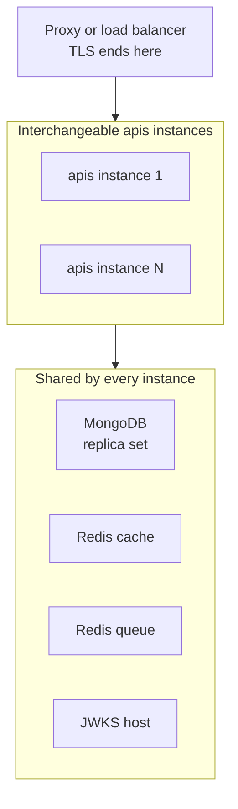
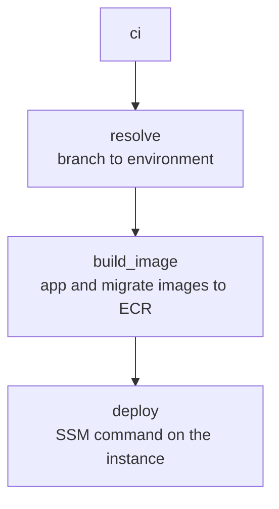

# Production

This page shows how to deploy the application and lists the values a deployed environment sets, for an operator who runs it on one or several hosts.

## Table of Contents

- [Related Documents](#related-documents)
- [Overview](#overview)
- [Topology](#topology)
- [Keys and secrets](#keys-and-secrets)
- [Variables set by hand](#variables-set-by-hand)
- [The application image](#the-application-image)
- [Schema push and seed](#schema-push-and-seed)
- [Path 1: existing dependencies](#path-1-existing-dependencies)
- [Path 2: Docker Compose host](#path-2-docker-compose-host)
- [Path 3: CI/CD](#path-3-cicd)
    - [The release workflow](#the-release-workflow)
    - [GitHub variables and secret](#github-variables-and-secret)
    - [Operator steps](#operator-steps)
    - [Version release](#version-release)
    - [Another CI system](#another-ci-system)
- [TLS between hosts](#tls-between-hosts)
- [Vault as a network service](#vault-as-a-network-service)
- [Cloud setup](#cloud-setup)
- [Observability](#observability)
- [Check the deployment](#check-the-deployment)

## Related Documents

- [Installation][ref-doc-installation]: the local stack this page deploys
- [Configuration Reference][ref-doc-reference-configuration]: every key and every `DOCKER_*` variable
- [Commands Reference][ref-doc-reference-commands]: every script and Compose command
- [Dependencies][ref-doc-dependencies]: how the application answers when MongoDB or Redis is down
- [Vault][ref-doc-vault]: the bundled Vault containers and helpers
- [Architecture][ref-doc-architecture]: why every instance is interchangeable

## Overview

- The application ships as one image built from `ci/dockerfile`. A second target of the same file, `migrate`, pushes the schema.
- MongoDB, two Redis instances, and a JWKS host are separate services the application connects to.
- Three paths end with the application answering `GET /api/public/hello`:
    - [Path 1](#path-1-existing-dependencies): MongoDB, Redis, and a JWKS host already exist.
    - [Path 2](#path-2-docker-compose-host): one host runs the dependencies and the application from `ci/docker-compose.yml`.
    - [Path 3](#path-3-cicd): `release.yml` builds the image and replaces the container on an EC2 instance.
- Neither the image nor a workflow runs the seeds: [Schema push and seed](#schema-push-and-seed).
- Every environment (`development`, `staging`, `production`) has its own `.env`, keys, and hosts.
- Before you start: Docker Engine with the Compose plugin on each host, and Node.js 26.13.x+ on the machine that generates the keys and runs the seeds.

## Topology

The diagram shows a proxy in front of interchangeable `apis` instances that share one set of dependencies.



- The application runs as several interchangeable `apis` instances, on one host or on several.
- The instances share one MongoDB replica set, the cache Redis, the queue Redis, and the JWKS URLs. No state another instance needs lives in process memory or on local disk, so a load balancer needs no session affinity.
- Each instance serves HTTP and runs the BullMQ workers, so any instance takes any job. A recurring job is a BullMQ job scheduler, so one instance runs each tick.
- `ci/docker-compose.yml` serves each environment from one host: the `deps` profile runs MongoDB, both Redis instances, the JWKS server, and BullBoard, and the `apis` profile runs `migrate` and `apis`.
- More `apis` instances on that host are containers of the same image that join the Compose network `app-network`, as the container `release.yml` starts does.
- An instance on another host reaches MongoDB, both Redis instances, and the JWKS server only when the deployment publishes them: the Compose services publish no database, Redis, or JWKS port, and the replica set advertises `mongo:27017`. What the deployment adds is in [TLS between hosts](#tls-between-hosts).
- `apis` publishes `127.0.0.1:3000` and BullBoard publishes `127.0.0.1:3010`. TLS ends at a proxy on the same host that forwards to that loopback port, and a load balancer for several hosts reaches each host's proxy. The Compose files hold no proxy service and no bind-address variable.

## Keys and secrets

A deployment needs these files:

- `.env`, which carries the JWT key pairs, the key ids, and both encryption secrets.
- `keys/access-jwks.json` and `keys/refresh-jwks.json`, which a JWKS host serves.
- `keys/mongo-keyfile`, which only the Compose `mongo` service mounts.
- `.env.docker`, which carries the Compose variables. A deployed host writes it by hand and never pulls it from Vault. `ci/docker-compose.yml` requires eleven of its variables: [Compose variables][ref-doc-reference-configuration-compose].

One script writes the first three. Run it once per environment before the first start, because every run replaces the keys. Every `apis` instance of an environment shares the same `.env` keys and JWKS files, so copy the results to each instance and never generate them again per host.

1. Generate the files with one of two commands. They are alternatives, so run only one:
    - On a machine with Node.js 26.13.x+ and the repository dependencies:

        ```bash
        pnpm generate:secret --direct-insert
        ```

    - On the host itself, with Node.js 26.13.x+ and no `pnpm install`, because the script uses only built-in modules:

        ```bash
        node scripts/generate-secret.ts all --direct-insert
        ```

2. Move the results to where they run: `.env` to each application host, the JWKS files to the JWKS host, and for a Compose host all of them into its checkout.
3. On a Compose host, `DOCKER_APIS_UID` and `DOCKER_APIS_GID` in `.env.docker` hold the user and group id of the account that owns `.env`, which `stat -c '%u %g' .env` prints on Linux. `.env` stays at mode 600, and `apis` and `migrate` run as that user: [Path 2](#path-2-docker-compose-host).

## Variables set by hand

The script leaves these for the operator. The list holds the variables every deployment sets. The integration variables are in [Cloud setup](#cloud-setup) (the S3 and SES credentials, buckets, `AWS_S3_IAM_PRINCIPAL_ARN`, and the sender addresses) and [Observability](#observability) (`SENTRY_*` and `LOGGER_*`), and every other key is in the [Configuration Reference][ref-doc-reference-configuration].

- `APP_ENV`: `production`, `staging`, or `development`.
- `APP_HTTP_HOST`: `0.0.0.0` in a container. With `localhost` the application listens on the container's loopback and the published port resets connections.
- `APP_HTTP_PORT`: `3000`. The image exposes 3000 and its health check calls it.
- `APP_HTTP_TRUSTED_PROXIES`: required when `APP_ENV` is `production`. It lists the proxy networks whose forwarding headers Express trusts: the presets `loopback`, `linklocal`, and `uniquelocal`, IP addresses, and CIDRs, never a hop count or `true`.
    - Outside production an empty value trusts no proxy, so `req.ip` is the socket peer and a client cannot forge it through `X-Forwarded-For`.
    - Behind a CDN that connects from public addresses, a value without the provider's CIDRs puts every client in one rate-limit bucket.
- `REQUEST_CORS_ALLOWED_ORIGINS`: the allowed origins. A `*` entry is refused in production.
- `DATABASE_DEBUG_ENABLED`: `false`. `true` is refused in production.
- `LOGGER_FILE_ENABLED`: `false`. The `apis` container has a read-only root filesystem and a `/tmp` tmpfs only.
- `MFA_TOTP_ISSUER`, `MFA_PASSKEY_RP_ID`, and `MFA_PASSKEY_ORIGINS`: the passkey origins list exact origins, `https://*.<domain>` under the RP id, or `android:apk-key-hash:<hash>`. A `*` entry is refused in production.
- `FRONTEND_NAME`, `FRONTEND_BASE_URL`, `AUTH_JWT_ISSUER`, and `AUTH_JWT_AUDIENCE`: the values of your deployment.
- `DATABASE_URL`, `REDIS_CACHE_URL`, `REDIS_QUEUE_URL`, and the two JWKS URIs: their values depend on the path.

Where the application reads its settings:

- It reads the process environment and `.env` once at boot. The process environment wins, and no `.env.<APP_ENV>` file is loaded.
- A variable in the container environment satisfies validation, so a deployment that sets every variable needs no mounted file. The image creates an empty `.env`, and a mounted file replaces it.
- A container with neither a mounted `.env` nor the variables fails validation at boot and exits with code 1.
- A mounted `.env` must be readable by the container user, so the containers run as the owner of the file: `--user` in the release and in Path 1, `DOCKER_APIS_UID:DOCKER_APIS_GID` in Compose.

Passkeys on mobile clients need two files served from the RP id domain:

- iOS reports the origin `https://<rpId>` and needs `/.well-known/apple-app-site-association` with a `webcredentials` entry.
- Android needs `/.well-known/assetlinks.json` and its `android:apk-key-hash:<hash>` entry in `MFA_PASSKEY_ORIGINS`.

## The application image

Build from the repository root:

```bash
docker build -f ci/dockerfile -t ack-nestjs-boilerplate-api .
```

`ci/dockerfile` has three stages:

- `builder` installs dependencies with `--frozen-lockfile`, runs `pnpm generate`, then `pnpm build`, whose closing `pnpm typecheck` is the only type check. It then runs `chmod -R a+rX dist prisma package.json`, so `apis` and `migrate`, which run as the host owner of `.env`, read every file whatever mode the checkout gave it.
- `migrate` extends `builder` and runs `prisma db push --skip-generate` through `node`, with no data-loss flag. Build it with `--target migrate`.
- `main` starts from the Node 26.13.x+ alpine base, sets `NODE_ENV=production`, installs production dependencies only, copies `dist/` and `package.json`, creates the user `ec2-user`, and starts as it.

Facts about the image:

- It starts as `ec2-user`, a non-root user, with `node dist/main.js`. No `pnpm` or init wrapper runs.
- `/app` is root-owned, and what the application reads there (`dist/`, `prisma/`, `package.json`, `node_modules/`) is world-readable. `ci/docker-compose.yml` and `release.yml` start the container as the host owner of `.env`, which replaces the `ec2-user` default.
- Both `pnpm install` steps keep the pnpm store and cache in BuildKit cache mounts, out of the image.
- The workflows run Node `lts/*`, the root `dockerfile` floats on `node:lts-alpine`, and `ci/dockerfile` names one exact Node alpine tag from the 26.13.x+ line, which Dependabot bumps within the major. CI follows the LTS line, so CI reaches the next LTS before the `ci/` image does.
- It exposes port 3000, and its health check calls `http://127.0.0.1:3000/api/public/hello`.
- It carries no `keys/`. The build creates an empty `.env`.
- It lacks the Prisma CLI and the Nest CLI, so the schema push runs from the `migrate` image or from a checkout.
- A schema or dependency change ships only in a rebuilt image.
- The application validates and reads `APP_ENV`. `bootstrapApplication` overwrites `NODE_ENV` with that value.

## Schema push and seed

- The schema is pushed by `prisma db push` and never with a data-loss flag. `migrate` does it in Path 2 and in the release. In Path 1 an operator runs `pnpm db:migrate` from a checkout.
- The seeds run from a checkout on a machine whose `.env` reaches MongoDB and both Redis instances. The seed process builds the same `CommonModule` as the API, validates the whole `.env`, and opens the same connections. These commands install, build, and run them:

    ```bash
    pnpm install --frozen-lockfile
    pnpm generate
    pnpm migration:build
    pnpm migration:seed
    ```

- A seed that throws ends `pnpm migration:seed` with exit code 1 and skips the seeds after it.
- Seed data depends on `APP_ENV`:
    - The `apiKey` seed writes keys for `local` only, and `MigrationApiKeyData` (`src/migration/data/migration.api-key.data.ts`) holds an empty list for every other environment. Every public route but the liveness route needs `x-api-key`, so add the keys for your environment there before seeding.
    - The `user` seed writes the superadmin, admin, and user accounts, and outside `local` it gives each new account a random password (`src/migration/data/migration.user.data.ts` holds `password: null`). The seed prints `<email> <password>` for each new account once, under `Generated user passwords, shown once:`. The first administrator signs in as `superadmin@mail.com` with that password, so keep the seed output. A rerun prints nothing for an account that exists.
    - Edit the files in the checkout, seed, then restore them with `git checkout -- src/migration/data`. The edited values hold secrets and are never committed.
- `awsS3Config` and `templateEmailNotification` are separate commands: [Cloud setup](#cloud-setup).

## Path 1: existing dependencies

MongoDB, two Redis instances, and a JWKS host already exist. This path states what the application needs from them and starts it. It covers neither how to run nor how to size those services.

| Service | Variable | Expected form |
| --- | --- | --- |
| MongoDB | `DATABASE_URL` | `mongodb://<host>:<port>/<database>?retryWrites=true&w=majority&replicaSet=<name>`, or `mongodb+srv://<host>/<database>?retryWrites=true&w=majority` |
| Redis cache | `REDIS_CACHE_URL` | `redis://<host>:<port>/<database number>`, or `rediss://` for TLS |
| Redis queue | `REDIS_QUEUE_URL` | `redis://<host>:<port>/<database number>`, or `rediss://` for TLS |
| JWKS host | `AUTH_JWT_ACCESS_TOKEN_JWKS_URI` | A URL that answers `GET` with the content of `keys/access-jwks.json` |
| JWKS host | `AUTH_JWT_REFRESH_TOKEN_JWKS_URI` | A URL that answers `GET` with the content of `keys/refresh-jwks.json` |

- MongoDB is a replica set, because transactions need one. A server that requires authentication takes `<user>:<password>@` before the host and `authSource=<database where the user lives>` in the query.
- The cache and the queue are two Redis instances. The cache evicts keys when it is full, and the queue holds BullMQ jobs and never evicts them. A password goes in the URL as `redis://:<password>@<host>:<port>/<database number>`.
- A special character in a password is percent-encoded.
- Each JWKS file holds one key whose `kid` equals the matching `AUTH_JWT_ACCESS_TOKEN_KID` or `AUTH_JWT_REFRESH_TOKEN_KID`. The API verifies tokens against the JWKS URIs.

Steps:

1. Clone the repository and stay in its root.
2. Generate the keys and `.env`: [Keys and secrets](#keys-and-secrets).
3. Publish the two JWKS files on the JWKS host at the URLs that go into `.env`.
4. Set the variables of [Variables set by hand](#variables-set-by-hand) and the five in the table.
5. Push the schema and seed from a checkout whose `.env` reaches the services:

    ```bash
    pnpm install --frozen-lockfile
    pnpm generate
    pnpm db:migrate
    pnpm migration:build
    pnpm migration:seed
    ```

6. Start the application in a container. This command builds the image and starts it with the hardening of `release.yml`: `.env` mounted read-only, the account that owns the file as the user, a read-only root with a `/tmp` tmpfs, every capability dropped, `no-new-privileges`, and the port published on `127.0.0.1` only. It leaves out the release's `app-network` and its 1 GB memory and 1 CPU limits, so add limits that fit the host. `stat -c` is the Linux form:

    ```bash
    docker build -f ci/dockerfile -t ack-nestjs-boilerplate-api .
    docker run -d --name ack-nestjs-boilerplate-api \
      --publish 127.0.0.1:3000:3000 \
      --user "$(stat -c '%u:%g' .env)" \
      --read-only --tmpfs /tmp \
      --cap-drop ALL --security-opt no-new-privileges:true \
      --restart unless-stopped \
      --volume "$PWD/.env":/app/.env:ro \
      ack-nestjs-boilerplate-api
    ```

    Without a container, on a machine with Node.js 26.13.x+ and pnpm 12.5.x+:

    ```bash
    pnpm install --frozen-lockfile
    pnpm generate
    pnpm build
    pnpm start:prod
    ```

7. Check the deployment on `127.0.0.1:3000`, or on `APP_HTTP_PORT` without a container: [Check the deployment](#check-the-deployment).

## Path 2: Docker Compose host

One host runs the whole stack from the repository checkout with `ci/docker-compose.yml`.

- The `deps` profile starts `mongo` (a single-node replica set), `redis-queue`, `redis-cache`, `jwks-server`, and `bullboard`.
- The `apis` profile starts `migrate`, which pushes the schema, and then `apis`, which waits for `migrate` to complete and for the dependencies to report healthy.
- `apis` mounts the root `.env` read-only at `/app/.env`. It runs with a read-only root, a `/tmp` tmpfs, every capability dropped, and `no-new-privileges`, and its limits are 1 CPU and 1 GB.
- `redis-queue`, `redis-cache`, and `bullboard` drop every capability. `jwks-server` keeps `CHOWN`, `SETGID`, and `SETUID`, which nginx needs to start its workers.
- `apis`, `mongo`, both Redis services, `jwks-server`, `bullboard`, and `vault` restart unless stopped, so the stack returns after a host reboot. `migrate` runs once.
- A missing file under `keys/` fails the start, because the bind mounts set `create_host_path: false`.

Steps:

1. Clone the repository on the host and stay in its root.
2. Generate the keys and `.env`: [Keys and secrets](#keys-and-secrets).
3. Write `.env.docker` with the eleven required variables: [Compose variables][ref-doc-reference-configuration-compose]. `DOCKER_APIS_UID` and `DOCKER_APIS_GID` hold the user and group id of the account that owns `.env`, which `stat -c '%u %g' .env` prints on Linux.
4. Set the variables of [Variables set by hand](#variables-set-by-hand), with the URLs pointing at the Compose services and the credentials that `.env.docker` sets. The application account is the `DOCKER_MONGO_APP_*` user:

    ```bash
    DATABASE_URL=mongodb://<app user>:<password>@mongo:27017/<app database>?authSource=<app database>&retryWrites=true&w=majority&replicaSet=rs0
    REDIS_CACHE_URL=redis://:<cache password>@redis-cache:6379/0
    REDIS_QUEUE_URL=redis://:<queue password>@redis-queue:6379/0
    AUTH_JWT_ACCESS_TOKEN_JWKS_URI=http://jwks-server/.well-known/access-jwks.json
    AUTH_JWT_REFRESH_TOKEN_JWKS_URI=http://jwks-server/.well-known/refresh-jwks.json
    ```

5. Start the dependencies and wait until they report healthy:

    ```bash
    docker compose --env-file .env.docker -f ci/docker-compose.yml --profile deps up -d
    docker compose --env-file .env.docker -f ci/docker-compose.yml --profile deps ps
    ```

6. Start `migrate` and `apis`. Compose builds the image on the first start:

    ```bash
    docker compose --env-file .env.docker -f ci/docker-compose.yml --profile deps --profile apis up -d
    ```

7. Seed the database. The Compose services publish no port, so the seeds run in a one-off container on `app-network` with the checkout mounted. This command runs as the invoking user and reads the checkout's `.env`:

    ```bash
    docker run --rm \
      --user "$(id -u):$(id -g)" \
      --network app-network \
      -e HOME=/tmp \
      -e PATH=/tmp/bin:/usr/local/bin:/usr/bin:/bin \
      -v "$PWD":/app -w /app \
      node:26.13.0-alpine \
      sh -c 'npm install -g --prefix /tmp corepack && corepack enable --install-directory /tmp/bin && pnpm install --frozen-lockfile --ignore-scripts && pnpm generate && pnpm migration:build && pnpm migration:seed'
    ```

8. Check the deployment on `127.0.0.1:3000`: [Check the deployment](#check-the-deployment). `docker compose ... ps` shows `apis` as `healthy`.

Reach BullBoard through an SSH tunnel, then open `http://localhost:3010`:

```bash
ssh -L 3010:127.0.0.1:3010 <user>@<host>
```

| Service | Published | Notes |
| --- | --- | --- |
| `apis` | `127.0.0.1:3000` | Plain HTTP, behind a proxy that terminates TLS |
| `bullboard` | `127.0.0.1:3010` | Behind the `DOCKER_BULLBOARD_*` login |
| `mongo`, `redis-queue`, `redis-cache`, `jwks-server` | none | Reachable on `app-network` only |

## Path 3: CI/CD

Two workflows release the application. Both run `ci.yml` first, and both start only on `workflow_dispatch`.

- `release.yml` builds the image, pushes it to Amazon ECR, and replaces the container on one EC2 instance through AWS Systems Manager.
- `release-version.yml` creates a GitHub release from `main`.

The diagram shows the jobs of `release.yml` in order.



### The release workflow

- `resolve` maps `main` to `production` and keeps `staging` and `development`. Any other branch deploys nothing.
- Each later job declares `environment:` and reads the variables and secrets of that GitHub environment by the plain names in the table below, so `production`, `staging`, and `development` each hold their own values under the same names.
- `build_image` assumes an AWS role through OIDC, builds `ci/dockerfile`, and pushes the application image tagged `sha-<short sha>` and `<environment>`, plus `latest` for `production`. It also pushes the `migrate` target tagged `migrate-sha-<short sha>`. Both carry provenance and an SBOM.
- Neither `docker/build-push-action` step sets `platforms:`, so the images build for the `ubuntu-latest` runner, x86_64, and the EC2 instance runs x86_64.
- An arm64 (Graviton) instance needs `platforms: linux/arm64` on both `docker/build-push-action` steps, built through QEMU (`docker/setup-qemu-action`) or on an arm64 runner.
- `deploy` runs one shell script on the instance with `aws ssm send-command`, one deploy at a time per environment:
    1. Log in to ECR and pull both images.
    2. Run the `migrate` image once on `app-network`. A failed push stops the release before the application is replaced.
    3. Remove the old container.
    4. Start the new container on `app-network` as the owner of `.env` (read through `stat`), with a read-only root, a `/tmp` tmpfs, every capability dropped, `no-new-privileges`, 1 GB, 1 CPU, `127.0.0.1:<DOCKER_HOST_PORT>:3000` published, and `.env` mounted read-only.
    5. Probe `/api/public/hello` every 2 seconds, 30 times. A probe that gets no answer fails the job with the old container already removed.
    6. Prune images older than 24 hours.
- The job waits for the SSM invocation and fails unless it ends in `Success`.
- The workflow deploys to one instance per environment: `EC2_INSTANCE_ID` names it, and the job polls that one invocation. Releasing a second instance is the deployment's change to the `deploy` job, which sends the same command list to each instance. Each instance holds its own `.env` and `app-network`.

### GitHub variables and secret

Each GitHub environment holds these values:

| Kind | Name | Used for |
| --- | --- | --- |
| Variable | `AWS_DEPLOY_ROLE_ARN` | The role the workflow assumes through OIDC |
| Variable | `AWS_REGION` | Region of the role, ECR, and the instance |
| Variable | `AWS_ECR_REPOSITORY_URI` | ECR repository the images go to |
| Variable | `DOCKER_CONTAINER_NAME` | Container name, hostname, and the directory under `/home/ec2-user/` |
| Variable | `DOCKER_HOST_PORT` | Host port published to container port 3000 |
| Secret | `EC2_INSTANCE_ID` | The instance the SSM command targets |

### Operator steps

1. Create the ECR repository the images go to.
2. Create an IAM OIDC identity provider for GitHub and the deploy role the workflow assumes. The role trusts the repository's GitHub environments and allows the ECR login and image push, `ssm:SendCommand` on the instance with the `AWS-RunShellScript` document, and `ssm:GetCommandInvocation`.
3. Create the GitHub environments `development`, `staging`, and `production`, then set the five variables and the `EC2_INSTANCE_ID` secret in each.
4. Prepare the instance: Docker, the AWS CLI, and the SSM agent installed, an instance role that pulls from ECR, and the `/home/ec2-user` home, under which the deploy reads `<DOCKER_CONTAINER_NAME>/.env`.
5. On the instance, run steps 1 to 5 of [Path 2](#path-2-docker-compose-host): the checkout, the keys, `.env.docker`, `.env`, and the `deps` profile only, because the release runs `migrate` and the application. `.env.docker` holds all eleven required keys, `DOCKER_APIS_UID` and `DOCKER_APIS_GID` included, because Compose reads the whole file even for the `deps` profile. The `deps` stack creates `app-network`.
6. Copy `.env` to `/home/ec2-user/<DOCKER_CONTAINER_NAME>/.env` at mode 600. The release starts the container as the owner of that file, read through `stat`. Its URLs name the services the instance runs, as in Path 2.
7. In GitHub Actions, run the `Release` workflow on `main`, `staging`, or `development`. `ci.yml` runs first, then the images build, the schema is pushed, and the instance updates.
8. Check the deployment on the instance at `127.0.0.1:<DOCKER_HOST_PORT>`: [Check the deployment](#check-the-deployment).
9. Seed the database once, after the first release has pushed the schema, with the one-off container of step 7 of [Path 2](#path-2-docker-compose-host) run from the instance checkout on `app-network`, because the Compose services publish no port: [Schema push and seed](#schema-push-and-seed).

### Version release

`release-version.yml` runs from `main` only. It builds `sbom.cdx.json` with `pnpm sbom`, then creates the GitHub release `v<version>` with generated notes and the SBOM attached.

### Another CI system

Another CI system needs these steps:

1. Check out the revision to release.
2. Build the application image, `docker build -f ci/dockerfile -t <registry>/<image>:<tag> .`, and the `migrate` image with `--target migrate`.
3. Push both images to a registry the target can pull from.
4. Run the `migrate` image once against the database, with the same `.env`, before replacing the application.
5. Seed the database once from a checkout: [Schema push and seed](#schema-push-and-seed).
6. Run the application image with port 3000 published and `.env` mounted or the variables set in its environment.
7. Make MongoDB, both Redis instances, and the JWKS host reachable from the container.
8. Check the deployment.

## TLS between hosts

- Inside one host's Compose network the services connect without encryption.
- `ci/docker-compose.yml` publishes no MongoDB, Redis, or JWKS port, serves each of them without TLS, and advertises the replica set member as `mongo:27017`. A deployment whose `apis` instance runs on another host adds:
    - A TLS listener on MongoDB, both Redis instances, and the JWKS server, or a TLS proxy in front of each, published on an address that host reaches.
    - A replica set member host (`MONGO_REPLICA_SET_HOST` of the `mongo` service) set to that address, because the driver reconnects to the advertised name.
    - Firewall rules that admit only the application hosts.
- An `apis` instance on another host connects through TLS:
    - `rediss://` in `REDIS_CACHE_URL` and `REDIS_QUEUE_URL`.
    - `tls=true` in `DATABASE_URL`, added to the existing query string after the replica set parameters (`...&replicaSet=<name>&tls=true`).
    - `https://` in the two JWKS URIs.
- The certificates are the deployment's.
- Client traffic ends TLS at a proxy on each `apis` host that forwards to its loopback port. A load balancer in front of several hosts reaches each host's proxy.
- The Compose files ship static service credentials, an optional Vault profile, and logs on standard output. Short-lived credentials, a mandatory secret manager, log shipping, and log rotation are the deployment's.

## Vault as a network service

The bundled Vault serves `pnpm vault:pull` and `pnpm vault:push` on the host it runs on only: it has no network address, no TLS, file storage, and its unseal key and AppRole credentials sit on that host's disk. An `apis` host elsewhere cannot pull its env file from it. What a deployment prepares to run Vault as a service every application host reaches:

1. Host and network: Vault on its own instance, with port 8200 open only to the application hosts' security group.
2. TLS: a certificate on the Vault listener, or TLS ended at an nginx proxy in front of Vault. Each host sets `VAULT_ADDR` and `VAULT_CACERT`.
3. Storage: integrated storage (Raft) in place of the file backend, with scheduled `vault operator raft snapshot save` backups and three nodes for high availability.
4. Unseal: `seal "awskms"` with a KMS key. Vault's IAM role holds `kms:Encrypt`, `kms:Decrypt`, and `kms:DescribeKey`.
5. Auth: the `aws` auth method (IAM type), one role per environment bound to the EC2 instance role, with the read-only policy of `ack-nestjs-boilerplate/<environment>`. No AppRole credential sits on disk.
6. Root token: revoked after bootstrap, with the recovery keys kept offline.
7. Deploy: a step the deployment adds to the release's SSM command list pulls the env file on each instance, logging in with `-method=aws`, before the container runs. `release.yml` carries no pull step.
8. Audit: an audit device is enabled.

How the bundled containers and helpers work: [Vault][ref-doc-vault].

## Cloud setup

S3 bucket setup:

- `pnpm migration awsS3Config --type seed` applies five settings to the public and private buckets. It needs S3 credentials, IAM permission to change those settings, `AWS_S3_IAM_PRINCIPAL_ARN`, and both bucket names. It logs a warning and skips when S3 or the principal is unset.
- The settings are block public access, disabled ACLs, the bucket policy, CORS, and a lifecycle rule that deletes incomplete multipart uploads and the objects under the temporary path.
- On the public bucket, block public access finishes before the bucket policy applies. The policy grants public read (`s3:GetObject`) and `s3:*` to the `AWS_S3_IAM_PRINCIPAL_ARN` principal. CORS allows `GET` and `HEAD` from any origin and `PUT`, `POST`, and `DELETE` from `REQUEST_CORS_ALLOWED_ORIGINS`.
- On the private bucket, all public access is blocked, the bucket policy is deleted so access comes from IAM permissions alone, and CORS allows its methods from `REQUEST_CORS_ALLOWED_ORIGINS` only.
- `--type remove` does nothing for this command.

SES identity and templates:

- `AWS_SES_IDENTITY_ARN` is optional. When set, every send passes it as `SourceArn`. `EMAIL_NO_REPLY_ADDRESS` and `EMAIL_SUPPORT_ADDRESS` are the sender addresses.
- `pnpm migration templateEmailNotification --type seed` upserts every Handlebars template in SES, so it syncs a changed template. It skips with a warning when SES is unset.

IAM permissions follow the calls the application makes:

- S3: `GetObject`, `PutObject`, `DeleteObject`, `DeleteObjects`, `CopyObject`, `ListObjectsV2`, `HeadObject`, `HeadBucket`, and the multipart actions, on both buckets. The `awsS3Config` seed also calls `PutPublicAccessBlock`, `PutBucketOwnershipControls`, `PutBucketPolicy`, `DeleteBucketPolicy`, `PutBucketCors`, and `PutBucketLifecycleConfiguration`.
- SES: `CreateTemplate`, `UpdateTemplate`, `DeleteTemplate`, `GetTemplate`, `ListTemplates`, `SendTemplatedEmail`, `SendBulkTemplatedEmail`, and `GetSendQuota`, which the health check calls.

## Observability

- Sentry starts only when `SENTRY_DSN` is set. `SENTRY_TRACES_SAMPLE_RATE` and `SENTRY_PROFILES_SAMPLE_RATE` set the sampling, from 0 to 1.
- In production Sentry Logs receive `warn`, `error`, and `fatal` only. Every other environment sends every level.
- Set `LOGGER_PRETTY_ENABLED` and `LOGGER_FILE_ENABLED` to `false` for JSON logs on standard output.
- Swagger is off in production.
- The application logs the client IP and user agent on each request, so the log sink restricts who reads the logs and how long it keeps them ([Personal level][ref-doc-reference-sensitive-data-personal]).
- A failure while the application starts, such as an invalid `.env` value or an unreachable MongoDB, logs one `FATAL [Bootstrap]` line, reports to Sentry when `SENTRY_DSN` is set, and ends the process with exit code 1.

## Check the deployment

Call the liveness route on the address the path published. Path 1 in a container and Path 2 publish `127.0.0.1:3000`, Path 1 without a container listens on `APP_HTTP_HOST` and `APP_HTTP_PORT`, and Path 3 publishes `127.0.0.1:<DOCKER_HOST_PORT>` on the instance:

```bash
curl -i http://127.0.0.1:3000/api/public/hello
```

- `/api/public/hello` is the one public route that needs no API key. It answers 200.
- A container started from the image reports `healthy` in `docker ps` once the same route answers inside it.
- The database health check needs a system API key. It answers 200 once MongoDB, the cache Redis, and the queue are reachable, and 503 while one is down: [Health checks][ref-doc-dependencies-health].
- A second instance answers the same checks and shares the same data.

<!-- REFERENCES -->

[ref-doc-installation]: getting-started/installation.md
[ref-doc-reference-configuration]: reference/configuration.md
[ref-doc-reference-configuration-compose]: reference/configuration.md#compose-variables
[ref-doc-reference-commands]: reference/commands.md
[ref-doc-dependencies]: concepts/dependencies.md
[ref-doc-dependencies-health]: concepts/dependencies.md#health-checks
[ref-doc-vault]: concepts/vault.md
[ref-doc-architecture]: concepts/architecture.md
[ref-doc-reference-sensitive-data-personal]: reference/sensitive-data.md#personal
