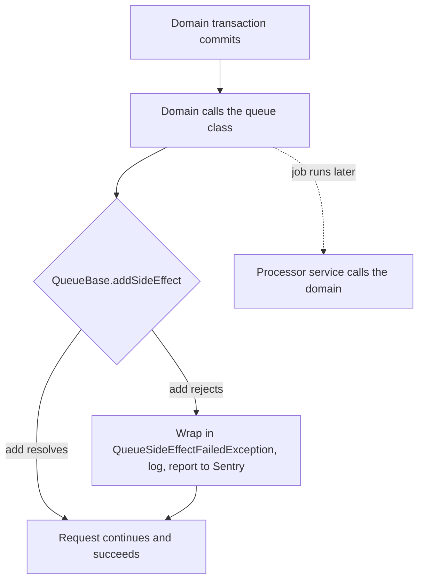
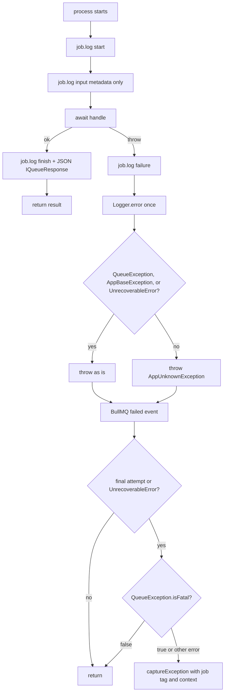

# Queue Documentation

- The BullMQ framework layer lives in `src/queues`.
- Named queues are registered by the owning feature.

## Overview

Background jobs run on [BullMQ][ref-bullmq] with [Redis][ref-redis].

Config lives in two files:

- `src/configs/redis.config.ts`: queue Redis connection settings
- `src/configs/queue.config.ts`: job defaults (attempts, backoff, `keepLogs`, retention age)

Code lives in two places:

- `src/queues`: BullMQ framework layer (enums, decorator, base classes, queue registration)
- owning feature modules: queue classes and processors
    - the router mounts the processors

## Related Documents

- [Configuration][ref-doc-configuration]: Queue Redis and BullMQ config keys
- [Environment][ref-doc-environment]: `QUEUE_REDIS_URL` and related vars
- [Notification][ref-doc-notification]: Notification queue consumers
- [Installation][ref-doc-installation]: Local Redis and BullBoard via Compose

## Table of Contents

- [Overview](#overview)
- [Related Documents](#related-documents)
- [Configuration](#configuration)
- [Queue Structure](#queue-structure)
- [Available Queues](#available-queues)
- [Usage](#usage)
    - [Adding Jobs to Queue](#adding-jobs-to-queue)
    - [Producer Decisions in Job Data](#producer-decisions-in-job-data)
    - [Job Options](#job-options)
    - [Fixed Job Ids](#fixed-job-ids)
- [Enqueuing After Commit](#enqueuing-after-commit)
- [Creating New Queue](#creating-new-queue)
- [Creating New Processor](#creating-new-processor)
- [QueueProcessorBase](#queueprocessorbase)
    - [Implementation](#implementation)
    - [Behavior](#behavior)
- [QueueException](#queueexception)
    - [Usage](#usage-1)
    - [Properties](#properties)
    - [Behavior](#behavior-1)
- [Bull Board Dashboard](#bull-board-dashboard)

## Configuration

Redis connection for queues is managed in `src/configs/redis.config.ts`:

```typescript
// the queue half of IConfigRedis; the other half is `cache`
queue: {
    url: string;
    namespace: string;
}
```

Job defaults (attempts, backoff delays, `keepLogs`, completed and failed retention age) and the producer connection limits are in `src/configs/queue.config.ts`:

- `queue.redis.connectTimeoutInMs`: how long the producer connection waits to connect (5 s).
- `queue.redis.maxRetriesPerRequest`: how many times ioredis retries one command before it rejects (`1`).

- `QueueModule.forRoot()` (`src/queues/queue.module.ts`) registers the producer connection under `QueueConfigKey`.
    - It sets `enableOfflineQueue: false`, `connectTimeout` from `queue.redis.connectTimeoutInMs`, and `maxRetriesPerRequest` from `queue.redis.maxRetriesPerRequest`, so an enqueue rejects quickly when Redis is down (see [Enqueuing After Commit](#enqueuing-after-commit)).
    - The default backoff is the `notificationBackoffDelayInMs` value (3 s). The key carries the notification queue's name, and the default applies to every queue on the connection.
- Each named queue's owning feature sets its own backoff and `keepLogs` through a `RegisterQueueOptionsFactory` on that feature's domain module, which overrides the connection default. The `EnumQueue.notification` factory reads the same `notificationBackoffDelayInMs` key, so that queue's backoff equals the connection default.

Environment variables:

- `QUEUE_REDIS_URL`: Redis connection URL (default: `redis://localhost:6379/1`). Queues live on Redis database `1`, and the cache uses database `0` through `CACHE_REDIS_URL`
- `APP_NAME`: Application name for connection naming
- `APP_ENV`: Application environment for connection naming

## Queue Structure

The queue system consists of:

1. **Queue Module** (`src/queues/queue.module.ts`): `QueueModule.forRoot()` registers the BullMQ producer Redis connection under `QueueConfigKey`. It does not register named queues, and it does not register the worker connection.
2. **Queue Processor Base** (`src/queues/bases/queue.processor.base.ts`): concrete `process` template (`job.log`, await `handle`, Nest `Logger.error` on failure), fatal-gate `onFailed` that reports to Sentry with the job name as a tag and the job id, name, `attemptsMade`, and `maxAttempts` as a context
3. **Queue Processor Decorator** (`src/queues/decorators/queue.decorator.ts`): `QueueProcessor`, the custom decorator for processor registration, which also opens the worker's own Redis connection
4. **Queue Constants** (`src/queues/constants/queue.constant.ts`): `QueueConfigKey`, the config key of the producer connection
5. **Queue Enums, Exceptions, Interface** (`src/queues/enums/queue.enum.ts`, `exceptions/queue.exception.ts`, `exceptions/queue.side-effect-failed.exception.ts`, `interfaces/queue.interface.ts`): `EnumQueue`, `EnumQueuePriority` and `EnumQueueJobState`, `QueueException`, `QueueSideEffectFailedException`, `IQueueResponse`
6. **Queue Base** (`src/queues/bases/queue.base.ts`): the abstract base of every queue class, with the protected `addSideEffect` and `addBulkSideEffect`, which run a post-commit enqueue without letting its failure change the response

**An enqueue lives in a queue class, never in a util or a service.**

- Path: `<feature>/queues/<feature>[.<concern>].queue.ts`.
- The class is `@Injectable()` and extends `QueueBase`.
- The class injects the BullMQ `Queue` with `@InjectQueue` and `SentryService`, and passes both to `super`.
- The feature's `<feature>.domain.module.ts` both provides and exports it:

| Class                    | From                       |
| ------------------------ | -------------------------- |
| `NotificationQueue`      | `NotificationDomainModule` |
| `NotificationEmailQueue` | `NotificationDomainModule` |
| `NotificationPushQueue`  | `NotificationDomainModule` |
| `WorkspaceQueue`         | `WorkspaceDomainModule`    |
| `ActivityLogQueue`       | `ActivityLogDomainModule`  |
| `SessionQueue`           | `SessionDomainModule`      |
| `TermPolicyQueue`        | `TermPolicyDomainModule`   |
| `UserQueue`              | `UserDomainModule`         |

A caller in another module injects the exported class rather than the `Queue` itself.

- Named queues are registered on the owning feature's domain module with `BullModule.registerQueueAsync({ name, configKey: QueueConfigKey, useClass: <Feature>[<Concern>]QueueFactory })`.
- The factory lives at `factories/<module>[.<concern>].queue.factory.ts` and sets that queue's job defaults.

Processors are not registered inside `src/queues`.

- Each one is a provider of its own feature's `<feature>.processor.module.ts` (`NotificationProcessorModule`, `WorkspaceProcessorModule`, `ActivityLogProcessorModule`, `SessionProcessorModule`, `TermPolicyProcessorModule`, `UserProcessorModule`).
- `RouterProcessorModule` (`src/router/processor/router.processor.module.ts`) imports every one of them.
- `RouterModule` imports `RouterProcessorModule` alongside the five HTTP route modules, so booting the API boots the workers in the same process.

Producers and workers do not share one connection.

- The producer connection comes from `QueueModule.forRoot()` under `QueueConfigKey`, with the connection name `{APP_NAME}-{APP_ENV}:queue`.
    - It is the only fail-fast connection: `enableOfflineQueue: false`, `queue.redis.connectTimeoutInMs`, and `queue.redis.maxRetriesPerRequest`.
- The `@QueueProcessor` decorator passes each worker its own `connection`: `redis.queue.url` with the connection name `{APP_NAME}-{APP_ENV}:processor`.
    - The worker keeps BullMQ's connection defaults, so its offline queue stays on and a command is retried until it succeeds.
    - The decorator reads the URL and the names from the environment when the class is decorated, since a decorator has no injection context.
- A named queue registers with `configKey: QueueConfigKey`, and the `@Processor` metadata of `@QueueProcessor` names the same key.
    - A worker therefore takes its `prefix` from the producer connection's queue namespace.

## Available Queues

Currently available queues defined in `src/queues/enums/queue.enum.ts`:

- `EnumQueue.notification`: General notification processing queue
- `EnumQueue.notificationEmail`: Email notification processing queue
- `EnumQueue.notificationPush`: Push notification processing queue
- `EnumQueue.workspace`: Workspace background processing queue
- `EnumQueue.activityLog`: Activity log row writes (the `createMany` job)
- `EnumQueue.session`: Session cache purges (the `purgeLogins` job)
- `EnumQueue.termPolicy`: Term policy S3 content deletes (the `deleteContent` job)
- `EnumQueue.user`: Previous profile photo S3 deletes (the `deletePhoto` job)

Queue priorities defined in `EnumQueuePriority`:

- `high`: 1
- `medium`: 5
- `low`: 10

Job states defined in `EnumQueueJobState`:

- BullMQ exports its `JobState` as a type only, so the enum names the strings `Job.getState()` returns: `completed`, `failed`, `active`, `delayed`, `prioritized`, `waiting`, `waitingChildren` (`waiting-children`), and `unknown`.
- Code that branches on a job state switches on `EnumQueueJobState`, never on a string literal.

## Usage

### Adding Jobs to Queue

The queue class is the only place that holds a BullMQ `Queue`, and it exposes one method per job it enqueues. A method a job calls enqueues with `this.queue.add`, as below, and throws on failure:

```typescript
@Injectable()
export class NotificationPushQueue extends QueueBase {
    constructor(
        @InjectQueue(EnumQueue.notificationPush)
        queue: Queue,
        sentryService: SentryService,
        private readonly helperStringService: HelperStringService
    ) {
        super(queue, sentryService);
    }

    async sendNewDeviceLogin(
        sendPayload: INotificationSendPushEncryptedPayload,
        data: INotificationNewDeviceLoginPayload
    ): Promise<void> {
        const payload: INotificationPushQueuePayload<INotificationNewDeviceLoginPayload> =
            {
                send: sendPayload,
                data,
                completedSteps: [],
                encryptedFailureTokens: null,
                encryptedPendingTokens: null,
            };

        const jobId = this.helperStringService.fillPattern(
            this.stepJobIdPattern,
            {
                notificationId: sendPayload.notificationId,
                step: EnumNotificationStep.sendPush,
            }
        );

        await this.queue.add(
            EnumNotificationPushProcess.newDeviceLogin,
            payload,
            {
                jobId,
                priority: EnumQueuePriority.high,
            }
        );
    }
}
```

A `jobId` is a `{token}` pattern from the owning module's config, a `<namespace>.jobId.<name>Pattern` key in `src/configs/`, read once in the queue class constructor and filled by `HelperStringService.fillPattern`. Every notification queue dedupes by `jobId` alone and sets no `deduplication` option.

- `notification.jobId.userPattern` is `{process}-{userId}`, for the jobs that run once per user.
- `notification.jobId.eventPattern` is `{process}-{eventId}`, for a job that reports one event (a password change, a reset, a login session) and takes that event's id.
- `notification.jobId.referencePattern` is `{process}-{reference}`, for a job keyed by the verification, reset, or invite reference.
- `notification.jobId.joinRequestPattern` is `{process}-{joinRequestId}-{userId}`, and `notification.jobId.userTermPolicyPattern` is `{process}-{userId}-{termPolicyId}`.
- The term-policy publication patterns key the publication jobs:
    - `notification.jobId.termPolicyPublishPattern`, `{process}-{termPolicyId}`, for the publication job.
    - `notification.jobId.termPolicyBatchPattern`, `{process}-{termPolicyId}-{batchId}`, for an email batch job.
    - `notification.jobId.termPolicyResendPattern`, `{process}-{termPolicyId}-{resendNonce}`, for the resend job.
    - `notification.jobId.termPolicyBatchResendPattern`, `{process}-{termPolicyId}-{batchId}-{resendNonce}`, for an email batch job of a resend.
- `notification.jobId.stepPattern` is `{notificationId}-{step}`. It fills the `jobId` of a push job, of a cleanup job, and of an email job for a recipient with an account, so one notification enqueues each step once while the job keeps its id (7 days after completion, 14 days after failure).
- The activity log, session, term-policy, and user queues key each job as `{process}-{nonce}` (`activityLog.jobId.createManyPattern`, `session.jobId.purgeLoginsPattern`, `termPolicy.jobId.deleteContentPattern`, `user.jobId.deletePhotoPattern`) with a fresh nonce from `DatabaseUtil.createId()`, so every request adds its own job.

A queue class that enqueues many jobs at once builds them and calls `addBulkSideEffect` (`addBulk` for a method a job calls): `NotificationQueue.sendWelcomeByAdminBulk` for the admin import and `NotificationQueue.sendWorkspaceJoinRequestBulk` for the reviewers of a join request.

A sensitive payload field is sealed by the queue class with `HelperEncryptionService` and named `encrypted<Field>`: a generated password, a link, a recipient email address, and device notification tokens.

- The queue class seals the field with the module's encryption purpose and the recipient id as authenticated data.
- Job data sits in Redis and shows in Bull Board, so it holds the ciphertext only.
- The `NotificationPushQueue` above receives `send.encryptedNotificationTokens` already sealed, from the recipient snapshot that `NotificationQueue` sealed.

A domain that needs the job injects the queue class and calls that method:

```typescript
await this.notificationPushQueue.sendNewDeviceLogin(sendPayload, data);
```

### Producer Decisions in Job Data

The producer decides once, at enqueue, and the decision rides in the job data as a required non-null field:

- who receives the job
- at which address
- on which channels, after the user's notification settings
- to which device tokens
- the bound of a recipient set

The processor takes these fields from the job and does not re-read the user, the device, or the setting to decide again. The producer reads the settings when it builds the decision, so a setting changed after the enqueue does not reach a queued job.

A notification job carries the sealed recipient snapshot (see [Notification: Recipient Snapshot][ref-doc-notification-snapshot]).

A recipient set too large for a payload carries a fixed bound taken from a stored column. The term-policy publication is the one such job:

1. The publication processor is the producer of its batch jobs, so its user paging is the enqueue-time read for them, not a consumer re-read.
    - It takes no recipient snapshot.
    - It reads active users a page of `email.batchSize` (`src/configs/email.config.ts`, 50) at a time in id order.
2. The processor applies no notification settings. Each `Notification` row it creates carries every channel of the kind.
3. For each page it creates the `Notification` rows and the `TermPolicyRecipient` markers for users without a marker, and it seals the address of each recipient into an email batch job.
    - The new rows of one page form one batch job of at most `email.batchSize` recipients.
    - A later attempt or a resend also adds each batch of that page that still has sendable markers (`sentAt` and `claimedAt` null).
    - A batch job carries its recipients, so the email processor does not read users.
4. The bound is `recipientCutoffAt`, the policy's stored `publishedAt`.
    - `TermPolicyDomain` writes it into the publication job data when it enqueues the job.
    - The processor takes it from the job data and does not read the policy, so every attempt uses the same value.
    - `publishedAt` is written once, when a draft is published. A published policy cannot be published again, and a resend job carries the stored value.
5. The cutoff is inclusive: a user qualifies when `createdAt` is at or before it. A user created after `publishedAt` never qualifies for that policy's publication.

The job also reads and updates state at run time, and that state is not a decision field:

- Step state in the job data: `completedSteps`, `encryptedFailureTokens`, and `encryptedPendingTokens`. The producer sets `completedSteps` to `[]` and the two token fields to `null`, and the processor service writes them back with `job.updateData`.
    - In a push job the two token fields are the only step state that may be `null`: each holds progress, so it has no value at enqueue, while the decision fields are always set.
    - An orchestration job holds `completedSteps` alone, always an array. The bulk publication job holds no step state.
    - An email job carries no step state.
- Step state on the `TermPolicyRecipient` marker: the email processor claims the sendable markers (`claimedAt`, `claimNonce`), stamps `sentAt` after a successful send, and releases the claim after a definite SES failure. A claimed marker is never claimed again.

Two jobs read at run time by design, because they decide from the current time or purge idempotently:

- `cleanupStaleTokens`, a scheduler sweep whose cutoff is relative to now.
- `cleanupTokens`, an idempotent purge of the tokens the job carries.

### Job Options

Default job options come from `queue.config.ts` (interface `IConfigQueue`).

- The connection-level backoff default on `QueueModule.forRoot()` is `notificationBackoffDelayInMs`, a connection default that takes the notification queue's key name.
- Each queue factory overrides backoff for its own queue with the key in the table below and sets `keepLogs` from `queue.job.keepLogs` (20).
- Retention is age-based.

Every queue shares:

- `attempts: 3`
- `keepLogs: 20`
- a completed job kept for `removeOnCompleteAgeInSeconds` (7 days)
- a failed job kept for `removeOnFailAgeInSeconds` (14 days)

The queues differ in the exponential backoff `delay`:

| Queue | config key | backoff delay |
| --- | --- | --- |
| `EnumQueue.notificationEmail` | `emailBackoffDelayInMs` | `10000` |
| `EnumQueue.notificationPush` | `pushBackoffDelayInMs` | `5000` |
| `EnumQueue.notification` | `notificationBackoffDelayInMs` | `3000` |
| `EnumQueue.workspace` | `workspaceBackoffDelayInMs` | `10000` |
| `EnumQueue.session` | `sessionBackoffDelayInMs` | `3000` |
| `EnumQueue.activityLog` | `activityLogBackoffDelayInMs` | `10000` |
| `EnumQueue.termPolicy` | `termPolicyBackoffDelayInMs` | `10000` |
| `EnumQueue.user` | `userBackoffDelayInMs` | `10000` |

For example, the `notificationEmail` queue:

```typescript
{
    attempts: 3,
    keepLogs: 20,
    backoff: {
        type: 'exponential',
        delay: 10000,
    },
    removeOnComplete: { age: 604800 },
    removeOnFail: { age: 1209600 },
}
```

- A single `add()` call overrides any of these options for that job.
- `keepLogs` retains the BullMQ `job.log` lines the base writes for that retention window.

### Fixed Job Ids

A fixed `jobId` enqueue is a plain `add`:

- BullMQ ignores the `add` while a job holds that id and raises no error.
- A completed job keeps its id for `removeOnCompleteAgeInSeconds` (7 days) and a failed job for `removeOnFailAgeInSeconds` (14 days), from `queue.job.*` in `src/configs/queue.config.ts`. After that age the id can be added again.
- No producer calls `getJob`, `getState`, `retry`, or `remove`, and no caller branches on the result of an `add`.

`NotificationQueue.sendPublishTermPolicy` adds the publication job under the `jobId` `publishTermPolicy-{termPolicyId}`. A second add for the same term policy is ignored while the first job exists.

**Resend.** An operator-triggered re-run puts a fresh nonce in every job id it adds, so no id collides with an earlier run:

1. `NotificationQueue.sendResendPublishTermPolicy` mints the nonce with `DatabaseUtil.createId()`.
2. It adds the `resendPublishTermPolicy` job under `resendPublishTermPolicy-{termPolicyId}-{resendNonce}` (`notification.jobId.termPolicyResendPattern`).
3. The nonce rides in the job data as `resendNonce`, which is `null` for a publication.
4. The fan-out adds each email batch job under `publishTermPolicy-{termPolicyId}-{batchId}-{resendNonce}` (`notification.jobId.termPolicyBatchResendPattern`). The job name stays `publishTermPolicy`.

**Per-batch email jobs.** `NotificationEmailQueue.sendPublishTermPolicyBatch` adds one job per recipient batch under the `jobId` `publishTermPolicy-{termPolicyId}-{batchId}`, or the resend id above when `resendNonce` is set, with a `delay` of `index * email.batchDelayInMs`. It checks no job state:

1. A later attempt of the fan-out job runs `processPublishTermPolicy` again, and users that already hold a recipient marker are skipped.
2. A batch with sendable markers is added again under its stored `batchId`, with its recipients rebuilt from the active users and sealed again.
    - BullMQ ignores that `add` while a job with the id still exists in the email queue (waiting, delayed, active, or kept after completion or failure).
    - Once the old job has expired, the same `add` creates a new job.
3. A batch whose markers are all claimed or sent is not added again.
4. Users with no marker form a new batch with a new `batchId`, so they get a new job.

The `jobId` does not decide delivery. A job that runs twice sends to a recipient at most once, because the email job claims the marker before the send (see [Notification][ref-doc-notification]).

## Enqueuing After Commit

A request's side effect (a notification, the activity log rows, a session cache purge, an S3 delete) is a job on the queue of the module that owns it. The request adds the job after its transaction commits and does not wait for the work.



- A queue-class method a request calls after the commit enqueues through the protected `QueueBase.addSideEffect(name, data, options, description)` or `addBulkSideEffect(jobs, description)`, which wrap `add` and `addBulk`.
    - A rejection becomes a `QueueSideEffectFailedException` (an `AppUnknownException` that carries the cause in `rawError` and names the effect in `description`), logged at `error` and passed to `SentryService.captureException`.
    - The method then resolves, so the request still succeeds.
- A domain awaits the queue method directly, with no wrapper around it.
- A domain exception the request throws is never replaced by an enqueue failure.
- A queue-class method a job calls, and the term-policy resend, call `add`, `addBulk`, or `upsertJobScheduler` directly and throw.
    - The term-policy resend is a route whose only work is the enqueue, so an `add` failure answers `500`.
    - An enqueue made inside a processor throws, and BullMQ retries the job.
- The producer connection rejects fast when Redis is down: `enableOfflineQueue` is `false` and `maxRetriesPerRequest` is bounded (see [Configuration](#configuration)).
- There is no transactional outbox. A job lost to a failed enqueue is recovered by re-running the operation.
- The recipient snapshot of a notification is read before the transaction, never inside it (see [Notification][ref-doc-notification]).

The jobs of the queues a request feeds:

| Queue | Job | Carries | Processor effect |
| --- | --- | --- | --- |
| `activityLog` | `createMany` | the rows one request staged, with their ids and `createdAt` | `ActivityLogRepository.createMany` writes only the ids that are absent |
| `session` | `purgeLogins` | the user id and the exact revoked session refs | `SessionCache.deleteLogins` deletes those entries |
| `termPolicy` | `deleteContent` | the content directory path of a deleted draft | `AwsS3Service.deleteDir` empties the private bucket directory |
| `user` | `deletePhoto` | the user id, key, and access of the replaced profile photo | `AwsS3Service.deleteItem` deletes the object |

- A profile photo is enqueued for delete only when its key sits under the user's own profile photo path and differs from the new key.
- The `deletePhoto` processor throws a fatal `QueueException` when the stored access names no bucket.
- A revoked session takes effect for cached logins when the `purgeLogins` job runs.
- The activity log is HTTP-only: a job stages no entry.

## Creating New Queue

1. Add new queue enum in `src/queues/enums/queue.enum.ts`:

```typescript
export enum EnumQueue {
    notification = 'notification',
    notificationEmail = 'notificationEmail',
    notificationPush = 'notificationPush',
    workspace = 'workspace',
    // ... the other queues
    yourQueue = 'yourQueue', // New queue
}
```

2. Add its backoff delay to `IConfigQueue` in `src/configs/queue.config.ts`:

```typescript
job: {
    // ... existing delays
    yourQueueBackoffDelayInMs: ms('5s'),
}
```

3. Add a queue factory under `src/modules/<feature>/factories/` that implements `RegisterQueueOptionsFactory`, reading job defaults from config (see `NotificationEmailQueueFactory`).

4. Register the queue on the feature's `<feature>.domain.module.ts`:

```typescript
BullModule.registerQueueAsync({
    name: EnumQueue.yourQueue,
    configKey: QueueConfigKey,
    useClass: YourQueueFactory,
});
```

5. Add the enqueue class in `src/modules/<feature>/queues/`, extending `QueueBase`, and provide plus export it from the feature's `<feature>.domain.module.ts`:

```typescript
@Injectable()
export class YourFeatureQueue extends QueueBase {
    constructor(
        @InjectQueue(EnumQueue.yourQueue)
        queue: Queue,
        sentryService: SentryService
    ) {
        super(queue, sentryService);
    }

    async sendSomething(data: IYourQueuePayload): Promise<void> {
        await this.addSideEffect(
            EnumYourProcess.something,
            data,
            { priority: EnumQueuePriority.medium },
            'enqueue your feature something'
        );
    }
}
```

A method that a job calls, instead of a request after commit, calls `this.queue.add` and throws.

## Creating New Processor

1. Create the processor class inside its owning feature module, under `src/modules/<feature>/processors/`, extending `QueueProcessorBase`.
    - The base owns the concrete `process` method.
    - The subclass implements `protected abstract handle` only:

```typescript
@QueueProcessor(EnumQueue.notificationPush, {
    limiter: {
        max: FirebaseMaxRateLimitPerDuration,
        duration: FirebaseRateLimitDurationInMs,
    },
})
export class NotificationPushProcessor extends QueueProcessorBase {
    constructor(
        private readonly notificationPushProcessorService: NotificationPushProcessorService,
        sentryService: SentryService
    ) {
        super(sentryService);
    }

    protected async handle(
        job: Job<unknown, IQueueResponse, EnumNotificationPushProcess>
    ): Promise<IQueueResponse> {
        switch (job.name) {
            case EnumNotificationPushProcess.newDeviceLogin:
                return await this.notificationPushProcessorService.processNewDeviceLogin(
                    job as Job<
                        INotificationPushQueuePayload<INotificationNewDeviceLoginPayload>,
                        IQueueResponse,
                        EnumNotificationPushProcess
                    >
                );
            default:
                return {
                    message: `No notification processor found for the given job name ${job.name}`,
                };
        }
    }
}
```

`handle` is the dispatcher:

- It switches on `job.name` and awaits a `*.processor.service.ts` method.
- Feature remaps stay inside `handle` (for example `NotificationEmailProcessor` and `NotificationPushProcessor` map `HelperDecryptFailedException` to BullMQ `UnrecoverableError`, and `NotificationEmailProcessor` does the same for `NotificationEmailDeliveryUnknownException`).
- The subclass implements `handle` only. `QueueProcessorBase` owns `process`, Nest failure logging, and `job.log`.

The second argument of `@QueueProcessor` is `IQueueProcessorOptions`:

- It is a BullMQ `WorkerOptions` minus `name` and `connection`. The decorator owns the name, and the shared Redis connection is the connection.
- A worker that needs its own throughput ceiling passes one: `NotificationPushProcessor` sets `limiter` from the Firebase send-quota constants.
- The decorator derives the worker name as `{APP_NAME}-{APP_ENV}:{queue}:consumer`, read from `process.env` at decoration time.

2. Register the processor and its processor service in the feature's own `<feature>.processor.module.ts`:

```typescript
@Module({
    controllers: [],
    providers: [
        NotificationProcessor,
        NotificationEmailProcessor,
        NotificationPushProcessor,
        NotificationProcessorService,
        NotificationEmailProcessorService,
        NotificationPushProcessorService,
        YourNewProcessor, // Add processor
    ],
    exports: [],
    imports: [],
})
export class NotificationProcessorModule {}
```

3. For a feature that has no processor module yet, create one and add it to `RouterProcessorModule`:

```typescript
@Module({
    controllers: [],
    providers: [],
    exports: [],
    imports: [
        ActivityLogProcessorModule,
        NotificationProcessorModule,
        SessionProcessorModule,
        TermPolicyProcessorModule,
        UserProcessorModule,
        WorkspaceProcessorModule,
        YourFeatureProcessorModule, // Add module
    ],
})
export class RouterProcessorModule {}
```

A processor module imports whatever its processor services depend on: `WorkspaceProcessorModule` imports `WorkspaceDomainModule`, while `NotificationProcessorModule` needs no imports because everything it injects is global.

## QueueProcessorBase

`QueueProcessorBase` is the base class for all queue processors. It:

- extends `WorkerHost` from BullMQ
- takes the global `SentryService` in its constructor
- owns the concrete `process` template (including BullMQ `job.log` lines)
- reports a fatal job failure to Sentry once from the `failed` worker event

### Implementation

Location: `src/queues/bases/queue.processor.base.ts`

```typescript
export abstract class QueueProcessorBase extends WorkerHost {
    private readonly logger = new Logger(QueueProcessorBase.name);

    constructor(protected readonly sentryService: SentryService) {
        super();
    }

    protected abstract handle(job: Job): Promise<IQueueResponse>;

    async process(job: Job): Promise<IQueueResponse> {
        const maxAttempts = job.opts.attempts ?? 1;

        await this.writeJobLog(job, 'Job started');
        await this.writeJobLog(
            job,
            `Job input id=${job.id} name=${job.name} attemptsMade=${job.attemptsMade} maxAttempts=${maxAttempts}`
        );

        try {
            const result = await this.handle(job);

            await this.writeJobLog(
                job,
                `Job finished ${JSON.stringify(result)}`
            );

            return result;
        } catch (error: unknown) {
            const failureMessage =
                error instanceof Error ? error.message : String(error);

            await this.writeJobLog(job, `Job failed ${failureMessage}`);
            this.logger.error(error, 'Queue job failed');

            if (
                error instanceof QueueException ||
                error instanceof AppBaseException ||
                error instanceof UnrecoverableError
            ) {
                throw error;
            }

            throw new AppUnknownException(error);
        }
    }

    @OnWorkerEvent('failed')
    onFailed(job: Job<unknown, null, string>, error: Error): void {
        const maxAttempts = job.opts.attempts ?? 1;
        const isLastAttempt =
            error instanceof UnrecoverableError ||
            error.name === 'UnrecoverableError' ||
            job.attemptsMade >= maxAttempts;

        if (!isLastAttempt) {
            return;
        }

        let isFatal = true;

        if (error instanceof QueueException) {
            isFatal = !!error.isFatal;
        }

        if (!isFatal) {
            return;
        }

        this.sentryService.captureException(error, {
            tags: { 'job.name': job.name },
            contexts: {
                job: {
                    id: String(job.id),
                    name: job.name,
                    attemptsMade: job.attemptsMade,
                    maxAttempts,
                },
            },
        });
    }
}
```

- `writeJobLog` wraps `job.log` and swallows a logging fault (Nest `Logger.warn` at most).
- A `job.log` fault leaves the job outcome unchanged.

### Behavior



1. **`process` template**:
    - start log
    - input metadata log (`job.id`, `job.name`, `attemptsMade`, `maxAttempts` from `job.opts.attempts`)
    - await `handle`
    - finish log with `JSON.stringify` of the returned `IQueueResponse`

    The input line never includes `job.data`.

2. **On throw inside `process`**: one failure `job.log` line, one Nest `Logger.error` (object-first) for Pino, then a throw so BullMQ can retry or mark the job failed.
    - A `QueueException`, an `AppBaseException`, or an `UnrecoverableError` is thrown as it is.
    - Any other error is wrapped in `AppUnknownException`, with the cause in `rawError`.
3. **On Job Failure (`onFailed`)**: triggered by the BullMQ `failed` worker event after the throw.
4. **Retry Check**: the failure is final when BullMQ will not retry it: `attemptsMade` (which already counts the failed attempt) has reached `attempts`, or the error is an `UnrecoverableError`.
5. **Error Classification**:
    - `QueueException` with `isFatal: true` → Reports to Sentry
    - `QueueException` with `isFatal: false` → Does not report to Sentry
    - Other exceptions, `UnrecoverableError` included → Reports to Sentry (treated as fatal)
6. **Sentry Reporting**: on that final fatal failure, `SentryService.captureException(error, captureContext)` runs once with:
    - the tag `job.name`
    - the `job` context holding `id`, `name`, `attemptsMade`, and `maxAttempts`

- A processor throws `UnrecoverableError` for a failure no retry can fix.
- `NotificationEmailProcessor.handle` and `NotificationPushProcessor.handle` do so for a payload that fails to decrypt (see [Notification][ref-doc-notification]).

## QueueException

`QueueException` is a custom exception class for queue error handling with Sentry integration control.

### Usage

```typescript
// Fatal error - reported to Sentry on the final failure
throw new QueueException('Critical payment processing failed', true);

// Non-fatal error - will not be reported to Sentry
throw new QueueException('Temporary service unavailable', false);

// Default behavior (non-fatal)
throw new QueueException('Minor validation error');
```

A notification processor service throws `QueueException(summary, true)` when a step of the job fails, so BullMQ retries and Sentry hears of it on the last attempt (see [Notification][ref-doc-notification]).

### Properties

- `message`: Error message
- `isFatal`: Boolean flag to control Sentry reporting (default: `false`)

### Behavior

When a job fails:

1. `QueueProcessorBase.process` writes a failure `job.log` line, calls Nest `Logger.error` once, and throws the error as is when it is a `QueueException`, an `AppBaseException`, or an `UnrecoverableError`, and wrapped in `AppUnknownException` otherwise
2. On the final failure (last attempt, or an `UnrecoverableError`), `onFailed` classifies the error:
    - If error is `QueueException` with `isFatal: true` → Reports to Sentry (with the `job.name` tag and the `job` context)
    - If error is `QueueException` with `isFatal: false` → Does not report to Sentry
    - If error is any other exception → Reports to Sentry (treated as fatal)
3. On a failure BullMQ will retry → Does not report to Sentry

## Bull Board Dashboard

ACK NestJS Boilerplate includes Bull Board for queue monitoring and management.

Access the dashboard:

```bash
docker-compose up -d
```

Dashboard URL: `http://localhost:3010`

Default credentials:

- Username: `admin`
- Password: `admin123`

- `DOCKER_BULLBOARD_USER` and `DOCKER_BULLBOARD_PASSWORD` in `.env` replace the defaults.
- `DOCKER_REDIS_PASSWORD` is passed on when Redis requires a password.
- Compose reads `.env` for these variables. With them empty, the defaults apply.

Configuration in `docker-compose.yml`:

```yaml
redis-bullboard:
    image: venatum/bull-board:latest
    hostname: redis-bullboard
    ports:
        - 3010:3000
    environment:
        - REDIS_HOST=redis
        - REDIS_PORT=6379
        - REDIS_PASSWORD=${DOCKER_REDIS_PASSWORD:-}
        - BULL_PREFIX=Queue
        - USER_LOGIN=${DOCKER_BULLBOARD_USER:-admin}
        - USER_PASSWORD=${DOCKER_BULLBOARD_PASSWORD:-admin123}
        - REDIS_DB=1
```

- Both Compose files give the service a health check that requests `http://127.0.0.1:3000/login` inside the container.
- The production Compose file publishes the dashboard on `127.0.0.1:3010` only.
- See [Release][ref-doc-release].

<!-- REFERENCES -->

[ref-bullmq]: https://bullmq.io
[ref-redis]: https://redis.io
[ref-doc-configuration]: configuration.md
[ref-doc-environment]: environment.md
[ref-doc-notification]: notification.md
[ref-doc-notification-snapshot]: notification.md#recipient-snapshot
[ref-doc-installation]: installation.md
[ref-doc-release]: release.md
