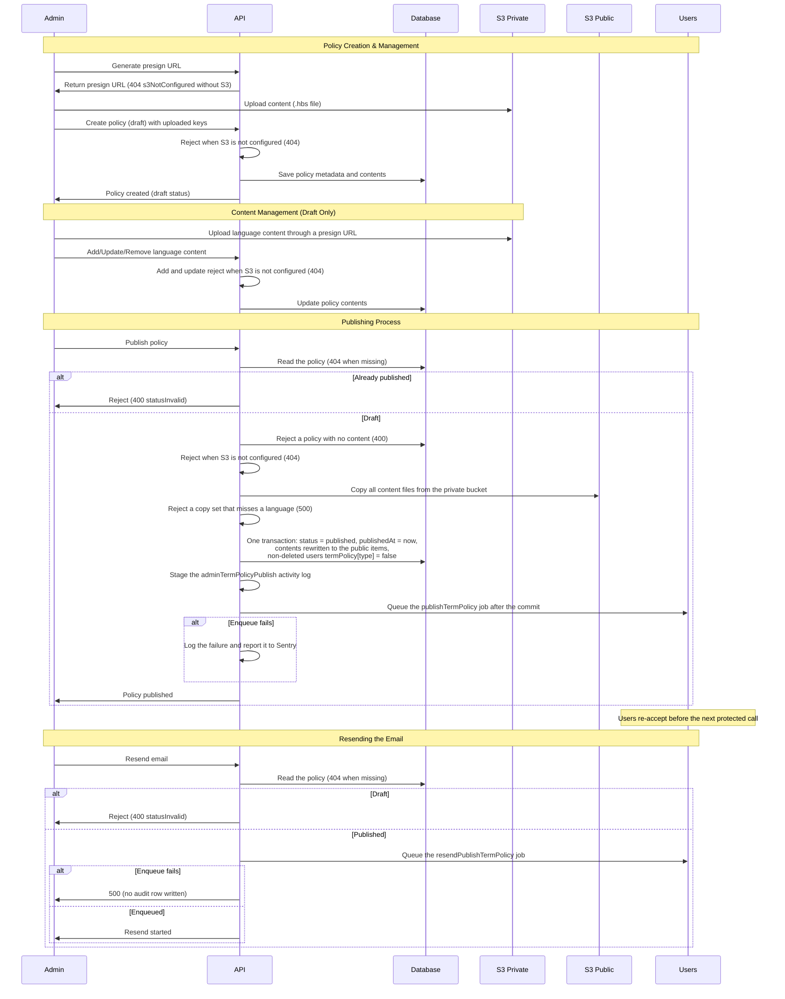
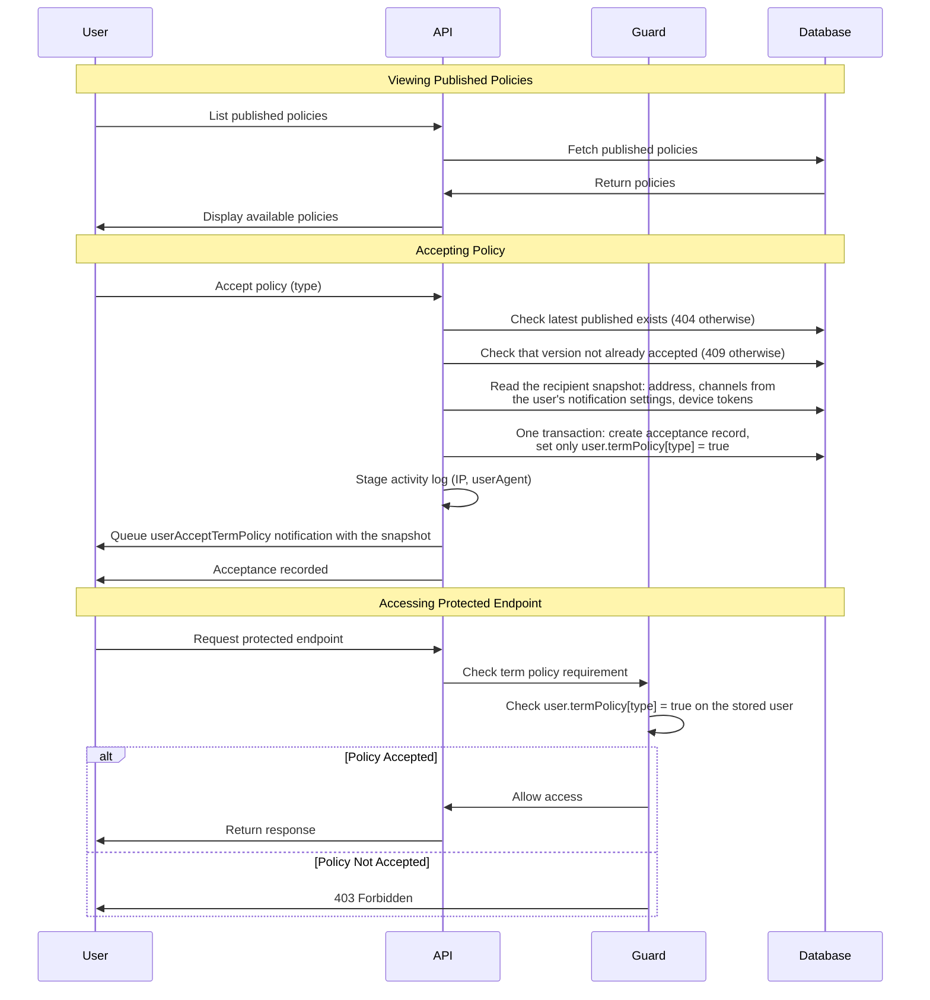
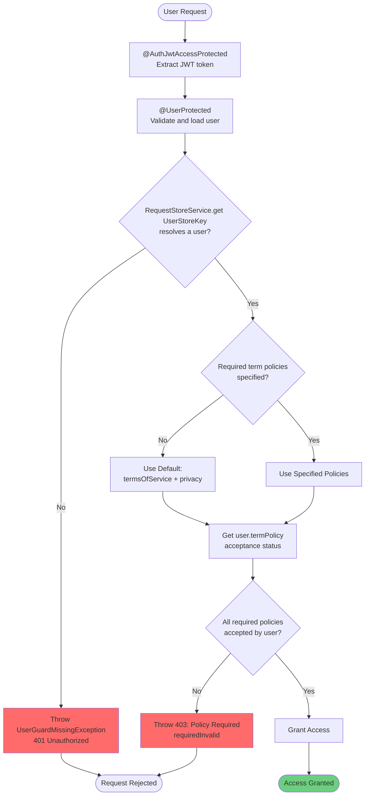

# Term Policy Document

## Overview

Term Policy stores versioned legal documents (terms of service, privacy policy, marketing consent, cookie policy) and records user acceptance.

## Related Documents

- [Database Documentation][ref-doc-database]: Migration, seeding, and schema
- [Authorization Documentation][ref-doc-authorization]: Admin RBAC on term-policy routes
- [Authentication Documentation][ref-doc-authentication]: JWT and session context
- [File Upload Documentation][ref-doc-file-upload]: Content upload and admin content GET (presign)
- [Analytic Documentation][ref-doc-analytic]: Admin acceptance-rate and time-to-accept metrics under `/admin/analytic/term-policies/*`
- [Email Documentation][ref-doc-email]: SES templates for policy publication (not the HTML bodies)

## Table of Contents

- [Overview](#overview)
- [Related Documents](#related-documents)
- [Policy Types](#policy-types)
- [Policy Status](#policy-status)
    - [Draft Status](#draft-status)
    - [Published Status](#published-status)
- [Flow](#flow)
    - [Admin Flow Diagram](#admin-flow-diagram)
    - [User Flow Diagram](#user-flow-diagram)
- [User Endpoints](#user-endpoints)
    - [List Published Policies](#list-published-policies)
    - [Accept Policy](#accept-policy)
    - [View Acceptance History](#view-acceptance-history)
- [Admin Endpoints](#admin-endpoints)
    - [Generate Presign URL](#generate-presign-url)
    - [Create Policy](#create-policy)
    - [Add Content](#add-content)
    - [Update Content](#update-content)
    - [Remove Content](#remove-content)
    - [Get Content](#get-content)
    - [Publish Policy](#publish-policy)
    - [Resend Email](#resend-email)
    - [List Policies](#list-policies)
    - [Delete Policy](#delete-policy)
- [TermPolicyAcceptanceProtected](#termpolicyacceptanceprotected)
    - [Basic Usage](#basic-usage)
    - [How It Works](#how-it-works)
    - [Important Notes](#important-notes)
- [Migration & Seeding](#migration--seeding)

## Policy Types

Four policy types are available via `EnumTermPolicyType`:

| Type             | Description                |
| ---------------- | -------------------------- |
| `termsOfService` | Terms of Service agreement |
| `privacy`        | Privacy Policy             |
| `marketing`      | Marketing consent          |
| `cookies`        | Cookie Policy              |

- Each type can have multiple versions.
- A user reaches protected endpoints only after accepting the latest published version.

## Policy Status

Term policies follow a two-stage status:

### Draft Status

- Policy created by admin
- Content files stored in **private S3 bucket**
- Can be edited, updated, or deleted
- Not visible to users
- Key: `term-policies/{type}/v{version}/{language}.hbs` (from `termPolicy.uploadContentPath`)

### Published Status

- Policy published by admin
- Content files exist in both buckets: the private originals the draft was uploaded to, and a copy in the **public S3 bucket**
- Cannot be edited or deleted
- Visible to all users
- **Invalidates all existing user acceptances** for that policy type
- Every non-deleted user re-accepts the new version before reaching protected endpoints again
- Key: `term-policies/{type}/v{version}/{language}.hbs` (from `termPolicy.contentPublicPath`)

- Both paths resolve to the same key, so the two copies differ by bucket alone.
- The record's `contents` point at the public copy, each entry carrying the `access` of the bucket it names.
- Publishing a new version writes `termPolicy: { update: { [type]: false } }` for every non-deleted user, whatever the user's status.
- The nested `update` changes only the flag of that type, so the other flags of the user stay as they are.
- Each user accepts the new version before reaching protected endpoints again.

## Flow

### Admin Flow Diagram



Publishing and resending are the admin actions that fan out to the users. Each request adds one orchestration job, and a policy can be resent many times.

Publish:

- A `draft` policy publishes, then the request queues one `publishTermPolicy` job. The response is `{}`.
- The order inside the request is:
    1. checks and the copy to the public bucket
    2. one transaction:
        1. the guarded update that sets `status` to `published`, stamps `publishedAt`, and rewrites `contents` to the public items
        2. the reset of every non-deleted user's acceptance
        3. the preparation of the `adminTermPolicyPublish` activity log
    3. the commit
    4. the staging of the prepared activity log
    5. the enqueue of the `publishTermPolicy` job
- Preparing an activity log validates its metadata against the action contract and builds the row in memory. It writes nothing, so a rolled-back transaction leaves no row.
- Staging after the commit hands the prepared row to the request. `ActivityLogInterceptor` flushes every staged row when the handler settles, on success and on failure.
- A policy already `published` answers `400` (`statusInvalid`, `TermPolicyStatusInvalidException`) from the initial read, before the copy and before any write. Publish runs once per version.
- No per-type gate exists: a version never waits for, and is never blocked by, another version of the same type.
- The status update matches the policy only while it is `draft`, so one of two concurrent publishes commits.
    - The losing publish queues nothing. Its initial read still saw a `draft`, so it has already copied the content to the public bucket when the guarded update runs inside the transaction.
    - It answers `400` (`statusInvalid`) from that update when the update runs after the winner commits.
    - It answers `400` (`statusInvalid`) as well when the two transactions overlap: MongoDB raises a write conflict (`P2034`), nothing retries it, and `publishByAdmin` maps `DatabaseWriteConflictException` to `TermPolicyStatusInvalidException`, never `409`.
- A write conflict inside the publish transaction can also come from a concurrent write to a user, because the acceptance reset updates every non-deleted user.
    - The transaction rolls back, the policy stays `draft`, and nothing is staged or queued.
    - The request answers `400` (`statusInvalid`), and the admin publishes again.
    - Any other database error keeps its mapping: an unavailable database answers `503` through `AppUnknownException` and the general filter.
- The copy to the public bucket must return a file for every language of the draft.
    - A copy that matches no content, or a language with no copy, throws before the transaction and the request answers `500`.
    - The policy stays `draft`, so a partial copy set never publishes.
- The job id is `publishTermPolicy-{termPolicyId}`.
    - BullMQ ignores a second add with the same id while the job is kept: a completed job for 7 days, a failed job for 14 days.
- A queue failure after the commit answers `200`: `NotificationQueue.sendPublishTermPolicy` enqueues through `QueueBase.addSideEffect`, which logs the failure and reports it to Sentry.
    - The policy stays `published` and the acceptances stay reset.
    - The `adminTermPolicyPublish` row is written, because it is staged before the enqueue.
    - The admin recovers with the resend endpoint, which re-runs the fan-out of a published policy (see [Resend Email](#resend-email)).

Resend:

- A `published` policy queues one `resendPublishTermPolicy` job. A `draft` policy answers `400` (`statusInvalid`).
- The job id is `resendPublishTermPolicy-{termPolicyId}-{resendNonce}`, and `resendNonce` is a fresh id per request, so every request queues its own job.
- The job carries the policy's stored `publishedAt` as `recipientCutoffAt`, the value the publish job carried, even when the publish job never queued. It runs the same fan-out and changes no acceptance and no policy field.
- It creates rows for the active users that have none and re-queues the recipient rows still unsent and unclaimed. A row already sent or claimed is left alone.
- A queue failure answers `500` (`AppUnknownException`) and writes no `adminTermPolicyResendEmail` row, because the row is staged only after the enqueue succeeds. The resend is the one request whose only work is the enqueue, so `NotificationQueue.sendResendPublishTermPolicy` calls `add` and its failure throws.
- A repeat request mints a fresh nonce, so it queues a new job.

Recipients:

- The job targets every active user (status `active`, not deleted) created at or before the publish.
    - `recipientCutoffAt` rides in the job payload as the ISO form of the policy's `publishedAt`, so a retry or a resend keeps the same cutoff.
    - A user created after `publishedAt`, a deleted user, and a user whose status is not `active` are outside the recipient set.
    - The `User` index on `[status, deletedAt, createdAt desc, id desc]` serves this filter.
    - Each user gets one marker row per term policy. A second batch job can still exist (a re-queue or a resend), but the unique row stops a second `Notification` row for that user.
    - A user's notification setting does not apply.
- The job pages users through `UserDomain.getListActiveRecipientCursor` with an `id` cursor and sends in batches of `email.batchSize` (50).
- Each page selects only `id`, `email`, and `username`.
- Each batch is one email job with a delay of `index * email.batchDelayInMs`.
- The batch payload carries the recipients frozen at enqueue: `userId`, `notificationId`, the email address encrypted with the `userId` as authenticated data, and `username`.
- A page that finds a recipient row neither sent nor claimed re-queues that batch. It reads the recipients that fell outside the page through `UserDomain.getManyActiveRecipientsByIds`, bounded by the same cutoff.
- A resend batch job id carries the `resendNonce`, so it never collides with the original batch job.

Email job:

1. It claims the batch rows that have no `sentAt` and no `claimedAt`, under a fresh claim nonce, and sends to the recipients it claimed.
2. It sets `sentAt` for each recipient SES reports as `Success`.
3. It releases the claim of each recipient SES reports as failed, and fails the job.
4. A recipient with an unknown delivery outcome stays claimed and is never sent again. The job fails without a retry.

The email job reads no user field. With SES unconfigured it claims nothing and completes.

Job ids, recipient rows, claims, retries, what happens when the orchestration job exhausts its attempts, and Sentry reporting: [Notification Documentation][ref-doc-notification].

### User Flow Diagram



## User Endpoints

Users interact with term policies through acceptance and viewing their acceptance history.

### List Published Policies

Users can view all published policies available for acceptance:

```http
GET /public/term-policy/list
```

Returns policies with cursor pagination, optionally filtered by type.

- `orderBy` accepts `publishedAt` and `version`, each as `field:direction`.
- A field outside that list answers `422` with status code `50300` (`request.error.validation`).
- The response metadata names the accepted fields in `availableOrderBy`.

### Accept Policy

To accept a specific policy type:

```typescript
POST /shared/user/term-policy/accept
{
  "type": "termsOfService"
}
```

- The route carries no `@TermPolicyAcceptanceProtected()`, so a user who has not accepted can reach it.
- The request names only the type. The server resolves it to the **latest published version** of that type and records the acceptance against that record.
- The duplicate check is per policy record, not per type, so a user who accepted version 1 accepts version 2 again once it is published.
- Accepting the same version twice returns `409` (`alreadyAccepted`).
- The acceptance writes `termPolicy: { update: { [type]: true } }` on the user, so only that one flag changes.
- When no published policy exists for the type, it returns `404` (`notFound`).
- `userAccept` reads the recipient snapshot before the write, through `NotificationRecipientDomain.getRecipient`: the address, the channels the user's notification settings leave enabled, and the device tokens.
- The job queued after the commit carries that snapshot, and its processor does not read the user again.
- A failed enqueue is logged and reported, and the acceptance still answers success.
- The job payload (`INotificationAcceptTermPolicyPayload`) holds `termPolicyId`, `type`, and `version`. The publish payload extends it with `recipientCutoffAt` and `resendNonce` (`null` on a publish, the request nonce on a resend).
- A user whose settings leave no channel enabled gets no notification row.

### View Acceptance History

Users can view their acceptance history:

```http
GET /shared/user/term-policy/acceptance/list
```

Returns all policies the user has accepted with timestamps and policy details.

- The route is cursor-paginated and `orderBy` accepts `createdAt`.
- A field outside that list answers `422` with status code `50300`.

## Admin Endpoints

Admins manage the complete lifecycle of term policies from creation to publishing.

Content lives in S3, so these routes need a configured S3 integration. Without one, each of these throws `AwsS3NotConfiguredException` (`404`, `s3NotConfigured`, message `aws.error.s3NotConfigured`):

- generate presign
- create
- add content
- update content
- get content
- publish

Behavior without S3:

- Publishing checks S3 before it copies anything, so a policy is never published with empty contents.
- Resend email copies no content and runs without S3.
- Remove content and delete run without S3.
- Delete then removes only the record.

### Generate Presign URL

Generate presigned URL for uploading content to S3:

```typescript
POST /admin/term-policy/content/presign/generate
{
  "type": "termsOfService",
  "version": 1,
  "language": "en",
  "size": 1024
}
```

The API derives the S3 key itself from `type`, `version`, and `language`. The client does not supply it.

Response:

- the standard presign payload (`key`, `mime`, `extension`, `presignUrl`, `expiredInSeconds`)
- against the **private** bucket

Requesting a presign for a type and version already published returns `400` (`statusInvalid`).

### Create Policy

Create a draft policy with its initial content entries:

```typescript
POST /admin/term-policy/create
{
  "type": "termsOfService",
  "version": 1,
  "contents": [{ "language": "en", "key": "term-policies/termsOfService/v1/en.hbs", "size": 1024 }]
}
```

- Each entry names a key the client already uploaded through a presign URL. The API records it against the private bucket and uploads nothing.
- A duplicate `type` and `version` returns `409` (`exist`).
- Two entries with the same language fail the request schema and return `422` with status code `50300` (`request.error.validation`) from the validation pipe.

### Add Content

Add new language variant to draft policy (`409` `contentExist` when the language already has content):

```typescript
PUT /admin/term-policy/content/:termPolicyId/add
```

### Update Content

Replace existing language content in draft policy:

```typescript
PUT /admin/term-policy/content/:termPolicyId/update
```

### Remove Content

Remove specific language variant from the draft record (`404` `contentNotFound` when the language has none). The S3 object stays in place:

```typescript
DELETE /admin/term-policy/content/:termPolicyId/remove
```

Add, update, remove, and get content read the stored contents through `TermPolicyUtil.toContents`. A stored content with an unknown language or access answers `500` (`contentInvalid`).

### Get Content

Get presigned URL to download policy content:

```typescript
GET /admin/term-policy/content/:termPolicyId/:language/get
```

- It works on draft and published policies alike.
- The signature targets the bucket named by the stored content's own `access`: the private bucket for a draft, the public one for a published policy.

### Publish Policy

Publish policy and invalidate all user acceptances:

```typescript
PATCH /admin/term-policy/publish/:termPolicyId
```

- The route carries the admin role guard and the `termPolicy` read and update abilities.
- The success message is `termPolicy.publish` and the response data is `{}`.
- The activity log action is `adminTermPolicyPublish`, staged after the commit.

Publishing a draft:

- sets `termPolicy[type]` to `false` for every non-deleted user, whatever the status, so each one accepts again
- queues the publication job described under [Admin Flow Diagram](#admin-flow-diagram)
- a policy with no content returns `400` (`contentEmpty`)
- a stored content with an unknown language or access returns `500` (`contentInvalid`)
- a copy set that misses a language returns `500` and leaves the policy `draft`
- a write conflict in the publish transaction returns `400` (`statusInvalid`), leaves the policy `draft`, and queues nothing: publish again
- a failed enqueue is logged and reported, and the request still returns `200`: the policy stays `published`, the acceptances stay reset, and the `adminTermPolicyPublish` row is written. [Resend Email](#resend-email) recovers it

Publishing a policy that is already published returns `400` (`statusInvalid`) and changes nothing.

Once published:

- A policy cannot be edited or deleted.
- Its content files exist in both buckets: the public copy the record points at, and the private original the draft was uploaded to.

### Resend Email

Re-run the publication email fan-out of a published policy:

```typescript
POST /admin/term-policy/resend/:termPolicyId/email
```

- The route carries the same guards and abilities as publish.
- The success message is `termPolicy.resendEmail`, the status is `200`, and the response data is `{}`.
- The activity log action is `adminTermPolicyResendEmail`, staged after the enqueue succeeds.
- A missing policy returns `404` (`notFound`).
- A `draft` policy returns `400` (`statusInvalid`).
- A published policy queues one `resendPublishTermPolicy` job under a fresh nonce, described under [Admin Flow Diagram](#admin-flow-diagram).
- The job emails only the recipient rows that are unsent and unclaimed, and creates rows for the active users that have none.
- A recipient whose delivery outcome was unknown stays claimed, and a resend does not reach it.
- A failed enqueue returns `500` and writes no activity log row, because the row is staged after the enqueue.
- It is the recovery for a publish whose enqueue failed: the policy is already `published`, so the resend creates rows for the active users that have none and re-queues the rows still unsent and unclaimed.

### List Policies

List all policies with optional filters:

```typescript
GET /admin/term-policy/list?type=termsOfService&status=draft
```

Offset pagination, unlike the public list.

- `type` and `status` each accept a comma-delimited set of values.
- `orderBy` accepts `publishedAt` and `version`, and a field outside that list answers `422` with status code `50300`.

### Delete Policy

Delete draft policy and remove S3 content:

```typescript
DELETE /admin/term-policy/delete/:termPolicyId
```

- Only draft policies can be deleted.
- Any other policy returns `400` (`statusInvalid`).
- The record is hard deleted.
- After the delete, a `deleteContent` job on the `termPolicy` queue carries the content directory path, and its processor deletes that directory from the private bucket.
- A failed enqueue is logged and reported, and the request still succeeds.

## TermPolicyAcceptanceProtected

The `@TermPolicyAcceptanceProtected()` decorator protects endpoints by requiring users to accept specific policies before accessing them.

The guard reads the user out of the request store, which `@UserProtected()` fills and `@AuthJwtAccessProtected()` feeds. Without both, it resolves no user and throws `UserGuardMissingException` (`401 Unauthorized`, `51027`, `guardMissing`).

**Decorator order** (from top to bottom):

```typescript
@TermPolicyAcceptanceProtected()
@UserProtected()
@AuthJwtAccessProtected()
```

### Basic Usage

```typescript
@Controller({
    version: '1',
    path: '/user/term-policy',
})
export class TermPolicySharedController {
    @Doc({ summary: 'list of terms or policies accepted by the user' })
    @ResponsePagination('termPolicy.listAccepted', {
        schema: TermPolicyUserAcceptanceResponseSchema,
    })
    @TermPolicyAcceptanceProtected()
    @UserProtected()
    @AuthJwtAccessProtected()
    @ApiKeyProtected()
    @RequestThrottle({ user: true })
    @Get('/acceptance/list')
    async listAccepted(
        @Query({ schema: TermPolicyAcceptedListRequestSchema })
        query: TermPolicyAcceptedListRequestDto,
        @AuthJwtPayload('userId') userId: string
    ): Promise<IResponsePaginationReturn<ITermPolicyUserAcceptance>> {
        return this.termPolicyAcceptanceHttpService.getListUserAccepted(
            userId,
            query
        );
    }

    @Doc({ summary: 'user accepts term or policy' })
    @Response('termPolicy.accept')
    @UserProtected()
    @AuthJwtAccessProtected()
    @ApiKeyProtected()
    @RequestThrottle({ user: true })
    @HttpCode(HttpStatus.OK)
    @Post('/accept')
    async accept(
        @UserCurrent() user: IUser,
        @Body({ schema: TermPolicyAcceptRequestSchema })
        body: TermPolicyAcceptRequestDto
    ): Promise<IResponseReturn<void>> {
        return this.termPolicyAcceptanceHttpService.userAccept(user, body);
    }
}
```

- The decorator takes optional `EnumTermPolicyType` arguments.
- With none, it requires `termsOfService` and `privacy`.
- Shared and admin routes pass no arguments.

### How It Works



### Important Notes

- `@TermPolicyAcceptanceProtected()` reads the user `@UserProtected()` stored, which depends on `@AuthJwtAccessProtected()`
- Decorator order from top to bottom: `@TermPolicyAcceptanceProtected()` → `@UserProtected()` → `@AuthJwtAccessProtected()`
- For more details about `@AuthJwtAccessProtected()`, see [Authentication Documentation][ref-doc-authentication]
- For more details about `@UserProtected()`, see [Authorization Documentation][ref-doc-authorization]
- Without the required decorators, the guard finds no user and throws `UserGuardMissingException` (`401 Unauthorized`, `51027`)
- If no term policies are specified, it defaults to requiring `termsOfService` and `privacy` acceptance
- Access is granted only when the user has accepted every specified term policy
- A user missing any required acceptance gets `403 Forbidden` (`requiredInvalid`)
- Incorrect decorator ordering fails the same way as a missing decorator: the guard runs before the user is in the store, so the request is rejected with `401`

## Migration & Seeding

Two seeds cover term policies:

```
src/migration/seeds/migration.term-policy.seed.ts           # command: termPolicy
src/migration/seeds/migration.template-term-policy.seed.ts  # command: templateTermPolicy
```

- `termPolicy` is the seed wired into `pnpm migration:seed` and `pnpm migration:remove`.
    - It upserts the rows in `src/migration/data/migration.term-policy.data.ts`: one version 1 record per type, all `published`, with empty `contents`.
    - Details of that seed (actor, order, remove): [Database Documentation][ref-doc-database].
- `templateTermPolicy` is run on its own. For each type it:
    1. uploads the bundled `.hbs` document to the private bucket
    2. copies it to the public content path
    3. upserts a published version 1 record whose single `en` content entry is the public item, so a seeded policy sits in both buckets like any published one

    When S3 is not configured it logs a warning and skips, and its `remove()` is a no-op.

```bash
pnpm migration templateTermPolicy --type seed
pnpm migration templateTermPolicy --type remove
```

A failing seed wraps its cause in `AppUnknownException`. The command logs one `fatal` line, reports the error to Sentry, and exits with code `1`.

<!-- REFERENCES -->

[ref-doc-database]: database.md
[ref-doc-authorization]: authorization.md
[ref-doc-authentication]: authentication.md
[ref-doc-file-upload]: file-upload.md#presign-upload
[ref-doc-analytic]: analytic.md
[ref-doc-email]: email.md
[ref-doc-notification]: notification.md#term-policy-publication-email
