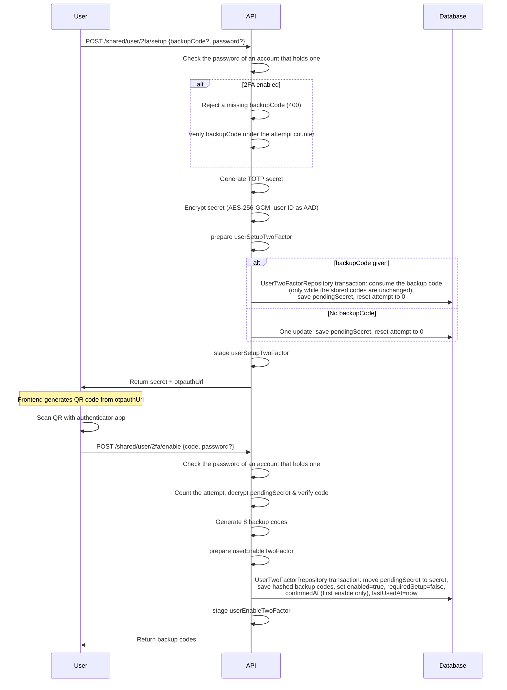
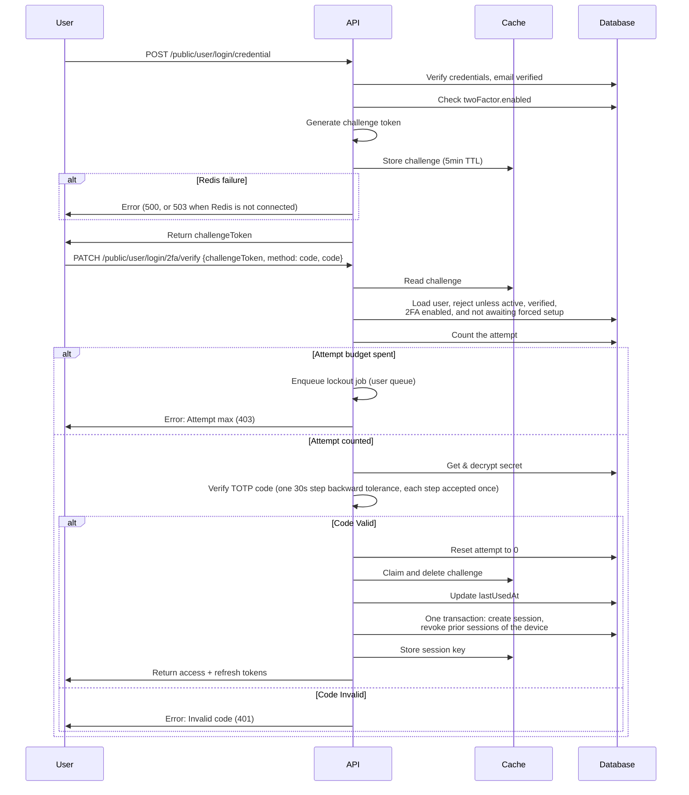
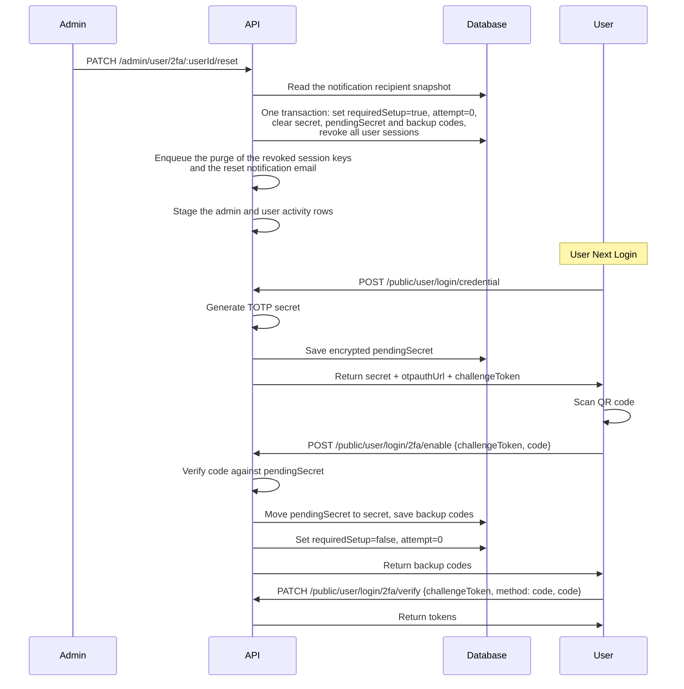
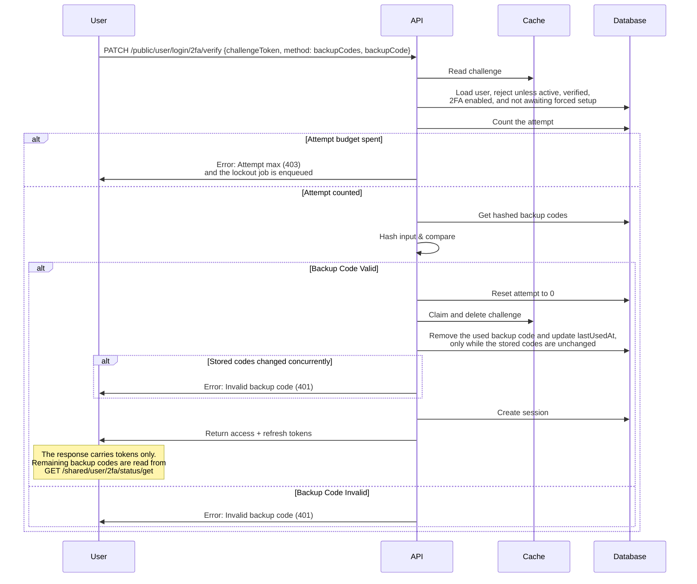
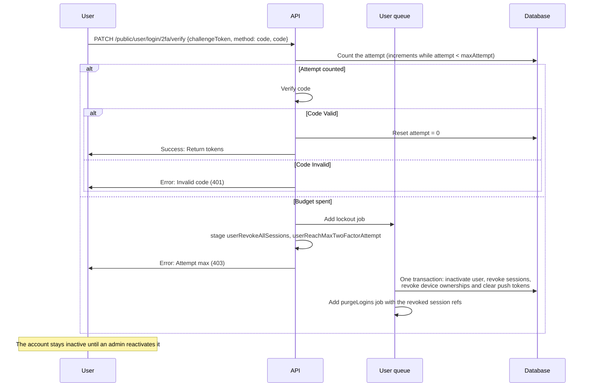
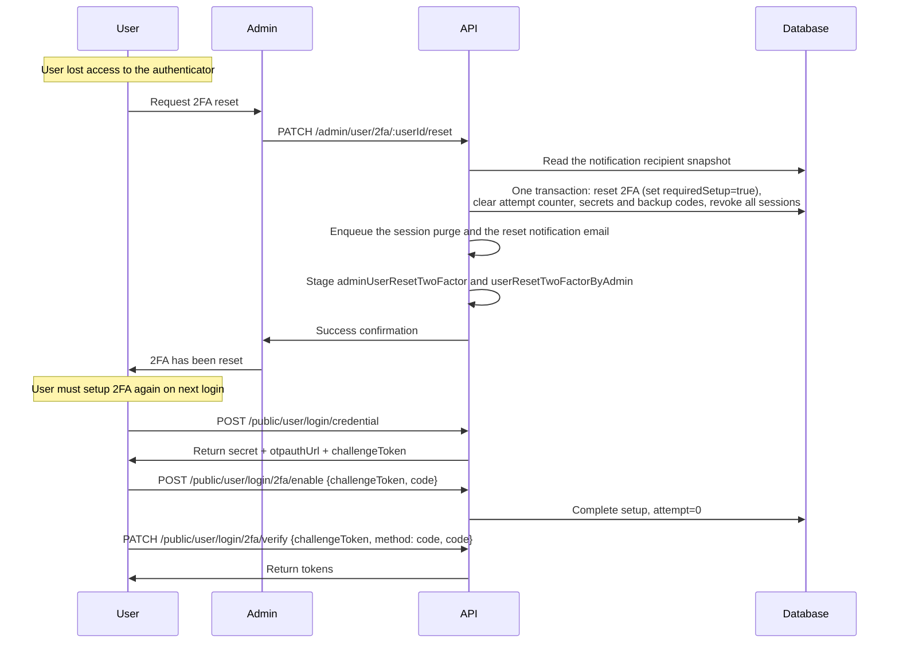
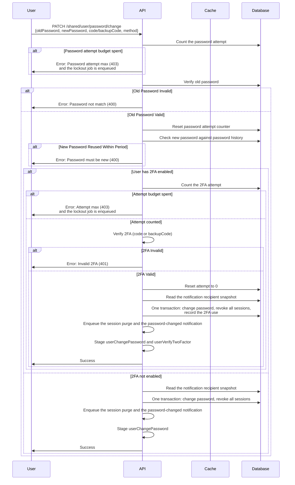
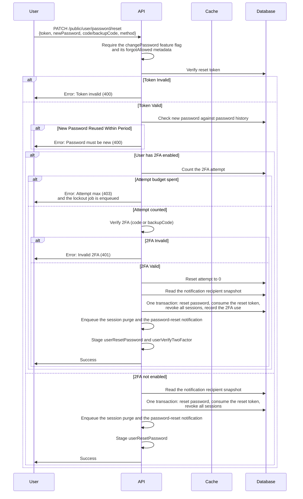
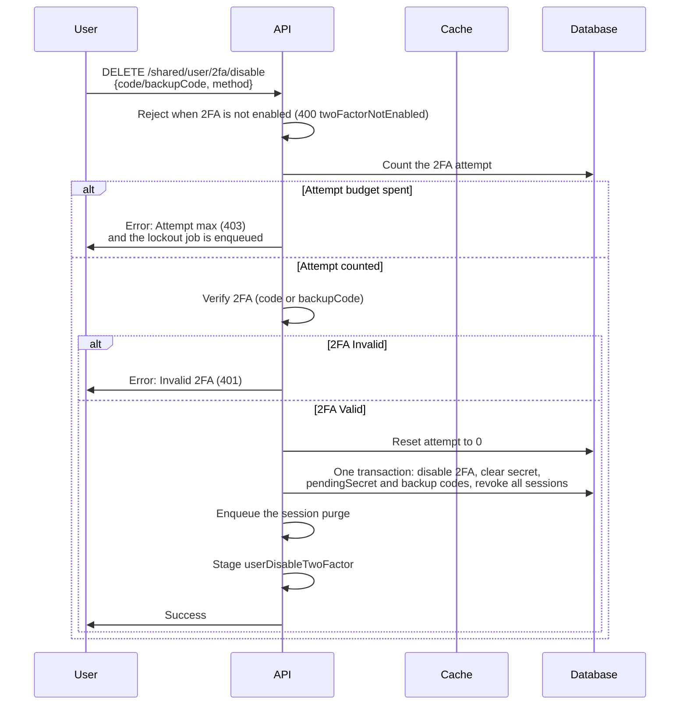

# Two Factor Documentation

## Overview

Login can require a TOTP (RFC 6238) from an authenticator app, plus one-time backup codes.

- TOTP-based verification (RFC 6238)
- 8 one-time backup codes for recovery
- Admin-controlled force setup
- AES-256-GCM encryption for secret storage, keyed by `AUTH_TWO_FACTOR_ENCRYPTION_KEY` and bound to the user ID
- Challenge-based verification flow
- Session revocation on security changes
- Account protection with an attempt budget of `maxAttempt` (5) counted attempts: the next attempt is refused and the account is inactivated
- 2FA verification applies to:
    - login
    - password change
    - password reset
    - disable 2FA
    - backup code regeneration
    - a new setup while 2FA is enabled (backup code)
    - confirming a setup (`enable`), with the authenticator code

## Related Documents

- [Authentication Documentation][ref-doc-authentication]: JWT, login, and sessions
- [Security and Middleware Documentation][ref-doc-security-and-middleware]: Rate limiting and headers
- [Cache Documentation][ref-doc-cache]: Challenge tokens in Redis
- [Activity Log Documentation][ref-doc-activity-log]: Security events
- [Environment Documentation][ref-doc-environment]: `AUTH_TWO_FACTOR_*`

## Table of Contents

- [Overview](#overview)
- [Related Documents](#related-documents)
- [Configuration](#configuration)
    - [Environment Variables](#environment-variables)
    - [Configuration Details](#configuration-details)
- [Security Features](#security-features)
    - [Failed Attempts Protection](#failed-attempts-protection)
    - [Attempt Limit and Lockout](#attempt-limit-and-lockout)
- [Where 2FA is Used](#where-2fa-is-used)
    - [Shared Endpoints (User Operations)](#shared-endpoints-user-operations)
    - [Public Endpoints](#public-endpoints)
    - [Admin Endpoints](#admin-endpoints)
- [Authentication Flows](#authentication-flows)
    - [Setup Flow](#setup-flow)
    - [Login Flow (2FA Enabled)](#login-flow-2fa-enabled)
    - [Admin Force Setup Flow](#admin-force-setup-flow)
    - [Backup Code Usage Flow](#backup-code-usage-flow)
    - [Lockout Flow](#lockout-flow)
    - [Admin Reset 2FA Flow](#admin-reset-2fa-flow)
    - [Password Operations with 2FA Flow](#password-operations-with-2fa-flow)
- [Error Handling](#error-handling)
    - [HTTP Status Codes](#http-status-codes)

## Configuration

### Environment Variables

```env
AUTH_TWO_FACTOR_ISSUER=
AUTH_TWO_FACTOR_ENCRYPTION_KEY=
```

### Configuration Details

Located in `src/configs/auth.config.ts`:

| Setting | Value | Description |
| --- | --- | --- |
| `strategy` | `totp` | OTP strategy passed to `otplib` |
| `algorithm` | `sha1` | HMAC algorithm passed to `otplib` |
| `issuer` | from `AUTH_TWO_FACTOR_ISSUER`, no code default | Displayed in authenticator apps |
| `digits` | `6` | TOTP code length (standard) |
| `periodInSeconds` | `ms('30s') / 1000` | TOTP time window in seconds, the unit otplib takes |
| `window` | `1` | Backward-only tolerance: `epochTolerance` is `[window × periodInSeconds, 0]`, so one 30 second step in the past is accepted and none in the future |
| `secretLength` | `32` | Base32 secret length |
| `challengeTtlInMs` | `ms('5m')` | Challenge token TTL (5 minutes) |
| `challengeKeyPattern` | `TwoFactor:Challenge:{token}` | Redis key pattern for challenge tokens |
| `backupCodes.count` | `8` | Number of backup codes generated |
| `backupCodes.length` | `10` | Characters per backup code (A-Z, 0-9) |
| `maxAttempt` | `5` | Counted attempts allowed (counter 0 to 5). The attempt made at counter 5 is refused, enqueues the lockout, and inactivates the account |
| `encryption.key` | from `AUTH_TWO_FACTOR_ENCRYPTION_KEY` | Root secret for the stored TOTP secrets: exactly 64 base64url characters (48 random bytes), validated by `RequestEncryptionSecretSchema` |

### Secret Storage

`AuthTwoFactorDomain` seals every TOTP secret with `HelperEncryptionService.aes256Encrypt`, using:

- `auth.twoFactor.encryption.key`
- the purpose `auth.twoFactor.secret`
- the user ID as authenticated data

A secret copied onto another user's row fails to decrypt. `TwoFactor` holds two sealed values:

- `pendingSecret`: written by every setup, never used to verify a login
- `secret`: the confirmed authenticator. Enable moves `pendingSecret` here and clears `pendingSecret`.

A code checked against a missing secret, or a secret that fails to decrypt, raises `409 twoFactorSecretUnavailable`.

- The decrypt failure is also reported to Sentry as an operator fault (a wrong key or a damaged value), not a user error.
- `pnpm generate:secret:encryption` generates the key (see [Installation][ref-doc-installation]).

## Security Features

### Failed Attempts Protection

Every verification attempt is counted before the code is checked, to block brute-force guessing:

- `countAttempt` runs one guarded update on `TwoFactor.attempt` that increments only while the counter is below `maxAttempt`.
- The guard sits in the database `where`, so concurrent attempts cannot pass the limit together.
- Counter resets to 0 when the user verifies with a valid code or backup code.
- Authenticator codes, backup codes, and setup-confirmation codes share the same counter (combined limit).
- A missing `method` throws `twoFactorMethodRequired` before the count.

**Counter tracking:**

```
Attempt 1 (TOTP failed) → attempt = 1
Attempt 2 (Backup code failed) → attempt = 2
Attempt 3 (TOTP failed) → attempt = 3
Attempt 4 (TOTP success) → attempt = 0 (reset)
```

### Attempt Limit and Lockout

The first five attempts are counted and checked normally. The attempt made while the counter already equals `maxAttempt` (5), the sixth since the last reset, is the one refused. It is refused before any code is checked, and it triggers the lockout:

1. The guarded update matches no row, so the attempt is not counted and the budget is spent.
2. `UserTwoFactorDomain.countAttempt` enqueues the `lockout` job on the `user` queue with the user id and returns the lockout stages.
3. The service stages `userRevokeAllSessions` and `userReachMaxTwoFactorAttempt`, before the job has revoked anything, then asserts the counted attempt.
4. The request answers `twoFactorAttemptMax` (403, `50812`).

The `lockout` job (`UserProcessorService.lockout`) runs one transaction:

1. It inactivates the user with a guarded update that matches only an active user. A user already inactive ends the job there: the job revokes nothing, and the request has still staged its two activity rows.
2. It revokes every unrevoked session of the user.
3. It revokes every non-revoked device ownership of the user and clears their push tokens.

After the commit the job enqueues the purge of the revoked session keys.

Recovery:

- The account stays `inactive` until an admin sets it back to `active` (`PATCH /admin/user/update/:userId/status`).
- Setting the status to `active` resets the password and two-factor counters.
- An admin 2FA reset sets the counter to 0 but does not change the status, so it does not reactivate an inactive account.
- A locked account cannot verify: the second login step answers `inactiveForbidden` (403) before it counts an attempt. Its counter stays at 5 until an admin reactivates the account or resets its 2FA.
- On an active account, the counter persists until a successful verification resets it.

Redis failures:

- A failure while storing the login challenge answers 500 (503 when Redis is not connected).
- A failure while claiming the challenge after a valid code answers 503 (`RedisUnavailableException`, `52400`).

Details: [Cache][ref-doc-cache].

## Where 2FA is Used

### Shared Endpoints (User Operations)

**2FA Management:**

- `GET /shared/user/2fa/status/get`: Check current 2FA status
- `POST /shared/user/2fa/setup`: Get TOTP secret and otpauthUrl (**requires an unused backup code while 2FA is enabled**)
- `POST /shared/user/2fa/enable`: Enable 2FA with code verification
- `DELETE /shared/user/2fa/disable`: **Disable 2FA (requires an authenticator code or a backup code)**
- `POST /shared/user/2fa/backup-code/regenerate`: **Regenerate backup codes (requires an authenticator code)**

`disable` and `backup-code/regenerate`:

- `disable` accepts either method: the body carries `method` (`code` or `backupCodes`) with the matching `code` / `backupCode`.
- `backup-code/regenerate` takes a `code` field only and pins the method to `code` on the server, so a backup code cannot be used to rotate the backup codes.
- The credential being replaced never authorises its own replacement.
- Both routes run the same verification path as login, so both are subject to the attempt counter and the lockout.

`setup` takes an optional `backupCode`:

- While 2FA is disabled, the body may be empty.
- While 2FA is enabled, a missing `backupCode` returns `400 twoFactorBackupCodeRequired`.
- A supplied `backupCode` is verified under the attempt counter, and consumed in the same transaction that stores the new `pendingSecret`.
- The account keeps its confirmed `secret` and remaining backup codes until `enable` confirms the new authenticator. This is the recovery path when the confirmed secret is unreadable (`409 twoFactorSecretUnavailable`).

`setup` and `enable` also take an optional `password`:

- An account that holds a password must send it, and it is checked under the password attempt counter.
- A passwordless account (a social sign-up) sends none.

**Password Operations (require 2FA if enabled):**

- `PATCH /shared/user/password/change`: **Change password (requires 2FA verification if enabled)**

### Public Endpoints

**Login Flow:**

- `POST /public/user/login/credential`: Login with email/password
- `POST /public/user/login/social/google`: Login with Google OAuth
- `POST /public/user/login/social/apple`: Login with Apple Sign In
- `PATCH /public/user/login/2fa/verify`: Verify TOTP code or backup code
- `POST /public/user/login/2fa/enable`: Complete forced 2FA setup during login

**Password Recovery (require 2FA if enabled):**

- `PATCH /public/user/password/reset`: **Reset password (requires 2FA verification if enabled)**

### Admin Endpoints

- `PATCH /admin/user/2fa/:userId/reset`: Force reset user's 2FA (resets the attempt counter and revokes every session)

Request and response schemas for each route are in the Swagger document.

## Authentication Flows

### Setup Flow

User enables 2FA for their account:



### Login Flow (2FA Enabled)

User logs in with 2FA enabled:



The session step is the credential login session step: it also signs out every other user of the device ([Device][ref-doc-device]).

### Admin Force Setup Flow

Admin forces a user who already has 2FA enabled to set it up again on next login. The endpoint rejects:

- the admin resetting their own account (`notSelf`)
- an unknown user (`notFound`)
- a target ranked at or above the admin (role rank check)
- a blocked user (`blockedInvalid`)
- a user whose 2FA is not enabled (`twoFactorNotEnabled`)



### Backup Code Usage Flow

User uses backup code when authenticator app is unavailable:



### Lockout Flow

System behavior when the attempt budget is spent:



### Admin Reset 2FA Flow

Admin can force reset user's 2FA when the user lost the authenticator:



### Password Operations with 2FA Flow

When user has 2FA enabled, password operations require additional verification:

**Change Password:**



- The password-history check is what makes the reuse window real. A password still held in history for `auth.password.periodInDays` is rejected before the 2FA step, so a user cannot rotate back to a recent password by passing 2FA.
- A user with no password set (a social sign-up) skips the attempt-limit, old-password, and history checks and goes straight to the 2FA step.
- The recipient snapshot is the address, the channels the user's settings leave enabled, and the device push tokens. The password change, the password reset, and the admin 2FA reset read it before their transaction opens and hand it to the notification job.

**Reset Password (Forgot Password):**



**Disable 2FA:**



## Error Handling

### HTTP Status Codes

| Status | Error Code | Description |
| --- | --- | --- |
| 400 | `twoFactorNotEnabled` | 2FA not enabled for this user |
| 400 | `twoFactorAlreadyEnabled` | 2FA already active |
| 400 | `twoFactorRequiredSetup` | Setup is required before continuing |
| 400 | `twoFactorNotRequiredSetup` | Setup already completed |
| 400 | `twoFactorSetupRequired` | No `pendingSecret` is stored: `POST /shared/user/2fa/setup` (or the forced-setup login) has not run |
| 400 | `twoFactorMethodRequired` | `method` missing on a request that must verify 2FA |
| 400 | `twoFactorBackupCodeRequired` | `POST /shared/user/2fa/setup` called while 2FA is enabled, without `backupCode` |
| 409 | `twoFactorSecretUnavailable` | The secret a code is checked against is missing or fails to decrypt |
| 401 | `twoFactorInvalid` | Invalid TOTP code or backup code |
| 401 | `twoFactorChallengeInvalid` | Challenge token expired or invalid |
| 403 | `twoFactorAttemptMax` | The attempt budget is spent and the account is inactivated by the lockout job |
| 403 | `inactiveForbidden` | Account inactive |
| 403 | `emailNotVerified` | Email not verified |
| 404 | `notFound` | User not found |

`twoFactorAttemptMax` (50812):

- It answers an attempt made while the counter equals `maxAttempt`.
- The same request enqueues the `lockout` job, which inactivates the account, revokes its sessions and non-revoked device ownerships, and clears their push tokens.
- An inactive account answers by surface, until an admin reactivates it:
    - credential login (`POST /public/user/login/credential`): the single invalid-credential error (401)
    - the second login step (`login/2fa/verify`, `login/2fa/enable`), social login, and every authenticated route behind `UserGuard`: `inactiveForbidden` (403)

<!-- REFERENCES -->

[ref-doc-authentication]: authentication.md
[ref-doc-security-and-middleware]: security-and-middleware.md
[ref-doc-cache]: cache.md
[ref-doc-activity-log]: activity-log.md
[ref-doc-installation]: installation.md
[ref-doc-environment]: environment.md
[ref-doc-device]: device.md
